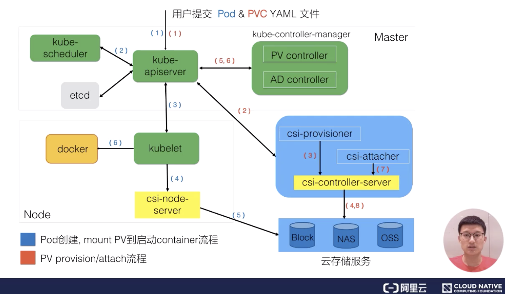
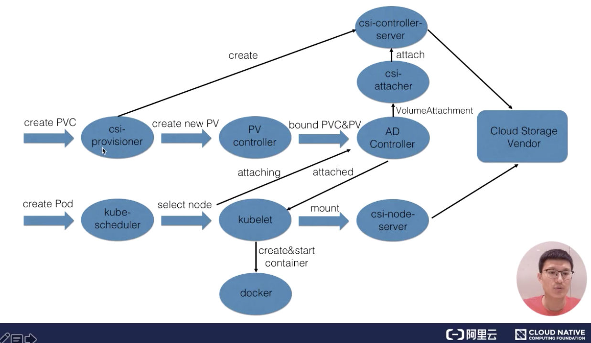

# 第9讲 文字版下

来源：https://edu.aliyun.com/course/314164/lesson/341313120

## 四、架构设计
### PV 和 PVC 的处理流程
我们接下来看一下 K8s 中的 PV 和 PVC 体系的完整处理流程。我首先看一下这张图的右下部分里面提到的 csi。

csi 是什么？csi 的全称是 container storage interface，它是K8s社区后面对存储插件实现(out of tree)的官方推荐方式。csi 的实现大体可以分为两部分：
  * 第一部分是由k8s社区驱动实现的通用的部分，像我们这张图中的 csi-provisioner和 csi-attacher controller；
  * 另外一种是由云存储厂商实践的，对接云存储厂商的 OpenApi，主要是实现真正的 create/delete/mount/unmount 存储的相关操作，对应到上图中的csi-controller-server和csi-node-server。

接下来看一下，当用户提交 yaml 之后，k8s内部的处理流程。用户在提交 PVCyaml 的时候，首先会在集群中生成一个 PVC 对象，然后 PVC 对象会被 csi-provisioner controller watch到，csi-provisioner 会结合 PVC 对象以及 PVC 对象中声明的 storageClass，通过 GRPC 调用 csi-controller-server，然后，到云存储服务这边去创建真正的存储，并最终创建出来 PV 对象。最后，由集群中的 PV controller 将 PVC 和 PV 对象做 bound 之后，这个 PV 就可以被使用了。
用户在提交 pod 之后，首先会被调度器调度选中某一个合适的node，之后该 node 上面的 kubelet 在创建 pod 流程中会通过首先 csi-node-server 将我们之前创建的 PV 挂载到我们 pod 可以使用的路径，然后 kubelet 开始 create && start pod 中的所有 container。
### PV、PVC 以及通过 csi 使用存储流程
我们接下来通过另一张图来更加详细看一下我们 PV、PVC 以及通过 CSI 使用存储的完整流程。

主要分为三个阶段：
  * 第一个阶段(Create阶段)是用户提交完 PVC，由 csi-provisioner 创建存储，并生成 PV 对象，之后 PV controller 将 PVC 及生成的 PV 对象做 bound，bound 之后，create 阶段就完成了；
  * 之后用户在提交 pod yaml 的时候，首先会被调度选中某一个 合适的node，等 pod 的运行 node 被选出来之后，会被 AD Controller watch 到 pod 选中的 node，它会去查找 pod 中使用了哪些 PV。然后它会生成一个内部的对象叫 VolumeAttachment 对象，从而去触发 csi-attacher去调用csi-controller-server 去做真正的 attache 操作，attach操作调到云存储厂商OpenAPI。这个 attach 操作就是将存储 attach到 pod 将会运行的 node 上面。第二个阶段 —— attach阶段完成；
  * 然后我们接下来看第三个阶段。第三个阶段 发生在kubelet 创建 pod的过程中，它在创建 pod 的过程中，首先要去做一个 mount，这里的 mount 操作是为了将已经attach到这个 node 上面那块盘，进一步 mount 到 pod 可以使用的一个具体路径，之后 kubelet 才开始创建并启动容器。这就是 PV 加 PVC 创建存储以及使用存储的第三个阶段 —— mount 阶段。

总的来说，有三个阶段：第一个 create 阶段，主要是创建存储；第二个 attach 阶段，就是将那块存储挂载到 node 上面(通常为将存储load到node的/dev下面)；第三个 mount 阶段，将对应的存储进一步挂载到 pod 可以使用的路径。这就是我们的 PVC、PV、已经通过CSI实现的卷从创建到使用的完整流程。
## 结束语
我们今天的内容大概就到这里，下一节我将为大家来分享 Volume Snapshot 以及 Volume Topology-aware Scheduling 相关的知识以及具体处理流程，谢谢大家~
# 本节总结
本节课的主要内容就到此为止了，这里为大家简单总结一下。
  * 介绍了 K8s Volume 的使用场景，以及本身局限性；
  * 通过介绍 K8s 的 PVC 和 PV 体系，说明 K8s 通过 PVC 和 PV 体系增强了 K8s Volumes 在多 Pod 共享/迁移/存储扩展等场景下的能力的必要性以及设计思想；
  * 通过介绍 PV（存储）的不同供给模式 (static and dynamic)，学习了如何通过不同方式为集群中的 Pod 供给所需的存储；
  * 通过 PVC&PV 在 K8s 中完整的处理流程，深入理解 PVC&PV 的工作原理。

