# 第21讲 文字版下

来源：https://edu.aliyun.com/course/314164/lesson/341314871

# 三、CSI 介绍及使用
和 Flexvolume 类似，CSI 也是为第三方存储提供数据卷实现的抽象接口。
有了 Flexvolume，为何还要 CSI 呢？
Flexvolume 只是给 kubernetes 这一个编排系统来使用的，而 CSI 可以满足不同编排系统的需求，比如 Mesos，Swarm。
其次 CSI 是容器化部署，可以减少环境依赖，增强安全性，丰富插件的功能。我们知道，Flexvolume 是在 host 空间一个二进制文件，执行 Flexvolum 时相当于执行了本地的一个 shell 命令，这使得我们在安装 Flexvolume 的时候需要同时安装某些依赖，而这些依赖可能会对客户的应用产生一些影响。因此在安全性上、环境依赖上，就会有一个不好的影响。
同时对于丰富插件功能这一点，我们在 Kubernetes 生态中实现 operator 的时候，经常会通过 RBAC 这种方式去调用 Kubernetes 的一些接口来实现某些功能，而这些功能必须要在容器内部实现，因此像 Flexvolume 这种环境，由于它是 host 空间中的二进制程序，就没法实现这些功能。而 CSI 这种容器化部署的方式，可以通过 RBAC 的方式来实现这些功能。
CSI 主要包含两个部分：CSI Controller Server 与 CSI Node Server。
  * Controller Server 是控制端的功能，主要实现创建、删除、挂载、卸载等功能；
  * Node Server 主要实现的是节点上的 mount、Unmount 功能。

下图给出了 CSI 接口通信的描述。CSI Controller Server 和 External CSI SideCar 是通过 Unix Socket 来进行通信的，CSI Node Server 和 Kubelet 也是通过 Unix Socket 来通信，之后我们会讲一下 External CSI SiderCar 的具体概念。
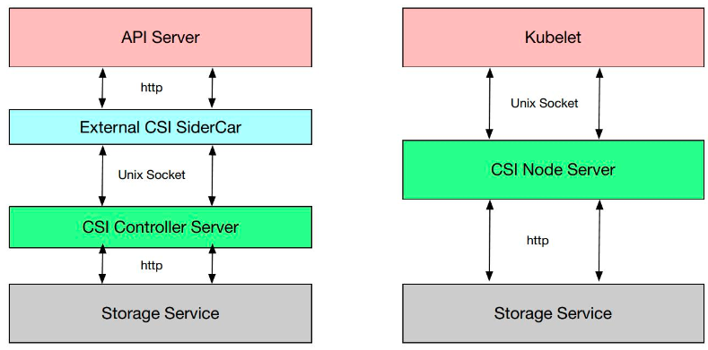
下图给出了 CSI 的接口。主要分为三类：通用管控接口、节点管控接口、中心管控接口。
  * 通用管控接口主要返回 CSI 的一些通用信息，像插件的名字、Driver 的身份信息、插件所提供的能力等；

  * 节点管控接口的 NodeStageVolume 和 NodeUnstageVolume 就相当于 Flexvolume 中的 MountDevice 和 UnmountDevice。NodePublishVolume 和 NodeUnpublishVolume 就相当于 SetUp 和 TearDown 接口；

  * 中心管控接口的 CreateVolume 和 DeleteVolume 就是我们的 Provision 和 Delete 存储卷的一个接口，ControllerPublishVolume 和 ControllerUnPublishVolume 则分别是 Attach 和 Detach 的接口。 

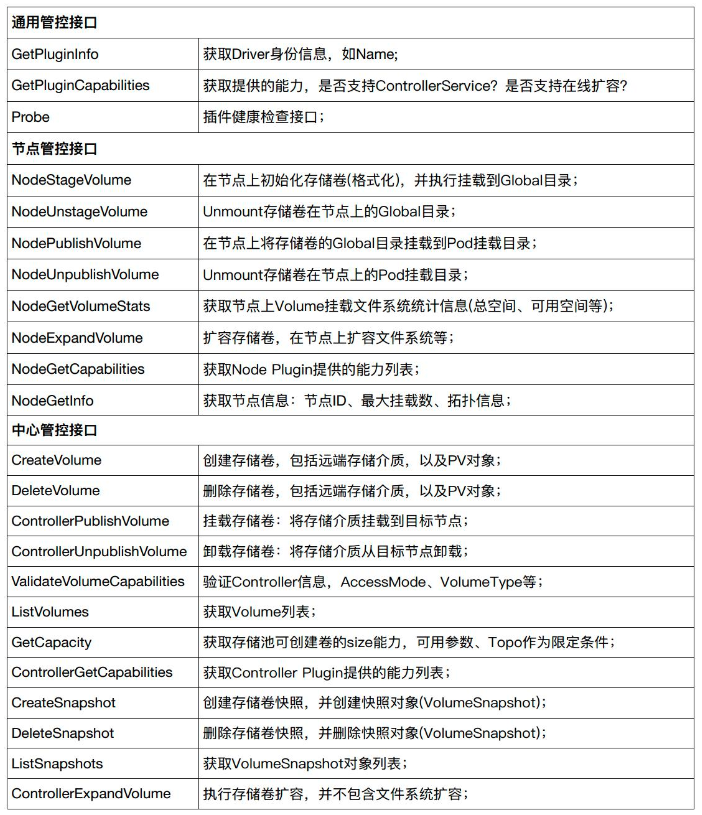
## CSI 的系统结构
CSI 是通过 CRD 的形式实现的，所以 CSI 引入了这么几个对象类型：VolumeAttachment、CSINode、CSIDriver 以及 CSI Controller Server 与 CSI Node Server 的一个实现。
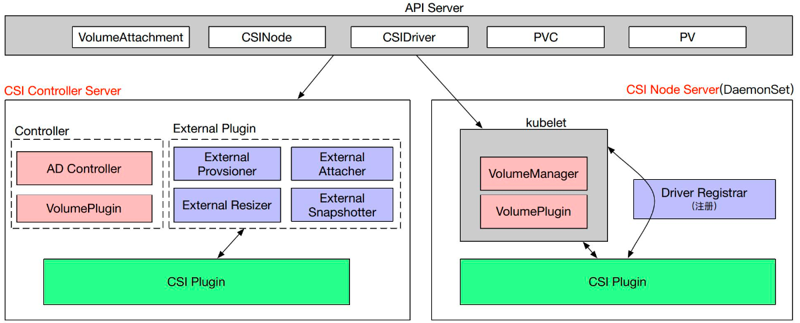
在 CSI Controller Server 中，有传统的类似 Kubernetes 中的 AD Controller 和 Volume Plugins，VolumeAttachment 对象就是由它们所创建的。
此外，还包含多个 External Plugin组件，每个组件和 CSI Plugin 组合的时候会完成某种功能。比如：
  * External Provisioner 和 Controller Server 组合的时候就会完成数据卷的创建与删除功能；
  * External Attacher 和 Controller Server 组合起来可以执行数据卷的挂载和操作；
  * External Resizer 和 Controller Server 组合起来可以执行数据卷的扩容操作；
  * External Snapshotter 和 Controller Server 组合则可以完成快照的创建和删除。

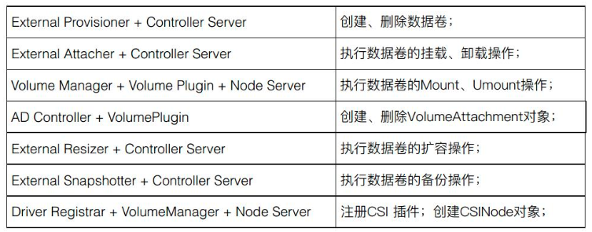
CSI Node Server 中主要包含 Kubelet 组件，包括 VolumeManager 和 VolumePlugin，它们会去调用 CSI Plugin 去做 mount 和 unmount 操作；另外一个组件 Driver Registrar 主要实现的是 CSI Plugin 注册的功能。
以上就是 CSI 的整个拓扑结构，接下来我们将分别介绍不同的对象和组件。
### CSI 对象
我们将介绍 3 种对象：VolumeAttachment，CSIDriver，CSINode。
VolumeAttachment 描述一个 Volume 卷在一个 Pod 使用中挂载、卸载的相关信息。例如，对一个卷在某个节点上的挂载，我们通过 VolumeAttachment 对该挂载进行跟踪。AD Controller 创建一个 VolumeAttachment，而 External-attacher 则通过观察该 VolumeAttachment，根据其状态来进行挂载和卸载操作。
下图就是一个 VolumeAttachment 的例子，其类别 (kind) 为 VolumeAttachment，spec 中指定了 attacher 为 ossplugin.csi.alibabacloud.com，即指定挂载是由谁操作的；指定了 nodeName 为 cn-zhangjiakou.192.168.1.53，即该挂载是发生在哪个节点上的；指定了 source 为 persistentVolumeName 为 oss-csi-pv，即指定了哪一个数据卷进行挂载和卸载。
status 中 attached 指示了挂载的状态，如果是 False， External-attacher 就会执行一个挂载操作。
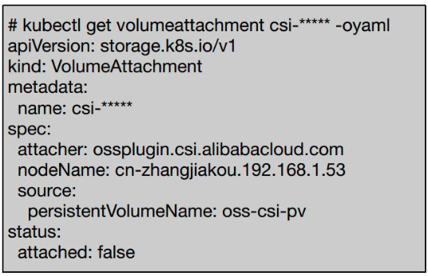
第二个对象是 CSIDriver，它描述了集群中所部署的 CSI Plugin 列表，需要管理员根据插件类型进行创建。
例如下图中创建了一些 CSI Driver，通过 `kuberctl get csidriver` 我们可以看到集群里面创建的 3 种类型的 CSI Driver：一个是云盘；一个是 NAS；一个是 OSS。
在 CSI Driver 中，我们定义了它的名字，在 spec 中还定义了 attachRequired 和 podInfoOnMount 两个标签。
  * attachRequired 定义一个 Plugin 是否支持 Attach 功能，主要是为了对块存储和文件存储做区分。比如文件存储不需要 Attach 操作，因此我们将该标签定义为 False；
  * podInfoOnMount 则是定义 Kubernetes 在调用 Mount 接口时是否带上 Pod 信息。

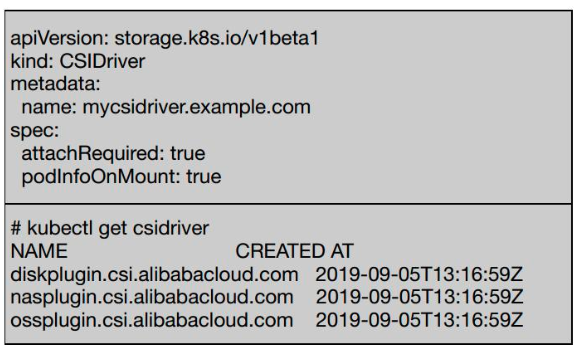
第三个对象是 CSINode，它是集群中的节点信息，由 node-driver-registrar 在启动时创建。它的作用是每一个新的 CSI Plugin 注册后，都会在 CSINode 列表里添加一个 CSINode 信息。
例如下图，定义了 CSINode 列表，每一个 CSINode 都有一个具体的信息（左侧的 YAML）。以 一 cn-zhangjiakou.192.168.1.49 为例，它包含一个云盘的 CSI Driver，还包含一个 NAS 的 CSI Driver。每个 Driver 都有自己的 nodeID 和它的拓扑信息 topologyKeys。如果没有拓扑信息，可以将 topologyKeys 设置为 "null"。也就是说，假如有一个有 10 个节点的集群，我们可以只定义一部分节点拥有 CSINode。
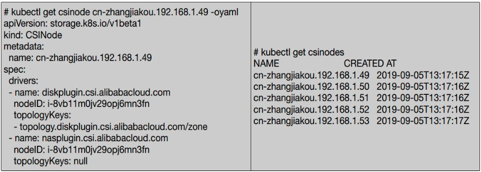
### CSI 组件之 Node-Driver-Registrar
Node-Driver-Registrar 主要实现了 CSI Plugin 注册的一个机制。我们来看一下下图中的流程图。
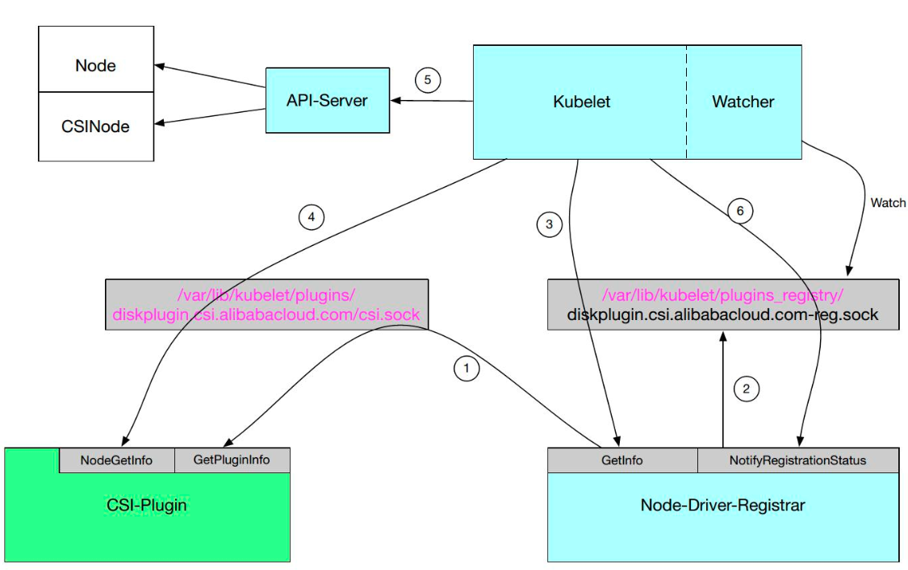
  * **第 1 步** ，在启动的时候有一个约定，比如说在 /var/lib/kuberlet/plugins_registry 这个目录每新加一个文件，就相当于每新加了一个 Plugin；

启动 Node-Driver-Registrar，它首先会向 CSI-Plugin 发起一个接口调用 GetPluginInfo，这个接口会返回 CSI 所监听的地址以及 CSI-Plugin 的一个 Driver name；
  * **第 2 步** ，Node-Driver-Registrar 会监听 GetInfo 和 NotifyRegistrationStatus 两个接口；

  * **第 3 步** ，会在 `/var/lib/kuberlet/plugins_registry` 这个目录下启动一个 Socket，生成一个 Socket 文件 ，例如："diskplugin.csi.alibabacloud.com-reg.sock"，此时 Kubelet 通过 Watcher 发现这个 Socket 后，它会通过该 Socket 向 Node-Driver-Registrar 的 GetInfo 接口进行调用。GetInfo 会把刚才我们所获得的的 CSI-Plugin 的信息返回给 Kubelet，该信息包含了 CSI-Plugin 的监听地址以及它的 Driver name；

  * **第 4 步** ，Kubelet 通过得到的监听地址对 CSI-Plugin 的 NodeGetInfo 接口进行调用；

  * **第 5 步** ，调用成功之后，Kubelet 会去更新一些状态信息，比如节点的 Annotations、Labels、status.allocatable 等信息，同时会创建一个 CSINode 对象；

  * **第 6 步** ，通过对 Node-Driver-Registrar 的 NotifyRegistrationStatus 接口的调用告诉它我们已经把 CSI-Plugin 注册成功了。

通过以上 6 步就实现了 CSI Plugin 注册机制。
### CSI 组件之 External-Attacher
External-Attacher 主要是通过 CSI Plugin 的接口来实现数据卷的挂载与卸载功能。它通过观察 VolumeAttachment 对象来实现状态的判断。VolumeAttachment 对象则是通过 AD Controller 来调用 Volume Plugin 中的 CSI Attacher 来创建的。CSI Attacher 是一个 In-Tree 类，也就是说这部分是 Kubernetes 完成的。
当 VolumeAttachment 的状态是 False 时，External-Attacher 就去调用底层的一个 Attach 功能；若期望值为 False，就通过底层的 ControllerPublishVolume 接口实现 Detach 功能。同时，External-Attacher 也会同步一些 PV 的信息在里面。
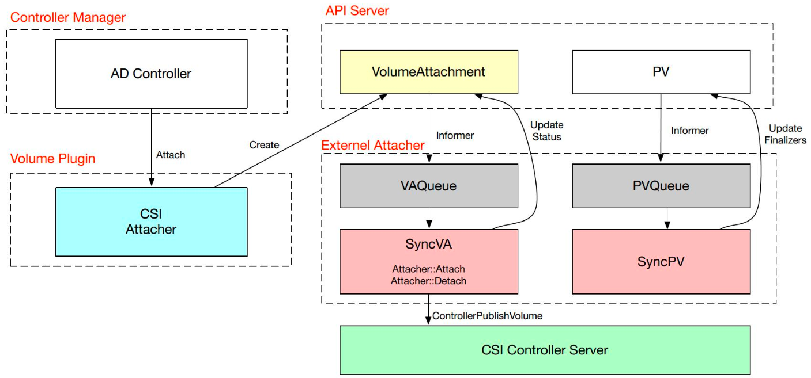
## CSI 部署
我们现在来看一下块存储的部署情况。
之前提到 CSI 的 Controller 分为两部分，一个是 Controller Server Pod，一个是 Node Server Pod。
我们只需要部署一个 Controller Server，如果是多备份的，可以部署两个。Controller Server 主要是通过多个外部插件来实现的，比如说一个 Pod 中可以定义多个 External 的 Container 和一个包含 CSI Controller Server 的 Container，这时候不同的 External 组件会和 Controller Server 组成不同的功能。
而 Node Server Pod 是个 DaemonSet，它会在每个节点上进行注册。Kubelet 会直接通过 Socket 的方式直接和 CSI Node Server 进行通信、调用 Attach/Detach/Mount/Unmount 等。
Driver Registrar 只是做一个注册的功能，会在每个节点上进行部署。
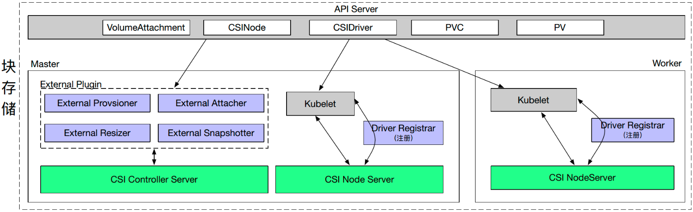
文件存储和块存储的部署情况是类似的。只不过它会把 Attacher 去掉，也没有 VolumeAttachment 对象。
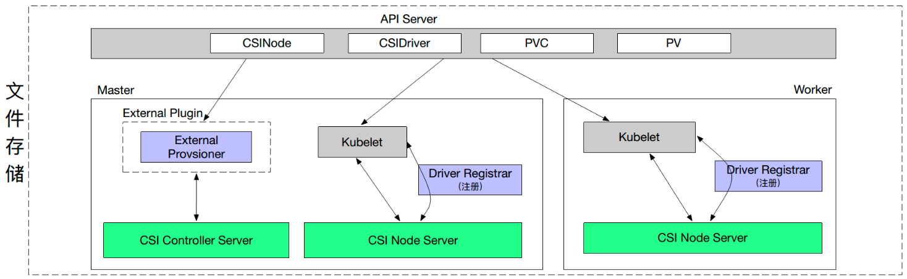
## CSI 使用示例
和 Flexvolume 一样，我们看一下它的定义模板。
可以看到，它和其它的定义并没什么区别。主要的区别在于类型为 CSI，里面会定义 driver，volumeHandle，volumeAttribute，nodeAffinity 等。
  * driver 就是定义是由哪一个插件来去实现挂载；
  * volumeHandle 主要是指示 PV 的唯一标签；
  * volumeAttribute 用于附加参数，比如 PV 如果定义的是 OSS，那么就可以在 volumeAttribute 定义 bucket、访问的地址等信息在里面；
  * nodeAffinity 则可以定义一些调度信息。与 Flexvolume 类似，还可以通过 selector 和 Label 定义一些绑定条件。

中间的图给出了一个动态调度的例子，它和其它类型的动态调度是一样的。只不过在定义 provisioner 的时候指定了一个 CSI 的 provisioner。
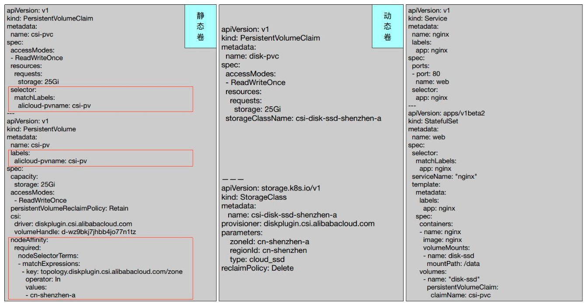
下面给出了一个具体的挂载例子。
Pod 启动之后，我们可以看到 Pod 已经把一个 /dev/vdb 挂载到 /data 上了。同理，它有一个 GlobalPath 和一个 PodPath 的集群在里面。我们可以把一个 /dev/vdb 挂载到一个 GlobalPath 里面，它就是一个 CSI 的一个 PV 在本节点上唯一确定的目录。一个 PodPath 就是一个 Pod 所确定的一个本地节点的目录，它会把 Pod 所对应的目录映射到我们的容器中去。
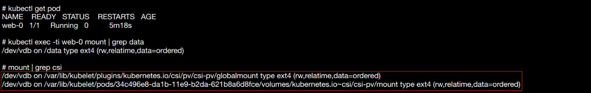
## CSI 的其它功能
除了挂载、卸载之外，CSI 化提供了一些附加的功能。例如，在定义模板的时候往往需要一些用户名和密码信息，此时我们就可通过 **Secret** 来进行定义。之前我们所讲的 Flexvolume 也支持这个功能，只不过 CSI 可以根据不同的阶段定义不同的 Secret 类型，比如挂载阶段的 Secret、Mount 阶段的 Secret、Provision 阶段的 Secret。
**Topology** 是一个拓扑感知的功能。当我们定义一个数据卷的时候，集群中并不是所有节点都能满足该数据卷的需求，比如我们需要挂载不同的 zone 的信息在里面，这就是一个拓扑感知的功能。这部分在第 10 讲已有详细的介绍，大家可以进行参考。
**Block Volume** 就是 volumeMode 的一个定义，它可以定义成 Block 类型，也可以定义成文件系统类型，CSI 支持 Block 类型的 Volume，就是说挂载到 Pod 内部时，它是一个块设备，而不是一个目录。
**Skip Attach** 和 **PodIno On Mount** 是刚才我们所讲过的 CSI Driver 中的两个功能。
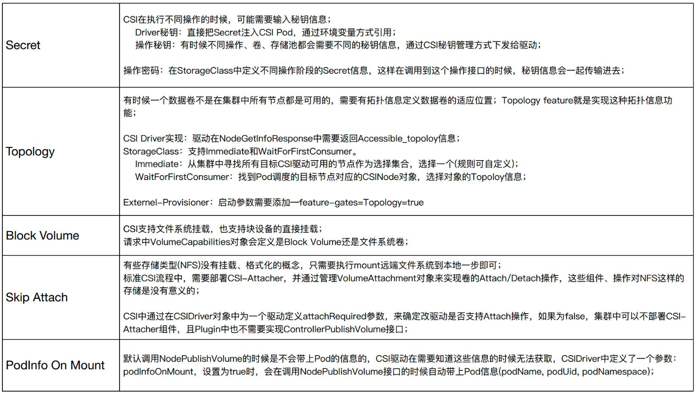
## CSI 的近期 Features
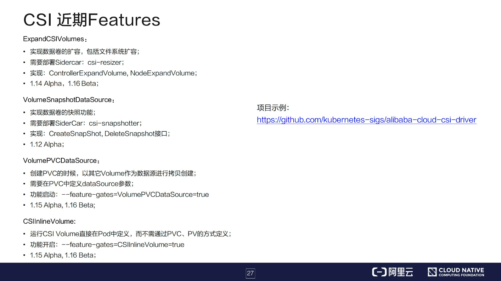
CSI 还是一个比较新的实现方式。近期也有了很多更新，比如 ExpandCSIVolumes 可以实现文件系统扩容的功能；VolumeSnapshotDataSource 可以实现数据卷的快照功能；VolumePVCDataSource 实现的是可以定义 PVC 的数据源；我们以前在使用 CSI 的时候只能通过 PVC、PV 的方式定义，而不能直接在 Pod 里面定义 Volume，CSIInlineVolume 则可以让我们可以直接在 Volume 中定义一些 CSI 的驱动。
阿里云在 GitHub 上开源了 CSI 的实现(https://github.com/kubernetes-sigs/alibaba-cloud-csi-driver)，大家有兴趣的可以看一下，做一些参考。
# 四、本节总结（分点概括）
上述概要介绍了Kubernetes集群中存储卷相关的知识，三部分内容总结如下：
  * 第一部分讲述了Kubernetes存储架构，主要包括存储卷概念、挂载流程、系统组件等相关知识；
  * 第二部分讲述了Flexvolume插件的实现原理、部署架构、使用示例等；
  * 第三部分讲述了CSI插件的实现原理、资源对象、功能组件、使用示例等；

希望上述知识点能让各位同学有所收获，特别是在处理存储卷相关的设计、开发、故障处理等方面有所帮助。希望大家继续关注云原生课程的其他精彩内容。
