# 云原生公开课文字版合集

> 合并自本目录中各讲的 Markdown 文字版，按课程编号排序。图片引用已调整为相对于本文件的 `assets/` 路径；HTML 版本未重复纳入。

> 共合并 33 个 Markdown 源文件，覆盖第1—30讲及第14讲特别篇；第9讲、第21讲保留上/下篇顺序。

## 目录

- [第1讲｜第一堂“云原生”课](#lecture-01)
- [第2讲｜容器基本概念](#lecture-02)
- [第3讲｜Kubernetes 核心概念](#lecture-03)
- [第4讲｜理解 Pod 和容器设计模式](#lecture-04)
- [第5讲｜应用编排与管理：核心原理](#lecture-05)
- [第6讲｜应用编排与管理： Deployment](#lecture-06)
- [第7讲｜应用编排与管理：Job 和 DaemonSet](#lecture-07)
- [第8讲｜应用配置管理](#lecture-08)
- [第9讲｜应用存储和持久化数据卷：核心知识](#lecture-09)
- [第10讲｜应用存储和持久化数据卷：存储快照与拓扑调度](#lecture-10)
- [第11讲｜可观测性：你的应用健康吗](#lecture-11)
- [第12讲｜可观测性：监控与日志](#lecture-12)
- [第13讲｜Kubernetes网络概念及策略控制](#lecture-13)
- [第14讲｜Kubernetes Services](#lecture-14)
- [第14讲特别篇｜Kubernetes Services](#lecture-14-extra)
- [第15讲｜深入剖析 Linux 容器](#lecture-15)
- [第16讲｜深入理解 etcd - 基本原理解析](#lecture-16)
- [第17讲｜深入理解etcd：etcd性能优化实践](#lecture-17)
- [第18讲｜Kubernetesdi调度和资源管理](#lecture-18)
- [第19讲｜调度器的调度流程和算法介绍](#lecture-19)
- [第20讲｜GPU管理和Device Plugin工作机制](#lecture-20)
- [第21讲｜Kubernetes 存储架构及插件使用](#lecture-21)
- [第22讲｜有状态应用编排：StatefulSet](#lecture-22)
- [第23讲｜KubernetesAPI编程范式](#lecture-23)
- [第24讲｜KubernetesAPI编程利器：Operator和OperatorFramework](#lecture-24)
- [第25讲｜Kubernetes网络模型进阶](#lecture-25)
- [第26讲｜理解CNI和CNI插件](#lecture-26)
- [第27讲｜Kubernetes安全之访问控制](#lecture-27)
- [第28讲｜理解容器运行时接口CRI](#lecture-28)
- [第29讲｜安全容器技术](#lecture-29)
- [第30讲｜理解RuntimeClass与使用多容器运行时](#lecture-30)

---

<a id="lecture-01"></a>
## 第1讲｜第一堂“云原生”课

来源：https://edu.aliyun.com/course/314164/lesson/341311954

**摘要：** 欢迎大家来到阿里云与 CNCF 共同推出的“云原生”技术公开课。本文整理自“云原生”技术公开课的开篇：第一堂“云原生”课。在本文中，阿里巴巴高级技术专家、CNCF 官方大使张磊为大家介绍了“云原生”技术的发展历程，本门课程的简介与预备知识以及“云原生”的定义和技术要点，精彩不容错过。
**本节课程要点**
  1. 云原生技术发展历程（为什么要学习这门课）
  2. 课程简介与预备知识（这门课到底教什么）
  3. 云原生的定义与技术要点（本节正式内容）


#### 一、为什么要开设云原生技术公开课？
#### 云原生技术发展简史
首先从第一个问题进行分享，那就是“为什么要开设云原生技术公开课？”云原生、CNCF 都是目前非常热门的关键词，但是这些技术并不是非常新鲜的内容。
  * 2004 年— 2007 年，Google 已在内部大规模地使用像 Cgroups 这样的容器技术；
  * 2008 年，Google 将 Cgroups 合并进入了 Linux 内核主干；
  * 2013 年，Docker 项目正式发布。
  * 2014 年，Kubernetes 项目也正式发布。这样的原因也非常容易理解，因为有了容器和 Docker 之后，就需要有一种方式去帮助大家方便、快速、优雅地管理这些容器，这就是 Kubernetes 项目的初衷。在 Google 和 Redhat 发布了 Kubernetes 之后，这个项目的发展速度非常之快。
  * 2015 年，由Google、Redhat 以及微软等大型云计算厂商以及一些开源公司共同牵头成立了 CNCF 云原生基金会。CNCF 成立之初，就有 22 个创始会员，而且 Kubernetes 也成为了 CNCF 托管的第一个开源项目。在这之后，CNCF 的发展速度非常迅猛；
  * 2017 年，CNCF 达到 170 个成员和 14 个基金项目；
  * 2018 年，CNCF 成立三周年有了 195 个成员，19 个基金会项目和 11 个孵化项目，如此之快的发展速度在整个云计算领域都是非常罕见的。


#### 云原生技术生态现状
因此，如今我们所讨论的云原生技术生态是一个庞大的技术集合。CNCF 有一张云原生全景图（<https://github.com/cncf/landscape>），在这个全景图里已经有 200 多个项目和产品了，这些项目和产品也都是和 CNCF 的观点所契合的。所以如果以这张全景图作为背景，加以思考就会发现，我们今天所讨论的云原生其实主要谈论了以下几点：
  1. 云原生基金会 —— CNCF；
  2. 云原生技术社区，比如像 CNCF 目前正式托管的 20 多个项目共同构成了现代云计算生态的基石，其中像 Kubernetes 这样的项目已经成为了世界第四活跃的开源项目；
  3. 除了前面两点之外，现在全球各大公有云厂商都已经支持了 Kubernetes。此外，还有 100 多家技术创业公司也在持续地进行投入。现在阿里巴巴也在谈全面上云，而且上云就要上云原生，这也是各大技术公司拥抱云原生的一个例子。


#### 我们正处于时代的关键节点
2019 年正是云原生时代的关键节点，为什么这么说？我们这里就为大家简单梳理一下。
从 2013 年 Docker 项目发布开始说起，Docker 项目的发布使得全操作系统语义的沙盒技术唾手可得，使得用户能够更好地、更完整地打包自己的应用，使得开发者可以轻而易举的获得了一个应用的最小可运行单位，而不需要依赖任何 PaaS 能力。这对经典 PaaS 产业其实是一个“降维打击”。
2014 年的时候，Kubernetes 项目发布，其意义在于 Google 将内部的 Borg/Omega 系统思想借助开源社区实现了“重生”，并且提出了“容器设计模式”的思想。而 Google 之所以选择间接开源 Kubernetes 而不是直接开源 Borg 项目，其实背后的原因也比较容易理解：Borg/Omega 这样的系统太复杂了，是没办法提供给 Google 之外的人使用，但是 Borg/Omega 这样的设计思想却可以借助 Kubernetes 让大家接触到，这也是开源 Kubernetes 的重要背景。
这样到了 2015 年到 2016 年，就到了容器编排“三国争霸”的时代，当时 Docker、Swarm、Mesos、Kubernetes 都在容器编排领域展开角逐，他们竞争的原因其实也比较容易理解， 那就是 Docker 或者容器本身的价值虽然大，但是如果想要让其产生商业价值或者说对云的价值，那么就一定需要在编排上面占据一个有利的位置。
Swarm 和 Mesos 的特点，那就是各自只在生态和技术方面比较强，其中，Swarm 更偏向于生态，而 Mesos 技术更强一些。相比之下， Kubernetes 则兼具了两者优势，最终在 2017 年“三国争霸”的局面中得以胜出，成为了当时直到现在的容器编排标准。这一过程的代表性事件就是 Docker 公司宣布在核心产品中内置了 Kubernetes 服务，并且 Swarm 项目逐渐停止维护。
到了 2018 年的时候，云原生技术理念开始逐渐萌芽，这是因为此时 Kubernetes 以及容器都成为了云厂商的既定标准，以“云”为核心的软件研发思想逐步形成。
而到了 2019 年，情况似乎又将发生一些变化。
#### 2019 年——云原生技术普及元年
为什么说 2019 年很可能是一个关键节点呢？**我们认为 2019 年是云原生技术的普及元年。**
首先大家可以看到，在 2019 年，阿里巴巴宣布要全面上云，而且“上云就要上云原生”。我们还可以看到，以“云”为核心的软件研发思想，正逐步成为所有开发者的默认选项。像 Kubernetes 等云原生技术正在成为技术人员的必修课，大量的工作岗位正在涌现出来。
这种背景下，“会 Kubernetes”已经远远不够了，“懂 Kubernetes”、“会云原生架构”的重要性正日益凸显出来。 从 2019 年开始，云原生技术将会大规模普及，这也是为什么大家都要在这个时间点上学习和投资云原生技术的重要原因。
#### 二、“云原生技术公开课”是一门怎样的课程？
基于上面所提到的技术趋势，所以阿里巴巴和 CNCF 联合开设了云原生技术公开课。
那么这样的公开课到底在讲什么内容呢？
#### 公开课教学大纲
第一期云原生公开课的教学大纲，主要以应用容器和 Kubernetes 为核心，在后面几期将会陆续上线 Service Mesh、Serverless 等相关课程。
在第一期公开课中，我们首先将课程分为两部分——基础知识部分和进阶知识部分，总共有 17 个知识点。
  * 首先，我们希望通过第一部分的课程讲解帮助大家夯实基础。然后，对于更高阶的内容展开更深入的代码级别的剖析。希望通过这样循序渐进的方式帮助大家学习云原生技术；
  * 其次，在每个课程后面我们的讲师都会设置对应的课后自测考试题，这些考试题实际上是对本节课程最有效的归纳，我们希望能够通过课后评测的方式来帮助大家总结知识点，打造出属于自己的云原生知识体系；
  * 最后，我们的讲师在每个知识点的背后都设计了云端实践，所谓“实践出真知”，学习计算机相关的知识还是需要上手来实际地进行操作才可以。 因此在云端实践部分，讲师会提供详细的实践步骤供大家课后自我联系。并且在这个环节，阿里云还会赠送了定量的阿里云代金券帮助大家更好地在云上进行实践。


以上三个部分就构成了阿里云和 CNCF 联合推出的云原生技术公开课的教学内容。
#### 公开课授课计划（第一期）
在授课计划方面，初步这样安排：第一堂课在 2019 年 4 月的第三周上线，此后将会每周更新一课，对于部分比较重要的知识点将会每周更新两次，总共 25 个课时。每个知识点后面都提供了课后自测和云端实践。
对于讲师阵容而言，也是本次公开课最引以为傲的部分。我们的公开课将会主要由 CNCF 社区资深成员与项目维护者为大家讲解，很多课程讲师都是阿里云容器平台团队的专家级工程师。同时，我们也会邀请云原生社区的资深专家和外部讲师为大家讲解部分内容。因此在课程进行过程中，我们会不定期地安排大咖直播、课程答疑和落地实践案例。
我们希望将这些内容都集成在一起，为大家呈现一个中国最完整、最权威、最具有影响力的云原生技术公开课。
#### 课程预备知识
大家可能存在这样的疑惑，就是想要学习云原生基础知识之前需要哪些预备知识呢？其实大致需要三部分预备知识：
  1. **Linux 操作系统知识** ：主要是一些通识性的基础，最好具有一定的在 Linux 下开发的经验；
  2. 计算机和程序设计的基础：这一点到入门工程师或者高年级本科生水平就足够了；
  3. **容器的使用基础** ：希望大家具有容器的简单使用经验，比如 docker run 以及 docker build 等，最好有一定 Docker 化应用开发的经验。当然，我们在课程中也会讲解相关的基础知识。


#### 三、什么是“云原生”？云原生该怎么落地？
在介绍完课程之后，我们再来详细的聊一聊“云原生”：什么是“云原生”？云原生该怎么落地？这两个问题也是整个课程的核心内容。
#### 云原生的定义
很多人都会问“到底什么是云原生？”
实际上，云原生是一条最佳路径或者最佳实践。更详细的说，**云原生为用户指定了一条低心智负担的、敏捷的、能够以可扩展、可复制的方式最大化地利用云的能力、发挥云的价值的最佳路径。**
因此，云原生其实是一套指导进行软件架构设计的思想。按照这样的思想而设计出来的软件：首先，天然就“生在云上，长在云上”；其次，能够最大化地发挥云的能力，使得我们开发的软件和“云”能够天然地集成在一起，发挥出“云”的最大价值。
所以，云原生的最大价值和愿景，就是认为未来的软件，会从诞生起就生长在云上，并且遵循一种新的软件开发、发布和运维模式，从而使得软件能够最大化地发挥云的能力。说到了这里，大家可以思考一下为什么容器技术具有革命性？
其实，容器技术和集装箱技术的革命性非常类似，即：容器技术使得应用具有了一种“自包含”的定义方式。所以，这样的应用才能以敏捷的、以可扩展可复制的方式发布在云上，发挥出云的能力。这也就是容器技术对云发挥出的革命性影响所在，所以说，容器技术正是云原生技术的核心底盘。
#### 云原生的技术范畴
云原生的技术范畴包括了以下几个方面：
  * 第一部分是云应用定义与开发流程。这包括应用定义与镜像制作、配置 CI/CD、消息和 Streaming 以及数据库等。
  * 第二部分是云应用的编排与管理流程。这也是 Kubernetes 比较关注的一部分，包括了应用编排与调度、服务发现治理、远程调用、API 网关以及 Service Mesh。
  * 第三部分是监控与可观测性。这部分所强调的是云上应用如何进行监控、日志收集、Tracing 以及在云上如何实现破坏性测试，也就是混沌工程的概念。
  * 第四部分就是云原生的底层技术，比如容器运行时、云原生存储技术、云原生网络技术等。
  * 第五部分是云原生工具集，在前面的这些核心技术点之上，还有很多配套的生态或者周边的工具需要使用，比如流程自动化与配置管理、容器镜像仓库、云原生安全技术以及云端密码管理等。
  * 最后则是 Serverless。Serverless 是一种 PaaS 的特殊形态，它定义了一种更为“极端抽象”的应用编写方式，包含了 FaaS 和 BaaS 这样的概念。而无论是 FaaS 还是 BaaS，其最为典型的特点就是按实际使用计费（Pay as you go），因此 Serverless 计费也是重要的知识和概念。


#### 云原生思想的两个理论
在了解完云原生的技术范畴之后你就会发现，其所包含的技术内容还是很多的，但是这些内容的技术本质却是类似的。云原生技术的本质是两个理论基础。
  * **第一个理论基础是：不可变基础设施** 。这一点目前是通过容器镜像来实现的，其含义就是应用的基础设施应该是不可变的，是一个自包含、自描述可以完全在不同环境中迁移的东西；
  * **第二个理论基础就是：云应用编排理论** 。当前的实现方式就是 Google 所提出来的“容器设计模式”，这也是本系列课程中的 Kubernetes 部分所需主要讲解的内容。


#### 基础设施向云演进的过程
首先为大家介绍一下“不可变基础设施”的概念。其实，应用所依赖的基础设施也在经历一个向云演进的过程，举例而言，对于传统的应用基础设施而言，其实往往是可变的。
大家可能经常会干这样一件事情，比如需要发布或者更新一个软件，那么流程大致是这样的，先通过 SSH 连到服务器，然后手动升级或者降级软件包，逐个调整服务器上的配置文件，并且将新代码直接都部署到现有服务器上。因此，这套基础设施会不断地被调整和修改。
但是在云上，对“云”友好的应用基础设施是不可变的。
这种场景下的上述更新过程会这么做：一旦应用部署完成之后，那么这套应用基础设施就不会再修改了。如果需要更新，那么需要现更改公共镜像来构建新服务直接替换旧服务。而我们之所以能够实现直接替换，就是因为容器提供了自包含的环境（包含应用运行所需的所有依赖）。所以对于应用而言，完全不需要关心容器发生了什么变化，只需要把容器镜像本身修改掉就可以了。因此，对于云友好的基础设施是随时可以替换和更换的，这就是因为容器具有敏捷和一致性的能力，也就是云时代的应用基础设施。
所以，总结而言，云时代的基础设施就像是可以替代的“牲口”，可以随时替换；而传统的基础设施则是独一无二的“宠物”，需要细心呵护，这就体现出了云时代不可变基础设施的优点。
#### 基础设施向云演进的意义
所以，像这样的基础设施向“不可变”演进的过程，为我们提供了两个非常重要的优点。
  * 1、基础设施的一致性和可靠性。同样一个镜像，无论是在美国打开，在中国打开，还是在印度打开都是一样的。并且其中的 OS 环境对于应用而言都是一致的。而对于应用而言，它就不需要关心容器跑在哪里，这就是基础设施一致性非常重要的一个特征。


  * 2、这样的镜像本身就是自包含的，其包含了应用运行所需要的所有依赖，因此也可以漂移到云上的任何一个位置。


此外，云原生的基础设施还提供了简单、可预测的部署和运维能力。由于现在有了镜像，应用还是自描述的，通过镜像运行起来的整个容器其实可以像 Kubernetes 的 Operator 技术一样将其做成自运维的，所以整个应用本身都是自包含的行为，使得其能够迁移到云上任何一个位置。这也使得整个流程的自动化变得非常容易。
应用本身也可以更好地扩容，从 1 个实例变成 100 个实例，进而变成 1 万个实例，这个过程对于容器化后的应用没有任何特殊的。最后，我们这时也能够通过不可变的基础设施来地快速周围的管控系统和支撑组件。因为，这些组件本身也是容器化的，是符合不可变基础设施这样一套理论的组件。
以上就是不可变基础设施为用户带来的最大的优点。
#### 云原生关键技术点
当我们回过头来看云原生关键技术点或者说它所依赖的技术理论的时候，可以看到主要有这样的四个方向：
  1. 如何构建自包含、可定制的应用镜像；
  2. 能不能实现应用快速部署与隔离能力；
  3. 应用基础设施创建和销毁的自动化管理；
  4. 可复制的管控系统和支撑组件。


这四个云原生关键技术点是落地实现云原生技术的四个主要途径，而这四个技术点也是本门课程的 17 个技术点所主要讲述的核心知识。
### 本节总结
  * “云原生”具备着重要的意义，它是云时代技术人自我提升的必备路径；
  * “云原生”定义了一条云时代应用从开发到交付的最佳路径；
  * “云原生”应用生在云上，长在云上，希望能够将云的能力发挥到极致。


### 讲师点评：
“未来的软件一定是生长于云上的”这是云原生理念的最核心假设。而所谓“云原生”，实际上就是在定义一条能够让应用最大程度利用云的能力、发挥云的价值的最佳路径。在这条路径上，脱离了“应用”这个载体，“云原生”就无从谈起；容器技术，则是将这个理念落地、将软件交付的革命持续进行下去的重要手段之一。
而本期云原生公开课重点讲解的 Kubernetes 项目，则是整个“云原生”理念落地的核心与关键所在。它正在迅速成为连通“云”与“应用”的高速公路，以标准、高效的方式将“应用”快速交付到世界上任何一个位置。如今”云原生应用交付“，已经成为了 2019 年云计算市场上最热门的技术关键词之一。希望学习课程的同学们能够学以致用，持续关注以 K8s 为基础进行“云原生应用管理与交付”的技术趋势。

---

<a id="lecture-02"></a>
## 第2讲｜容器基本概念

来源：https://edu.aliyun.com/course/314164/lesson/341312088

**摘要：** 欢迎大家来到阿里云与 CNCF 共同推出的“云原生”技术公开课。本文整理自云原生技术公开课的课时 2：容器基本概念。本次课程中，阿里巴巴高级开发工程师傅伟为大家介绍了容器与镜像的概念、容器的生命周期、项目架构以及容器与 VM 之间的区别等，精彩不容错过。
**本节课程要点**
  1. 什么是容器与镜像？如何构建容器与镜像
  2. 容器的生命周期
  3. 容器项目的架构
  4. 容器 VS.VM


#### 一、容器与镜像
##### 什么是容器？
在介绍容器的具体概念之前，先简单回顾一下操作系统是如何管理进程的。
首先，当我们登录到操作系统之后，可以通过 ps 等操作看到各式各样的进程，这些进程包括系统自带的服务和用户的应用进程。那么，这些进程都有什么样的特点？
  * 第一，这些进程可以相互看到、相互通信；
  * 第二，它们使用的是同一个文件系统，可以对同一个文件进行读写操作；
  * 第三，这些进程会使用相同的系统资源。


这样的三个特点会带来什么问题呢？
  * 因为这些进程能够相互看到并且进行通信，高级权限的进程可以攻击其他进程；
  * 因为它们使用的是同一个文件系统，因此会带来两个问题：这些进程可以对于已有的数据进行增删改查，具有高级权限的进程可能会将其他进程的数据删除掉，破坏掉其他进程的正常运行；此外，进程与进程之间的依赖可能会存在冲突，如此一来就会给运维带来很大的压力；
  * 因为这些进程使用的是同一个宿主机的资源，应用之间可能会存在资源抢占的问题，当一个应用需要消耗大量 CPU 和内存资源的时候，就可能会破坏其他应用的运行，导致其他应用无法正常地提供服务。


针对上述的三个问题，如何为进程提供一个独立的运行环境呢？
  * 针对不同进程使用同一个文件系统所造成的问题而言，Linux 和 Unix 操作系统可以通过 chroot 系统调用将子目录变成根目录，达到视图级别的隔离；进程在 chroot 的帮助下可以具有独立的文件系统，对于这样的文件系统进行增删改查不会影响到其他进程；


  * 因为进程之间相互可见并且可以相互通信，使用 Namespace 技术来实现进程在资源的视图上进行隔离。在 chroot 和 Namespace 的帮助下，进程就能够运行在一个独立的环境下了；


  * 但在独立的环境下，进程所使用的还是同一个操作系统的资源，一些进程可能会侵蚀掉整个系统的资源。为了减少进程彼此之间的影响，可以通过 Cgroup 来限制其资源使用率，设置其能够使用的 CPU 以及内存量。


那么，应该如何定义这样的进程集合呢？
其实，**容器就是一个视图隔离、资源可限制、独立文件系统的进程集合。** 所谓“视图隔离”就是能够看到部分进程以及具有独立的主机名等；控制资源使用率则是可以对于内存大小以及 CPU 使用个数等进行限制。容器就是一个进程集合，它将系统的其他资源隔离开来，具有自己独立的资源视图。
容器具有一个独立的文件系统，因为使用的是系统的资源，所以在独立的文件系统内不需要具备内核相关的代码或者工具，我们只需要提供容器所需的二进制文件、配置文件以及依赖即可。只要容器运行时所需的文件集合都能够具备，那么这个容器就能够运行起来。
##### 什么是镜像？
综上所述，我们将这些容器运行时所需要的所有的文件集合称之为容器镜像。
那么，一般都是通过什么样的方式来构建镜像的呢？通常情况下，我们会采用 Dockerfile 来构建镜像，这是因为 Dockerfile 提供了非常便利的语法糖，能够帮助我们很好地描述构建的每个步骤。当然，每个构建步骤都会对已有的文件系统进行操作，这样就会带来文件系统内容的变化，我们将这些变化称之为 changeset。当我们把构建步骤所产生的变化依次作用到一个空文件夹上，就能够得到一个完整的镜像。
changeset 的分层以及复用特点能够带来几点优势：
  * 第一，能够提高分发效率，简单试想一下，对于大的镜像而言，如果将其拆分成各个小块就能够提高镜像的分发效率，这是因为镜像拆分之后就可以并行下载这些数据；


  * 第二，因为这些数据是相互共享的，也就意味着当本地存储上包含了一些数据的时候，只需要下载本地没有的数据即可，举个简单的例子就是 golang 镜像是基于 alpine 镜像进行构建的，当本地已经具有了 alpine 镜像之后，在下载 golang 镜像的时候只需要下载本地 alpine 镜像中没有的部分即可；


  * 第三，因为镜像数据是共享的，因此可以节约大量的磁盘空间，简单设想一下，当本地存储具有了 alpine 镜像和 golang 镜像，在没有复用的能力之前，alpine 镜像具有 5M 大小，golang 镜像有 300M 大小，因此就会占用 305M 空间；而当具有了复用能力之后，只需要 300M 空间即可。


##### 如何构建镜像？
如下图所示的 Dockerfile 适用于描述如何构建 golang 应用的。

如图所示：
  1. FROM 行表示以下的构建步骤基于什么镜像进行构建，正如前面所提到的，镜像是可以复用的；
  2. WORKDIR 行表示会把接下来的构建步骤都在哪一个相应的具体目录下进行，其起到的作用类似于 Shell 里面的 cd；
  3. COPY 行表示的是可以将宿主机上的文件拷贝到容器镜像内；
  4. RUN 行表示在具体的文件系统内执行相应的动作。当我们运行完毕之后就可以得到一个应用了；
  5. CMD 行表示使用镜像时的默认程序名字。


当有了 Dockerfile 之后，就可以通过 docker build 命令构建出所需要的应用。构建出的结果存储在本地，一般情况下，镜像构建会在打包机或者其他的隔离环境下完成。
那么，这些镜像如何运行在生产环境或者测试环境上呢？这时候就需要一个中转站或者中心存储，我们称之为 docker registry，也就是镜像仓库，其负责存储所有产生的镜像数据。我们只需要通过 docker push 就能够将本地镜像推动到镜像仓库中，这样一来，就能够在生产环境上或者测试环境上将相应的数据下载下来并运行了。
##### 如何运行容器？
运行一个容器一般情况下分为三步：
  * 第一步：从镜像仓库中将相应的镜像下载下来；
  * 第二步：当镜像下载完成之后就可以通过 docker images 来查看本地镜像，这里会给出一个完整的列表，我们可以在列表中选中想要的镜像；
  * 第三步：当选中镜像之后，就可以通过 docker run 来运行这个镜像得到想要的容器，当然可以通过多次运行得到多个容器。一个镜像就相当于是一个模板，一个容器就像是一个具体的运行实例，因此镜像就具有了一次构建、到处运行的特点。


##### 小结
简单回顾一下，容器就是和系统其它部分隔离开来的进程集合，这里的其他部分包括进程、网络资源以及文件系统等。而镜像就是容器所需要的所有文件集合，其具备一次构建、到处运行的特点。
#### 二、容器的生命周期
##### 容器运行时的生命周期
容器是一组具有隔离特性的进程集合，在使用 docker run 的时候会选择一个镜像来提供独立的文件系统并指定相应的运行程序。这里指定的运行程序称之为 initial 进程，这个 initial 进程启动的时候，容器也会随之启动，当 initial 进程退出的时候，容器也会随之退出。
因此，可以认为容器的生命周期和 initial 进程的生命周期是一致的。当然，因为容器内不只有这样的一个 initial 进程，initial 进程本身也可以产生其他的子进程或者通过 docker exec 产生出来的运维操作，也属于 initial 进程管理的范围内。当 initial 进程退出的时候，所有的子进程也会随之退出，这样也是为了防止资源的泄漏。
但是这样的做法也会存在一些问题，首先应用里面的程序往往是有状态的，其可能会产生一些重要的数据，当一个容器退出被删除之后，数据也就会丢失了，这对于应用方而言是不能接受的，所以需要将容器所产生出来的重要数据持久化下来。容器能够直接将数据持久化到指定的目录上，这个目录就称之为数据卷。
数据卷有一些特点，其中非常明显的就是数据卷的生命周期是独立于容器的生命周期的，也就是说容器的创建、运行、停止、删除等操作都和数据卷没有任何关系，因为它是一个特殊的目录，是用于帮助容器进行持久化的。简单而言，我们会将数据卷挂载到容器内，这样一来容器就能够将数据写入到相应的目录里面了，而且容器的退出并不会导致数据的丢失。
通常情况下，数据卷管理主要有两种方式：
  * 第一种是通过 bind 的方式，直接将宿主机的目录直接挂载到容器内；这种方式比较简单，但是会带来运维成本，因为其依赖于宿主机的目录，需要对于所有的宿主机进行统一管理。
  * 第二种是将目录管理交给运行引擎。


#### 三、容器项目架构
##### moby 容器引擎架构
moby 是目前最流行的容器管理引擎，moby daemon 会对上提供有关于容器、镜像、网络以及 Volume的管理。moby daemon 所依赖的最重要的组件就是 containerd，containerd 是一个容器运行时管理引擎，其独立于 moby daemon ，可以对上提供容器、镜像的相关管理。
containerd 底层有 containerd shim 模块，其类似于一个守护进程，这样设计的原因有几点：
  * 首先，containerd 需要管理容器生命周期，而容器可能是由不同的容器运行时所创建出来的，因此需要提供一个灵活的插件化管理。而 shim 就是针对于不同的容器运行时所开发的，这样就能够从 containerd 中脱离出来，通过插件的形式进行管理。


  * 其次，因为 shim 插件化的实现，使其能够被 containerd 动态接管。如果不具备这样的能力，当 moby daemon 或者 containerd daemon 意外退出的时候，容器就没人管理了，那么它也会随之消失、退出，这样就会影响到应用的运行。


  * 最后，因为随时可能会对 moby 或者 containerd 进行升级，如果不提供 shim 机制，那么就无法做到原地升级，也无法做到不影响业务的升级，因此 containerd shim 非常重要，它实现了动态接管的能力。


本节课程只是针对于 moby 进行一个大致的介绍，在后续的课程也会详细介绍。
#### 四、容器 VS VM
##### 容器和 VM 之间的差异
VM 利用 Hypervisor 虚拟化技术来模拟 CPU、内存等硬件资源，这样就可以在宿主机上建立一个 Guest OS，这是常说的安装一个虚拟机。
每一个 Guest OS 都有一个独立的内核，比如 Ubuntu、CentOS 甚至是 Windows 等，在这样的 Guest OS 之下，每个应用都是相互独立的，VM 可以提供一个更好的隔离效果。但这样的隔离效果需要付出一定的代价，因为需要把一部分的计算资源交给虚拟化，这样就很难充分利用现有的计算资源，并且每个 Guest OS 都需要占用大量的磁盘空间，比如 Windows 操作系统的安装需要 10~30G 的磁盘空间，Ubuntu 也需要 5~6G，同时这样的方式启动很慢。正是因为虚拟机技术的缺点，催生出了容器技术。
容器是针对于进程而言的，因此无需 Guest OS，只需要一个独立的文件系统提供其所需要文件集合即可。所有的文件隔离都是进程级别的，因此启动时间快于 VM，并且所需的磁盘空间也小于 VM。当然了，进程级别的隔离并没有想象中的那么好，隔离效果相比 VM 要差很多。
总体而言，容器和 VM 相比，各有优劣，因此容器技术也在向着强隔离方向发展。
### 本节总结
  * 容器是一个进程集合，具有自己独特的视图视角；
  * 镜像是容器所需要的所有文件集合，其具备一次构建、到处运行的特点；
  * 容器的生命周期和 initial 进程的生命周期是一样的；
  * 容器和 VM 相比，各有优劣，容器技术在向着强隔离方向发展。

---

<a id="lecture-03"></a>
## 第3讲｜Kubernetes 核心概念

来源：https://edu.aliyun.com/course/314164/lesson/341312172

本文整理自 CNCF 和阿里巴巴联合举办的云原生技术公开课的课时 3：Kubernetes 核心概念。本次课程中，阿里巴巴资深技术专家、CNCF 9个 TCO 之一 李响为大家介绍了 Kubernetes 的主要功能与能力、Kubernetes 的架构以及其核心概念与核心 API 等，精彩不容错过。
本次课程的分享主要围绕以下 3 个部分：
  1. 什么是 Kubernetes ：介绍 Kubernetes 的主要功能以及能力；
  2. Kubernetes 的架构：介绍 Kubernetes 的核心组件，以及介绍它们之间是如何相互互动连接；
  3. Kubernetes 的核心概念与核心 API；


#### 一、什么是 Kubernetes
Kubernetes，从官方网站上可以看到，它是一个工业级的容器编排平台。Kubernetes 这个单词是希腊语，它的中文翻译是“舵手”或者“飞行员”。在一些常见的资料中也会看到“ks”这个词，也就是“k8s”，它是通过将8个字母“ubernete ”替换为“8”而导致的一个缩写。
Kubernetes 为什么要用“舵手”来命名呢？大家可以看一下这张图：

这是一艘载着一堆集装箱的轮船，轮船在大海上运着集装箱奔波，把集装箱送到它们该去的地方。我们之前其实介绍过一个概念叫做 container，container 这个英文单词也有另外的一个意思就是“集装箱”。Kubernetes 也就借着这个寓意，希望成为运送集装箱的一个轮船，来帮助我们管理这些集装箱，也就是管理这些容器。
这个就是为什么会选用 Kubernetes 这个词来代表这个项目的原因。更具体一点地来说：Kubernetes 是一个自动化的容器编排平台，它负责应用的部署、应用的弹性以及应用的管理，这些都是基于容器的。
#### 二、Kubernetes 有如下几个核心的功能：
  * 服务的发现与负载的均衡；


  * 容器的自动装箱，我们也会把它叫做 scheduling，就是“调度”，把一个容器放到一个集群的某一个机器上，Kubernetes 会帮助我们去做存储的编排，让存储的声明周期与容器的生命周期能有一个连接；


  * Kubernetes 会帮助我们去做自动化的容器的恢复。在一个集群中，经常会出现宿主机的问题或者说是 OS 的问题，导致容器本身的不可用，Kubernetes 会自动地对这些不可用的容器进行恢复；


  * Kubernetes 会帮助我们去做应用的自动发布与应用的回滚，以及与应用相关的配置密文的管理；


  * 对于 job 类型任务，Kubernetes 可以去做批量的执行；


  * 为了让这个集群、这个应用更富有弹性，Kubernetes 也支持水平的伸缩。


下面，我们希望以三个例子跟大家更切实地介绍一下 Kubernetes 的能力。
##### 1、调度
Kubernetes 可以把用户提交的容器放到 Kubernetes 管理的集群的某一台节点上去。Kubernetes 的调度器是执行这项能力的组件，它会观察正在被调度的这个容器的大小、规格。
比如说它所需要的 CPU以及它所需要的 memory，然后在集群中找一台相对比较空闲的机器来进行一次 placement，也就是一次放置的操作。在这个例子中，它可能会把红颜色的这个容器放置到第二个空闲的机器上，来完成一次调度的工作。
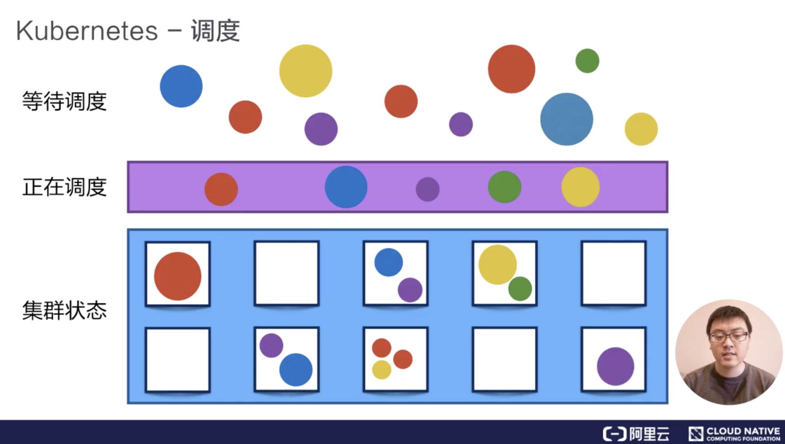
##### 2、自动修复
Kubernetes 有一个节点健康检查的功能，它会监测这个集群中所有的宿主机，当宿主机本身出现故障，或者软件出现故障的时候，这个节点健康检查会自动对它进行发现。
下面 Kubernetes 会把运行在这些失败节点上的容器进行自动迁移，迁移到一个正在健康运行的宿主机上，来完成集群内容器的一个自动恢复。
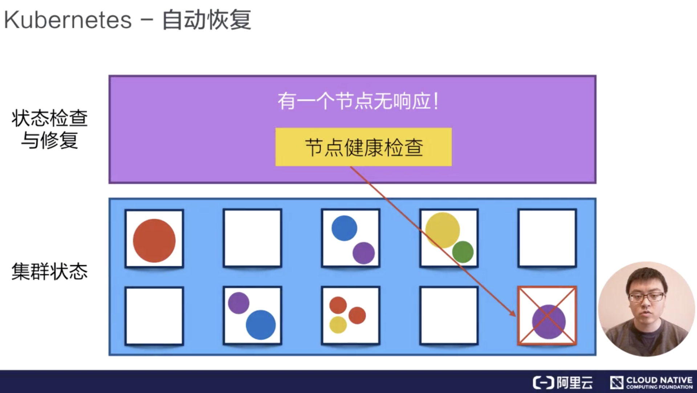
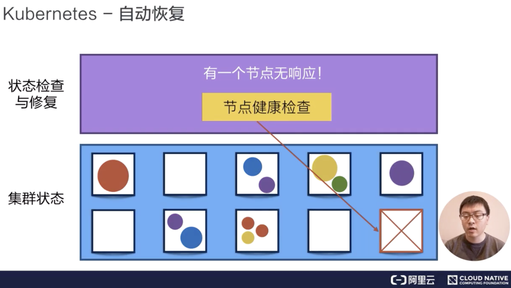
##### 3、水平伸缩
Kubernetes 有业务负载检查的能力，它会监测业务上所承担的负载，如果这个业务本身的 CPU 利用率过高，或者响应时间过长，它可以对这个业务进行一次扩容。
比如说在下面的例子中，黄颜色的过度忙碌，Kubernetes 就可以把黄颜色负载从一份变为三份。接下来，它就可以通过负载均衡把原来打到第一个黄颜色上的负载平均分到三个黄颜色的负载上去，以此来提高响应的时间。
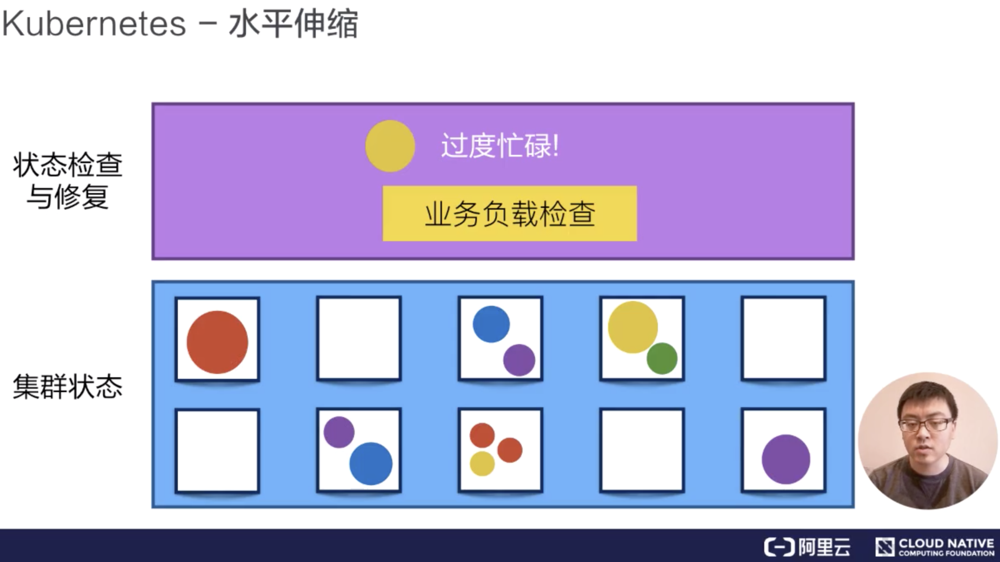
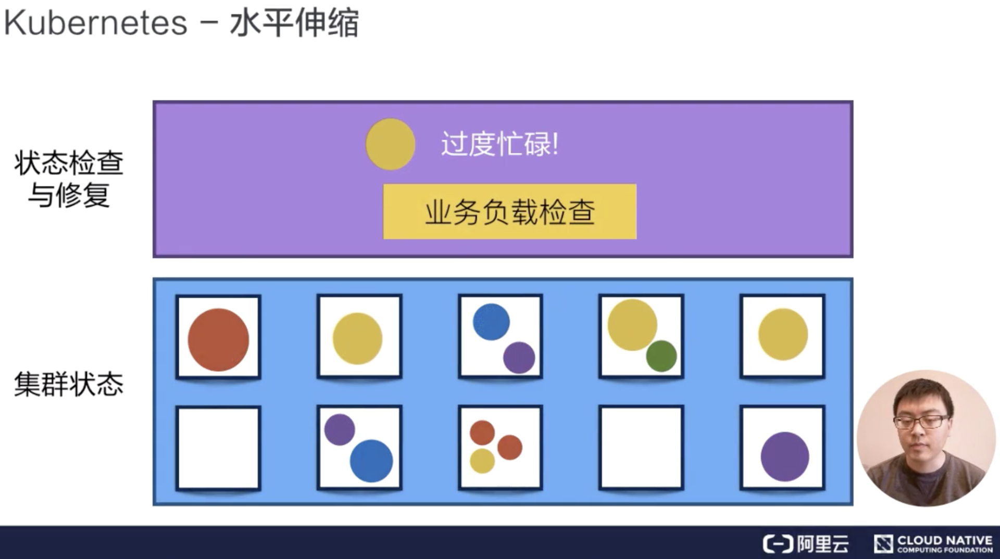
以上就是 Kubernetes 三个核心能力的简单介绍。
#### 三、Kubernetes 的架构
Kubernetes 架构是一个比较典型的二层架构和 server-client 架构。Master 作为中央的管控节点，会去与 Node 进行一个连接。
所有 UI 的、clients、这些 user 侧的组件，只会和 Master 进行连接，把希望的状态或者想执行的命令下发给 Master，Master 会把这些命令或者状态下发给相应的节点，进行最终的执行。
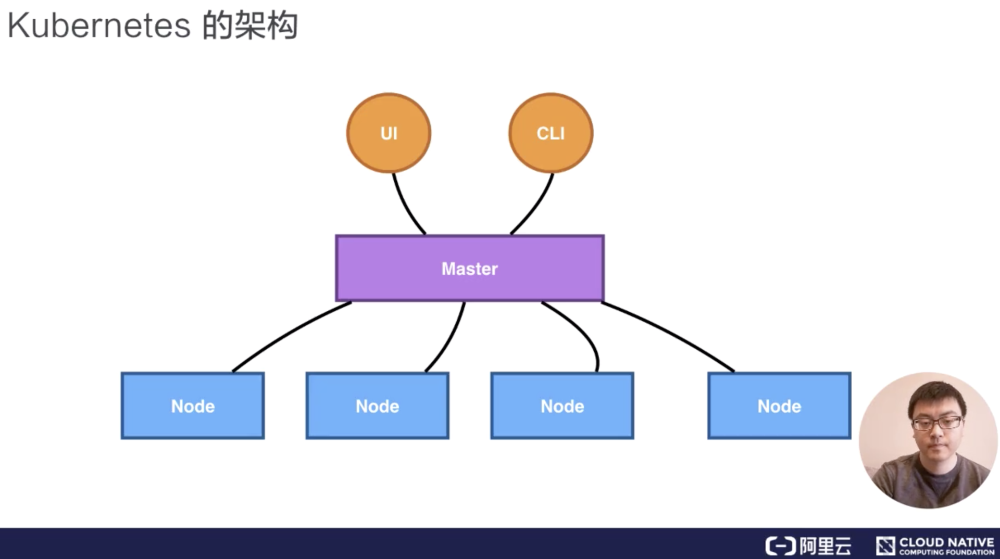
Kubernetes 的 Master 包含四个主要的组件：API Server、Controller、Scheduler 以及 etcd。如下图所示：
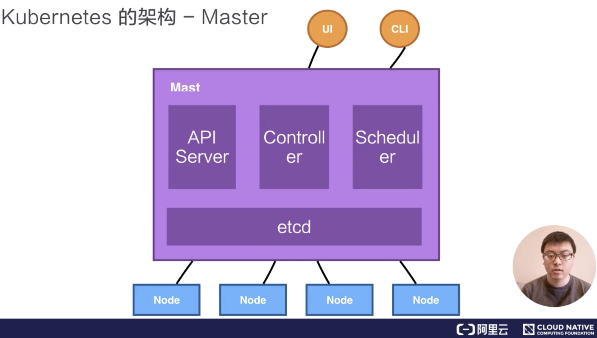
  * **API Server：** 顾名思义是用来处理 API 操作的，Kubernetes 中所有的组件都会和 API Server 进行连接，组件与组件之间一般不进行独立的连接，都依赖于 API Server 进行消息的传送；


  * **Controller：** 是控制器，它用来完成对集群状态的一些管理。比如刚刚我们提到的两个例子之中，第一个自动对容器进行修复、第二个自动进行水平扩张，都是由 Kubernetes 中的 Controller 来进行完成的；


  * **Scheduler：** 是调度器，“调度器”顾名思义就是完成调度的操作，就是我们刚才介绍的第一个例子中，把一个用户提交的 Container，依据它对 CPU、对 memory 请求大小，找一台合适的节点，进行放置；


  * **etcd：** 是一个分布式的一个存储系统，API Server 中所需要的这些原信息都被放置在 etcd 中，etcd 本身是一个高可用系统，通过 etcd 保证整个 Kubernetes 的 Master 组件的高可用性。


我们刚刚提到的 API Server，它本身在部署结构上是一个可以水平扩展的一个部署组件；Controller 是一个可以进行热备的一个部署组件，它只有一个 active，它的调度器也是相应的，虽然只有一个 active，但是可以进行热备。
##### **Kubernetes 的架构：Node**
Kubernetes 的 Node 是真正运行业务负载的，每个业务负载会以 Pod 的形式运行。等一下我会介绍一下 Pod 的概念。一个 Pod 中运行的一个或者多个容器，真正去运行这些 Pod 的组件的是叫做 **kubelet** ，也就是 Node 上最为关键的组件，它通过 API Server 接收到所需要 Pod 运行的状态，然后提交到我们下面画的这个 Container Runtime 组件中。
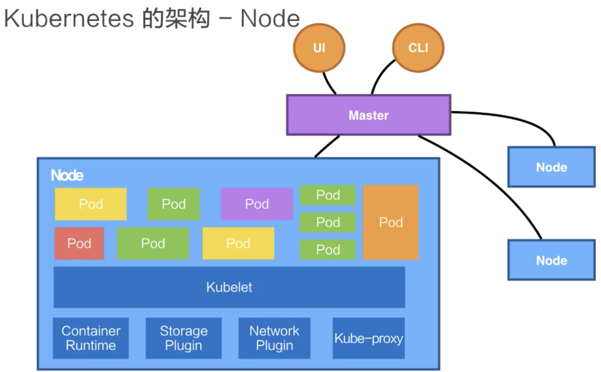
在 OS 上去创建容器所需要运行的环境，最终把容器或者 Pod 运行起来，也需要对存储跟网络进行管理。Kubernetes 并不会直接进行网络存储的操作，他们会靠 Storage Plugin 或者是网络的 Plugin 来进行操作。用户自己或者云厂商都会去写相应的 **Storage Plugin** 或者 **Network Plugin** ，去完成存储操作或网络操作。
在 Kubernetes 自己的环境中，也会有 Kubernetes 的 Network，它是为了提供 Service network 来进行搭网组网的。（等一下我们也会去介绍“service”这个概念。）真正完成 service 组网的组件的是 **Kube-proxy** ，它是利用了 iptable 的能力来进行组建 Kubernetes 的 Network，就是 cluster network，以上就是 Node 上面的四个组件。
Kubernetes 的 Node 并不会直接和 user 进行 interaction，它的 interaction 只会通过 Master。而 User 是通过 Master 向节点下发这些信息的。Kubernetes 每个 Node 上，都会运行我们刚才提到的这几个组件。
下面我们以一个例子再去看一下 Kubernetes 架构中的这些组件，是如何互相进行 interaction 的。
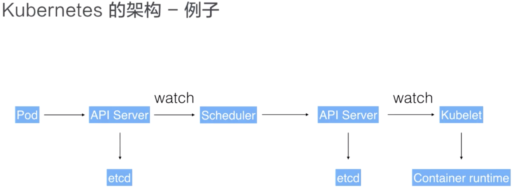
用户可以通过 UI 或者 CLI 提交一个 Pod 给 Kubernetes 进行部署，这个 Pod 请求首先会通过 CLI 或者 UI 提交给 Kubernetes API Server，下一步 API Server 会把这个信息写入到它的存储系统 etcd，之后 Scheduler 会通过 API Server 的 watch 或者叫做 notification 机制得到这个信息：有一个 Pod 需要被调度。
这个时候 Scheduler 会根据它的内存状态进行一次调度决策，在完成这次调度之后，它会向 API Server report 说：“OK！这个 Pod 需要被调度到某一个节点上。”
这个时候 API Server 接收到这次操作之后，会把这次的结果再次写到 etcd 中，然后 API Server 会通知相应的节点进行这次 Pod 真正的执行启动。相应节点的 kubelet 会得到这个通知，kubelet 就会去调 Container runtime 来真正去启动配置这个容器和这个容器的运行环境，去调度 Storage Plugin 来去配置存储，network Plugin 去配置网络。
这个例子我们可以看到：这些组件之间是如何相互沟通相互通信，协调来完成一次Pod的调度执行操作的。
#### 四、Kubernetes 的核心概念与它的 API
##### 核心概念
###### 第一个概念：Pod
Pod 是 Kubernetes 的一个最小调度以及资源单元。用户可以通过 Kubernetes 的 Pod API 生产一个 Pod，让 Kubernetes 对这个 Pod 进行调度，也就是把它放在某一个 Kubernetes 管理的节点上运行起来。一个 Pod 简单来说是对一组容器的抽象，它里面会包含一个或多个容器。
比如像下面的这幅图里面，它包含了两个容器，每个容器可以指定它所需要资源大小。比如说，一个核一个 G，或者说 0.5 个核，0.5 个 G。
当然在这个 Pod 中也可以包含一些其他所需要的资源：比如说我们所看到的 Volume 卷这个存储资源；比如说我们需要 100 个 GB 的存储或者 20GB 的另外一个存储。
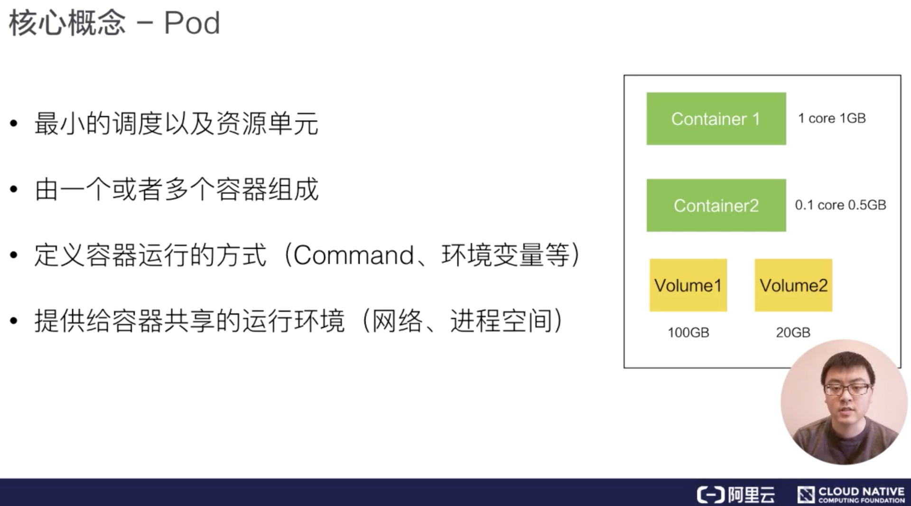
在 Pod 里面，我们也可以去定义容器所需要运行的方式。比如说运行容器的 Command，以及运行容器的环境变量等等。Pod 这个抽象也给这些容器提供了一个共享的运行环境，它们会共享同一个网络环境，这些容器可以用 localhost 来进行直接的连接。而 Pod 与 Pod 之间，是互相有 isolation 隔离的。
###### 第二个概念：Volume
Volume 就是卷的概念，它是用来管理 Kubernetes 存储的，是用来声明在 Pod 中的容器可以访问文件目录的，一个卷可以被挂载在 Pod 中一个或者多个容器的指定路径下面。
而 Volume 本身是一个抽象的概念，一个 Volume 可以去支持多种的后端的存储。比如说 Kubernetes 的 Volume 就支持了很多存储插件，它可以支持本地的存储，可以支持分布式的存储，比如说像 ceph，GlusterFS ；它也可以支持云存储，比如说阿里云上的云盘、AWS 上的云盘、Google 上的云盘等等。
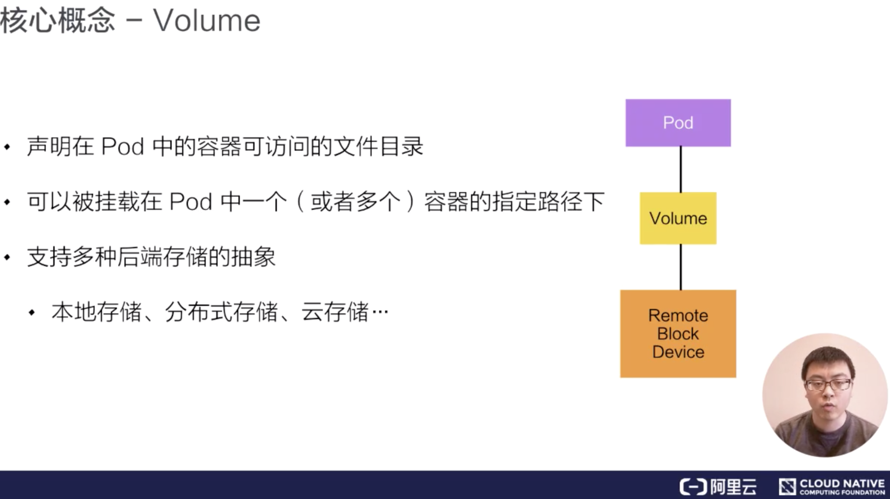
###### 第三个概念：Deployment
Deployment 是在 Pod 这个抽象上更为上层的一个抽象，它可以定义一组 Pod 的副本数目、以及这个 Pod 的版本。一般大家用 Deployment 这个抽象来做应用的真正的管理，而 Pod 是组成 Deployment 最小的单元。
Kubernetes 是通过 Controller，也就是我们刚才提到的控制器去维护 Deployment 中 Pod 的数目，它也会去帮助 Deployment 自动恢复失败的 Pod。
比如说我可以定义一个 Deployment，这个 Deployment 里面需要两个 Pod，当一个 Pod 失败的时候，控制器就会监测到，它重新把 Deployment 中的 Pod 数目从一个恢复到两个，通过再去新生成一个 Pod。通过控制器，我们也会帮助完成发布的策略。比如说进行滚动升级，进行重新生成的升级，或者进行版本的回滚。
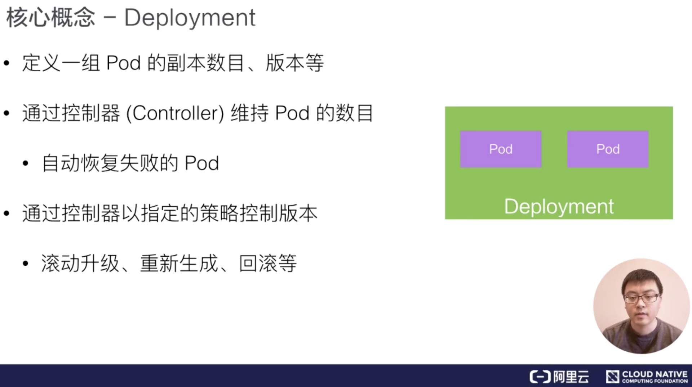
###### 第四个概念：Service
Service 提供了一个或者多个 Pod 实例的稳定访问地址。
比如在上面的例子中，我们看到：一个 Deployment 可能有两个甚至更多个完全相同的 Pod。对于一个外部的用户来讲，访问哪个 Pod 其实都是一样的，所以它希望做一次负载均衡，在做负载均衡的同时，我只想访问某一个固定的 VIP，也就是 Virtual IP 地址，而不希望得知每一个具体的 Pod 的 IP 地址。
我们刚才提到，这个 pod 本身可能 terminal go（终止），如果一个 Pod 失败了，可能会换成另外一个新的。
对一个外部用户来讲，提供了多个具体的 Pod 地址，这个用户要不停地去更新 Pod 地址，当这个 Pod 再失败重启之后，我们希望有一个抽象，把所有 Pod 的访问能力抽象成一个第三方的一个 IP 地址，实现这个的 Kubernetes 的抽象就叫 Service。
实现 Service 有多种方式，Kubernetes 支持 Cluster IP，上面我们讲过的 kuber-proxy 的组网，它也支持 nodePort、 LoadBalancer 等其他的一些访问的能力。
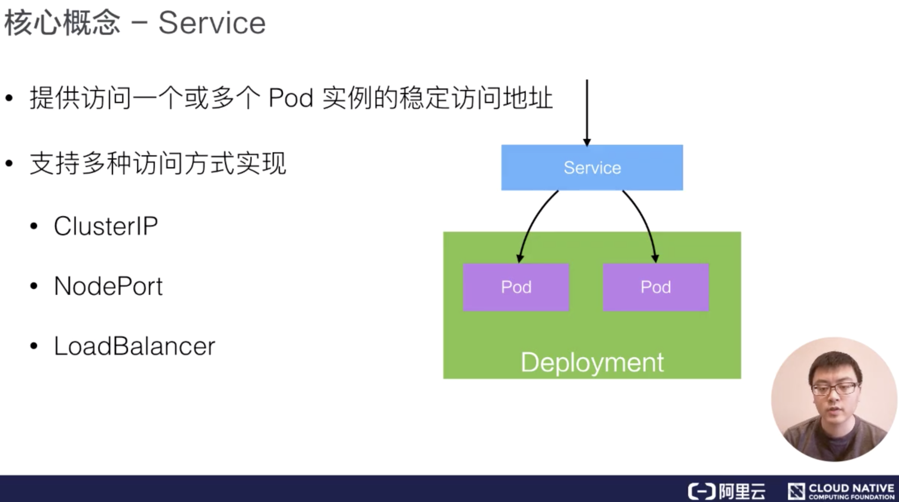
###### 第五个概念：Namespace
Namespace 是用来做一个集群内部的逻辑隔离的，它包括鉴权、资源管理等。Kubernetes 的每个资源，比如刚才讲的 Pod、Deployment、Service 都属于一个 Namespace，同一个 Namespace 中的资源需要命名的唯一性，不同的 Namespace 中的资源可以重名。
Namespace 一个用例，比如像在阿里巴巴，我们内部会有很多个 business units，在每一个 business units 之间，希望有一个视图上的隔离，并且在鉴权上也不一样，在 cuda 上面也不一样，我们就会用 Namespace 来去给每一个 BU 提供一个他所看到的这么一个看到的隔离的机制。
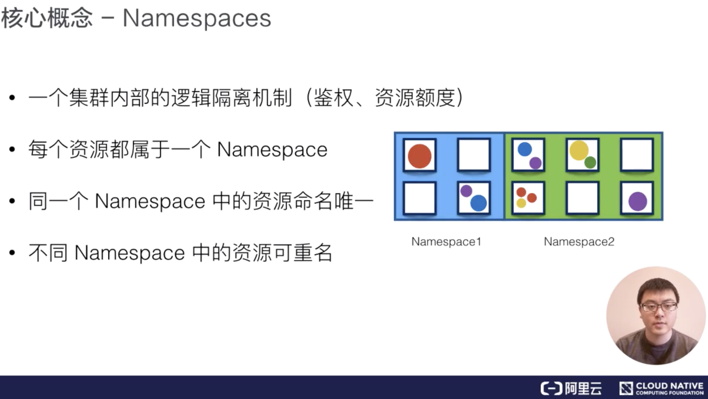
##### **Kubernetes** 的 **API**
下面我们介绍一下 Kubernetes 的 API 的基础知识。从 high-level 上看，Kubernetes API 是由 **HTTP+JSON** 组成的：用户访问的方式是 HTTP，访问的 API 中 content 的内容是 JSON 格式的。
Kubernetes 的 kubectl 也就是 command tool，Kubernetes UI，或者有时候用 curl，直接与 Kubernetes 进行沟通，都是使用 HTTP + JSON 这种形式。
下面有个例子：比如说，对于这个 Pod 类型的资源，它的 HTTP 访问的路径，就是 API，然后是 apiVesion: V1, 之后是相应的 Namespaces，以及 Pods 资源，最终是 Podname，也就是 Pod 的名字。
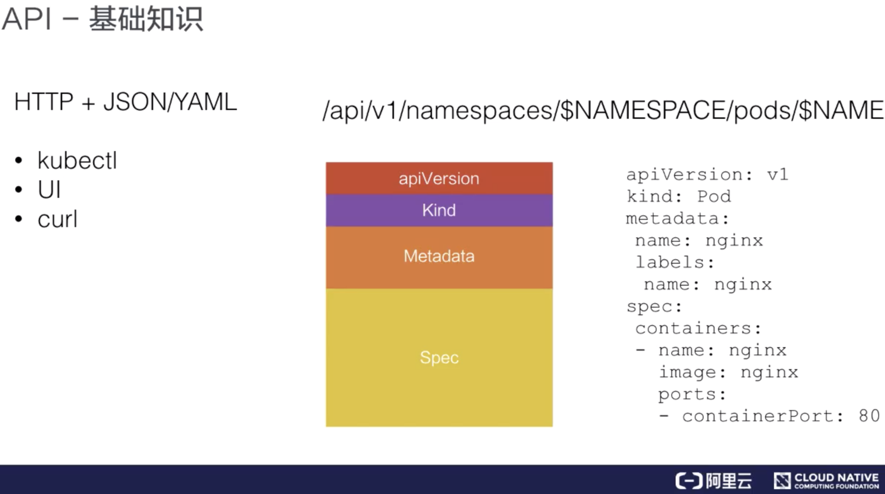
如果我们去提交一个 Pod，或者 get 一个 Pod 的时候，它的 content 内容都是用 JSON 或者是 YAML 表达的。上图中有个 yaml 的例子，在这个 yaml file 中，对 Pod 资源的描述也分为几个部分。
第一个部分，一般来讲会是 API 的 **version** 。比如在这个例子中是 V1，它也会描述我在操作哪个资源；比如说我的 **kind** 如果是 pod，在 Metadata 中，就写上这个 Pod 的名字；比如说 nginx，我们也会给它打一些 **label** ，我们等下会讲到 label 的概念。在 Metadata 中，有时候也会去写 **annotation** ，也就是对资源的额外的一些用户层次的描述。
比较重要的一个部分叫做 **Spec** ，Spec 也就是我们希望 Pod 达到的一个预期的状态。比如说它内部需要有哪些 container 被运行；比如说这里面有一个 nginx 的 container，它的 image 是什么？它暴露的 port 是什么？
当我们从 Kubernetes API 中去获取这个资源的时候，一般来讲在 Spec 下面会有一个项目叫 **status** ，它表达了这个资源当前的状态；比如说一个 Pod 的状态可能是正在被调度、或者是已经 running、或者是已经被 terminates，就是被执行完毕了。
刚刚在 API 之中，我们讲了一个比较有意思的 metadata 叫做“**label** ”，这个 label 可以是一组 KeyValuePair。
比如下图的第一个 pod 中，label 就可能是一个 color 等于 red，即它的颜色是红颜色。当然你也可以加其他 label，比如说 size: big 就是大小，定义为大的，它可以是一组 label。
这些 label 是可以被 selector，也就是选择器所查询的。这个能力实际上跟我们的 sql 类型的 select 语句是非常相似的，比如下图中的三个 Pod 资源中，我们就可以进行 select。name color 等于 red，就是它的颜色是红色的，我们也可以看到，只有两个被选中了，因为只有他们的 label 是红色的，另外一个 label 中写的 color 等于 yellow，也就是它的颜色是黄色，是不会被选中的。
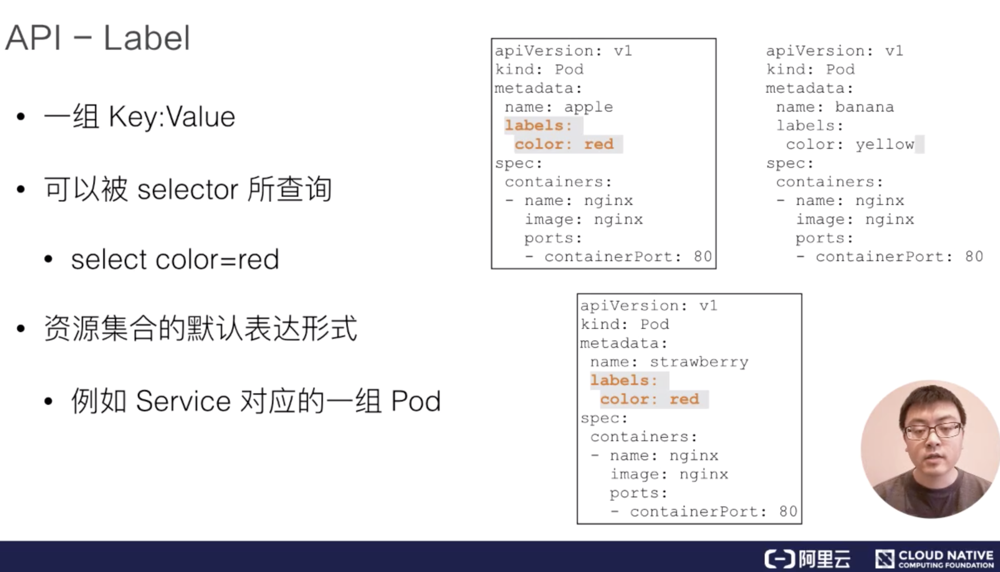
通过 label，kubernetes 的 API 层就可以对这些资源进行一个筛选，那这些筛选也是 kubernetes 对资源的集合所表达默认的一种方式。
例如说，我们刚刚介绍的 Deployment，它可能是代表一组的 Pod，它是一组 Pod 的抽象，一组 Pod 就是通过 label selector 来表达的。当然我们刚才讲到说 service 对应的一组 Pod，就是一个 service 要对应一个或者多个的 Pod，来对它们进行统一的访问，这个描述也是通过 label selector 来进行 select 选取的一组 Pod。
所以可以看到 label 是一个非常核心的 kubernetes API 的概念，我们在接下来的课程中也会着重地去讲解和介绍 label 这个概念，以及如何更好地去使用它。
#### 五、以一个 demo 结尾
最后一部分，我想以一个例子来结束，让大家跟我一起来尝试一个 kubernetes，在尝试 Kubernetes 之前，我希望大家能在本机上安装一下 Kubernetes，安装一个 Kubernetes 沙箱环境。
安装这个沙箱环境，主要有三个步骤：
  * 首先需要安装一个虚拟机，来在虚拟机中启动 Kubernetes。我们会推荐大家利用 virtualbox 来作为虚拟机的运行环境；


安装 VirtualBox： <https://www.virtualbox.org/wiki/Downloads>
  * 其次我们需要在虚拟机中启动 Kubernetes，Kubernetes 有一个非常有意思的项目，叫 minikube，也就是启动一个最小的 local 的 Kubernetes 的一个环境。


minikube 我们推荐使用下面写到的阿里云的版本，它和官方 minikube 的主要区别就是把 minikube 中所需要的 Google 上的依赖换成国内访问比较快的一些镜像，这样就方便了大家的安装工作；
安装 MiniKube（中国版）: <https://yq.aliyun.com/articles/221687>
  * 最后在安装完 virtualbox 和 minikube 之后，大家可以对 minikube 进行启动，也就是下面这个命令。


启动命令：minikube start —vm-driver virtualbox
如果大家不是 Mac 系统，其他操作系统请访问下面这个链接，查看其它操作系统如何安装 minikube 沙箱环境。
[https://kubernetes.io/docs/tasks/tools/install-minikube/](https://kubernetes.io/docs/tasks/tools/install-minikube%EF%BC%8C)
当大家安装好之后，我会跟大家一起做一个例子，来做三件事情：
  1. 提交一个 nginx deployment；


kubectl apply -f https://k8s.io/examples/application/deployment.yaml
  2. 升级 nginx deployment；


kubectl apply -f https://k8s.io/examples/application/deployment-update.yaml
  3. 扩容 nginx deployment。


kubectl apply -f https://k8s.io/examples/application/deployment-scale.yaml
第一步，我们提交一个 nginx 的 Deployment，然后对这个 Deployment 进行一次版本升级，也就是改变它中间 Pod 的版本。最后我们也会尝试对 nginx 进行一次扩容，进行一次水平的伸缩，下面就让大家一起跟我来尝试这三个操作吧。
首先，我们先看一下 minikube 的 status，可以看到 kubelet master 和 kubectl 都是配置好的。
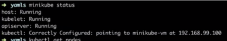
下一步我们利用 kubectl 来看一下这个集群中节选的状态，可以看到这个master 的节点已经是running状态：

我们就以这个为节点，下面我们尝试去看一下现在集群中 Deployment 这个资源：

可以看到集群中没有任何的 Deployment，我们可以利用 watch 这个语义去看集群中 Deployment 这个资源的变化情况。
下面我们去做刚才想要的三个操作：第一个操作是去创建一个 Deployment。可以看到下面第一个图，这是一个 API 的 content，它的 kind 是 Deployment，name 是 nginx-deployment, 有图中它的 replicas 数目是2，它的镜像版本是 1.7.9。
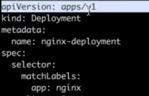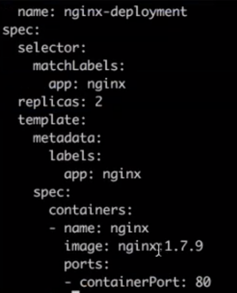
我们下面还是回到 kubectl 这个 commnd 来执行这次 Deployment 的真正的操作。我们可以看到一个简单的操作，就会去让 Deployment 不停地生成副本。
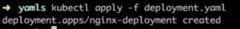
Deployment 副本数目是 2 个，下面也可以 describe 一下现在的 Deployment 的状态。我们知道之前是没有这个 Deployment 的，现在我们去 describe 这个 nginx-deployment。
下图中可以看到：有一个 nginx-deployment 已经被生成了，它的 replicas 数目也是我们想要的、selector 也是我们想要的、它的 image 的版本也是 1.7.9。还可以看到，里面的 deployment-controller 这种版本控制器也是在管理它的生成。
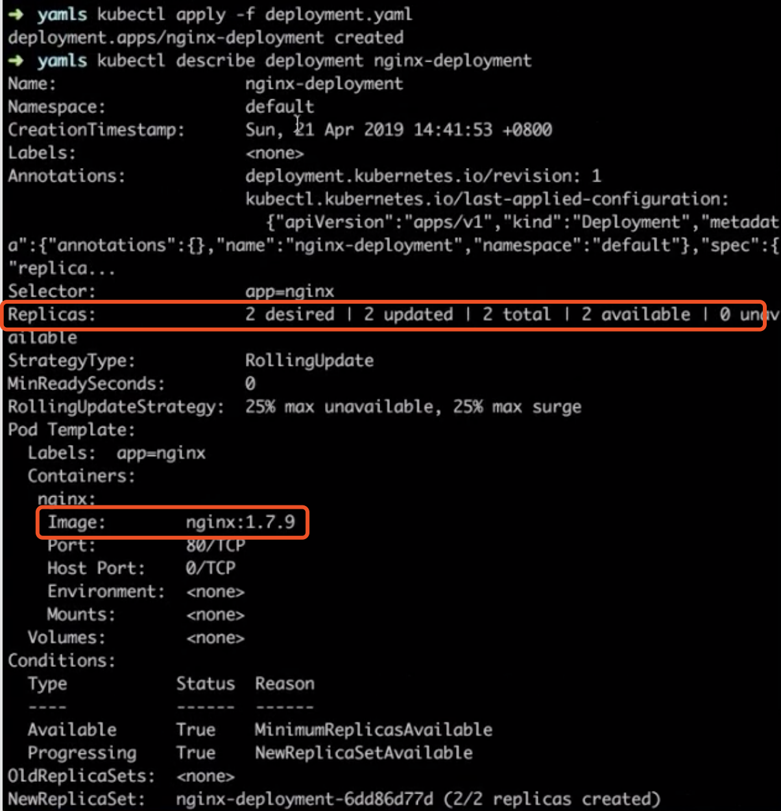
下面我们去升级这个 Deployment 版本，首先下载另外一个 yaml 文件 deployment-update.yaml，可以看到这里面的 image 本身的版本号从 1.7.9 升级到 1.8。
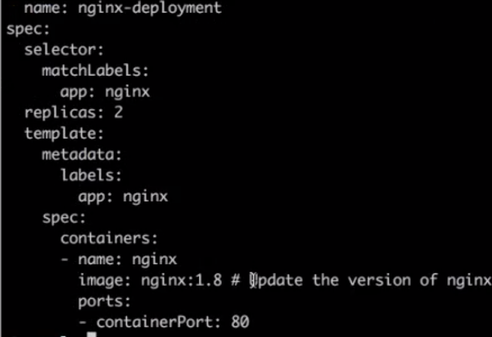
接下来我们重新 apply 新的 deployment-update 这个 yaml 文件。
可以看到，在另一边的屏幕上显示出了这个 Deployment 升级的一些操作，最终它的 up-to-date 值从 0 变成了 2，也就是说所有的容器都是最新版本的，所有的 Pod 都是最新版本的。我们也可以 discribe 具体去看一下是不是所有 Pod 的版本都被更新了，可以看到这个 image 的版本由 1.7.9 真正更新到了 1.8。
最后，我们也可以看到 controller 又执行了几次新的操作，这个控制器维护了整个 Deployment 和 Pod 状态。
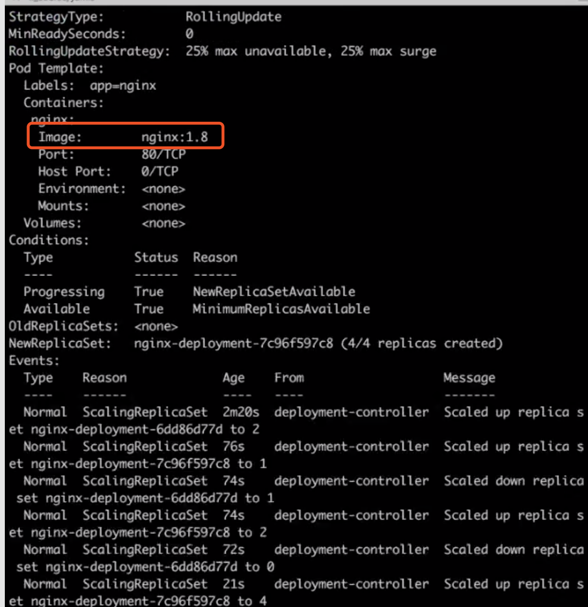
最后我们演示一下给 Deployment 做水平扩张，下载另一个 yaml 文件 deployment-scale.yaml，这里面的 replicas 数目已经从 2 改成了 4。
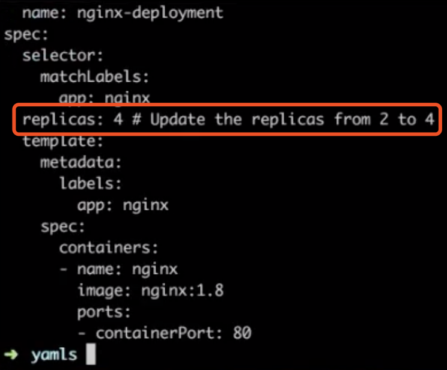
回到最开始的窗口，用 kubectl 去 apply 这个新的 deployment-scale.yaml 文件，在另外一个窗口上可以看到，当我们执行了 deployment-scale 操作之后，它的容器 Pod 数目从 2 变成了 4。我们可以再一次 describ 一下当前集群中的 deployment 的情况，可以看到它的 replicas 的数目从 2 变到了 4，同时也可以看到 controller 又做了几次新的操作，这个 scale up 成功了。
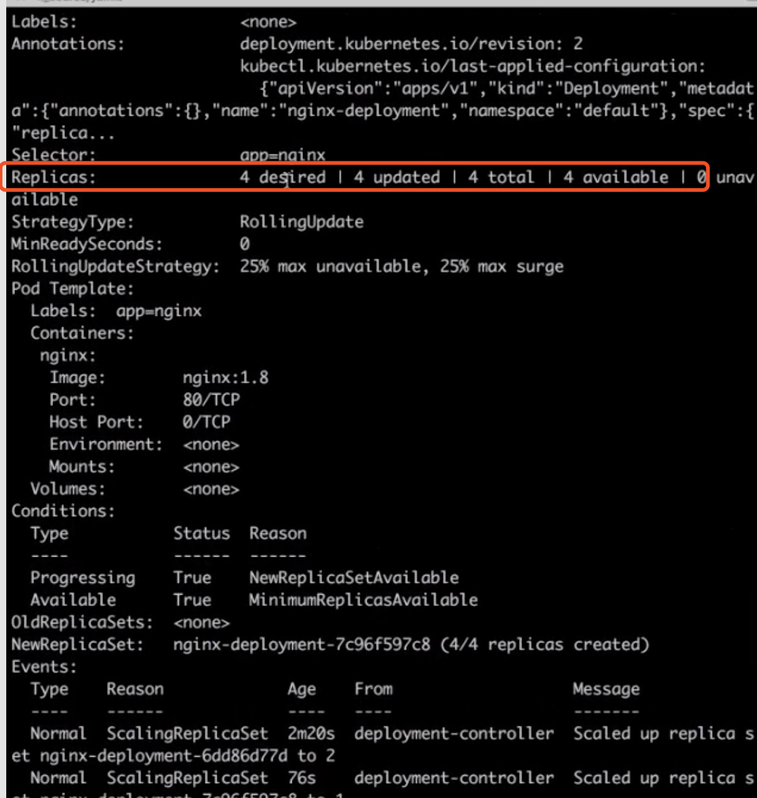
最后，让我们利用 delete 操作把我们刚才生成的 Deployment 给删除掉。kubectl delete deployment，也是刚才我们本身的 deployment name，当我们把它删除掉之后，我们今天所有的操作就完成了。
我们再去重新 get 这个 Deployment，也会显示这个资源不再存在，这个集群又回到了最开始干净的状态。
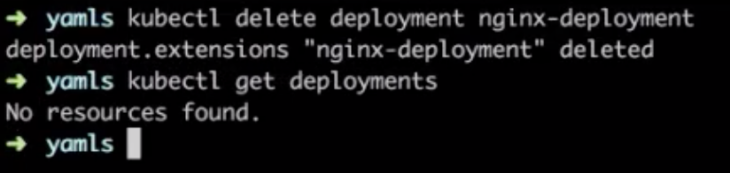
以上这就是这堂课中所有的内容了，我们关注了 kubernetes 的核心概念以及 kubernetes 的架构设计，希望大家能在这节课中有所收获，也希望大家能关注云原生技术课堂中的其他内容，谢谢大家的观看！
### 本节总结
  * Kubernetes 是一个自动化的容器编排平台，它负责应用的部署、应用的弹性以及应用的管理，这些都是基于容器的；
  * Kubernetes 架构是一个比较典型的二层架构和 server-client 架构；

---

<a id="lecture-04"></a>
## 第4讲｜理解 Pod 和容器设计模式

来源：https://edu.aliyun.com/course/314164/lesson/341312349

本文整理自 CNCF 和阿里巴巴联合举办的云原生技术公开课的课时 4：理解 Pod 和容器设计模式。本次课程中，阿阿里巴巴高级技术专家、CNCF 官方大使张磊为大家介绍了为什么我们需要 Pod、Pod 的实现机制以及详解容器设计模式等，精彩不容错过。
本次课程的分享主要围绕以下三个部分：
  1. 为什么需要 Pod；
  2. Pod 的实现机制；
  3. 详解容器设计模式。


#### 一、为什么需要 Pod
##### 容器的基本概念
现在来看第一个问题：为什么需要 Pod？我们知道 Pod 是 Kubernetes 项目里面一个非常重要的概念，也是非常重要的一个原子调度单位，但是为什么我们会需要这样一个概念呢？我们在使用容器 Docker 的时候，也没有这个说法。其实如果要理解 Pod，我们首先要理解容器，所以首先来回顾一下容器的概念：
**容器的本质实际上是一个进程，是一个视图被隔离，资源受限的进程。**
容器里面 PID=1 的进程就是应用本身，这意味着管理虚拟机等于管理基础设施，因为我们是在管理机器，但管理容器却等于直接管理应用本身。这也是之前说过的不可变基础设施的一个最佳体现，这个时候，你的应用就等于你的基础设施，它一定是不可变的。
在以上面的例子为前提的情况下，Kubernetes 又是什么呢？我们知道，很多人都说 Kubernetes 是云时代的操作系统，这个非常有意思，因为如果以此类推，容器镜像就是这个操作系统的软件安装包，它们之间是这样的一个类比关系。
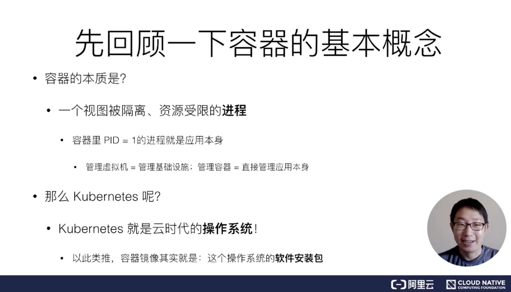
##### 真实操作系统里的例子
如果说 Kubernetes 就是操作系统的话，那么我们不妨看一下真实的操作系统的例子。
例子里面有一个程序叫做 Helloworld，这个 Helloworld 程序实际上是由一组进程组成的，需要注意一下，这里说的进程实际上等同于 Linux 中的线程。
因为 Linux 中的线程是轻量级进程，所以如果从 Linux 系统中去查看 Helloworld 中的 pstree，将会看到这个 Helloworld 实际上是由四个线程组成的，分别是 **{api、main、log、compute}** 。也就是说，四个这样的线程共同协作，共享 Helloworld 程序的资源，组成了 Helloworld 程序的真实工作情况。
这是操作系统里面进程组或者线程组中一个非常真实的例子，以上就是进程组的一个概念。
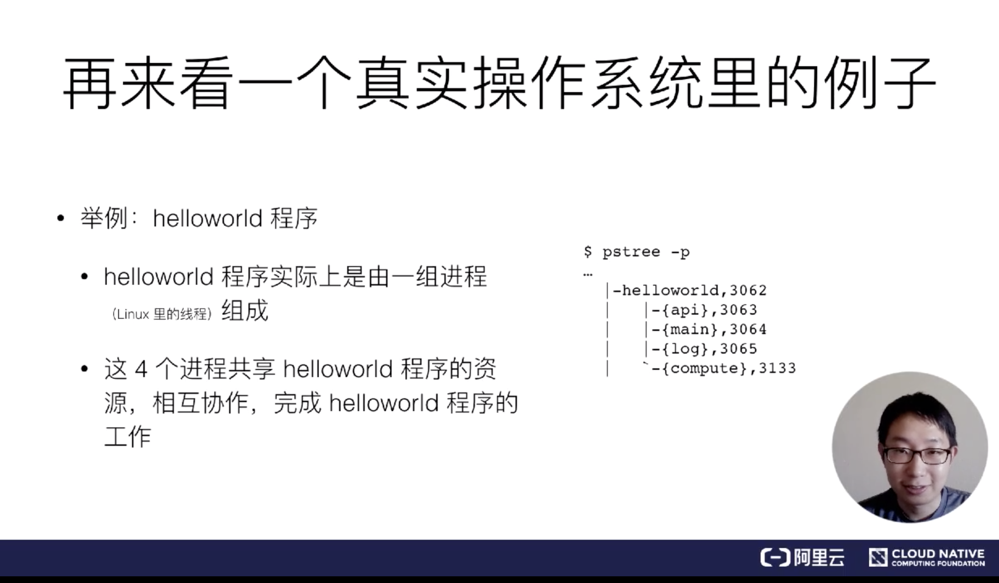
那么大家不妨思考一下，在真实的操作系统里面，一个程序往往是根据进程组来进行管理的。Kubernetes 把它类比为一个操作系统，比如说 Linux。针对于容器我们前面提到可以类比为进程，就是前面的 Linux 线程。那么 Pod 又是什么呢？实际上 Pod 就是我们刚刚提到的进程组，也就是 Linux 里的线程组。
##### 进程组概念
说到进程组，首先建议大家至少有个概念上的理解，然后我们再详细的解释一下。
还是前面那个例子：Helloworld 程序由四个进程组成，这些进程之间会共享一些资源和文件。那么现在有一个问题：假如说现在把 Helloworld 程序用容器跑起来，你会怎么去做？
当然，最自然的一个解法就是，我现在就启动一个 Docker 容器，里面运行四个进程。可是这样会有一个问题，这种情况下容器里面 PID=1 的进程该是谁? 比如说，它应该是我的 main 进程，那么问题来了，“谁”又负责去管理剩余的 3 个进程呢？
这个核心问题在于，容器的设计本身是一种“单进程”模型，不是说容器里只能起一个进程，由于容器的应用等于进程，所以只能去管理 PID=1 的这个进程，其他再起来的进程其实是一个托管状态。 所以说服务应用进程本身就具有“进程管理”的能力。
比如说 Helloworld 的程序有 system 的能力，或者直接把容器里 PID=1 的进程直接改成 systemd，否则这个应用，或者是容器是没有办法去管理很多个进程的。因为 PID=1 进程是应用本身，如果现在把这个 PID=1 的进程给 kill 了，或者它自己运行过程中死掉了，那么剩下三个进程的资源就没有人回收了，这个是非常非常严重的一个问题。
而反过来真的把这个应用本身改成了 systemd，或者在容器里面运行了一个 systemd，将会导致另外一个问题：使得管理容器，不再是管理应用本身了，而等于是管理 systemd，这里的问题就非常明显了。比如说我这个容器里面 run 的程序或者进程是 systemd，那么接下来，这个应用是不是退出了？是不是 fail 了？是不是出现异常失败了？实际上是没办法直接知道的，因为容器管理的是 systemd。这就是为什么在容器里面运行一个复杂程序往往比较困难的一个原因。
这里再帮大家梳理一下：**由于容器实际上是一个“单进程”模型** ，所以如果你在容器里启动多个进程，只有一个可以作为 PID=1 的进程，而这时候，如果这个 PID=1 的进程挂了，或者说失败退出了，那么其他三个进程就会自然而然的成为孤儿，没有人能够管理它们，没有人能够回收它们的资源，这是一个非常不好的情况。
> 注意：Linux 容器的“单进程”模型，指的是容器的生命周期等同于 PID=1 的进程（容器应用进程）的生命周期，而不是说容器里不能创建多进程。当然，一般情况下，容器应用进程并不具备进程管理能力，所以你通过 exec 或者 ssh 在容器里创建的其他进程，一旦异常退出（比如 ssh 终止）是很容易变成孤儿进程的。
反过来，其实可以在容器里面 run 一个 systemd，用它来管理其他所有的进程。这样会产生第二个问题：实际上没办法直接管理我的应用了，因为我的应用被 systemd 给接管了，那么这个时候应用状态的生命周期就不等于容器生命周期。这个管理模型实际上是非常非常复杂的。
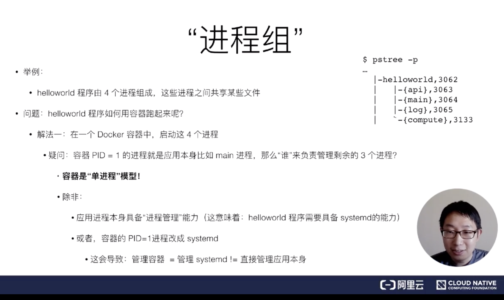
##### Pod = “进程组”
在 kubernetes 里面，Pod 实际上正是 kubernetes 项目为你抽象出来的一个可以类比为进程组的概念。
前面提到的，由四个进程共同组成的一个应用 Helloworld，在 Kubernetes 里面，实际上会被定义为一个拥有四个容器的 Pod，这个概念大家一定要非常仔细的理解。
就是说现在有四个职责不同、相互协作的进程，需要放在容器里去运行，在 Kubernetes 里面并不会把它们放到一个容器里，因为这里会遇到两个问题。那么在 Kubernetes 里会怎么去做呢？它会把四个独立的进程分别用四个独立的容器启动起来，然后把它们定义在一个 Pod 里面。
所以当 Kubernetes 把 Helloworld 给拉起来的时候，你实际上会看到四个容器，它们共享了某些资源，这些资源都属于 Pod，所以我们说 Pod 在 Kubernetes 里面只有一个逻辑单位，没有一个真实的东西对应说这个就是 Pod，不会有的。真正起来在物理上存在的东西，就是四个容器。这四个容器，或者说是多个容器的组合就叫做 Pod。并且还有一个概念一定要非常明确，Pod 是 Kubernetes 分配资源的一个单位，因为里面的容器要共享某些资源，所以 Pod 也是 Kubernetes 的原子调度单位。
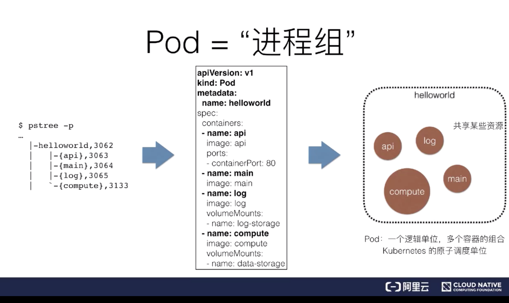
上面提到的 Pod 设计，也不是 Kubernetes 项目自己想出来的， 而是早在 Google 研发 Borg 的时候，就已经发现了这样一个问题。这个在 Borg paper 里面有非常非常明确的描述。简单来说 Google 工程师发现在 Borg 下面部署应用时，很多场景下都存在着类似于“进程与进程组”的关系。更具体的是，这些应用之前往往有着密切的协作关系，使得它们必须部署在同一台机器上并且共享某些信息。
以上就是进程组的概念，也是 Pod 的用法。
##### 为什么 Pod 必须是原子调度单位？
可能到这里大家会有一些问题：虽然了解这个东西是一个进程组，但是为什么要把 Pod 本身作为一个概念抽象出来呢？或者说能不能通过调度把 Pod 这个事情给解决掉呢？为什么 Pod 必须是 Kubernetes 里面的原子调度单位？
下面我们通过一个例子来解释。
假如现在有两个容器，它们是紧密协作的，所以它们应该被部署在一个 Pod 里面。具体来说，第一个容器叫做 App，就是业务容器，它会写日志文件；第二个容器叫做 LogCollector，它会把刚刚 App 容器写的日志文件转发到后端的 ElasticSearch 中。
两个容器的资源需求是这样的：App 容器需要 1G 内存，LogCollector 需要 0.5G 内存，而当前集群环境的可用内存是这样一个情况：Node_A：1.25G 内存，Node_B：2G 内存。
假如说现在没有 Pod 概念，就只有两个容器，这两个容器要紧密协作、运行在一台机器上。可是，如果调度器先把 App 调度到了 Node_A 上面，接下来会怎么样呢？这时你会发现：LogCollector 实际上是没办法调度到 Node_A 上的，因为资源不够。其实此时整个应用本身就已经出问题了，调度已经失败了，必须去重新调度。
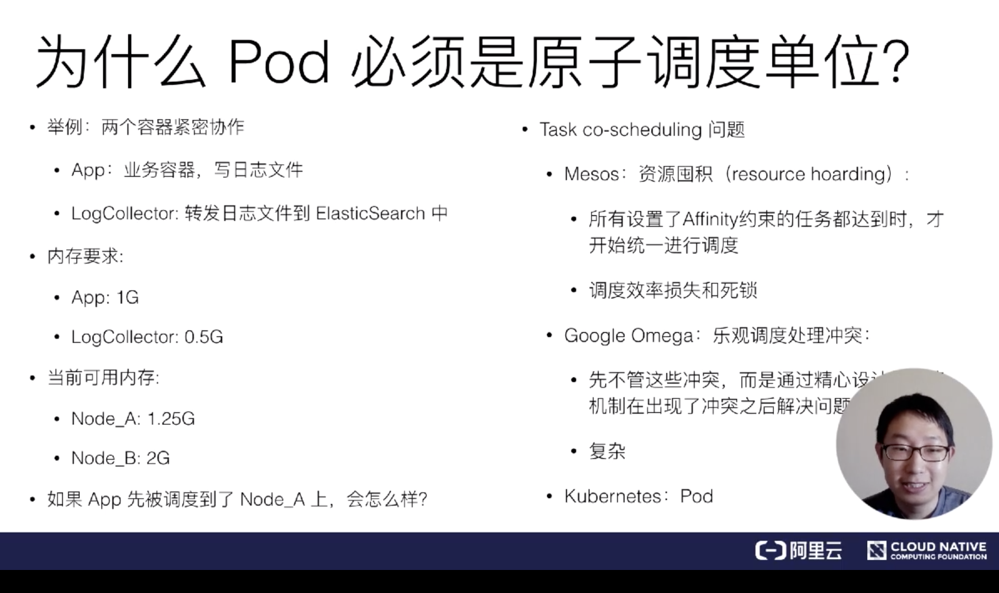
以上就是一个非常典型的成组调度失败的例子。英文叫做：Task co-scheduling 问题，这个问题不是说不能解，在很多项目里面，这样的问题都有解法。
比如说在 Mesos 里面，它会做一个事情，叫做资源囤积（resource hoarding）：即当所有设置了 Affinity 约束的任务都达到时，才开始统一调度，这是一个非常典型的成组调度的解法。
所以上面提到的“App”和“LogCollector”这两个容器，在 Mesos 里面，他们不会说立刻调度，而是等两个容器都提交完成，才开始统一调度。这样也会带来新的问题，首先调度效率会损失，因为需要等待。由于需要等还会有外一个情况会出现，就是产生死锁，就是互相等待的一个情况。这些机制在 Mesos 里都是需要解决的，也带来了额外的复杂度。
另一种解法是 Google 的解法。它在 Omega 系统（就是 Borg 下一代）里面，做了一个非常复杂且非常厉害的解法，叫做乐观调度。比如说：不管这些冲突的异常情况，先调度，同时设置一个非常精妙的回滚机制，这样经过冲突后，通过回滚来解决问题。这个方式相对来说要更加优雅，也更加高效，但是它的实现机制是非常复杂的。这个有很多人也能理解，就是悲观锁的设置一定比乐观锁要简单。
而像这样的一个 Task co-scheduling 问题，在 Kubernetes 里，就直接通过 Pod 这样一个概念去解决了。因为在 Kubernetes 里，这样的一个 App 容器和 LogCollector 容器一定是属于一个 Pod 的，它们在调度时必然是以一个 Pod 为单位进行调度，所以这个问题是根本不存在的。
##### 再次理解 Pod
在讲了前面这些知识点之后，我们来再次理解一下 Pod，首先 Pod 里面的容器是“超亲密关系”。
这里有个“超”字需要大家理解，正常来说，有一种关系叫做亲密关系，这个亲密关系是一定可以通过调度来解决的。
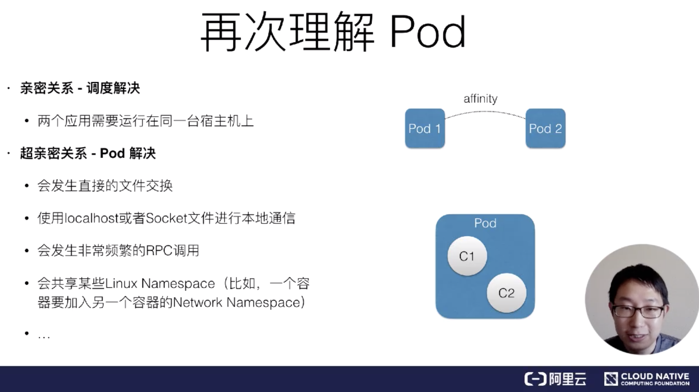
比如说现在有两个 Pod，它们需要运行在同一台宿主机上，那这样就属于亲密关系，调度器一定是可以帮助去做的。但是对于超亲密关系来说，有一个问题，即它必须通过 Pod 来解决。因为如果超亲密关系赋予不了，那么整个 Pod 或者说是整个应用都无法启动。
什么叫做超亲密关系呢？大概分为以下几类：
  * 比如说两个进程之间会发生文件交换，前面提到的例子就是这样，一个写日志，一个读日志；
  * 两个进程之间需要通过 localhost 或者说是本地的 Socket 去进行通信，这种本地通信也是超亲密关系；
  * 这两个容器或者是微服务之间，需要发生非常频繁的 RPC 调用，出于性能的考虑，也希望它们是超亲密关系；
  * 两个容器或者是应用，它们需要共享某些 Linux Namespace。最简单常见的一个例子，就是我有一个容器需要加入另一个容器的 Network Namespace。这样我就能看到另一个容器的网络设备，和它的网络信息。


像以上几种关系都属于超亲密关系，它们都是在 Kubernetes 中会通过 Pod 的概念去解决的。
现在我们理解了 Pod 这样的概念设计，理解了为什么需要 Pod。它解决了两个问题：
  1. 我们怎么去描述超亲密关系；
  2. 我们怎么去对超亲密关系的容器或者说是业务去做统一调度，这是 Pod 最主要的一个诉求。


#### 二、Pod 的实现机制
##### Pod 要解决的问题
像 Pod 这样一个东西，本身是一个逻辑概念。那在机器上，它究竟是怎么实现的呢？这就是我们要解释的第二个问题。
既然说 Pod 要解决这个问题，核心就在于如何让一个 Pod 里的多个容器之间最高效的共享某些资源和数据。
因为容器之间原本是被 Linux Namespace 和 cgroups 隔开的，所以现在实际要解决的是怎么去打破这个隔离，然后共享某些事情和某些信息。这就是 Pod 的设计要解决的核心问题所在。
**所以说具体的解法分为两个部分：网络和存储。**
###### 1.共享网络
第一个问题是 Pod 里的多个容器怎么去共享网络？下面是个例子：
比如说现在有一个 Pod，其中包含了一个容器 A 和一个容器 B，它们两个就要共享 Network Namespace。在 Kubernetes 里的解法是这样的：它会在每个 Pod 里，额外起一个 Infra container 小容器来共享整个 Pod 的 Network Namespace。
Infra container 是一个非常小的镜像，大概 100~200KB 左右，是一个汇编语言写的、永远处于“暂停”状态的容器。由于有了这样一个 Infra container 之后，其他所有容器都会通过 Join Namespace 的方式加入到 Infra container 的 Network Namespace 中。
所以说一个 Pod 里面的所有容器，它们看到的网络视图是完全一样的。即：它们看到的网络设备、IP地址、Mac地址等等，跟网络相关的信息，其实全是一份，这一份都来自于 Pod 第一次创建的这个 Infra container。这就是 Pod 解决网络共享的一个解法。
在 Pod 里面，一定有一个 IP 地址，是这个 Pod 的 Network Namespace 对应的地址，也是这个 Infra container 的 IP 地址。所以大家看到的都是一份，而其他所有网络资源，都是一个 Pod 一份，并且被 Pod 中的所有容器共享。这就是 Pod 的网络实现方式。
由于需要有一个相当于说中间的容器存在，所以整个 Pod 里面，必然是 Infra container 第一个启动。并且整个 Pod 的生命周期是等同于 Infra container 的生命周期的，与容器 A 和 B 是无关的。这也是为什么在 Kubernetes 里面，它是允许去单独更新 Pod 里的某一个镜像的，即：做这个操作，整个 Pod 不会重建，也不会重启，这是非常重要的一个设计。
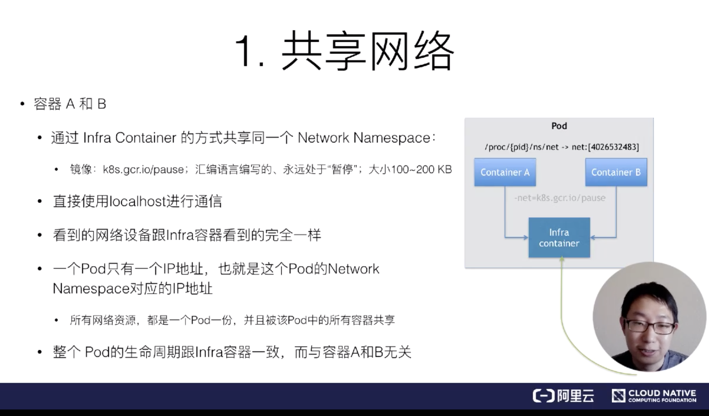
###### 2.共享存储
第二问题：Pod 怎么去共享存储？Pod 共享存储就相对比较简单。
比如说现在有两个容器，一个是 Nginx，另外一个是非常普通的容器，在 Nginx 里放一些文件，让我能通过 Nginx 访问到。所以它需要去 share 这个目录。我 share 文件或者是 share 目录在 Pod 里面是非常简单的，实际上就是把 volume 变成了 Pod level。然后所有容器，就是所有同属于一个 Pod 的容器，他们共享所有的 volume。
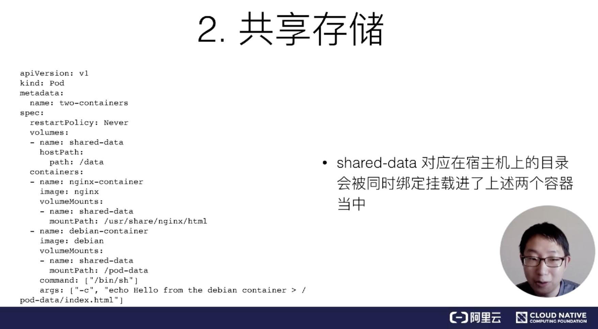
比如说上图的例子，这个 volume 叫做 shared-data，它是属于 Pod level 的，所以在每一个容器里可以直接声明：要挂载 shared-data 这个 volume，只要你声明了你挂载这个 volume，你在容器里去看这个目录，实际上大家看到的就是同一份。这个就是 Kubernetes 通过 Pod 来给容器共享存储的一个做法。
所以在之前的例子中，应用容器 App 写了日志，只要这个日志是写在一个 volume 中，只要声明挂载了同样的 volume，这个 volume 就可以立刻被另外一个 LogCollector 容器给看到。以上就是 Pod 实现存储的方式。
#### 三、详解容器设计模式
现在我们知道了为什么需要 Pod，也了解了 Pod 这个东西到底是怎么实现的。最后，以此为基础，详细介绍一下 Kubernetes 非常提倡的一个概念，叫做容器设计模式。
##### 举例
接下来将会用一个例子来给大家进行讲解。
比如我现在有一个非常常见的一个诉求：我现在要发布一个应用，这个应用是 JAVA 写的，有一个 WAR 包需要把它放到 Tomcat 的 web APP 目录下面，这样就可以把它启动起来了。可是像这样一个 WAR 包或 Tomcat 这样一个容器的话，怎么去做，怎么去发布？这里面有几种做法。
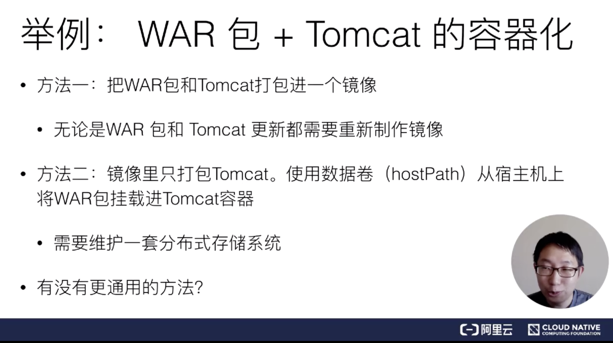
  * 第一种方式：可以把 WAR 包和 Tomcat 打包放进一个镜像里面。但是这样带来一个问题，就是现在这个镜像实际上揉进了两个东西。那么接下来，无论是我要更新 WAR 包还是说我要更新 Tomcat，都要重新做一个新的镜像，这是比较麻烦的；


  * 第二种方式：就是镜像里面只打包 Tomcat。它就是一个 Tomcat，但是需要使用数据卷的方式，比如说 hostPath，从宿主机上把 WAR 包挂载进我们 Tomcat 容器中，挂到我的 web APP 目录下面，这样把这个容器启用起来之后，里面就能用了。


但是这时会发现一个问题：这种做法一定需要维护一套分布式存储系统。因为这个容器可能第一次启动是在宿主机 A 上面，第二次重新启动就可能跑到 B 上去了，容器它是一个可迁移的东西，它的状态是不保持的。所以必须维护一套分布式存储系统，使容器不管是在 A 还是在 B 上，都可以找到这个 WAR 包，找到这个数据。
> 注意，即使有了分布式存储系统做 Volume，你还需要负责维护 Volume 里的 WAR 包。比如：你需要单独写一套 Kubernetes Volume 插件，用来在每次 Pod 启动之前，把应用启动所需的 WAR 包下载到这个 Volume 里，然后才能被应用挂载使用到。
这样操作带来的复杂程度还是比较高的，且这个容器本身必须依赖于一套持久化的存储插件（用来管理 Volume 里的 WAR 包内容）。
##### InitContainer
所以大家有没有考虑过，像这样的组合方式，有没有更加通用的方法？哪怕在本地 Kubernetes 上，没有分布式存储的情况下也能用、能玩、能发布。
实际上方法是有的，在 Kubernetes 里面，像这样的组合方式，叫做 Init Container。
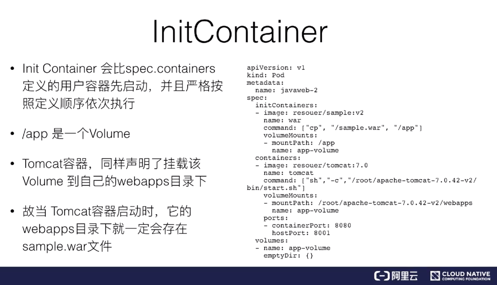
还是同样一个例子：在上图的 yaml 里，首先定义一个 Init Container，它只做一件事情，就是把 WAR 包从镜像里拷贝到一个 Volume 里面，它做完这个操作就退出了，所以 Init Container 会比用户容器先启动，并且严格按照定义顺序来依次执行。
然后，这个关键在于刚刚拷贝到的这样一个目的目录：APP 目录，实际上是一个 Volume。而我们前面提到，一个 Pod 里面的多个容器，它们是可以共享 Volume 的，所以现在这个 Tomcat 容器，只是打包了一个 Tomcat 镜像。但在启动的时候，要声明使用 APP 目录作为我的 Volume，并且要把它们挂载在 Web APP 目录下面。
而这个时候，由于前面已经运行过了一个 Init Container，已经执行完拷贝操作了，所以这个 Volume 里面已经存在了应用的 WAR 包：就是 sample.war，绝对已经存在这个 Volume 里面了。等到第二步执行启动这个 Tomcat 容器的时候，去挂这个 Volume，一定能在里面找到前面拷贝来的 sample.war。
所以可以这样去描述：这个 Pod 就是一个自包含的，可以把这一个 Pod 在全世界任何一个 Kubernetes 上面都顺利启用起来。不用担心没有分布式存储、Volume 不是持久化的，它一定是可以公布的。
所以这是一个通过组合两个不同角色的容器，并且按照这样一些像 Init Container 这样一种编排方式，统一的去打包这样一个应用，把它用 Pod 来去做的非常典型的一个例子。像这样的一个概念，在 Kubernetes 里面就是一个非常经典的容器设计模式，叫做：“Sidecar”。
##### 容器设计模式：Sidecar
什么是 Sidecar？就是说其实在 Pod 里面，可以定义一些专门的容器，来执行主业务容器所需要的一些辅助工作，比如我们前面举的例子，其实就干了一个事儿，这个 Init Container，它就是一个 Sidecar，它只负责把镜像里的 WAR 包拷贝到共享目录里面，以便被 Tomcat 能够用起来。
其它有哪些操作呢？比如说：
  * 原本需要在容器里面执行 SSH 需要干的一些事情，可以写脚本、一些前置的条件，其实都可以通过像 Init Container 或者另外像 Sidecar 的方式去解决；


  * 当然还有一个典型例子就是我的日志收集，日志收集本身是一个进程，是一个小容器，那么就可以把它打包进 Pod 里面去做这个收集工作；


  * 还有一个非常重要的东西就是 Debug 应用，实际上现在 Debug 整个应用都可以在应用 Pod 里面再次定义一个额外的小的 Container，它可以去 exec 应用 pod 的 namespace；


  * 查看其他容器的工作状态，这也是它可以做的事情。不再需要去 SSH 登陆到容器里去看，只要把监控组件装到额外的小容器里面就可以了，然后把它作为一个 Sidecar 启动起来，跟主业务容器进行协作，所以同样业务监控也都可以通过 Sidecar 方式来去做。


这种做法一个非常明显的优势就是在于其实将辅助功能从我的业务容器解耦了，所以我就能够独立发布 Sidecar 容器，并且更重要的是这个能力是可以重用的，即同样的一个监控 Sidecar 或者日志 Sidecar，可以被全公司的人共用的。这就是设计模式的一个威力。
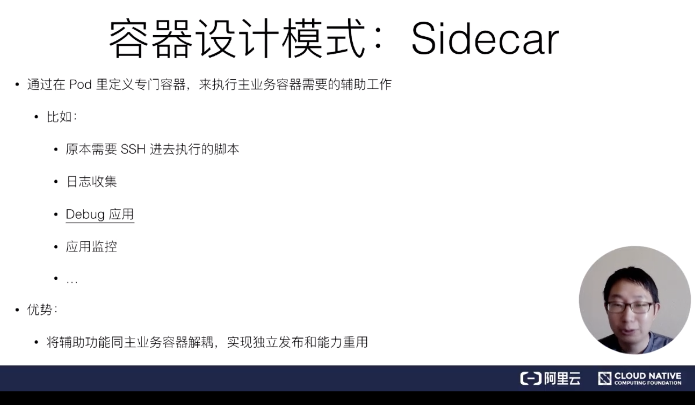
###### 
###### Sidecar：应用与日志收集
接下来，我们再详细细化一下 Sidecar 这样一个模式，它还有一些其他的场景。
比如说前面提到的应用日志收集，业务容器将日志写在一个 Volume 里面，而由于 Volume 在 Pod 里面是被共享的，所以日志容器 —— 即 Sidecar 容器一定可以通过共享该 Volume，直接把日志文件读出来，然后存到远程存储里面，或者转发到另外一个例子。现在业界常用的 Fluentd 日志进程或日志组件，基本上都是这样的工作方式。
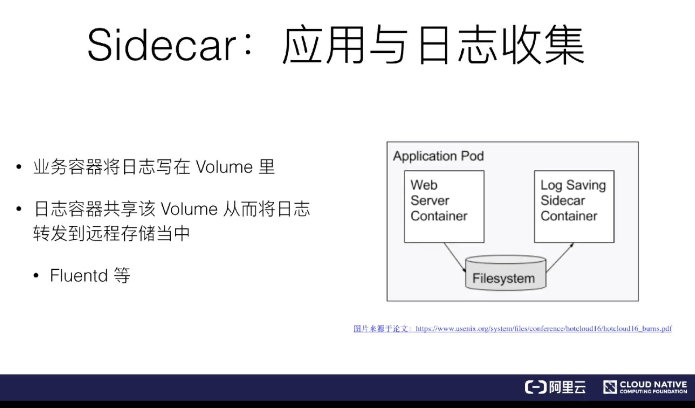
###### Sidecar：代理容器
Sidecar 的第二个用法，可以称作为代理容器 Proxy。什么叫做代理容器呢？
假如现在有个 Pod 需要访问一个外部系统，或者一些外部服务，但是这些外部系统是一个集群，那么这个时候如何通过一个统一的、简单的方式，用一个 IP 地址，就把这些集群都访问到？有一种方法就是：修改代码。因为代码里记录了这些集群的地址；另外还有一种解耦的方法，即通过 Sidecar 代理容器。
简单说，单独写一个这么小的 Proxy，用来处理对接外部的服务集群，它对外暴露出来只有一个 IP 地址就可以了。所以接下来，业务容器主要访问 Proxy，然后由 Proxy 去连接这些服务集群，这里的关键在于 Pod 里面多个容器是通过 localhost 直接通信的，因为它们同属于一个 network Namespace，网络视图都一样，所以它们俩通信 localhost，并没有性能损耗。
所以说代理容器除了做了解耦之外，并不会降低性能，更重要的是，像这样一个代理容器的代码就又可以被全公司重用了。
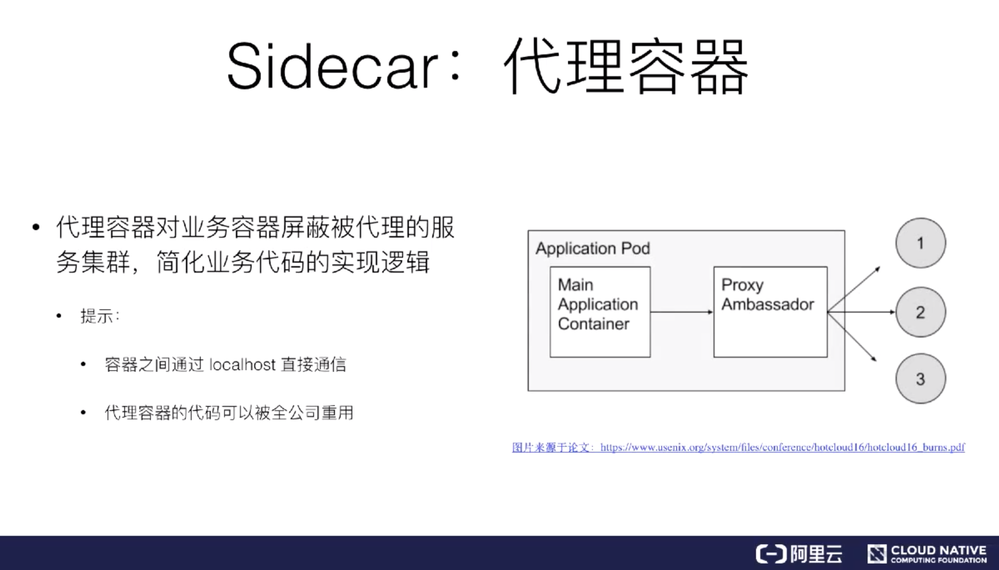
###### Sidecar：适配器容器
Sidecar 的第三个设计模式 —— 适配器容器 Adapter，什么叫 Adapter 呢？
现在业务暴露出来的 API，比如说有个 API 的一个格式是 A，但是现在有一个外部系统要去访问我的业务容器，它只知道的一种格式是 API B ,所以要做一个工作，就是把业务容器怎么想办法改掉，要去改业务代码。但实际上，你可以通过一个 Adapter 帮你来做这层转换。
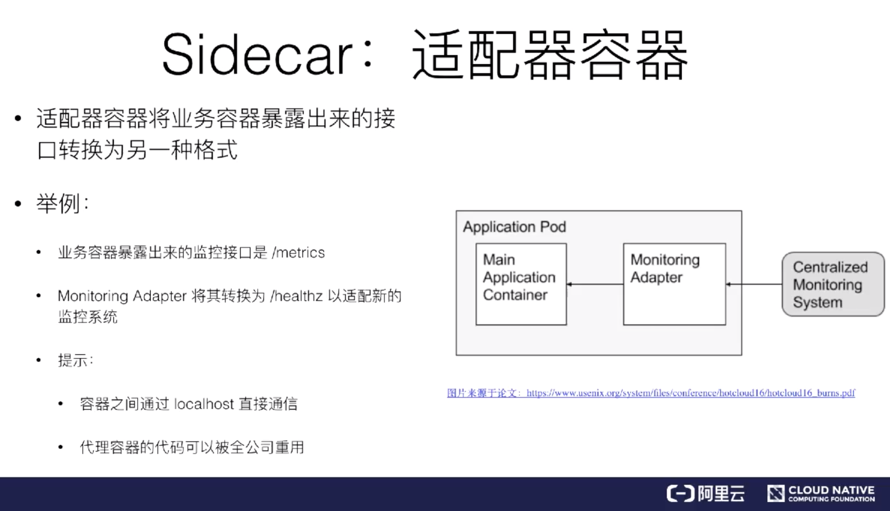
现在有个例子：现在业务容器暴露出来的监控接口是 /metrics，访问这个这个容器的 metrics 的这个 URL 就可以拿到了。可是现在，这个监控系统升级了，它访问的 URL 是 /health，我只认得暴露出 health 健康检查的 URL，才能去做监控，metrics 不认识。那这个怎么办？那就需要改代码了，但可以不去改代码，而是额外写一个 Adapter，用来把所有对 health 的这个请求转发给 metrics 就可以了，所以这个 Adapter 对外暴露的是 health 这样一个监控的 URL，这就可以了，你的业务就又可以工作了。
这样的关键还在于 Pod 之中的容器是通过 localhost 直接通信的，所以没有性能损耗，并且这样一个 Adapter 容器可以被全公司重用起来，这些都是设计模式给我们带来的好处。
### **本节总结**
  * Pod 是 Kubernetes 项目里实现“容器设计模式”的核心机制；
  * “容器设计模式”是 Google Borg 的大规模容器集群管理最佳实践之一，也是 Kubernetes 进行复杂应用编排的基础依赖之一；
  * 所有“设计模式”的本质都是：解耦和重用。


### 讲师点评
Pod 与容器设计模式是 Kubernetes 体系里面最重要的一个基础知识点，希望读者能够仔细揣摩和掌握。在这里，我建议你去重新审视一下之前自己公司或者团队里使用 Pod 方式，是不是或多或少采用了所谓“富容器”这种设计呢？这种设计，只是一种过渡形态，会培养出很多非常不好的运维习惯。我强烈建议你逐渐采用容器设计模式的思想对富容器进行解耦，将它们拆分成多个容器组成一个 Pod。这也正是当前阿里巴巴“全面上云”战役中正在全力推进的一项重要的工作内容。

---

<a id="lecture-05"></a>
## 第5讲｜应用编排与管理：核心原理

来源：https://edu.aliyun.com/course/314164/lesson/341312528

本文将主要分享以下四方面的内容：
  1. K8s 资源的重要元信息；
  2. 使用阿里云服务演示一下如何去修改或查看 K8s 重要元数据；
  3. 详细分析控制器模式；
  4. 总结控制器模式特点。


#### 一、资源元信息
##### 1. Kubernetes 资源对象
首先，我们来回顾一下 Kubernetes 的资源对象组成：主要包括了 Spec、Status 两部分。其中 Spec 部分用来描述期望的状态，Status 部分用来描述观测到的状态。
今天我们将为大家介绍 K8s 的另外一个部分，即元数据部分。该部分主要包括了用来识别资源的标签：Labels， 用来描述资源的注解；Annotations， 用来描述多个资源之间相互关系的 OwnerReference。这些元数据在 K8s 运行中有非常重要的作用。后续课程中将会反复讲到。
##### 2. labels
第一个元数据，也是最重要的一个元数据是：资源标签。资源标签是一种具有标识型的 Key：Value 元数据，这里展示了几个常见的标签。
前三个标签都打在了 Pod 对象上，分别标识了对应的应用环境、发布的成熟度和应用的版本。从应用标签的例子可以看到，标签的名字包括了一个域名的前缀，用来描述打标签的系统和工具， 最后一个标签打在 Node 对象上，还在域名前增加了版本的标识 beta 字符串。
标签主要用来筛选资源和组合资源，可以使用类似于 SQL 查询 select，来根据 Label 查询相关的资源。
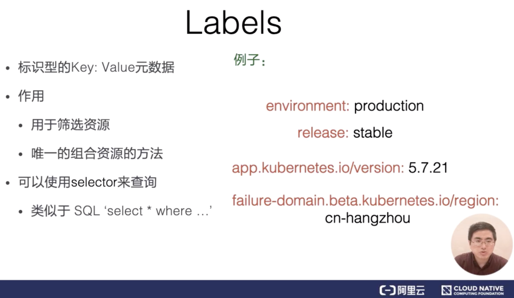
* * *
##### 3. Selector
最常见的 Selector 就是相等型 Selector。现在举一个简单的例子：
假设系统中有四个 Pod，每个 Pod 都有标识系统层级和环境的标签，我们通过 Tie：front 这个标签，可以匹配左边栏的 Pod，相等型 Selector 还可以包括多个相等条件，多个相等条件之间是逻辑”与“的关系。
在刚才的例子中，通过 Tie=front,Env=dev 的Selector，我们可以筛选出所有 Tie=front，而且 Env=dev 的 Pod，也就是下图中左上角的 Pod。另外一种 Selector 是集合型 Selector，在例子中，Selector 筛选所有环境是 test 或者 gray 的 Pod。
除了 in 的集合操作外，还有 notin 集合操作，比如 tie notin（front,back），将会筛选所有 tie 不是 front 且不是 back 的 Pod。另外，也可以根据是否存在某 lable 的筛选，如：Selector release，筛选所有带 release 标签的 Pod。集合型和相等型的 Selector，也可以用“，”来连接，同样的标识逻辑”与“的关系。
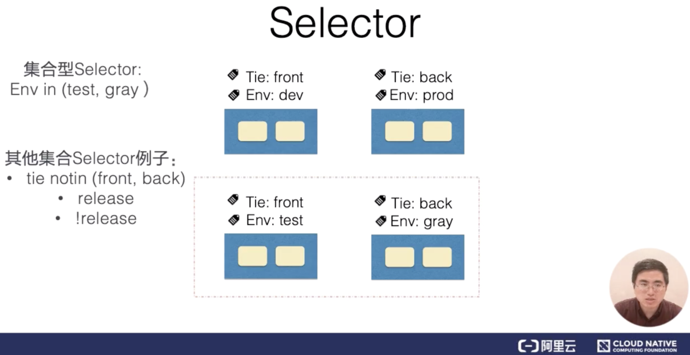****
##### 4. Annotations
另外一种重要的元数据是：annotations。一般是系统或者工具用来存储资源的非标示性信息，可以用来扩展资源的 spec/status 的描述，这里给了几个 annotations 的例子：
第一个例子，存储了阿里云负载器的证书 ID，我们可以看到 annotations 一样可以拥有域名的前缀，标注中也可以包含版本信息。第二个 annotation存储了 nginx 接入层的配置信息，我们可以看到 annotations 中包括“，”这样无法出现在 label 中的特殊字符。第三个 annotations 一般可以在 kubectl apply 命令行操作后的资源中看到， annotation 值是一个结构化的数据，实际上是一个 json 串，标记了上一次 kubectl 操作的资源的 json 的描述。
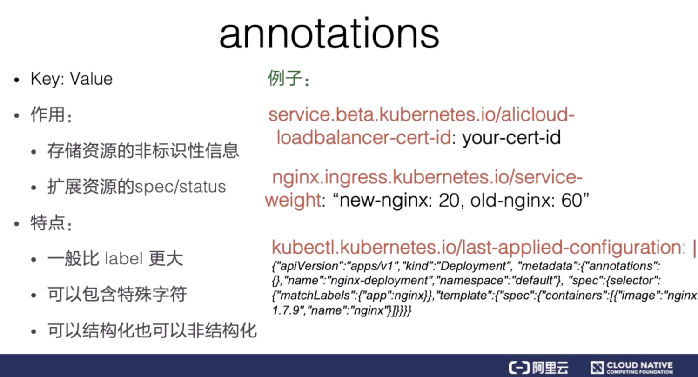
##### 5. OwnerReference
我们当时讲到最后一个元数据叫做 OwnerReference，所谓所有者，一般就是指集合类的资源，比如说 Pod 集合，就有 replicaset、statefulset，这个将在后序的课程中讲到。
集合类资源的控制器会创建对应的归属资源。比如：replicaset 控制器在操作中会创建 Pod，被创建 Pod 的 OwnerReference 就指向了创建 Pod 的 replicaset，OwnerReference 使得用户可以方便地查找一个创建资源的对象，另外，还可以用来实现级联删除的效果。****
#### 二、操作演示
这里通过 kubectl 命令去连接我们 ACK 中已经创建好的一个 K8s 集群，然后来展示一下怎么查看和修改 K8s 对象中的元数据，主要就是 Pod 的一个标签、注解，还有对应的 OwnerReference。
首先我们看一下集群里现在的配置情况：
  1. 查看 Pod，现在没有任何的一个 Pod；


  * **kubectl get pods**


  2. 然后用事先准备好的一个 Pod 的 yaml，创建一个 Pod 出来；


  * **kubectl apply -f pod1.yaml**
  * **kubectl apply -f pod2.yaml**


  3. 现在查看一下 Pod 打的标签，我们用 --show-labels 这个选项，可以看到这两个 Pod 都打上了一个部署环境和层级的标签；


  * **kubectl get pods —show-labels**


  4. 我们也可以通过另外一种方式来查看具体的资源信息。首先查看 nginx1 第一个 Pod 的一个信息，用 -o yaml 的方式输出，可以看到这个 Pod 元数据里面包括了一个 lables 的字段，里面有两个 lable；


  * **kubectl get pods nginx1 -o yaml | less**


  5. 现在再想一下，怎么样对 Pod 已有的 lable 进行修改？我们先把它的部署环境，从开发环境改成测试环境，然后指定 Pod 名字，在环境再加上它的一个值 test ，看一下能不能成功。 这里报了一个错误，可以看到，它其实是说现在这个 label 已经有值了；


  * **kubectl label pods nginx1 env=test**


  6. 如果想覆盖掉它的话，得额外再加上一个覆盖的选项。加上之后呢，我们应该可以看到这个打标已经成功了；


  * **kubectl label pods nginx1 env=test —overwrite**


  7. 我们再看一下现在集群的 lable 设置情况，首先可以看到 nginx1 的确已经加上了一个部署环境 test 标签；


  * **kubectl get pods —show-labels**


  8. 如果想要对 Pod 去掉一个标签，也是跟打标签一样的操作，但是 env 后就不是等号了。只加上 label 名字，后面不加等号，改成用减号表示去除 label 的 k:v；


  * **kubectl label pods nginx tie-**


  9. 可以看到这个 label，去标已经完全成功；


  * **kubectl get pods —show-labels**


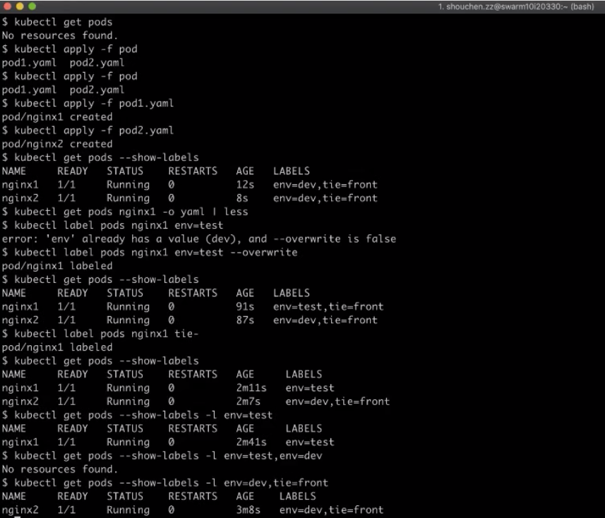
  10. 下面来看一下配置的 label 值，的确能看到 nginx1 的这个 Pod 少了一个 tie=front 的标签。有了这个 Pod 标签之后，可以看一下怎样用 label Selector 进行匹配？首先 label Selector 是通过 -l 这个选项来进行指定的 ，指定的时候，先试一下用相等型的一个 label 来筛选，所以我们指定的是部署环境等于测试的一个 Pod，我们可以看到能够筛选出一台；


  * **kubectl get pods —show-labels -l env=test**


  11. 假如说有多个相等的条件需要指定的，实际上这是一个与的关系，假如说 env 再等于 dev，我们实际上是一个 Pod 都拿不到的；


  * **kubectl get pods —show-labels -l env=test,env=dev**


  12. 然后假如说 env=dev，但是 tie=front，我们能够匹配到第二个 Pod，也就是 nginx2；


  * **kubectl get pods —show-labels -l env=dev,tie=front**


  13. 我们还可以再试一下怎么样用集合型的 label Selector 来进行筛选。这一次我们还是想要匹配出所有部署环境是 test 或者是 dev 的一个 Pod，所以在这里加上一个引号，然后在括号里面指定所有部署环境的一个集合。这次能把两个创建的 Pod 都筛选出来；


  * **kubectl get pods —show-labels -l ’env in (dev,test)’**


  14. 我们再试一下怎样对 Pod 增加一个注解，注解的话，跟打标是一样的操作，但是把 label 命令改成 annotate 命令；然后，一样指定类型和对应的名字。后面就不是加上 label 的 k:v 了，而是加上 annotation 的 k:v。这里我们可以指定一个任意的字符串，比如说加上空格、加上逗号都可以；


  * **kubectl annotate pods nginx1 my-annotate=‘my annotate,ok’**


  15. 然后，我们再看一下这个 Pod 的一些元数据，我们这边能够看到这个 Pod 的元数据里面 annotations，这是有一个 my-annotate 这个 Annotations；


  * **kubectl get pods nging1 -o yaml | less**


然后我们这里其实也能够看到有一个 kubectl apply 的时候，kubectl 工具增加了一个 annotation，这也是一个 json 串。
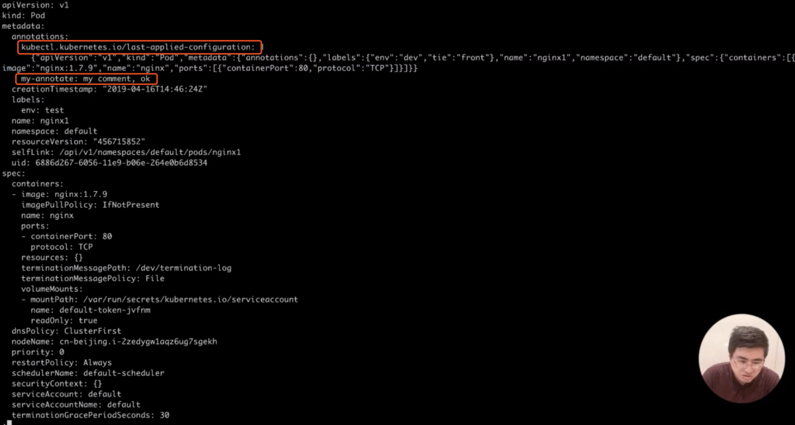
  16. 然后我们再演示一下看 Pod 的 OwnerReference 是怎么出来的。原来的 Pod 都是直接通过创建 Pod 这个资源方式来创建的，这次换一种方式来创建：通过创建一个 ReplicaSet 对象来创建 Pod 。首先创建一个 ReplicaSet 对象，这个 ReplicaSet 对象可以具体查看一下；


  * **kubectl apply -f rs.yaml**
  * **kubectl get replicasets nginx-replicasets -o yaml |less**


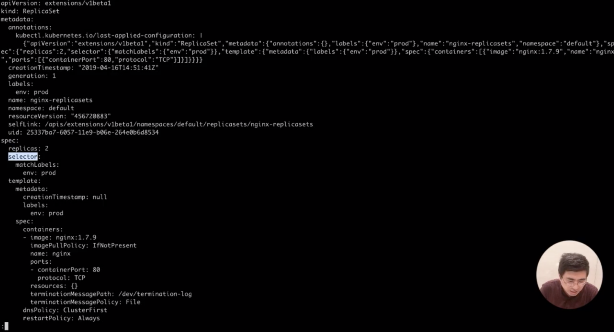
  17. 我们可以关注一下这个 ReplicaSet 里面 spec 里面，提到会创建两个 Pod，然后 selector 通过匹配部署环境是 product 生产环境的这个标签来进行匹配。所以我们可以看一下，现在集群中的 Pod 情况；


  * **kubectl get pods**


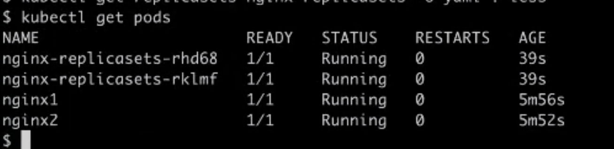
  18. 将会发现多了两个 Pod，仔细查看这两个 Pod，可以看到 ReplicaSet 创建出来的 Pod 有一个特点，即它会带有 OwnerReference，然后 OwnerReference 里面指向了是一个 replicasets 类型，名字就叫做 nginx-replicasets；


  * **kubectl get pods nginx-replicasets-rhd68 -o yaml | less**


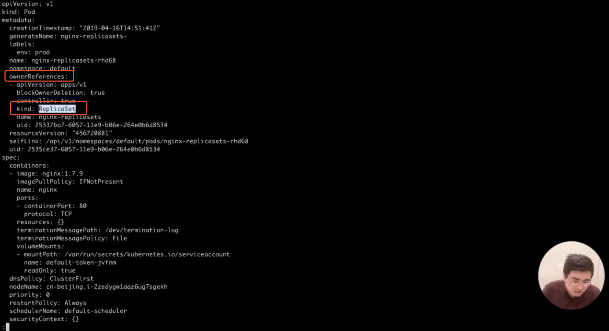
#### 三、控制器模式
##### 1、控制循环
控制型模式最核心的就是控制循环的概念。在控制循环中包括了控制器，被控制的系统，以及能够观测系统的传感器，三个逻辑组件。
当然这些组件都是逻辑的，外界通过修改资源 spec 来控制资源，控制器比较资源 spec 和 status，从而计算一个 diff，diff 最后会用来决定执行对系统进行什么样的控制操作，控制操作会使得系统产生新的输出，并被传感器以资源 status 形式上报，控制器的各个组件将都会是独立自主地运行，不断使系统向 spec 表示终态趋近。
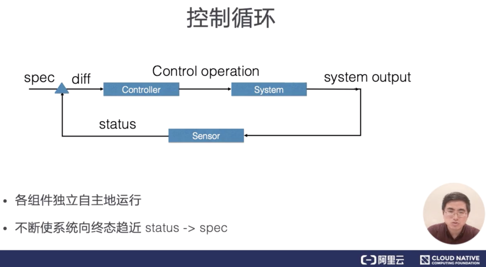
##### 2、Sensor
控制循环中逻辑的传感器主要由 Reflector、Informer、Indexer 三个组件构成。
Reflector 通过 List 和 Watch K8s server 来获取资源的数据。List 用来在 Controller 重启以及 Watch 中断的情况下，进行系统资源的全量更新；而 Watch 则在多次 List 之间进行增量的资源更新；Reflector 在获取新的资源数据后，会在 Delta 队列中塞入一个包括资源对象信息本身以及资源对象事件类型的 Delta 记录，Delta 队列中可以保证同一个对象在队列中仅有一条记录，从而避免 Reflector 重新 List 和 Watch 的时候产生重复的记录。
Informer 组件不断地从 Delta 队列中弹出 delta 记录，然后把资源对象交给 indexer，让 indexer 把资源记录在一个缓存中，缓存在默认设置下是用资源的命名空间来做索引的，并且可以被 Controller Manager 或多个 Controller 所共享。之后，再把这个事件交给事件的回调函数
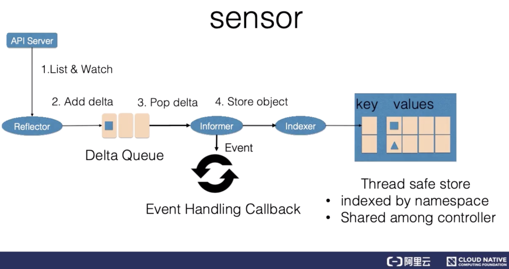
控制循环中的控制器组件主要由事件处理函数以及 worker 组成，事件处理函数之间会相互关注资源的新增、更新、删除的事件，并根据控制器的逻辑去决定是否需要处理。对需要处理的事件，会把事件关联资源的命名空间以及名字塞入一个工作队列中，并且由后续的 worker 池中的一个 Worker 来处理，工作队列会对存储的对象进行去重，从而避免多个 Woker 处理同一个资源的情况。
Worker 在处理资源对象时，一般需要用资源的名字来重新获得最新的资源数据，用来创建或者更新资源对象，或者调用其他的外部服务，Worker 如果处理失败的时候，一般情况下会把资源的名字重新加入到工作队列中，从而方便之后进行重试。
##### 3、控制循环例子-扩容
这里举一个简单的例子来说明一下控制循环的工作原理。
ReplicaSet 是一个用来描述无状态应用的扩缩容行为的资源， ReplicaSet controler 通过监听 ReplicaSet 资源来维持应用希望的状态数量，ReplicaSet 中通过 selector 来匹配所关联的 Pod，在这里考虑 ReplicaSet rsA 的，replicas 从 2 被改到 3 的场景。

首先，Reflector 会 watch 到 ReplicaSet 和 Pod 两种资源的变化，为什么我们还会 watch pod 资源的变化稍后会讲到。发现 ReplicaSet 发生变化后，在 delta 队列中塞入了对象是 rsA，而且类型是更新的记录。
Informer 一方面把新的 ReplicaSet 更新到缓存中，并与 Namespace nsA 作为索引。另外一方面，调用 Update 的回调函数，ReplicaSet 控制器发现 ReplicaSet 发生变化后会把字符串的 nsA/rsA 字符串塞入到工作队列中，工作队列后的一个 Worker 从工作队列中取到了 nsA/rsA 这个字符串的 key，并且从缓存中取到了最新的 ReplicaSet 数据。
Worker 通过比较 ReplicaSet 中 spec 和 status 里的数值，发现需要对这个 ReplicaSet 进行扩容，因此 ReplicaSet 的 Worker 创建了一个 Pod，这个 pod 中的 OwnerReference 取向了 ReplicaSet rsA。

* * *
然后 Reflector Watch 到的 Pod 新增事件，在 delta 队列中额外加入了 Add 类型的 deta 记录，一方面把新的 Pod 记录通过 Indexer 存储到了缓存中，另一方面调用了 ReplicaSet 控制器的 Add 回调函数，Add 回调函数通过检查 pod ownerReferences 找到了对应的 ReplicaSet，并把包括 ReplicaSet 命名空间和字符串塞入到了工作队列中。
ReplicaSet 的 Woker 在得到新的工作项之后，从缓存中取到了新的 ReplicaSet 记录，并得到了其所有创建的 Pod，因为 ReplicaSet 的状态不是最新的，也就是所有创建 Pod 的数量不是最新的。因此在此时 ReplicaSet 更新 status 使得 spec 和 status 达成一致。

#### 四、控制器模式总结
##### 1、两种 API 设计方法
Kubernetes 控制器模式依赖声明式的 API。另外一种常见的 API 类型是命令式 API。为什么 Kubernetes 采用声明式 API，而不是命令式 API 来设计整个控制器呢？
首先，比较两种 API 在交互行为上的差别。在生活中，常见的命令式的交互方式是家长和孩子交流方式，因为孩子欠缺目标意识，无法理解家长期望，家长往往通过一些命令，教孩子一些明确的动作，比如说：吃饭、睡觉类似的命令。我们在容器编排体系中，命令式 API 就是通过向系统发出明确的操作来执行的。
而常见的声明式交互方式，就是老板对自己员工的交流方式。老板一般不会给自己的员工下很明确的决定，实际上可能老板对于要操作的事情本身，还不如员工清楚。因此，老板通过给员工设置可量化的业务目标的方式，来发挥员工自身的主观能动性。比如说，老板会要求某个产品的市场占有率达到 80%，而不会指出要达到这个市场占有率，要做的具体操作细节。
类似的，在容器编排体系中，我们可以执行一个应用实例副本数保持在 3 个，而不用明确的去扩容 Pod 或是删除已有的 Pod，来保证副本数在三个。

##### 2、命令式 API 的问题
在理解两个交互 API 的差别后，可以分析一下命令式 API 的问题。
  * 命令 API 最大的一个问题在于错误处理；


在大规模的分布式系统中，错误是无处不在的。一旦发出的命令没有响应，调用方只能通过反复重试的方式来试图恢复错误，然而盲目的重试可能会带来更大的问题。
假设原来的命令，后台实际上已经执行完成了，重试后又多执行了一个重试的命令操作。为了避免重试的问题，系统往往还需要在执行命令前，先记录一下需要执行的命令，并且在重启等场景下，重做待执行的命令，而且在执行的过程中，还需要考虑多个命令的先后顺序、覆盖关系等等一些复杂的逻辑情况。
  * 实际上许多命令式的交互系统后台往往还会做一个巡检的系统，用来修正命令处理超时、重试等一些场景造成数据不一致的问题；


然而，因为巡检逻辑和日常操作逻辑是不一样的，往往在测试上覆盖不够，在错误处理上不够严谨，具有很大的操作风险，因此往往很多巡检系统都是人工来触发的。
  * 最后，命令式 API 在处理多并发访问时，也很容易出现问题；


假如有多方并发的对一个资源请求进行操作，并且一旦其中有操作出现了错误，就需要重试。那么最后哪一个操作生效了，就很难确认，也无法保证。很多命令式系统往往在操作前会对系统进行加锁，从而保证整个系统最后生效行为的可预见性，但是加锁行为会降低整个系统的操作执行效率。
  * 相对的，声明式 API 系统里天然地记录了系统现在和最终的状态。


不需要额外的操作数据。另外因为状态的幂等性，可以在任意时刻反复操作。在声明式系统运行的方式里，正常的操作实际上就是对资源状态的巡检，不需要额外开发巡检系统，系统的运行逻辑也能够在日常的运行中得到测试和锤炼，因此整个操作的稳定性能够得到保证。
最后，因为资源的最终状态是明确的，我们可以合并多次对状态的修改。可以不需要加锁，就支持多方的并发访问。

##### 3、控制器模式总结
最后我们总结一下：
  1. Kubernetes 所采用的控制器模式，是由声明式 API 驱动的。确切来说，是基于对 Kubernetes 资源对象的修改来驱动的；
  2. Kubernetes 资源之后，是关注该资源的控制器。这些控制器将异步的控制系统向设置的终态驱近；
  3. 这些控制器是自主运行的，使得系统的自动化和无人值守成为可能；
  4. 因为 Kubernetes 的控制器和资源都是可以自定义的，因此可以方便的扩展控制器模式。特别是对于有状态应用，我们往往通过自定义资源和控制器的方式，来自动化运维操作。这个也就是后续会介绍的 operator 的场景。


* * *
### 本节总结
本节课的主要内容就到此为止了，这里为大家简单总结一下：
  * Kubernetes 资源对象中的元数据部分，主要包括了用来识别资源的标签：Labels， 用来描述资源的注解；Annotations， 用来描述多个资源之间相互关系的 OwnerReference。这些元数据在 K8s 运行中有非常重要的作用；
  * 控制型模式中最核心的就是控制循环的概念；
  * 两种 API 设计方法：声明式 API 和命令式 API ；Kubernetes 所采用的控制器模式，是由声明式 API 驱动的；

---

<a id="lecture-06"></a>
## 第6讲｜应用编排与管理： Deployment

来源：https://edu.aliyun.com/course/314164/lesson/341312679

本文将主要分享以下四方面的内容：
  1. 需求来源；
  2. 用例解读；
  3. 操作演示以及架构设计。


#### 一、需求来源
##### 背景问题
首先，我们来看一下背景问题。如下图所示：如果我们直接管理集群中所有的 Pod，应用 A、B、C 的 Pod，其实是散乱地分布在集群中。

现在有以下的问题：
  * 首先，如何保证集群内可用 Pod 的数量？也就是说我们应用 A 四个 Pod 如果出现了一些宿主机故障，或者一些网络问题，如何能保证它可用的数量？
  * 如何为所有 Pod 更新镜像版本？我们是否要某一个 Pod 去重建新版本的 Pod？
  * 然后在更新过程中，如何保证服务的可用性？
  * 以及更新过程中，如果发现了问题，如何快速回滚到上一个版本？


##### Deployment：管理部署发布的控制器
这里就引入了我们今天课程的主题：Deployment 管理部署发布的控制器。

可以看到我们通过 Deployment 将应用 A、B、C 分别规划到不同的 Deployment 中，每个 Deployment 其实是管理的一组相同的应用 Pod，这组 Pod 我们认为它是相同的一个副本，那么 Deployment 能帮我们做什么事情呢？
  1. 首先，Deployment 定义了一种 Pod 期望数量，比如说应用 A，我们期望 Pod 数量是四个，那么这样的话，controller 就会持续维持 Pod 数量为期望的数量。当我们与 Pod 出现了网络问题或者宿主机问题的话，controller 能帮我们恢复，也就是新扩出来对应的 Pod，来保证可用的 Pod 数量与期望数量一致；


  2. 配置 Pod 发布方式，也就是说 controller 会按照用户给定的策略来更新 Pod，而且更新过程中，也可以设定不可用 Pod 数量在多少范围内；


  3. 如果更新过程中发生问题的话，即所谓“一键”回滚，也就是说你通过一条命令或者一行修改能够将 Deployment 下面所有 Pod 更新为某一个旧版本 。


#### 二、用例解读
##### Deployment 语法
下面我们用一个简单的用例来解读一下如何操作 Deployment。

上图可以看到一个最简单的 Deployment 的 yaml 文件。
“apiVersion：apps/v1”，也就是说 Deployment 当前所属的组是 apps，版本是 v1。“metadata”是我们看到的 Deployment 元信息，也就是往期回顾中的 Labels、Selector、Pod.image，这些都是在往期中提到的知识点。
Deployment 作为一个 K8s 资源，它有自己的 metadata 元信息，这里我们定义的 Deployment.name 是 nginx.Deployment。Deployment.spec 中首先要有一个核心的字段，即 replicas，这里定义期望的 Pod 数量为三个；selector 其实是 Pod 选择器，那么所有扩容出来的 Pod，它的 Labels 必须匹配 selector 层上的 image.labels，也就是 app.nginx。
就如上面的 Pod 模板 template 中所述，这个 template 它其实包含了两部分内容：
  * 一部分是我们期望 Pod 的 metadata，其中包含了 labels，即跟 selector.matchLabels 相匹配的一个 Labels；


  * 第二部分是 template 包含的一个 Pod.spec。这里 Pod.spec 其实是 Deployment 最终创建出来 Pod 的时候，它所用的 Pod.spec，这里定义了一个 container.nginx，它的镜像版本是 nginx:1.7.9。


下面是遇到的新知识点：
  * 第一个是 replicas，就是 Deployment 中期望的或者终态数量；
  * 第二个是 template，也就是 Pod 相关的一个模板。


##### 查看 Deployment 状态
当我们创建出一个 Deployment 的时候，可以通过 kubectl get deployment，看到 Deployment 总体的一个状态。如下图所示：

上图中可以看到：
  * **DESIRED** ：期望的 Pod 数量是 3 个；
  * **CURRENT** ：当前实际 Pod 数量是 3 个；
  * **UP-TO-DATE** ：其实是到达最新的期望版本的 Pod 数量；
  * **AVAILABLE** ：这个其实是运行过程中可用的 Pod 数量。后面会提到，这里 AVAILABLE 并不简单是可用的，也就是 Ready 状态的，它其实包含了一些可用超过一定时间长度的 Pod；
  * **AGE** ：deployment 创建的时长，如上图 Deployment 就是已经创建了 80 分钟。


##### 查看 Pod
最后我们可以查看一下 Pod。如下图所示：

上图中有三个 Pod，Pod 名字格式我们不难看到。
最前面一段：nginx-deployment，其实是 Pod 所属 Deployment.name；中间一段：template-hash，这里三个 Pod 是一样的，因为这三个 Pod 其实都是同一个 template 中创建出来的。
最后一段，是一个 random 的字符串，我们通过 get.pod 可以看到，Pod 的 ownerReferences 即 Pod 所属的 controller 资源，并不是 Deployment，而是一个 ReplicaSet。这个 ReplicaSet 的 name，其实是 nginx-deployment 加上 pod.template-hash，后面会提到。所有的 Pod 都是 ReplicaSet 创建出来的，而 ReplicaSet 它对应的某一个具体的 Deployment.template 版本。
##### 更新镜像
接下来我们可以看一下，如何对一个给定的 Deployment 更新它所有Pod的镜像版本呢？这里我们可以执行一个 kubectl 命令：
**kubectl set image deployment.v1.apps/nginx-deployment nginx=nginx:1.9.1**
首先 kubectl 后面有一个 set image 固定写法，这里指的是设定镜像；其次是一个 deployment.v1.apps，这里也是一个固定写法，写的是我们要操作的资源类型，deployment 是资源名、v1 是资源版本、apps 是资源组，这里也可以简写为 deployment 或者 deployment.apps，比如说写为 deployment 的时候，默认将使用 apps 组 v1 版本。
第三部分是要更新的 deployment 的 name，也就是我们的 nginx-deployment；再往后的 nginx 其实指的是 template，也就是 Pod 中的 container.name；这里我们可以注意到：一个 Pod 中，其实可能存在多个 container，而我们指定想要更新的镜像的 container.name，就是 nginx。
最后，指定我们这个容器期望更新的镜像版本，这里指的是 nginx: 1.9.1。如下图所示：当执行完这条命令之后，可以看到 deployment 中的 template.spec 已经更新为 nginx: 1.9.1。

##### 快速回滚
如果我们在发布过程中遇到了问题，也支持快速回滚。通过 kubectl 执行的话，其实是“kubectl rollout undo”这个命令，可以回滚到 Deployment 上一版本；通过“rollout undo”加上“to-revision”来指定可以回滚到某一个具体的版本。

##### DeploymeStatus
最后我们来看一下 DeploymeStatus。前面的课程我们学习到，每一个资源都有它的 spec.Status。这里可以看一下，deploymentStatus 中描述的三个其实是它的 conversion 状态，也就是 Processing、Complete 以及 Failed。

以 Processing 为例：Processing 指的是 Deployment 正在处于扩容和发布中。比如说 Processing 状态的 deployment，它所有的 replicas 及 Pod 副本全部达到最新版本，而且是 available，这样的话，就可以进入 complete 状态。而 complete 状态如果发生了一些扩缩容的话，也会进入 processing 这个处理工作状态。
如果在处理过程中遇到一些问题：比如说拉镜像失败了，或者说 readiness probe 检查失败了，就会进入 failed 状态；如果在运行过程中即 complete 状态，中间运行时发生了一些 pod readiness probe 检查失败，这个时候 deployment 也会进入 failed 状态。进入 failed 状态之后，除非所有点 replicas 均变成 available，而且是 updated 最新版本，deployment 才会重新进入 complete 状态。
#### 三、操作演示
##### Deployment 创建及状态
下面我们来进行操作演示：这里连接一个阿里云服务集群。我们可以看到当前集群已经有几个可用的 node。

首先创建对应的 deployment。可以看到 deployment 中的 desired、current、up-to-date 以及 available 已经都达到了可用的期望状态。

##### Deployment 的结构
这里看到 spec 中的 replicas 是三个，selector 以及 template labels中定义的标签都是 app：nginx，spec 中的 image 是我们期望的 nginx: 1.7.9；status 中的 available.replicas，readReplicas 以及 updatedReplicas 都是 3 个。

##### Pod 状态
我们可以再选择一个 Pod 看一下状态：
可以看到：Pod 中 ownerReferences 的功能是 ReplicaSet；pod.spec.container 里的镜像是 1.7.9。这个 Pod 已经是 Running 状态，而且它的 conditions.status 是“true”，表示它的服务已经可用了。

##### 更新升级
当前只有最新版本的 replicaset，那么现在尝试对 deployment 做一次升级。

“kubectl set image”这个操作命令，后面接 “deployment”，加 deployment.name，最后指定容器名，以及我们期望升级的镜像版本。

接下来我们看下 deployment 中的 template 中的 image 已经更新为 1.9.1。

这个时候我们再 get pod 看一下状态。

三个 pod 已经升级为新版本，pod 名字中的 pod-template-hash 也已更新。

可以看到：旧版本 replicaset 的 spec 数量以及 pod 数量是都是 0，新版本的 pod 数量是 3 个。
假设又做了一次更新，这个时候 get.pod 其实可以看到：当前的 pod 其实是有两个旧版本的处于 running，另一个旧版本是在删除中；而两个新版本的 pod，一个已经进入 running，一个还在 creating 中。
这时我们可用的 pod 数量即非删除状态的 pod 数量，其实是 4 个，已经超过了 replica 原先在 deployment 设置的数量 3 个。这个原因是我们在 deployment 中有 maxavailable 和 maxsugar 两个操作，这两个配置可以限制我们在发布过程中的一些策略。在后面架构设计中会讲到这个问题。
****
##### 历史版本保留 revisionHistoryLimit
上图看到，我们当前最新版本的 replicaset 是 3 个 pod，另外还有两个历史版本的 replicaset，那么会不会存在一种情况：就是随着 deployment 持续的更新，这个旧版本的 replicaset 会越积越多呢？其实 deployment 提供了一个机制来避免这个问题：在 deployment spec 中，有一个 revisionHistoryLimit，它的默认值为 10，它其实保证了保留历史版本的 replicaset 的数量，我们尝试把它改为 1。


由上面第二张图，可以看到两个 replicaset，也就是说，除了当前版本的 replicaset 之外，旧版本的 replicaset 其实只保留了一个。
##### 回滚
最后再尝试做一下回滚。首先再来看一下 replicaset，这时发现旧版本的 replicaset 数量从 0 个增到 2 个，而新版本的 replicaset 数量从 3 个削减为 1 个，表示它已经开始在做回滚的操作。然后再观察一下， 旧版本的数量已经是 3 个，即已经回滚成功，而新版本的 pod 数量变为 0 个。

我们最后再 get pod 看一下：

这时，3 个 pod.template-hash 已经更新为旧版本的 hash，但其实这 3 个 pod 都是重新创建出来的，而并非我们在前一版本中创建的 3 个 pod。换句话说，也就是我们回滚的时候，其实是创建了 3 个旧版本的 pod，而并非把先前的 3 个 pod 找回来。
#### 四、架构设计
##### 管理模式
****
我们来看一下架构设计。首先简单看一下管理模式：Deployment 只负责管理不同版本的 ReplicaSet，由 ReplicaSet 来管理具体的 Pod 副本数，每个 ReplicaSet 对应 Deployment template 的一个版本。在上文的例子中可以看到，每一次修改 template，都会生成一个新的 ReplicaSet，这个 ReplicaSet 底下的 Pod 其实都是相同的版本。
如上图所示：Deployment 创建 ReplicaSet，而 ReplicaSet 创建 Pod。他们的 OwnerRef 其实都对应了其控制器的资源。
##### Deployment 控制器
我们先简单看一下控制器实现原理。
首先，我们所有的控制器都是通过 Informer 中的 Event 做一些 Handler 和 Watch。这个地方 Deployment 控制器，其实是关注 Deployment 和 ReplicaSet 中的 event，收到事件后会加入到队列中。而 Deployment controller 从队列中取出来之后，它的逻辑会判断 Check Paused，这个 Paused 其实是 Deployment 是否需要新的发布，如果 Paused 设置为 true 的话，就表示这个 Deployment 只会做一个数量上的维持，不会做新的发布。

如上图，可以看到如果 Check paused 为 Yes 也就是 true 的话，那么只会做 Sync replicas。也就是说把 replicas sync 同步到对应的 ReplicaSet 中，最后再 Update Deployment status，那么 controller 这一次的 ReplicaSet 就结束了。
那么如果 paused 为 false 的话，它就会做 Rollout，也就是通过 Create 或者是 Rolling 的方式来做更新，更新的方式其实也是通过 Create/Update/Delete 这种 ReplicaSet 来做实现的。
##### ReplicaSet 控制器

当 Deployment 分配 ReplicaSet 之后，ReplicaSet 控制器本身也是从 Informer 中 watch 一些事件，这些事件包含了 ReplicaSet 和 Pod 的事件。从队列中取出之后，ReplicaSet controller 的逻辑很简单，就只管理副本数。也就是说如果 controller 发现 replicas 比 Pod 数量大的话，就会扩容，而如果发现实际数量超过期望数量的话，就会删除 Pod。
上面 Deployment 控制器的图中可以看到，Deployment 控制器其实做了更复杂的事情，包含了版本管理，而它把每一个版本下的数量维持工作交给 ReplicaSet 来做。
##### 扩/缩容模拟
下面来看一些操作模拟，比如说扩容模拟。这里有一个 Deployment，它的副本数是 2，对应的 ReplicaSet 有 Pod1 和 Pod2。这时如果我们修改 Deployment replicas， controller 就会把 replicas 同步到当前版本的 ReplicaSet 中，这个 ReplicaSet 发现当前有 2 个 Pod，不满足当前期望 3 个，就会创建一个新的 Pod3。

##### 发布模拟
我们再模拟一下发布，发布的情况会稍微复杂一点。这里可以看到 Deployment 当前初始的 template，比如说 template1 这个版本。template1 这个 ReplicaSet 对应的版本下有三个 Pod：Pod1，Pod2，Pod3。
这时修改 template 中一个容器的 image， Deployment controller 就会新建一个对应 template2 的 ReplicaSet。创建出来之后 ReplicaSet 会逐渐修改两个 ReplicaSet 的数量，比如它会逐渐增加 ReplicaSet2 中 replicas 的期望数量，而逐渐减少 ReplicaSet1 中的 Pod 数量。
那么最终达到的效果是：新版本的 Pod 为 Pod4、Pod5和Pod6，旧版本的 Pod 已经被删除了，这里就完成了一次发布。

##### 回滚模拟
来看一下回滚模拟，根据上面的发布模拟可以知道 Pod4、Pod5、Pod6 已经发布完成。这时发现当前的业务版本是有问题的，如果做回滚的话，不管是通过 rollout 命令还是通过回滚修改 template，它其实都是把 template 回滚为旧版本的 template1。
这个时候 Deployment 会重新修改 ReplicaSet1 中 Pod 的期望数量，把期望数量修改为 3 个，且会逐渐减少新版本也就是 ReplicaSet2 中的 replica 数量，最终的效果就是把 Pod 从旧版本重新创建出来。

发布模拟的图中可以看到，其实初始版本中 Pod1、Pod2、Pod3 是旧版本，而回滚之后其实是 Pod7、Pod8、Pod9。就是说它的回滚并不是把之前的 Pod 重新找出来，而是说重新创建出符合旧版本 template 的 Pod。
##### spec 字段解析
最后再来简单看一些 Deployment 中的字段解析。首先看一下 Deployment 中其他的 spec 字段：
  * MinReadySeconds：Deployment 会根据 Pod ready 来看 Pod 是否可用，但是如果我们设置了 MinReadySeconds 之后，比如设置为 30 秒，那 Deployment 就一定会等到 Pod ready 超过 30 秒之后才认为 Pod 是 available 的。Pod available 的前提条件是 Pod ready，但是 ready 的 Pod 不一定是 available 的，它一定要超过 MinReadySeconds 之后，才会判断为 available；


  * revisionHistoryLimit：保留历史 revision，即保留历史 ReplicaSet 的数量，默认值为 10 个。这里可以设置为一个或两个，如果回滚可能性比较大的话，可以设置数量超过 10；


  * paused：paused 是标识，Deployment 只做数量维持，不做新的发布，这里在 Debug 场景可能会用到；


  * progressDeadlineSeconds：前面提到当 Deployment 处于扩容或者发布状态时，它的 condition 会处于一个 processing 的状态，processing 可以设置一个超时时间。如果超过超时时间还处于 processing，那么 controller 将认为这个 Pod 会进入 failed 的状态。


##### 升级策略字段解析
最后来看一下升级策略字段解析。
Deployment 在 RollingUpdate 中主要提供了两个策略，一个是 MaxUnavailable，另一个是 MaxSurge。这两个字段解析的意思，可以看下图中详细的 comment，或者简单解释一下：
  * MaxUnavailable：滚动过程中最多有多少个 Pod 不可用；
  * MaxSurge：滚动过程中最多存在多少个 Pod 超过预期 replicas 数量。


上文提到，ReplicaSet 为 3 的 Deployment 在发布的时候可能存在一种情况：新版本的 ReplicaSet 和旧版本的 ReplicaSet 都可能有两个 replicas，加在一起就是 4 个，超过了我们期望的数量三个。这是因为我们默认的 MaxUnavailable 和 MaxSurge 都是 25%，默认 Deployment 在发布的过程中，可能有 25% 的 replica 是不可用的，也可能超过 replica 数量 25% 是可用的，最高可以达到 125% 的 replica 数量。
这里其实可以根据用户实际场景来做设置。比如当用户的资源足够，且更注重发布过程中的可用性，可设置 MaxUnavailable 较小、MaxSurge 较大。但如果用户的资源比较紧张，可以设置 MaxSurge 较小，甚至设置为 0，这里要注意的是 MaxSurge 和 MaxUnavailable 不能同时为 0。
理由不难理解，当 MaxSurge 为 0 的时候，必须要删除 Pod，才能扩容 Pod；如果不删除 Pod 是不能新扩 Pod 的，因为新扩出来的话，总共的 Pod 数量就会超过期望数量。而两者同时为 0 的话，MaxSurge 保证不能新扩 Pod，而 MaxUnavailable 不能保证 ReplicaSet 中有 Pod 是 available 的，这样就会产生问题。所以说这两个值不能同时为 0。用户可以根据自己的实际场景来设置对应的、合适的值。

### 本节总结
本节课的主要内容就到此为止了，这里为大家简单总结一下。
  * Deployment 是 Kubernetes 中常见的一种 Workload，支持部署管理多版本的 Pod；
  * Deployment 管理多版本的方式，是针对每个版本的 template 创建一个 ReplicaSet，由 ReplicaSet 维护一定数量的 Pod 副本，而 Deployment 只需要关心不同版本的 ReplicaSet 里要指定多少数量的 Pod；
  * 因此，Deployment 发布部署的根本原理，就是 Deployment 调整不同版本 ReplicaSet 里的终态副本数，以此来达到多版本 Pod 的升级和回滚。

---

<a id="lecture-07"></a>
## 第7讲｜应用编排与管理：Job 和 DaemonSet

来源：https://edu.aliyun.com/course/314164/lesson/341312790

本文将主要分享以下两方面的内容：
  1. Job & CronJobs 基础操作与概念解析；
  2. DaemonSet 基础操作与概念解析。


#### 一、Job
##### 需求来源
###### Job 背景问题
首先我们来看一下 Job 的需求来源。我们知道 K8s 里面，最小的调度单元是 Pod，我们可以直接通过 Pod 来运行任务进程。这样做将会产生以下几种问题：
  * 我们如何保证 Pod 内进程正确的结束？
  * 如何保证进程运行失败后重试？
  * 如何管理多个任务，且任务之间有依赖关系？
  * 如何并行地运行任务，并管理任务的队列大小？


###### Job：管理任务的控制器
我们来看一下 Kubernetes 的 Job 为我们提供了什么功能：
  * 首先 kubernetes 的 Job 是一个管理任务的控制器，它可以创建一个或多个 Pod 来指定 Pod 的数量，并可以监控它是否成功地运行或终止；
  * 我们可以根据 Pod 的状态来给 Job 设置重置的方式及重试的次数；
  * 我们还可以根据依赖关系，保证上一个任务运行完成之后再运行下一个任务；
  * 同时还可以控制任务的并行度，根据并行度来确保 Pod 运行过程中的并行次数和总体完成大小。


##### 用例解读
我们根据一个实例来看一下Job是如何来完成下面的应用的。
###### Job 语法

上图是 Job 最简单的一个 yaml 格式，这里主要新引入了一个 kind 叫 Job，这个 Job 其实就是 job-controller 里面的一种类型。 然后 metadata 里面的 name 来指定这个 Job 的名称，下面 spec.template 里面其实就是 pod 的 spec。
这里面的内容都是一样的，唯一多了两个点：
  * 第一个是 restartPolicy，在 Job 里面我们可以设置 Never、OnFailure、Always 这三种重试策略。在希望 Job 需要重新运行的时候，我们可以用 Never；希望在失败的时候再运行，再重试可以用 OnFailure；或者不论什么情况下都重新运行时 Alway；
  * 另外，Job 在运行的时候不可能去无限的重试，所以我们需要一个参数来控制重试的次数。这个 backoffLimit 就是来保证一个 Job 到底能重试多少次。


所以在 Job 里面，我们主要重点关注的一个是 **restartPolicy 重启策略** 和 **backoffLimit 重试次数限制** 。
###### Job 状态

Job 创建完成之后，我们就可以通过 kubectl get jobs 这个命令，来查看当前 job 的运行状态。得到的值里面，基本就有 Job 的名称、当前完成了多少个 Pod，进行多长时间。
**AGE** 的含义是指这个 Pod 从当前时间算起，减去它当时创建的时间。这个时长主要用来告诉你 Pod 的历史、Pod 距今创建了多长时间。**DURATION** 主要来看我们 Job 里面的实际业务到底运行了多长时间，当我们的性能调优的时候，这个参数会非常的有用。**COMPLETIONS** 主要来看我们任务里面这个 Pod 一共有几个，然后它其中完成了多少个状态，会在这个字段里面做显示。
###### 查看 Pod
下面我们来看一下 Pod，其实 Job 最后的执行单元还是 Pod。我们刚才创建的 Job 会创建出来一个叫“pi”的一个 Pod，这个任务就是来计算这个圆周率，Pod 的名称会以“${job-name}-${random-suffix}”，我们可以看一下下面 Pod 的 yaml 格式。

它比普通的 Pod 多了一个叫 **ownerReferences** ，这个东西来声明此 pod 是归哪个上一层 controller 来管理。可以看到这里的 ownerReferences 是归 batch/v1，也就是上一个 Job 来管理的。这里就声明了它的 controller 是谁，然后可以通过 pod 返查到它的控制器是谁，同时也能根据 Job 来查一下它下属有哪些 Pod。
###### 并行运行 Job
我们有时候有些需求：希望 Job 运行的时候可以最大化的并行，并行出 n 个 Pod 去快速地执行。同时，由于我们的节点数有限制，可能也不希望同时并行的 Pod 数过多，有那么一个管道的概念，我们可以希望最大的并行度是多少，Job 控制器都可以帮我们来做到。
这里主要看两个参数：**一个是 completions，一个是 parallelism。**
  * 首先第一个参数是用来指定本 Pod 队列执行次数。可能这个不是很好理解，其实可以把它认为是这个 Job 指定的可以运行的总次数。比如这里设置成 8，即这个任务一共会被执行 8 次；
  * 第二个参数代表这个并行执行的个数。所谓并行执行的次数，其实就是一个管道或者缓冲器中缓冲队列的大小，把它设置成 2，也就是说这个 Job 一定要执行 8 次，每次并行 2 个 Pod，这样的话，一共会执行 4 个批次。


###### 查看并行 Job 运行

下面来看一下它的实际运行效果，上图就是当这个 Job 整体运行完毕之后可以看到的效果，首先看到 job 的名字，然后看到它一共创建出来了 8 个 pod，执行了 2 分 23 秒，这是创建的时间。
接着来看真正的 pods，pods 总共出来了 8 个 pod，每个 pod 的状态都是完成的，然后来看一下它的 AGE，就是时间。从下往上看，可以看到分别有 73s、40s、110s 和 2m26s。每一组都有两个 pod 时间是相同的，即：时间段是 40s 的时候是最后一个创建、 2m26s 是第一个创建的。也就是说，总是两个 pod 同时创建出来，并行完毕、消失，然后再创建、再运行、再完毕。
比如说，刚刚我们其实通过第二个参数来控制了当前 Job 并行执行的次数，这里就可以了解到这个缓冲器或者说管道队列大小的作用。
###### Cronjob 语法

下面来介绍另外一个 Job，叫做 CronJob，其实也可以叫定时运行 Job。CronJob 其实和 Job 大体是相似的，唯一的不同点就是它可以设计一个时间。比如说可以定时在几点几分执行，特别适合晚上做一些清理任务，还有可以几分钟执行一次，几小时执行一次等等，这就叫定时任务。
定时任务和 Job 相比会多几个不同的字段：
  * **schedule** ：schedule 这个字段主要是设置时间格式，它的时间格式和 Linux 的 crontime 是一样的，所以直接根据 Linux 的 crontime 书写格式来书写就可以了。举个例子： */1 指每分钟去执行一下 Job，这个 Job 需要做的事情就是打印出大约时间，然后打印出“Hello from the kubernetes cluster” 这一句话；


  * **startingDeadlineSeconds：** 即：每次运行 Job 的时候，它最长可以等多长时间，有时这个 Job 可能运行很长时间也不会启动。所以这时，如果超过较长时间的话，CronJob 就会停止这个 Job；


  * **concurrencyPolicy** ：就是说是否允许并行运行。所谓的并行运行就是，比如说我每分钟执行一次，但是这个 Job 可能运行的时间特别长，假如两分钟才能运行成功，也就是第二个 Job 要到时间需要去运行的时候，上一个 Job 还没完成。如果这个 policy 设置为 true 的话，那么不管你前面的 Job 是否运行完成，每分钟都会去执行；如果是 false，它就会等上一个 Job 运行完成之后才会运行下一个；


  * **JobsHistoryLimit：** 这个就是每一次 CronJob 运行完之后，它都会遗留上一个 Job 的运行历史、查看时间。当然这个额不能是无限的，所以需要设置一下历史存留数，一般可以设置默认 10 个或 100 个都可以，这主要取决于每个人集群不同，然后根据每个人的集群数来确定这个时间。


##### 操作演示
###### Job 的编排文件
下面看一下具体如何使用 Job。

###### Job 的创建及运行验证
首先看一下 job.yaml。这是一个非常简单的计算 pi 的一个任务。使用 kubectl creat-f job.yaml，这样 job 就能提交成功了。来看一下 kubectl.get.jobs，可以看到这个 job 正在运行；get pods 可以看到这个 pod 应该是运行完成了，那么接下来 logs 一下这个 job 以及 pod。可以看到下图里面打印出来了圆周率。

###### 并行 Job 的编排文件
下面再来看第二个例子：

###### 并行 Job 的创建及运行验证
这个例子就是指刚才的并行运行 Job 创建之后，可以看到有第二个并行的 Job。

现在已经有两个 Pod 正在 running，可以看到它大概执行了快到 30s

30s 之后它应该会起第二个。

第一批的 pod 已经执行完毕，第二批的 pod 正在 running，每批次分别是两个Pod。也就是说后面每隔 40s 左右，就会有两个 pod 在并行执行，它一共会执行 4 批，共 8 个 pod，等到所有的 pod 执行完毕，就是刚才所说的并行执行的缓冲队列功能。
过一段时间再看这个 pods，可以发现第二批已经执行结束，接下来开始创建第三批······

###### Cronjob 的编排文件
下面来看第三个例子 —— CronJob。 CronJob 是每分钟执行一次，每次一个 job。

###### Cronjob 的创建及运行验证
如下图 CronJob 已经创建了，可以通过 get cronjob 来看到当前有一个 CronJob，这个时候再来看 jobs，由于它是每分钟执行一次，所以得稍微等一下。

同时可以看到，上一个 job 还在运行，它的时间是 2m12s 左右，它的完成度是 7/8、6/8，刚刚看到 7/8 到 8/8，也就是说我们上一个任务执行了最后一步，而且每次都是两个两个地去运行。每次两个运行的 job 都会让我们在运行一些大型工作流或者工作任务的时候感到特别的方便。

上图中可以看到突然出现了一个 job，“hello-xxxx”这个 job 就是刚才所说的 CronJob。它距离刚才 CronJob 提交已经过去 1 分钟了，这样就会自动创建出来一个 job，如果不去干扰它的话，它以后大概每一分钟都会创建出来这么一个 job，除非等我们什么时候指定它不可以再运行的时候它才会停止创建。
在这里 CronJob 其实主要是用来运作一些清理任务或者说执行一些定时任务。比如说 Jenkins 构建等方面的一些任务，会特别有效。
##### 架构设计
###### Job 管理模式

我们来看一下 job 的架构设计。Job Controller 其实还是主要去创建相对应的 pod，然后 Job Controller 会去跟踪 Job 的状态，及时地根据我们提交的一些配置重试或者继续创建。同时我们刚刚也提到，每个 pod 会有它对应的 label，来跟踪它所属的 Job Controller，并且还去配置并行的创建， 并行或者串行地去创建 pod。
###### Job 控制器

上图是一个 Job 控制器的主要流程。所有的 job 都是一个 controller，它会 watch 这个 API Server，我们每次提交一个 Job 的 yaml 都会经过 api-server 传到 ETCD 里面去，然后 Job Controller 会注册几个 Handler，每当有添加、更新、删除等操作的时候，它会通过一个内存级的消息队列，发到 controller 里面。
通过 Job Controller 检查当前是否有运行的 pod，如果没有的话，通过 Scale up 把这个 pod 创建出来；如果有的话，或者如果大于这个数，对它进行 Scale down，如果这时 pod 发生了变化，需要及时 Update 它的状态。
同时要去检查它是否是并行的 job，或者是串行的 job，根据设置的配置并行度、串行度，及时地把 pod 的数量给创建出来。最后，它会把 job 的整个的状态更新到 API Server 里面去，这样我们就能看到呈现出来的最终效果了。
#### 二、DaemonSet
##### 需求来源
###### DaemonSet 背景问题
下面介绍第二个控制器：**DaemonSet。** 同样的问题：如果我们没有 DaemonSet 会怎么样？下面有几个需求：
  * 首先如果希望每个节点都运行同样一个 pod 怎么办？
  * 如果新节点加入集群的时候，想要立刻感知到它，然后去部署一个 pod，帮助我们初始化一些东西，这个需求如何做？
  * 如果有节点退出的时候，希望对应的 pod 会被删除掉，应该怎么操作？
  * 如果 pod 状态异常的时候，我们需要及时地监控这个节点异常，然后做一些监控或者汇报的一些动作，那么这些东西运用什么控制器来做？


###### DaemonSet：守护进程控制器
DaemonSet 也是 Kubernetes 提供的一个 default controller，它实际是做一个守护进程的控制器，它能帮我们做到以下几件事情：
  * 首先能保证集群内的每一个节点都运行一组相同的 pod；
  * 同时还能根据节点的状态保证新加入的节点自动创建对应的 pod；
  * 在移除节点的时候，能删除对应的 pod；
  * 而且它会跟踪每个 pod 的状态，当这个 pod 出现异常、Crash 掉了，会及时地去 recovery 这个状态。


##### 用例解读
###### DaemonSet 语法
下面举个例子来看一下，DaemonSet.yaml 会稍微长一些。

首先是 kind:DaemonSet。如果前面学过 deployment 后，其实我们再看这个 yaml 会比较简单。例如它会有 matchLabel，通过 matchLabel 去管理对应所属的 pod，这个 pod.label 也要和这个 DaemonSet.controller.label 想匹配，它才能去根据 label.selector 去找到对应的管理 Pod。下面 spec.container 里面的东西都是一致的。
这里用 fluentd 来做例子。DaemonSet 最常用的点在于以下几点内容：
  * 首先是存储，GlusterFS 或者 Ceph 之类的东西，需要每台节点上都运行一个类似于 Agent 的东西，DaemonSet 就能很好地满足这个诉求；


  * 另外，对于日志收集，比如说 logstash 或者 fluentd，这些都是同样的需求，需要每台节点都运行一个 Agent，这样的话，我们可以很容易搜集到它的状态，把各个节点里面的信息及时地汇报到上面；


  * 还有一个就是，需要每个节点去运行一些监控的事情，也需要每个节点去运行同样的事情，比如说 Promethues 这些东西，也需要 DaemonSet 的支持。


###### 查看 DaemonSet 状态

创建完 DaemonSet 之后，我们可以使用 kubectl get DaemonSet（DaemonSet 缩写为 ds）。可以看到 DaemonSet 返回值和 deployment 特别像，即它当前一共有正在运行的几个，然后我们需要几个，READY 了几个。当然这里面，READY 都是只有 Pod，所以它最后创建出来所有的都是 pod。
这里有几个参数，分别是：需要的 pod 个数、当前已经创建的 pod 个数、就绪的个数，以及所有可用的、通过健康检查的 pod；还有 NODE SELECTOR，因为 NODE SELECTOR 在 DaemonSet 里面非常有用。有时候我们可能希望只有部分节点去运行这个 pod 而不是所有的节点，所以有些节点上被打了标的话，DaemonSet 就只运行在这些节点上。比如，我只希望 master 节点运行某些 pod，或者只希望 Worker 节点运行某些 pod，就可以使用这个 NODE SELECTOR。
###### 更新 DaemonSet

其实 DaemonSet 和 deployment 特别像，它也有两种更新策略：一个是 **RollingUpdate** ，另一个是 **OnDelete** 。
  * RollingUpdate 其实比较好理解，就是会一个一个的更新。先更新第一个 pod，然后老的 pod 被移除，通过健康检查之后再去见第二个 pod，这样对于业务上来说会比较平滑地升级，不会中断；


  * OnDelete 其实也是一个很好的更新策略，就是模板更新之后，pod 不会有任何变化，需要我们手动控制。我们去删除某一个节点对应的 pod，它就会重建，不删除的话它就不会重建，这样的话对于一些我们需要手动控制的特殊需求也会有特别好的作用。


##### 操作演示
###### DaemonSet 的编排
下面举一个例子。比如说我们去改了些 DaemonSet 的镜像，然后看到了它的状态，它就会去一个一个地更新。

上图这个就是刚才 DaemonSet 的 yaml，会比刚才会多一些， 我们做一些资源的限制，这个都不影响。
###### DaemonSet 的创建与运行验证
下面我们创建一下 DaemonSet ，然后再看一下它的状态。下图就是我们刚才看到的 DaemonSet 在 ready 里打出来的状态。

从下图中可以看到，一共有 4 个 pod 被创建出来。为什么是 4 个 pod呢？因为只有 4 个节点，所以每个节点上都会运行一个对应的 pod。

###### DaemonSet 的更新
这时，我们来更新 DaemonSet， 执行完了kubectl apply -f 后，它的 DaemonSet 就已经更新了。接下来我们去查看 DaemonSet 的更新状态。

上图中可以看到：DaemonSet 默认这个是 RollingUpdate 的，我们看到是 0-4，现在是 1-4，也就是说它在更新第一个，第一个更新完成会去更新第二个，第二个更新完，就更新第三个······这个就是 RollingUpdate。RollingUpdate 可以做到全自动化的更新，不用有人值守，而是一个一个地去自动更新，更新的过程也比较平滑，这样可以有利于我们在现场发布或者做一些其他操作。
上图结尾处可以看到，整个的 DaemonSet 已经 RollingUpdate 完毕。
##### 架构设计
###### DaemonSet 管理模式

接下来看一下 DaemonSet 架构设计。DaemonSet 还是一个 controller，它最后真正的业务单元也是 Pod，DaemonSet 其实和 Job controller 特别相似，它也是通过 controller 去 watch API Server 的状态，然后及时地添加 pod。唯一不同的是，它会监控节点的状态，节点新加入或者消失的时候会在节点上创建对应的 pod，然后同时根据你配置的一些 affinity 或者 label 去选择对应的节点。
###### DaemonSet 控制器

最后我们来看一下 DaemonSet 的控制器，DaemonSet 其实和 Job controller 做的差不多：两者都需要根据 watch 这个 API Server 的状态。现在 DaemonSet 和 Job controller 唯一的不同点在于，DaemonsetSet Controller需要去 watch node 的状态，但其实这个 node 的状态还是通过 API Server 传递到 ETCD 上。
当有 node 状态节点发生变化时，它会通过一个内存消息队列发进来，然后DaemonSet controller 会去 watch 这个状态，看一下各个节点上是都有对应的 Pod，如果没有的话就去创建。当然它会去做一个对比，如果有的话，它会比较一下版本，然后加上刚才提到的是否去做 RollingUpdate？如果没有的话就会重新创建，Ondelete 删除 pod 的时候也会去做 check 它做一遍检查，是否去更新，或者去创建对应的 pod。
当然最后的时候，如果全部更新完了之后，它会把整个 DaemonSet 的状态去更新到 API Server 上，完成最后全部的更新。
#### 结束语
我们本期的所有的讲解都已经完毕，请大家后面再去看一下课后的习题和实验！
### 本节总结
  * Job & CronJobs 基础操作与概念解析：本节详细介绍了 Job 和 CronJob 的概念，并通过两个实际的例子介绍了 Job 和 CronJob 的使用，对于 Job 和 CronJob 内的各种功能便签都进行了详细的演示；
  * DaemonSet 基础操作与概念解析：通过类比 Deployment 控制器，我们理解了一下 DaemonSet 控制器的工作流程与方式，并且通过对 DaemonSet 的更新了解了滚动更新的概念和相对应的操作方式。

---

<a id="lecture-08"></a>
## 第8讲｜应用配置管理

来源：https://edu.aliyun.com/course/314164/lesson/341312974

**本节课程要点**
  1. ConfigMaps 和 Secret 资源的创建和使用；
  2. Pod 身份认证的实现和原理；
  3. 容器资源、安全、前置校验等配置和使用。


细分为以下八个方面：

#### 一、需求来源
##### 背景问题
首先一起来看一下需求来源。大家应该都有过这样的经验，就是用一个容器镜像来启动一个 container。要启动这个容器，其实有很多需要配套的问题待解决：
  * 第一，比如说一些可变的配置。因为我们不可能把一些可变的配置写到镜像里面，当这个配置需要变化的时候，可能需要我们重新编译一次镜像，这个肯定是不能接受的；
  * 第二就是一些敏感信息的存储和使用。比如说应用需要使用一些密码，或者用一些 token；
  * 第三就是我们容器要访问集群自身。比如我要访问 kube-apiserver，那么本身就有一个身份认证的问题；
  * 第四就是容器在节点上运行之后，它的资源需求；
  * 第五个就是容器在节点上，它们是共享内核的，那么它的一个安全管控怎么办？
  * 最后一点我们说一下容器启动之前的一个前置条件检验。比如说，一个容器启动之前，我可能要确认一下 DNS 服务是不是好用？又或者确认一下网络是不是联通的？那么这些其实就是一些前置的校验。


##### Pod 的配置管理
在 Kubernetes 里面，它是怎么做这些配置管理的呢？如下图所示：

  * 可变配置就用 ConfigMap；
  * 敏感信息是用 Secret；
  * 身份认证是用 ServiceAccount 这几个独立的资源来实现的；
  * 资源配置是用 Resources；
  * 安全管控是用 SecurityContext；
  * 前置校验是用 InitContainers 这几个在 spec 里面加的字段，来实现的这些配置管理。


#### 二、ConfigMap
##### ConfigMap 介绍
下面我们来介绍第一个部分，就是 ConfigMap。我们先来介绍 ConfigMap 它是用来做什么的、以及它带来的一个好处。它其实主要是管理一些可变配置信息，比如说我们应用的一些配置文件，或者说它里面的一些环境变量，或者一些命令行参数。
它的好处在于它可以让一些可变配置和容器镜像进行解耦，这样也保证了容器的可移植性。看一下下图中右边的编排文件截图。

这是 ConfigMap 本身的一个定义，它包括两个部分：一个是 ConfigMap 元信息，我们关注 name 和 namespace 这两个信息。接下来这个 data 里面，可以看到它管理了两个配置文件。它的结构其实是这样的：从名字看ConfigMap中包含Map单词，Map 其实就是 key:value，key 是一个文件名，value 是这个文件的内容。
##### ConfigMap 创建
看过介绍之后，再具体看一下它是怎么创建的。我们推荐用 kubectl 这个命令来创建，它带的参数主要有两个：一个是指定 name，第二个是 DATA。其中 DATA 可以通过指定文件或者指定目录，以及直接指定键值对，下面可以看一下这个例子。

指定文件的话，文件名就是 Map 中的 key，文件内容就是 Map 中的 value。然后指定键值对就是指定数据键值对，即：key:value 形式，直接映射到 Map 的key:value。
##### ConfigMap 使用
创建完了之后，应该怎么使用呢？

如上图所示，主要是在 pod 里来使用 ConfigMap：
  * 第一种是环境变量。环境变量的话通过 valueFrom，然后 ConfigMapKeyRef 这个字段，下面的 name 是指定 ConfigMap 名，key 是 ConfigMap.data 里面的 key。这样的话，在 busybox 容器启动后容器中执行 env 将看到一个 SPECIAL_LEVEL_KEY 环境变量；
  * 第二个是命令行参数。命令行参数其实是第一行的环境变量直接拿到 cmd 这个字段里面来用；
  * 最后一个是通过 volume 挂载的方式直接挂到容器的某一个目录下面去。上面的例子是把 special-config 这个 ConfigMap 里面的内容挂到容器里面的 /etc/config 目录下，这个也是使用的一种方式。


##### ConfigMap 注意要点
现在对 ConfigMap 的使用做一个总结，以及它的一些注意点，注意点一共列了以下五条：
  1. ConfigMap 文件的大小。虽然说 ConfigMap 文件没有大小限制，但是在 ETCD 里面，数据的写入是有大小限制的，现在是限制在 1MB 以内；
  2. 第二个注意点是 pod 引入 ConfigMap 的时候，必须是相同的 Namespace 中的 ConfigMap，前面其实可以看到，ConfigMap.metadata 里面是有 namespace 字段的；
  3. 第三个是 pod 引用的 ConfigMap。假如这个 ConfigMap 不存在，那么这个 pod 是无法创建成功的，其实这也表示在创建 pod 前，必须先把要引用的 ConfigMap 创建好；
  4. 第四点就是使用 envFrom 的方式。把 ConfigMap 里面所有的信息导入成环境变量时，如果 ConfigMap 里有些 key 是无效的，比如 key 的名字里面带有数字，那么这个环境变量其实是不会注入容器的，它会被忽略。但是这个 pod 本身是可以创建的。这个和第三点是不一样的方式，是 ConfigMap 文件存在基础上，整体导入成环境变量的一种形式；
  5. 最后一点是：什么样的 pod 才能使用 ConfigMap？这里只有通过 K8s api 创建的 pod 才能使用 ConfigMap，比如说通过用命令行 kubectl 来创建的 pod，肯定是可以使用 ConfigMap 的，但其他方式创建的 pod，比如说 kubelet 通过 manifest 创建的 static pod，它是不能使用 ConfigMap 的。


#### 三、Secret
##### Secret 介绍
现在我们讲一下 Secret，Secret 是一个主要用来存储密码 token 等一些敏感信息的资源对象。其中，敏感信息是采用 base-64 编码保存起来的，我们来看下图中 Secret 数据的定义。

元数据的话，里面主要是 name、namespace 两个字段；接下来是 type，它是非常重要的一个字段，是指 Secret 的一个类型。Secret 类型种类比较多，下面列了常用的四种类型：
  * 第一种是 Opaque，它是普通的 Secret 文件；
  * 第二种是 service-account-token，是用于 service-account 身份认证用的 Secret； 
  * 第三种是 dockerconfigjson，这是拉取私有仓库镜像的用的一种 Secret；
  * 第四种是 bootstrap.token，是用于节点接入集群校验用的 Secret。


再接下来是 data，是存储的 Secret 的数据，它也是 key-value 的形式存储的。
##### Secret 创建
接下来我们看一下 Secret 的创建。

如上图所示，有两种创建方式：
  * 系统创建：比如 K8s 为每一个 namespace 的默认用户（default ServiceAccount）创建 Secret；


  * 用户手动创建：手动创建命令，推荐 kubectl 这个命令行工具，它相对 ConfigMap 会多一个 type 参数。其中 data 也是一样，它也是可以指定文件和键值对的。type 的话，要是你不指定的话，默认是 Opaque 类型。


上图中两个例子。第一个是通过指定文件，创建了一个拉取私有仓库镜像的 Secret，指定的文件是 /root/.docker/config.json。type 的话指定的是 dockerconfigjson，另外一个我们指定键值对，我们 type 没有指定，默认是 Opaque。键值对是 key:value 的形式，其中对 value 内容进行 base64 加密。创建 Secret 就是这么一个情况。
##### Secret 使用
创建完 Secret 之后，再来看一下如何使用它。它主要是被 pod 来使用，一般是通过 volume 形式挂载到容器里指定的目录，然后容器里的业务进程再到目录下读取 Secret 来进行使用。另外在需要访问私有镜像仓库时，也是通过引用 Secret 来实现。

我们先来看一下挂载到用户指定目录的方式：
  * 第一种方式：如上图左侧所示，用户直接指定，把 mysecret 挂载到容器 /etc/foo 目录下面；
  * 第二种方式：如上图右侧所示，系统自动生成，把 serviceaccount-secret 自动挂载到容器 /var/run/secrets/kubernetes.io/serviceaccount 目录下，它会生成两个文件，一个是 ca.crt，一个是 token。这是两个保存了认证信息的证书文件。


##### 使用私有镜像库
下面看一下用 Secret 来使用私有镜像仓库。首先，私有镜像仓库的信息是存储在 Secret 里面的(具体参照上述的Secret创建章节)，然后拉取私有仓库镜像，那么通过下图中两种方法的配置就可以：
  * 第一种方式：如下图左侧所示，直接在 pod 里面，通过 imagePullSecrets 字段来配置；
  * 第二种方式是自动注入。用户提前在 pod 会使用的 serviceaccount 里配置 imagePullSecrets，Pod创建时系统自动注入这个 imagePullSecrets。


##### Secret 使用注意要点
最后来看一下 Secret 使用的一些注意点，下面列了三点：
  1. 第一个是 Secret 的文件大小限制。这个跟 ConfigMap 一样，也是 1MB；


  2. 第二个是 Secret 采用了 base-64 编码，但是它跟明文也没有太大区别。所以说，如果有一些机密信息要用 Secret 来存储的话，还是要很慎重考虑。也就是说谁会来访问你这个集群，谁会来用你这个 Secret，还是要慎重考虑，因为它如果能够访问这个集群，就能拿到这个 Secret。


如果是对 Secret 敏感信息要求很高，对加密这块有很强的需求，推荐可以使用 Kubernetes 和开源的 vault做一个解决方案，来解决敏感信息的加密和权限管理。
  3. 第三个就是 Secret 读取的最佳实践，建议不要用 list/watch，如果用 list/watch 操作的话，会把 namespace 下的所有 Secret 全部拉取下来，这样其实暴露了更多的信息。推荐使用 GET 的方法，这样只获取你自己需要的那个 Secret。


#### 四、ServiceAccount
##### ServiceAccount 介绍
接下来，我们讲一下 ServiceAccount。ServiceAccount 首先是用于解决 pod 在集群里面的身份认证问题，身份认证信息是存在于 Secret 里面。

先看一下上面的左侧截图，可以看到最下面的红框里，有一个 Secret 字段，它指定 ServiceAccount 用哪一个 Secret，这个是 K8s 自动为 ServiceAccount 加上的。然后再来看一下上图中的右侧截图，它对应的 Secret 的 data 里有两块数据，一个是 ca.crt，一个是 token。ca.crt 用于对服务端的校验，token 用于 Pod 的身份认证，它们都是用 base64 编码过的。然后可以看到 metadata 即元信息里，其实是有关联 ServiceAccount 信息的（这个 secret 被哪个 ServiceAccount 使用）。最后我们注意一下 type，这个就是 service-account-token 这种类型。
##### 举例：Pod 里的应用访问它所属的 K8s 集群
介绍完 ServiceAccount 以及它对应的 secret 后，我们来看一下，pod 是怎么利用 ServiceAccount 或者说它是怎么利用 secret 来访问所属 K8s 集群的。
其实 pod 创建的时候，首先它会把这个 secret 挂载到容器固定的目录下，这是 K8s 功能上实现的。它要把这个 ca.crt 和 token 这两个文件挂载到固定目录下面。
pod 要访问集群的时候，它是怎么来利用这个文件的呢？我们看一下下面的代码截图：

我们在 Go 里面实现 Pod 访问 K8s 集群时，一般直接会调一个 InClusterConfig 方法，来生成这个访问服务 Client 的一些信息。然后可以看一下，最后这个 Config 里面有两部分信息：
  * 一个是 tlsClientConfig，这个主要是用于 ca.crt 校验服务端；
  * 第二个是 Bearer Token，这个就是 pod 的身份认证。在服务端，会利用 token 对 pod 进行一个身份认证。


再次回到上图左侧。认证完之后 pod 的身份信息会有两部分：一个是 Group，一个是 User。身份认证是就是认证这两部分信息。接着可以使用 RBAC 功能，对 pod 进行一个授权管理。
假如 RBAC 没有配置的话，默认的 pod 具有资源 GET 权限，就是可以从所属的 K8s 集群里 get 数据。如果是需要更多的权限，那么就需要 自行配置 RBAC 。RBAC 的相关知识，我们在后面的课程里面会详细介绍，大家可以关注一下。
#### 五、Resource
##### 容器资源配合管理
下面介绍一下 Resource，即：容器的一个资源配置管理。
目前内部支持类型有三种：CPU、内存，以及临时存储。当用户觉得这三种不够，有自己的一些资源，比如说 GPU，或者其他资源，也可以自己来定义，但配置时，指定的数量必须为整数。目前资源配置主要分成 request 和 limit 两种类型，一个是需要的数量，一个是资源的界限。CPU、内存以及临时存储都是在 container 下的 Resource 字段里进行一个声明。

举个例子，wordpress 容器的资源需求，一个是 request ，一个是 limits，它分别对需要的资源和资源临界进行一个声明。
##### Pod 服务质量 (QoS) 配置
根据 CPU 对容器内存资源的需求，我们对 pod 的服务质量进行一个分类，分别是 Guaranteed、Burstable 和 BestEffort。
  * Guaranteed ：pod 里面每个容器都必须有内存和 CPU 的 request 以及 limit 的一个声明，且 request 和 limit 必须是一样的，这就是 Guaranteed；
  * Burstable：Burstable 至少有一个容器存在内存和 CPU 的一个 request；
  * BestEffort：只要不是 Guaranteed 和 Burstable，那就是 BestEffort。


那么这个服务质量是什么样的呢？资源配置好后，当这个节点上 pod 容器运行，比如说节点上 memory 配额资源不足，kubelet会把一些低优先级的，或者说服务质量要求不高的（如：BestEffort、Burstable）pod 驱逐掉。它们是按照先去除 BestEffort，再去除 Burstable 的一个顺序来驱逐 pod 的。
#### 六、SecurityContext
##### SecurityContext 介绍
SecurityContext 主要是用于限制容器的一个行为，它能保证系统和其他容器的安全。这一块的能力不是 Kubernetes 或者容器 runtime 本身的能力，而是 Kubernetes 和 runtime 通过用户的配置，最后下传到内核里，再通过内核的机制让 SecurityContext 来生效。所以这里讲的内容，会比较简单或者说比较抽象一点。
SecurityContext 主要分为三个级别：
  * 第一个是容器级别，仅对容器生效；
  * 第二个是 pod 级别，对 pod 里所有容器生效；
  * 第三个是集群级别，就是 PSP，对集群内所有 pod 生效。


权限和访问控制设置项，现在一共列有七项（这个数量后续可能会变化）：
  1. 第一个就是通过用户 ID 和组 ID 来控制文件访问权限；
  2. 第二个是 SELinux，它是通过策略配置来控制用户或者进程对文件的访问控制；
  3. 第三个是特权容器；
  4. 第四个是 Capabilities，它也是给特定进程来配置一个 privileged 能力；
  5. 第五个是 AppArmor，它也是通过一些配置文件来控制可执行文件的一个访问控制权限，比如说一些端口的读写；
  6. 第六个是一个对系统调用的控制；
  7. 第七个是对子进程能否获取比父亲更多的权限的一个限制。


最后其实都是落到内核来控制它的一些权限。

上图是对 pod 级别和容器级别配置 SecurityContext 的一个例子，如果大家对这些内容有更多的需求，可以根据这些信息去搜索更深入的资料来学习。
#### 七、InitContainer
##### InitContainer 介绍
接下来看一下 InitContainer，首先介绍 InitContainer 和普通 container 的区别，有以下三点内容：
  1. InitContainer 首先会比普通 container 先启动，并且直到所有的 InitContainer 执行成功后，普通 container 才会被启动；
  2. InitContainer 之间是按定义的次序去启动执行的，执行成功一个之后再执行第二个，而普通的 container 是并发启动的；
  3. InitContainer 执行成功后就结束退出，而普通容器可能会一直在执行。它可能是一个 longtime 的，或者说失败了会重启，这个也是 InitContainer 和普通 container 不同的地方。


根据上面三点内容，我们看一下 InitContainer 的一个用途。它其实主要为普通 container 服务，比如说它可以为普通 container 启动之前做一个初始化，或者为它准备一些配置文件， 配置文件可能是一些变化的东西。再比如做一些前置条件的校验，如网络是否联通。

上面的截图是 flannel 组件的 InitContainer 的一个配置，它的 InitContainer 主要是为 kube-flannel 这个普通容器启动之前准备一些网络配置文件。
#### 结束语
  * ConfigMap 和 Secret: 首先介绍了 ConfigMap 和 Secret 的创建方法和使用场景，然后对 ConfigMap 和 Secret 的常见使用注意点进行了分类和整理。最后介绍了私有仓库镜像的使用和配置；
  * Pod 身份认证: 首先介绍了 ServiceAccount 和 Secret 的关联关系，然后从源码角度对 Pod 身份认证流程和实现细节进行剖析，同时引出了 Pod 的权限管理(即 RBAC 的配置管理)；
  * 容器资源和安全： 首先介绍了容器常见资源类型 (CPU/Memory) 的配置，然后对 Pod 服务质量分类进行详细的介绍。同时对 SecurityContext 有效层级和权限配置项进行简要说明；
  * InitContainer: 首先介绍了 InitContainer 和普通 container 的区别以及 InitContainer 的用途。然后基于实际用例对 InitContainer 的用途进行了说明。


好的，我们今天的内容讲到这里，谢谢大家。

---

<a id="lecture-09"></a>
## 第9讲｜应用存储和持久化数据卷：核心知识

### 上篇

来源：https://edu.aliyun.com/course/314164/lesson/341313110

本次课程的分享主要围绕以下三个部分：
  1. K8s Volume 使用场景
  2. PVC/PV/StorageClass 基本操作和概念解析
  3. PVC+PV 体系的设计与实现原理


#### 一、Volumes 介绍
##### Pod Volumes
首先来看一下 Pod Volumes 的使用场景：
  * 场景一：如果 pod 中的某一个容器在运行时异常退出，被 kubelet 重新拉起之后，如何保证之前容器产生的重要数据没有丢失？
  * 场景二：如果同一个 pod 中的多个容器想要共享数据，应该如何去做？


以上两个场景，其实都可以借助 Volumes 来很好地解决，接下来首先看一下 Pod Volumes 的常见类型：
  1. 本地存储，常用的有 emptydir/hostpath；
  2. 网络存储：网络存储当前的实现方式有两种，一种是 in-tree，它的实现的代码是放在 K8s 代码仓库中的，随着k8s对存储类型支持的增多，这种方式会给k8s本身的维护和发展带来很大的负担；而第二种实现方式是 out-of-tree，它的实现其实是给 K8s 本身解耦的，通过抽象接口将不同存储的driver实现从k8s代码仓库中剥离，因此out-of-tree 是后面社区主推的一种实现网络存储插件的方式；
  3. Projected Volumes：它其实是将一些配置信息，如 secret/configmap 用卷的形式挂载在容器中，让容器中的程序可以通过POSIX接口来访问配置数据；
  4. PV 与 PVC 就是今天要重点介绍的内容。


##### Persistent Volumes

接下来看一下 PV（Persistent Volumes）。既然已经有了 Pod Volumes，为什么又要引入 PV 呢？我们知道 pod 中声明的 volume 生命周期与 pod 是相同的，以下有几种常见的场景：
  * 场景一：pod 重建销毁，如用 Deployment 管理的 pod，在做镜像升级的过程中，会产生新的 pod并且删除旧的 pod ，那新旧 pod 之间如何复用数据？
  * 场景二：宿主机宕机的时候，要把上面的 pod 迁移，这个时候 StatefulSet 管理的 pod，其实已经实现了带卷迁移的语义。这时通过 Pod Volumes 显然是做不到的；
  * 场景三：多个 pod 之间，如果想要共享数据，应该如何去声明呢？我们知道，同一个 pod 中多个容器想共享数据，可以借助 Pod Volumes 来解决；当多个 pod 想共享数据时，Pod Volumes 就很难去表达这种语义；
  * 场景四：如果要想对数据卷做一些功能扩展性，如：snapshot、resize 这些功能，又应该如何去做呢？


以上场景中，通过 Pod Volumes 很难准确地表达它的复用/共享语义，对它的扩展也比较困难。因此 K8s 中又引入了 **Persistent Volumes** 概念，它可以将存储和计算分离，通过不同的组件来管理存储资源和计算资源，然后解耦 pod 和 Volume 之间生命周期的关联。这样，当把 pod 删除之后，它使用的PV仍然存在，还可以被新建的 pod 复用。
##### PVC 设计意图

了解 PV 后，应该如何使用它呢？
用户在使用 PV 时其实是通过 PVC，为什么有了 PV 又设计了 PVC 呢？主要原因是为了简化K8s用户对存储的使用方式，做到职责分离。通常用户在使用存储的时候，只用声明所需的存储大小以及访问模式。
访问模式是什么？其实就是：我要使用的存储是可以被多个node共享还是只能单node独占访问(注意是node level而不是pod level)？只读还是读写访问？用户只用关心这些东西，与存储相关的实现细节是不需要关心的。
通过 PVC 和 PV 的概念，将用户需求和实现细节解耦开，用户只用通过 PVC 声明自己的存储需求。PV是有集群管理员和存储相关团队来统一运维和管控，这样的话，就简化了用户使用存储的方式。可以看到，PV 和 PVC 的设计其实有点像面向对象的接口与实现的关系。用户在使用功能时，只需关心用户接口，不需关心它内部复杂的实现细节。
既然 PV 是由集群管理员统一管控的，接下来就看一下 PV 这个对象是怎么产生的。
##### Static Volume Provisioning
第一种产生方式：静态产生方式 - 静态 Provisioning。

静态 Provisioning：由集群管理员事先去规划这个集群中的用户会怎样使用存储，它会先预分配一些存储，也就是预先创建一些 PV；然后用户在提交自己的存储需求（也就是 PVC）的时候，K8s 内部相关组件会帮助它把 PVC 和 PV 做绑定；之后用户再通过 pod 去使用存储的时候，就可以通过 PVC 找到相应的 PV，它就可以使用了。
静态产生方式有什么不足呢？可以看到，首先需要集群管理员预分配，预分配其实是很难预测用户真实需求的。举一个最简单的例子：如果用户需要的是 20G，然而集群管理员在分配的时候可能有 80G 、100G 的，但没有 20G 的，这样就很难满足用户的真实需求，也会造成资源浪费。有没有更好的方式呢？
##### Dynamic Volume Provisioning
第二种访问方式：动态 Dynamic Provisioning。

动态供给是什么意思呢？就是说现在集群管理员不预分配 PV，他写了一个模板文件，这个模板文件是用来表示创建某一类型存储（块存储，文件存储等）所需的一些参数，这些参数是用户不关心的，给存储本身实现有关的参数。用户只需要提交自身的存储需求，也就是PVC文件，并在 PVC 中指定使用的存储模板（StorageClass）。
K8s 集群中的管控组件，会结合 PVC 和 StorageClass 的信息动态，生成用户所需要的存储（PV），将 PVC 和 PV 进行绑定后，pod 就可以使用 PV 了。通过 StorageClass 配置生成存储所需要的存储模板，再结合用户的需求动态创建 PV 对象，做到按需分配，在没有增加用户使用难度的同时也解放了集群管理员的运维工作。
#### 二、用例解读
接下来看一下 Pod Volumes、PV、PVC 及 StorageClass 具体是如何使用的。
##### Pod Volumes 的使用

首先来看一下 Pod Volumes 的使用。如上图左侧所示，我们可以在 pod yaml 文件中的 Volumes 字段中，声明我们卷的名字以及卷的类型。声明的两个卷，一个是用的是 emptyDir，另外一个用的是 hostPath，这两种都是本地卷。在容器中应该怎么去使用这个卷呢？它其实可以通过 volumeMounts 这个字段，volumeMounts 字段里面指定的 name 其实就是它使用的哪个卷，mountPath 就是容器中的挂载路径。
这里还有个 subPath，subPath 是什么？
先看一下，这两个容器都指定使用了同一个卷，就是这个 cache-volume。那么，在多个容器共享同一个卷的时候，为了隔离数据，我们可以通过 subPath 来完成这个操作。它会在卷里面建立两个子目录，然后容器 1 往 cache 下面写的数据其实都写在子目录 cache1 了，容器 2 往 cache 写的目录，其数据最终会落在这个卷里子目录下面的 cache2 下。
还有一个 readOnly 字段，readOnly 的意思其实就是只读挂载，这个挂载你往挂载点下面实际上是没有办法去写数据的。
另外emptyDir、hostPath 都是本地存储，它们之间有什么细微的差别呢？emptyDir 其实是在 pod 创建的过程中会临时创建的一个目录，这个目录随着 pod 删除也会被删除，里面的数据会被清空掉；hostPath 顾名思义，其实就是宿主机上的一个路径，在 pod 删除之后，这个目录还是存在的，它的数据也不会被丢失。这就是它们两者之间一个细微的差别。
##### 静态 PV 使用

接下来再看一下，PV 和 PVC 是怎么使用的。
先看一个静态 PV 创建方式。静态 PV 的话，首先是由管理员来创建的，管理员我们这里以 NAS，就是阿里云文件存储为例。我需要先在阿里云的文件存储控制台上去创建 NAS 存储，然后把 NAS 存储的相关信息要填到 PV 对象中，这个 PV 对象预创建出来后，用户可以通过 PVC 来声明自己的存储需求，然后再去创建 pod。创建 pod 还是通过我们刚才讲解的字段把存储挂载到某一个容器中的某一个挂载点下面。
那么接下来看一下 yaml 怎么写。集群管理员首先是在云存储厂商那边先去把存储创建出来，然后把相应的信息填写到 PV 对象中。

刚刚创建的阿里云 NAS 文件存储对应的PV，有个比较重要的字段：capacity，即创建的这个存储的大小，accessModes，创建出来的这个存储它的访问方式，我们后面会讲解总共有几种访问方式。
然后有个 ReclaimPolicy，ReclaimPolicy 的意思就是：这块存储在被使用后，等它的使用方 pod 以及 PVC 被删除之后，这个 PV 是应该被删掉还是被保留呢？其实就是PV的回收策略。
接下来看看用户怎么去使用该PV对象。用户在使用存储的时候，需要先创建一个 PVC 对象。PVC 对象里面，只需要指定存储需求，不用关心存储本身的具体实现细节。存储需求包括哪些呢？首先是需要的大小，也就是 resources.requests.storage；然后是它的访问方式，即需要这个存储的访问方式，这里声明为ReadWriteMany，也即支持多node读写访问，这也是文件存储的典型特性。

上图中左侧，可以看到这个声明：它的 size 和它的access mode，跟我们刚才静态创建这块 PV 其实是匹配的。这样的话，当用户在提交 PVC 的时候，K8s 集群相关的组件就会把 PV 的 PVC bound 到一起。之后，用户在提交 pod yaml 的时候，可以在卷里面写上 PVC声明，在 PVC声明里面可以通过 claimName 来声明要用哪个 PVC。这时，挂载方式其实跟前面讲的一样，当提交完 yaml 的时候，它可以通过 PVC 找到 bound 着的那个 PV，然后就可以用那块存储了。这是静态 Provisioning到被pod使用的一个过程。
##### 动态 PV 使用
然后再看一下动态 Provisioning。动态 Provisioning 上面提到过，系统管理员不再预分配 PV，而只是创建一个模板文件。

这个模板文件叫 StorageClass，在StorageClass里面，我们需要填的重要信息：第一个是 provisioner，provisioner 是什么？它其实就是说我当时创建 PV 和对应的存储的时候，应该用哪个存储插件来去创建。
这些参数是通过k8s创建存储的时候，需要指定的一些细节参数。对于这些参数，用户是不需要关心的，像这里 regionld、zoneld、fsType 和它的类型。ReclaimPolicy跟我们刚才讲解的 PV 里的意思是一样的，就是说动态创建出来的这块 PV,当使用方使用结束、Pod 及 PVC 被删除后，这块 PV 应该怎么处理，我们这个地方写的是 delete，意思就是说当使用方 pod 和 PVC 被删除之后，这个 PV 也会被删除掉。
接下来看一下，集群管理员提交完 StorageClass，也就是提交创建 PV 的模板之后，用户怎么用，首先还是需要写一个 PVC 的文件。

PVC 的文件里存储的大小、访问模式是不变的。现在需要新加一个字段，叫 StorageClassName，它的意思是指定动态创建PV的模板文件的名字，这里StorageClassName填的就是上面声明的csi-disk。
在提交完 PVC之后，K8s 集群中的相关组件就会根据 PVC 以及对应的 StorageClass 动态生成这块 PV 给这个 PVC 做一个绑定，之后用户在提交自己的 yaml 时，用法和接下来的流程和前面的静态使用方式是一样的，通过 PVC 找到我们动态创建的 PV，然后把它挂载到相应的容器中就可以使用了。
##### PV Spec 重要字段解析
接下来，我们讲解一下 PV 的一些重要字段：

  * **Capacity** ：这个很好理解，就是存储对象的大小；
  * **AccessModes：** 也是用户需要关心的，就是说我使用这个 PV 的方式。它有三种使用方式。


  *     * 一种是单 node 读写访问；
    * 第二种是多个 node 只读访问，是常见的一种数据的共享方式；
    * 第三种是多个 node 上读写访问。


用户在提交 PVC 的时候，最重要的两个字段 —— Capacity 和 AccessModes。在提交 PVC 后，k8s 集群中的相关组件是如何去找到合适的 PV 呢？首先它是通过为 PV 建立的 AccessModes 索引找到所有能够满足用户的 PVC 里面的 AccessModes 要求的 PV list，然后根据PVC的 Capacity，StorageClassName, Label Selector 进一步筛选 PV，如果满足条件的 PV 有多个，选择 PV 的 size 最小的，accessmodes 列表最短的 PV，也即最小适合原则。
  * **ReclaimPolicy** ：这个就是刚才提到的，我的用户方 PV 的 PVC 在删除之后，我的 PV 应该做如何处理？常见的有三种方式。


  *     * 第一种方式我们就不说了，现在 K8s 中已经不推荐使用了；
    * 第二种方式 delete，也就是说 PVC 被删除之后，PV 也会被删除；
    * 第三种方式 Retain，就是保留，保留之后，后面这个 PV 需要管理员来手动处理。


  * **StorageClassName** ：StorageClassName 这个我们刚才说了，我们动态 Provisioning 时必须指定的一个字段，就是说我们要指定到底用哪一个模板文件来生成 PV ；
  * **NodeAffinity** ：就是说我创建出来的 PV，它能被哪些 node 去挂载使用，其实是有限制的。然后通过 NodeAffinity 来声明对node的限制，这样其实对 使用该PV的pod调度也有限制，就是说 pod 必须要调度到这些能访问 PV 的 node 上，才能使用这块 PV，这个字段在我们下一讲讲解存储拓扑调度时在细说。


##### PV 状态流转

接下来我们看一下 PV 的状态流转。首先在创建 PV 对象后，它会处在短暂的pending 状态；等真正的 PV 创建好之后，它就处在 available 状态。
available 状态意思就是可以使用的状态，用户在提交 PVC 之后，被 K8s 相关组件做完 bound（即：找到相应的 PV），这个时候 PV 和 PVC 就结合到一起了，此时两者都处在 bound 状态。当用户在使用完 PVC，将其删除后，这个 PV 就处在 released 状态，之后它应该被删除还是被保留呢？这个就会依赖我们刚才说的 ReclaimPolicy。
这里有一个点需要特别说明一下：当 PV 已经处在 released 状态下，它是没有办法直接回到 available 状态，也就是说接下来无法被一个新的 PVC 去做绑定。如果我们想把已经 released 的 PV 复用，我们这个时候通常应该怎么去做呢？
第一种方式：我们可以新建一个 PV 对象，然后把之前的 released 的 PV 的相关字段的信息填到新的 PV 对象里面，这样的话，这个 PV 就可以结合新的 PVC 了；第二种是我们在删除 pod 之后，不要去删除 PVC 对象，这样给 PV 绑定的 PVC 还是存在的，下次 pod 使用的时候，就可以直接通过 PVC 去复用。K8s中的 StatefulSet 管理的 Pod 带存储的迁移就是通过这种方式。
#### 三、操作演示
接下来，我会在实际的环境中给大家演示一下，静态 Provisioning 以及动态 Provisioning 具体操作方式。
##### 静态 Provisioning 例子
静态 Provisioning 主要用的是阿里云的 NAS 文件存储；动态 Provisioning 主要用了阿里云的云盘。它们需要相应存储插件，插件我已经提前部署在我的 K8s 集群中了(csi-nasplugin*是为了在k8s中使用阿里云NAS所需的插件，csi-disk*是为了在k8s中使用阿里云云盘所需要的插件)。

我们接下来先看一下静态 Provisioning 的 PV 的 yaml 文件。

volumeAttributes是我在阿里云nas控制台预先创建的 NAS 文件系统的相关信息，我们主要需要关心的有 capacity 为5Gi; accessModes 为多node读写访问; reclaimPolicy：Retain，也就是当我使用方的 PVC 被删除之后，我这个 PV 是要保留下来的；以及在使用这个卷的过程中使用的driver。
然后我们把对应的 PV 创建出来：

我们看一下上图 PV 的状态，已经处在 Available，也就是说它已经可以被使用了。
再创建出来 nas-pvc：

我们看这个时候 PVC 已经新创建出来了，而且也已经和我们上面创建的PV绑定到一起了。我们看一下 PVC 的 yaml 里面写的什么。

其实很简单 ，就是我需要的大小以及我需要的 accessModes。提交完之后，它就与我们集群中已经存在的 PV 做匹配，匹配成功之后，它就会做 bound。
接下来我们去创建使用 nas-fs 的 pod：

上图看到，这两个 Pod 都已经处在 running 状态了。
我们先看一下这个 pod yaml：

pod yaml 里面声明了刚才我们创建出来的 PVC 对象，然后把它挂载到 nas-container 容器中的 /data 下面。我们这个 pod 是通过前面课程中讲解 deployment 创建两个副本，通过反亲和性，将两个副本调度在不同的 node 上面。

上图我们可以看一下，两个Pod所在的宿主机是不一样的。
如下图所示：我们登陆到第一个上面，findmnt 看一下它的挂载信息，这个其实就挂载在我声明的 nas-fs 上，那我们再在下面 touch 个 test.test.test 文件，我们也会登陆到另外一个容器看一下，它有没有被共享。

我们退出再登陆另外一个 pod（刚才登陆的是第一个，现在登陆第二个）。
如下图所示：我们也 findmnt 一下，可以看到，这两个 pod 的远程挂载路径一样，也就是说我们用的是同一个 NAS PV，我们再看一下刚才创建出来的那个是否存在。

可以看到，这个也是存在的，就说明这两个运行在不同node上的 pod 共享了同一个 nas 存储。
接下来我们看一下把两个 pod 删掉之后的情况。先删Pod，接着再删一下对应的 PVC (K8s 内部对 pvc 对象由保护机制，在删除 pvc 对象时如果发现有 pod 在使用 pvc，pvc 是删除不掉的)，这个可能要稍等一下。

看一下下图对应的 PVC 是不是已经被删掉了。

上图显示，它已经被删掉了。再看一下，刚才的 nas PV 还是在的，它的状态是处在 Released 状态，也就是说刚才使用它的 PVC 已经被删掉了，然后它被 released 了。又因为我们 RECLAIN POLICY 是 Retain，所以它这个 PV 是被保留下来的。
##### 动态 Provisioning 例子
接下来我们来看第二个例子，动态 Provisioning 的例子。我们先把保留下来的 PV 手动删掉，可以看到集群中没有 PV了。接下来演示一下动态 Provisioning。
首先，先去创建一个生成 PV 的模板文件，也就是 storageclass。看一下 storageclass 里面的内容，其实很简单。

如上图所示，我事先指定的是我要创建存储的卷插件(阿里云云盘插件，由阿里云团队开发)，这个我们已经提前部署好了；我们可以看到，parameters部分是创建存储所需要的一些参数，但是用户不需要关心这些信息；然后是 reclaimPolicy，也就是说通过这个 storageclass 创建出来的 PV 在给绑定到一起的 PVC 删除之后，它是要保留还是要删除。

如上图所示：现在这个集群中是没有 PV 的，我们动态提交一个 PVC 文件，先看一下它的 PVC 文件。它的 accessModes-ReadWriteOnce (因为阿里云云盘其实只能是单 node 读写的，所以我们声明这样的方式），它的存储大小需求是 30G，它的 storageClassName 是 csi-disk，就是我们刚才创建的 storageclass，也就是说它指定要通过这个模板去生成 PV。

这个 PVC 此时正处在 pending 状态，这就说明它对应的 PV 还在创建过程中。

稍过一会，我们看到已经有一个新的 PV 生成，这个 PV 其实就是根据我们提交的 PVC 以及 PVC 里面指定的storageclass 动态生成的。之后k8s会将生成的 PV 以及我们提交的 PVC，就是这个 disk PVC 做绑定，之后我们就可以通过创建 pod 来使用了。
再看一下 pod yaml：

pod yaml 很简单，也是通过 PVC 声明，表明使用这个 PVC。然后是挂载点，下面我们可以创建看一下。

如下图所示：我们可以大概看一下 Events，首先被调度器调度，调度完之后，接下来会有个 attachdetach controller，它会去做 disk的attach操作，就是把我们对应的 PV 挂载到调度器调度的 node 上，然后Pod对应的容器才能启动，启动容器才能使用对应的盘。

接下来我会把 PVC 删掉，看一下PV 会不会根据我们的 reclaimPolicy 随之删掉呢？我们先看一下，这个时候 PVC 还是存在的，对应的 PV 也是存在的。

然后删一下 PVC，删完之后再看一下：我们的 PV 也被删了，也就是说根据 reclaimPolicy，我们在删除 PVC 的同时，PV 也会被删除掉。

我们的演示部分就到这里了。

### 下篇

来源：https://edu.aliyun.com/course/314164/lesson/341313120

#### 四、架构设计
##### PV 和 PVC 的处理流程
我们接下来看一下 K8s 中的 PV 和 PVC 体系的完整处理流程。我首先看一下这张图的右下部分里面提到的 csi。

csi 是什么？csi 的全称是 container storage interface，它是K8s社区后面对存储插件实现(out of tree)的官方推荐方式。csi 的实现大体可以分为两部分：
  * 第一部分是由k8s社区驱动实现的通用的部分，像我们这张图中的 csi-provisioner和 csi-attacher controller；
  * 另外一种是由云存储厂商实践的，对接云存储厂商的 OpenApi，主要是实现真正的 create/delete/mount/unmount 存储的相关操作，对应到上图中的csi-controller-server和csi-node-server。


接下来看一下，当用户提交 yaml 之后，k8s内部的处理流程。用户在提交 PVCyaml 的时候，首先会在集群中生成一个 PVC 对象，然后 PVC 对象会被 csi-provisioner controller watch到，csi-provisioner 会结合 PVC 对象以及 PVC 对象中声明的 storageClass，通过 GRPC 调用 csi-controller-server，然后，到云存储服务这边去创建真正的存储，并最终创建出来 PV 对象。最后，由集群中的 PV controller 将 PVC 和 PV 对象做 bound 之后，这个 PV 就可以被使用了。
用户在提交 pod 之后，首先会被调度器调度选中某一个合适的node，之后该 node 上面的 kubelet 在创建 pod 流程中会通过首先 csi-node-server 将我们之前创建的 PV 挂载到我们 pod 可以使用的路径，然后 kubelet 开始 create && start pod 中的所有 container。
##### PV、PVC 以及通过 csi 使用存储流程
我们接下来通过另一张图来更加详细看一下我们 PV、PVC 以及通过 CSI 使用存储的完整流程。

主要分为三个阶段：
  * 第一个阶段(Create阶段)是用户提交完 PVC，由 csi-provisioner 创建存储，并生成 PV 对象，之后 PV controller 将 PVC 及生成的 PV 对象做 bound，bound 之后，create 阶段就完成了；
  * 之后用户在提交 pod yaml 的时候，首先会被调度选中某一个 合适的node，等 pod 的运行 node 被选出来之后，会被 AD Controller watch 到 pod 选中的 node，它会去查找 pod 中使用了哪些 PV。然后它会生成一个内部的对象叫 VolumeAttachment 对象，从而去触发 csi-attacher去调用csi-controller-server 去做真正的 attache 操作，attach操作调到云存储厂商OpenAPI。这个 attach 操作就是将存储 attach到 pod 将会运行的 node 上面。第二个阶段 —— attach阶段完成；
  * 然后我们接下来看第三个阶段。第三个阶段 发生在kubelet 创建 pod的过程中，它在创建 pod 的过程中，首先要去做一个 mount，这里的 mount 操作是为了将已经attach到这个 node 上面那块盘，进一步 mount 到 pod 可以使用的一个具体路径，之后 kubelet 才开始创建并启动容器。这就是 PV 加 PVC 创建存储以及使用存储的第三个阶段 —— mount 阶段。


总的来说，有三个阶段：第一个 create 阶段，主要是创建存储；第二个 attach 阶段，就是将那块存储挂载到 node 上面(通常为将存储load到node的/dev下面)；第三个 mount 阶段，将对应的存储进一步挂载到 pod 可以使用的路径。这就是我们的 PVC、PV、已经通过CSI实现的卷从创建到使用的完整流程。
#### 结束语
我们今天的内容大概就到这里，下一节我将为大家来分享 Volume Snapshot 以及 Volume Topology-aware Scheduling 相关的知识以及具体处理流程，谢谢大家~
### 本节总结
本节课的主要内容就到此为止了，这里为大家简单总结一下。
  * 介绍了 K8s Volume 的使用场景，以及本身局限性；
  * 通过介绍 K8s 的 PVC 和 PV 体系，说明 K8s 通过 PVC 和 PV 体系增强了 K8s Volumes 在多 Pod 共享/迁移/存储扩展等场景下的能力的必要性以及设计思想；
  * 通过介绍 PV（存储）的不同供给模式 (static and dynamic)，学习了如何通过不同方式为集群中的 Pod 供给所需的存储；
  * 通过 PVC&PV 在 K8s 中完整的处理流程，深入理解 PVC&PV 的工作原理。

---

<a id="lecture-10"></a>
## 第10讲｜应用存储和持久化数据卷：存储快照与拓扑调度

来源：https://edu.aliyun.com/course/314164/lesson/341313301

本文将主要分享以下两方面的内容：
  1. 存储快照概念、使用与工作原理；
  2. 存储拓扑调度背景、概念、使用与工作原理。


#### **一、基本知识**
##### **存储快照产生背景**
在使用存储时，为了提高数据操作的容错性，我们通常有需要对线上数据进行snapshot，以及能快速restore的能力。另外，当需要对线上数据进行快速的复制以及迁移等动作，如进行环境的复制、数据开发等功能时，都可以通过存储快照来满足需求，而 K8s 中通过 CSI Snapshotter controller 来实现存储快照的功能。
##### 存储快照用户接口-Snapshot
我们知道，K8s 中通过 pvc 以及 pv 的设计体系来简化用户对存储的使用，而存储快照的设计其实是仿照 pvc & pv 体系的设计思想。当用户需要存储快照的功能时，可以通过 VolumeSnapshot 对象来声明，并指定相应的 VolumeSnapshotClass 对象，之后由集群中的相关组件动态生成存储快照以及存储快照对应的对象 VolumeSnapshotContent。如下对比图所示，动态生成 VolumeSnapshotContent 和动态生成 pv 的流程是非常相似的。

##### 
##### 存储快照用户接口-Restore
有了存储快照之后，如何将快照数据快速恢复过来呢？如下图所示：

如上所示的流程，可以借助 PVC 对象将其的 dataSource 字段指定为 VolumeSnapshot 对象。这样当 PVC 提交之后，会由集群中的相关组件找到 dataSource 所指向的存储快照数据，然后新创建对应的存储以及 pv 对象，将存储快照数据恢复到新的 pv 中，这样数据就恢复回来了，这就是存储快照的restore用法。
##### 
##### Topolopy-含义
首先了解一下拓扑是什么意思：这里所说的拓扑是 K8s 集群中为管理的 nodes 划分的一种“位置”关系，意思为：可以通过在 node 的 labels 信息里面填写某一个 node 属于某一个拓扑。
常见的有三种，这三种在使用时经常会遇到的：
  * 第一种，在使用云存储服务的时候，经常会遇到 **region** ，也就是地区的概念，在 K8s 中常通过 label failure-domain.beta.kubernetes.io/region 来标识。这个是为了标识单个 K8s 集群管理的跨 region 的 nodes 到底属于哪个地区；


  * 第二种，比较常用的是可用区，也就是 available **zone** ，在 K8s 中常通过 label failure-domain.beta.kubernetes.io/zone 来标识。这个是为了标识单个 K8s 集群管理的跨 zone 的 nodes 到底属于哪个可用区；


  * 第三种，是 **hostname，** 就是单机维度，是拓扑域为 node 范围，在 K8s 中常通过 label kubernetes.io/hostname 来标识，这个在文章的最后讲 local pv 的时候，会再详细描述。


上面讲到的三个拓扑是比较常用的，而拓扑其实是可以自己定义的。可以定义一个字符串来表示一个拓扑域，这个 key 所对应的值其实就是拓扑域下不同的拓扑位置。
举个例子：可以用 **rack，** 也就是机房中的机架这个纬度来做一个拓扑域。这样就可以将不同机架 (rack) 上面的机器标记为不同的拓扑位置，也就是说可以将不同机架上机器的位置关系通过 rack 这个纬度来标识。属于 rack1 上的机器，node label 中都添加 rack 的标识，它的 value 就标识成 rack1，即 rack=rack1；另外一组机架上的机器可以标识为 rack=rack2，这样就可以通过机架的纬度就来区分来 K8s 中的 node 所处的位置。
接下来就一起来看看拓扑在 K8s 存储中的使用。
##### 存储拓扑调度产生背景
上一节课我们说过，K8s 中通过 PV 的 PVC 体系将存储资源和计算资源分开管理了。如果创建出来的 PV有"访问位置"的限制，也就是说，它通过 nodeAffinity 来指定哪些 node 可以访问这个 PV。为什么会有这个访问位置的限制？
因为在 K8s 中创建 pod 的流程和创建 PV 的流程，其实可以认为是并行进行的，这样的话，就没有办法来保证 pod 最终运行的 node 是能访问到 有位置限制的 PV 对应的存储，最终导致 pod 没法正常运行。这里来举两个经典的例子：
首先来看一下 **Local PV 的例子** ，Local PV 是将一个 node 上的本地存储封装为 PV，通过使用 PV 的方式来访问本地存储。为什么会有 Local PV 的需求呢？简单来说，刚开始使用 PV 或 PVC 体系的时候，主要是用来针对分布式存储的，分布式存储依赖于网络，如果某些业务对 I/O 的性能要求非常高，可能通过网络访问分布式存储没办法满足它的性能需求。这个时候需要使用本地存储，刨除了网络的 overhead，性能往往会比较高。但是用本地存储也是有坏处的！分布式存储可以通过多副本来保证高可用，但本地存储就需要业务自己用类似 Raft 协议来实现多副本高可用。
接下来看一下 Local PV 场景可能如果没有对PV做“访问位置”的限制会遇到什么问题？

当用户在提交完 PVC 的时候，K8s PV controller可能绑定的是 node2 上面的 PV。但是，真正使用这个 PV 的 pod，在被调度的时候，有可能调度在 node1 上，最终导致这个 pod 在起来的时候没办法去使用这块存储，因为 pod 真实情况是要使用 node2 上面的存储。
第二个(如果不对 PV 做“访问位置”的限制会出问题的)场景：

如果搭建的 K8s 集群管理的 nodes 分布在单个区域多个可用区内。在创建动态存储的时候，创建出来的存储属于可用区 2，但之后在提交使用该存储的 pod，它可能会被调度到可用区 1 了，那就可能没办法使用这块存储。因此像阿里云的云盘，也就是块存储，当前不能跨可用区使用，如果创建的存储其实属于可用区 2，但是 pod 运行在可用区 1，就没办法使用这块存储，这是第二个常见的问题场景。
接下来我们来看看 K8s 中如何通过存储拓扑调度来解决上面的问题的。
##### 存储拓扑调度
首先总结一下之前的两个问题，它们都是 PV 在给 PVC 绑定或者动态生成 PV 的时候，我并不知道后面将使用它的 pod 将调度在哪些 node 上。但 PV 本身的使用，是对 pod 所在的 node 有拓扑位置的限制的，如 Local PV 场景是我要调度在指定的 node 上我才能使用那块 PV，而对第二个问题场景就是说跨可用区的话，必须要在将使用该 PV 的 pod 调度到同一个可用区的 node 上才能使用阿里云云盘服务，那 K8s 中怎样去解决这个问题呢？
简单来说，在 K8s 中将 PV 和 PVC 的 binding 操作和动态创建 PV 的操作做了 delay，delay 到 pod 调度结果出来之后，再去做这两个操作。这样的话有什么好处？
  * 首先，如果要是所要使用的 PV 是预分配的，如 Local PV，其实使用这块 PV 的 pod 它对应的 PVC 其实还没有做绑定，就可以通过调度器在调度的过程中，结合 pod 的计算资源需求(如 cpu/mem) 以及 pod 的 PVC 需求，选择的 node 既要满足计算资源的需求又要 pod 使用的 pvc 要能 binding 的 pv 的 nodeaffinity 限制;
  * 其次对动态生成 PV 的场景其实就相当于是如果知道 pod 运行的 node 之后，就可以根据 node 上记录的拓扑信息来动态的创建这个 PV，也就是保证新创建出来的 PV 的拓扑位置与运行的 node 所在的拓扑位置是一致的，如上面所述的阿里云云盘的例子，既然知道 pod 要运行到可用区 1，那之后创建存储时指定在可用区 1 创建即可。


为了实现上面所说的延迟绑定和延迟创建 PV，需要在 K8s 中的改动涉及到的相关组件有三个：
  * PV Controller 也就是 persistent volume controller，它需要支持延迟 Binding 这个操作。
  * 另一个是动态生成 PV 的组件，如果 pod 调度结果出来之后，它要根据 pod 的拓扑信息来去动态的创建 PV。
  * 第三组件，也是最重要的一个改动点就是 kube-scheduler。在为 pod 选择 node 节点的时候，它不仅要考虑 pod 对 CPU/MEM 的计算资源的需求，它还要考虑这个 pod 对存储的需求，也就是根据它的 PVC，它要先去看一下当前要选择的 node，能否满足能和这个 PVC 能匹配的 PV 的 nodeAffinity；或者是动态生成 PV 的过程，它要根据 StorageClass 中指定的拓扑限制来 check 当前的 node 是不是满足这个拓扑限制，这样就能保证调度器最终选择出来的 node 就能满足存储本身对拓扑的限制。


这就是存储拓扑调度的相关知识。
#### **二、用例解读**
接下来通过 yaml 用例来解读一下第一部分的基本知识。
##### Volume Snapshot/Restore示例

下面来看一下存储快照如何使用：首先需要集群管理员，在集群中创建 VolumeSnapshotClass 对象，VolumeSnapshotClass 中一个重要字段就是 Snapshot，它是指定真正创建存储快照所使用的卷插件，这个卷插件是需要提前部署的，稍后再说这个卷插件。
接下来用户他如果要做真正的存储快照，需要声明一个 VolumeSnapshotClass，VolumeSnapshotClass 首先它要指定的是 VolumeSnapshotClassName，接着它要指定的一个非常重要的字段就是 source，这个 source 其实就是指定快照的数据源是啥。这个地方指定 name 为 disk-pvc，也就是说通过这个 pvc 对象来创建存储快照。提交这个 VolumeSnapshot 对象之后，集群中的相关组件它会找到这个 PVC 对应的 PV 存储，对这个 PV 存储做一次快照。
有了存储快照之后，那接下来怎么去用存储快照恢复数据呢？这个其实也很简单，通过声明一个新的 PVC 对象并在它的 spec 下面的 DataSource 中来声明我的数据源来自于哪个 VolumeSnapshot，这里指定的是 disk-snapshot 对象，当我这个 PVC 提交之后，集群中的相关组件，它会动态生成新的 PV 存储，这个新的 PV 存储中的数据就来源于这个 Snapshot 之前做的存储快照。
##### Local PV 的示例
如下图看一下 Local PV 的 yaml 示例：

Local PV 大部分使用的时候都是通过静态创建的方式，也就是要先去声明 PV 对象，既然 Local PV 只能是本地访问，就需要在声明 PV 对象的，在 PV 对象中通过 nodeAffinity 来限制我这个 PV 只能在单 node 上访问，也就是给这个 PV 加上拓扑限制。如上图拓扑的 key 用 kubernetes.io/hostname 来做标记，也就是只能在 node1 访问。如果想用这个 PV，你的 pod 必须要调度到 node1 上。
既然是静态创建 PV 的方式，这里为什么还需要 storageClassname 呢？前面也说了，在 Local PV 中，如果要想让它正常工作，需要用到延迟绑定特性才行，那既然是延迟绑定，当用户在写完 PVC 提交之后，即使集群中有相关的 PV 能跟它匹配，它也暂时不能做匹配，也就是说 PV controller 不能马上去做 binding，这个时候你就要通过一种手段来告诉 PV controller，什么情况下是不能立即做 binding。这里的 storageClass 就是为了起到这个副作用，我们可以看到 storageClass 里面的 provisioner 指定的是 **no-provisioner** ，其实就是相当于告诉 K8s 它不会去动态创建 PV，它主要用到 storageclass 的 VolumeBindingMode 字段，叫 WaitForFirstConsumer，可以先简单地认为它是延迟绑定。
当用户开始提交 PVC 的时候，pv controller 在看到这个 pvc 的时候，它会找到相应的 storageClass，发现这个 BindingMode 是延迟绑定，它就不会做任何事情。
之后当真正使用这个 pvc 的 pod，在调度的时候，当它恰好调度在符合 pv nodeaffinity 的 node 的上面后，这个 pod 里面所使用的 PVC 才会真正地与 PV 做绑定，这样就保证我 pod 调度到这台 node 上之后，这个 PVC 才与这个 PV 绑定，最终保证的是创建出来的 pod 能访问这块 Local PV，也就是静态 Provisioning 场景下怎么去满足 PV 的拓扑限制。
##### 限制 Dynamic Provisioning PV 拓扑示例
再看一下动态 Provisioning PV 的时候，怎么去做拓扑限制的？

动态就是指动态创建 PV 就有拓扑位置的限制，那怎么去指定？
首先在 storageclass 还是需要指定 BindingMode，就是 WaitForFirstConsumer，就是延迟绑定。
其次特别重要的一个字段就是 **allowedTopologies** ，限制就在这个地方。上图中可以看到拓扑限制是可用区的级别，这里其实有两层意思：
  1. 第一层意思就是说我在动态创建 PV 的时候，创建出来的 PV 必须是在这个可用区可以访问的;
  2. 第二层含义是因为声明的是延迟绑定，那调度器在发现使用它的 PVC 正好对应的是该 storageclass 的时候，调度 pod 就要选择位于该可用区的 nodes。


总之，就是要从两方面保证，一是动态创建出来的存储时要能被这个可用区访问的，二是我调度器在选择 node 的时候，要落在这个可用区内的，这样的话就保证我的存储和我要使用存储的这个 pod 它所对应的 node，它们之间的拓扑域是在同一个拓扑域，用户在写 PVC 文件的时候，写法是跟以前的写法是一样的，主要是在 storageclass 中要做一些拓扑限制。
#### 
#### **三、操作演示**
本节将在线上环境来演示一下前面讲解的内容。
首先来看一下我的阿里云服务器上搭建的 K8s 服务。总共有 3 个 node 节点。一个 master 节点，两个 node。其中 master 节点是不能调度 pod 的。

再看一下，我已经提前把我需要的插件已经布好了，一个是 snapshot 插件 (csi-external-snapshot*)，一个是动态云盘的插件 (csi-disk*)。

现在开始 snapshot 的演示。首先去动态创建云盘，然后才能做 snapshot。动态创建云盘需要先创建 storageclass，然后去根据 PVC 动态创建 PV，然后再创建一个使用它的 pod 了。

有个以上对象，现在就可以做 snapshot 了，首先看一下做 snapshot 需要的第一个配置文件：snapshotclass.yaml。

其实里面就是指定了在做存储快照的时候需要使用的插件，这个插件刚才演示了已经部署好了，就是 csi-external-snapshot-0 这个插件。

接下来创建 volume-snapshotclass 文件，创建完之后就开始了 snapshot。

然后看 snapshot.yaml，Volumesnapshot 声明创建存储快照了，这个地方就指定刚才创建的那个 PVC 来做的数据源来做 snapshot，那我们开始创建。

我们看一下 Snapshot 有没有创建好，如下图所示，content 已经在 11 秒之前创建好了。

可以看一下它里面的内容，主要看 volumesnapshotcontent 记录的一些信息，这个是我 snapshot 出来之后，它记录的就是云存储厂商那边返回给我的 snapshot 的 ID。然后是这个 snapshot 数据源，也就是刚才指定的 PVC，可以通过它会找到对应的 PV。

snapshot 的演示大概就是这样，把刚才创建的 snapshot 删掉，还是通过 volumesnapshot 来删掉。然后看一下，动态创建的这个 volumesnapshotcontent 也被删掉。

接下来看一下动态 PV 创建的过程加上一些拓扑限制，首先将的 storageclass 创建出来，然后再看一下 storageclass 里面做的限制，storageclass 首先还是指定它的 BindingMode 为 WaitForFirstConsumer，也就是做延迟绑定，然后是对它的拓扑限制，我这里面在 allowedTopologies 字段中配置了一个可用区级别的限制。 

来尝试创建一下的 PVC，PVC 创建出来之后，理论上它应该处在 pending 状态。看一下，它现在因为它要做延迟绑定，由于现在没有使用它的 pod，暂时没办法去做绑定，也没办法去动态创建新的 PV。

接下来创建使用该 pvc 的 pod 看会有什么效果，看一下 pod，pod 也处在 pending了。

那来看一下 pod 为啥处在 pending 状态，可以看一下是调度失败了，调度失败原因：一个 node 由于 taint 不能调度，这个其实是 master，另外两个 node 也是没有说是可绑定的 PV。

为什么会有两个 node 出现没有可绑定的 pv 的错误？不是动态创建么？
我们来仔细看看 storageclass 中的拓扑限制，通过上面的讲解我们知道，这里限制使用该 storageclass 创建的 PV 存储必须在可用区 cn-hangzhou-d 可访问的，而使用该存储的 pod 也必须调度到 cn-hangzhou-d 的 node 上。

那就来看一下 node 节点上有没有这个拓扑信息，如果它没有当然是不行了。
看一下第一个 node 的全量信息吧，主要找它的 labels 里面的信息，看 lables 里面的确有一个这样的 key。也就是说有一个这样的拓扑，但是这指定是 cn-hangzhou-b，刚才 storageclass 里面指定的是 cn-hangzhou-d。

那看一下另外的一个 node 上的这个拓扑信息写的也是 hangzhou-b，但是我们那个 storageclass 里面限制是 d。

这就导致最终没办法将 pod 调度在这两个 node 上。现在我们修改一下 storageclass 中的拓扑限制，将 cn-hangzhou-d 改为 cn-hangzhou-b。

改完之后再看一下，其实就是说我动态创建出来的 PV 要能被 hangzhou-b 这个可用区访问的，使用该存储的 pod 要调度到该可用区的 node 上。把之前的 pod 删掉，让它重新被调度看一下有什么结果，好，现在这个已经调度成功了，就是已经在启动容器阶段。

说明刚才把 storageclass 它里面的对可用区的限制从 hangzhou-d 改为 hangzhou-b 之后，集群中就有两个 node，它的拓扑关系是和 storageclass 里要求的拓扑关系是相匹配的，这样的话它就能保证它的 pod 是有 node 节点可调度的。上图中最后一点 Pod 已经 Running 了，说明刚才的拓扑限制改动之后可以 work 了。
#### **四、处理流程**
##### kubernetes 对 Volume Snapshot/Restore 处理流程
接下来看一下 K8s 中对存储快照与拓扑调度的具体处理流程。如下图所示：

首先来看一下存储快照的处理流程，这里来首先解释一下 csi 部分。K8s 中对存储的扩展功能都是推荐通过 csi out-of-tree 的方式来实现的。
csi 实现存储扩展主要包含两部分：
  * 第一部分是由 K8s 社区推动实现的 csi controller 部分，也就是这里的 csi-snapshottor controller 以及 csi-provisioner controller，这些主要是通用的 controller 部分;
  * 另外一部分是由特定的云存储厂商用自身 OpenAPI 实现的不同的 csi-plugin 部分，也叫存储的 driver 部分。


两部分部件通过 unix domain socket 通信连接到一起。有这两部分，才能形成一个真正的存储扩展功能。
如上图所示，当用户提交 VolumeSnapshot 对象之后，会被 csi-snapshottor controller watch 到。之后它会通过 GPPC 调用到 csi-plugin，csi-plugin 通过 OpenAPI 来真正实现存储快照的动作，等存储快照已经生成之后，会返回到 csi-snapshottor controller 中，csi-snapshottor controller 会将存储快照生成的相关信息放到 VolumeSnapshotContent 对象中并将用户提交的 VolumeSnapshot 做 bound。这个 bound 其实就有点类似 PV 和 PVC 的 bound 一样。
有了存储快照，如何去使用存储快照恢复之前的数据呢？前面也说过，通过声明一个新的 PVC 对象，并且指定他的 dataSource 为 Snapshot 对象，当提交 PVC 的时候会被 csi-provisioner watch 到，之后会通过 GRPC 去创建存储。这里创建存储跟之前讲解的 csi-provisioner 有一个不太一样的地方，就是它里面还指定了 Snapshot 的 ID，当去云厂商创建存储时，需要多做一步操作，即将之前的快照数据恢复到新创建的存储中。之后流程返回到 csi-provisioner，它会将新创建的存储的相关信息写到一个新的 PV 对象中，新的 PV 对象被 PV controller watch 到它会将用户提交的 PVC 与 PV 做一个 bound，之后 pod 就可以通过 PVC 来使用 Restore 出来的数据了。这是 K8s 中对存储快照的处理流程。
##### kubernetes 对 Volume Topology-aware Scheduling 处理流程
接下来看一下存储拓扑调度的处理流程：

**第一个步骤** 其实就是要去声明延迟绑定，这个通过 StorageClass 来做的，上面已经阐述过，这里就不做详细描述了。
接下来看一下调度器，上图中红色部分就是调度器新加的存储拓扑调度逻辑，我们先来看一下不加红色部分时调度器的为一个 pod 选择 node 时，它的大概流程：
  * 首先用户提交完 pod 之后，会被调度器 watch 到，它就会去首先做预选，预选就是说它会将集群中的所有 node 都来与这个 pod 它需要的资源做匹配；
  * 如果匹配上，就相当于这个 node 可以使用，当然可能不止一个 node 可以使用，最终会选出来一批 node；
  * 然后再经过第二个阶段优选，优选就相当于我要对这些 node 做一个打分的过程，通过打分找到最匹配的一个 node；
  * 之后调度器将调度结果写到 pod 里面的 spec.nodeName 字段里面，然后会被相应的 node 上面的 kubelet watch 到，最后就开始创建 pod 的整个流程。


那现在看一下加上卷相关的调度的时候，筛选 node(**第二个步骤**)又是怎么做的？
  * 先就要找到 pod 中使用的所有 PVC，找到已经 bound 的 PVC，以及需要延迟绑定的这些 PVC；
  * 对于已经 bound 的 PVC，要 check 一下它对应的 PV 里面的 nodeAffinity 与当前 node 的拓扑是否匹配 。如果不匹配， 就说明这个 node 不能被调度。如果匹配，继续往下走，就要去看一下需要延迟绑定的 PVC；
  * 对于需要延迟绑定的 PVC。先去获取集群中存量的 PV，满足 PVC 需求的，先把它全部捞出来，然后再将它们一一与当前的 node labels 上的拓扑做匹配，如果它们(存量的 PV)都不匹配，那就说明当前的存量的 PV 不能满足需求，就要进一步去看一下如果要动态创建 PV 当前 node 是否满足拓扑限制，也就是还要进一步去 check StorageClass 中的拓扑限制，如果 StorageClass 中声明的拓扑限制与当前的 node 上面已经有的 labels 里面的拓扑是相匹配的，那其实这个 node 就可以使用，如果不匹配，说明该 node 就不能被调度。


经过这上面步骤之后，就找到了所有即满足 pod 计算资源需求又满足 pod 存储资源需求的所有 nodes。
当 node 选出来之后，**第三个步骤** 就是调度器内部做的一个优化。这里简单过一下，就是更新经过预选和优选之后，pod 的 node 信息，以及 PV 和 PVC 在 scheduler 中做的一些 cache 信息。
**第四个步骤** 也是重要的一步，已经选择出来 node 的 Pod，不管其使用的 PVC 是要 binding 已经存在的 PV，还是要做动态创建 PV，这时就可以开始做。由调度器来触发，调度器它就会去更新 PVC 对象和 PV 对象里面的相关信息，然后去触发 PV controller 去做 binding 操作，或者是由 csi-provisioner 去做动态创建流程。
#### 总结
  1. 通过对比 PVC&PV 体系讲解了存储快照的相关 K8s 资源对象以及使用方法；
  2. 通过两个实际场景遇到的问题引出存储拓扑调度功能必要性，以及 K8s 中如何通过拓扑调度来解决这些问题；
  3. 通过剖析 K8s 中存储快照和存储拓扑调度内部运行机制，深入理解该部分功能的工作原理。

---

<a id="lecture-11"></a>
## 第11讲｜可观测性：你的应用健康吗

来源：https://edu.aliyun.com/course/314164/lesson/341313423

本次课程的分享主要围绕以下五个部分： 
  * 介绍一些整体需求的来源；
  * 介绍在 K8s 中 Liveness 和 Readiness 的使用方式；
  * 介绍在 K8s 中常见问题的诊断；
  * 应用的远程调试的方式；
  * 课程的总结与实践；


#### **一、需求来源**
首先来看一下，整个需求的来源：当把应用迁移到 Kubernetes 之后，要如何去保障应用的健康与稳定呢？其实很简单，可以从两个方面来进行增强：
  1. 首先是提高应用的可观测性；
  2. 第二是提高应用的可恢复能力。


从可观测性上来讲，可以在三个方面来去做增强：
  1. 首先是应用的健康状态上面，可以实时地进行观测；
  2. 第二个是可以获取应用的资源使用情况；
  3. 第三个是可以拿到应用的实时日志，进行问题的诊断与分析。


当出现了问题之后，首先要做的事情是要降低影响的范围，进行问题的调试与诊断。最后当出现问题的时候，理想的状况是：可以通过和 K8s 集成的自愈机制进行完整的恢复。
#### **二、Liveness 与 Readiness**
本小节为大家介绍 Liveness probe 和 eadiness probe。
##### 应用健康状态-初识 Liveness 与 Readiness
Liveness probe 也叫就绪指针，用来判断一个 pod 是否处在就绪状态。当一个 pod 处在就绪状态的时候，它才能够对外提供相应的服务，也就是说接入层的流量才能打到相应的 pod。当这个 pod 不处在就绪状态的时候，接入层会把相应的流量从这个 pod 上面进行摘除。
来看一下简单的一个例子：
如下图其实就是一个 Readiness 就绪的一个例子：

当这个 pod 指针判断一直处在失败状态的时候，其实接入层的流量不会打到现在这个 pod 上。

当这个 pod 的状态从 FAIL 的状态转换成 success 的状态时，它才能够真实地承载这个流量。
Liveness 指针也是类似的，它是存活指针，用来判断一个 pod 是否处在存活状态。当一个 pod 处在不存活状态的时候，会出现什么事情呢？

这个时候会由上层的判断机制来判断这个 pod 是否需要被重新拉起。那如果上层配置的重启策略是 restart always 的话，那么此时这个 pod 会直接被重新拉起。
##### 应用健康状态-使用方式
接下来看一下 Liveness 指针和 Readiness 指针的具体的用法。
###### 探测方式
Liveness 指针和 Readiness 指针支持三种不同的探测方式：
  1. 第一种是 httpGet。它是通过发送 http Get 请求来进行判断的，当返回码是 200-399 之间的状态码时，标识这个应用是健康的；
  2. 第二种探测方式是 Exec。它是通过执行容器中的一个命令来判断当前的服务是否是正常的，当命令行的返回结果是 0，则标识容器是健康的；
  3. 第三种探测方式是 tcpSocket。它是通过探测容器的 IP 和 Port 进行 TCP 健康检查，如果这个 TCP 的链接能够正常被建立，那么标识当前这个容器是健康的。


###### 探测结果
从探测结果来讲主要分为三种：
  * 第一种是 success，当状态是 success 的时候，表示 container 通过了健康检查，也就是 Liveness probe 或 Readiness probe 是正常的一个状态；
  * 第二种是 Failure，Failure 表示的是这个 container 没有通过健康检查，如果没有通过健康检查的话，那么此时就会进行相应的一个处理，那在 Readiness 处理的一个方式就是通过 service。service 层将没有通过 Readiness 的 pod 进行摘除，而 Liveness 就是将这个 pod 进行重新拉起，或者是删除。
  * 第三种状态是 Unknown，Unknown 是表示说当前的执行的机制没有进行完整的一个执行，可能是因为类似像超时或者像一些脚本没有及时返回，那么此时 Readiness-probe 或 Liveness-probe 会不做任何的一个操作，会等待下一次的机制来进行检验。


那在 kubelet 里面有一个叫 ProbeManager 的组件，这个组件里面会包含 Liveness-probe 或 Readiness-probe，这两个 probe 会将相应的 Liveness 诊断和 Readiness 诊断作用在 pod 之上，来实现一个具体的判断。
##### 应用健康状态-Pod Probe Spec
下面介绍这三种方式不同的检测方式的一个 yaml 文件的使用。
首先先看一下 exec，exec 的使用其实非常简单。如下图所示，大家可以看到这是一个 Liveness probe，它里面配置了一个 exec 的一个诊断。接下来，它又配置了一个 command 的字段，这个 command 字段里面通过 cat 一个具体的文件来判断当前 Liveness probe 的状态，当这个文件里面返回的结果是 0 时，或者说这个命令返回是 0 时，它会认为此时这个 pod 是处在健康的一个状态。

那再来看一下这个 httpGet，httpGet 里面有一个字段是路径，第二个字段是 port，第三个是 headers。这个地方有时需要通过类似像 header 头的一个机制做 health 的一个判断时，需要配置这个 header，通常情况下，可能只需要通过 health 和 port 的方式就可以了。

第三种是 tcpSocket，tcpSocket 的使用方式其实也比较简单，你只需要设置一个检测的端口，像这个例子里面使用的是 8080 端口，当这个 8080 端口 tcp connect 审核正常被建立的时候，那 tecSocket，Probe 会认为是健康的一个状态。

此外还有如下的五个参数，是 Global 的参数。
  * 第一个参数叫 initialDelaySeconds，它表示的是说这个 pod 启动延迟多久进行一次检查，比如说现在有一个 Java 的应用，它启动的时间可能会比较长，因为涉及到 jvm 的启动，包括 Java 自身 jar 的加载。所以前期，可能有一段时间是没有办法被检测的，而这个时间又是可预期的，那这时可能要设置一下 initialDelaySeconds；


  * 第二个是 periodSeconds，它表示的是检测的时间间隔，正常默认的这个值是 10 秒；


  * 第三个字段是 timeoutSeconds，它表示的是检测的超时时间，当超时时间之内没有检测成功，那它会认为是失败的一个状态；


  * 第四个是 successThreshold，它表示的是：当这个 pod 从探测失败到再一次判断探测成功，所需要的阈值次数，默认情况下是 1 次，表示原本是失败的，那接下来探测这一次成功了，就会认为这个 pod 是处在一个探针状态正常的一个状态；


  * 最后一个参数是 failureThreshold，它表示的是探测失败的重试次数，默认值是 3，表示的是当从一个健康的状态连续探测 3 次失败，那此时会判断当前这个pod的状态处在一个失败的状态。


##### 应用健康状态-Liveness 与 Readiness 总结
接下来对 Liveness 指针和 Readiness 指针进行一个简单的总结。

###### 介绍
Liveness 指针是存活指针，它用来判断容器是否存活、判断 pod 是否 running。如果 Liveness 指针判断容器不健康，此时会通过 kubelet 杀掉相应的 pod，并根据重启策略来判断是否重启这个容器。如果默认不配置 Liveness 指针，则默认情况下认为它这个探测默认返回是成功的。
Readiness 指针用来判断这个容器是否启动完成，即 pod 的 condition 是否 ready。如果探测的一个结果是不成功，那么此时它会从 pod 上 Endpoint 上移除，也就是说从接入层上面会把前一个 pod 进行摘除，直到下一次判断成功，这个 pod 才会再次挂到相应的 endpoint 之上。
###### 检测失败
对于检测失败上面来讲 Liveness 指针是直接杀掉这个 pod，而 Readiness 指针是切掉 endpoint 到这个 pod 之间的关联关系，也就是说它把这个流量从这个 pod 上面进行切掉。
###### 适用场景
Liveness 指针适用场景是支持那些可以重新拉起的应用，而 Readiness 指针主要应对的是启动之后无法立即对外提供服务的这些应用。
###### 注意事项
在使用 Liveness 指针和 Readiness 指针的时候有一些注意事项。因为不论是 Liveness 指针还是 Readiness 指针都需要配置合适的探测方式，以免被误操作。
  * 第一个是调大超时的阈值，因为在容器里面执行一个 shell 脚本，它的执行时长是非常长的，平时在一台 ecs 或者在一台 vm 上执行，可能 3 秒钟返回的一个脚本在容器里面需要 30 秒钟。所以这个时间是需要在容器里面事先进行一个判断的，那如果可以调大超时阈值的方式，来防止由于容器压力比较大的时候出现偶发的超时；


  * 第二个是调整判断的一个次数，3 次的默认值其实在比较短周期的判断周期之下，不一定是最佳实践，适当调整一下判断的次数也是一个比较好的方式；


  * 第三个是 exec，如果是使用 shell 脚本的这个判断，调用时间会比较长，比较建议大家可以使用类似像一些编译性的脚本 Golang 或者一些 C 语言、C++ 编译出来的这个二进制的 binary 进行判断，那这种通常会比 shell 脚本的执行效率高 30% 到 50%；


  * 第四个是如果使用 tcpSocket 方式进行判断的时候，如果遇到了 TLS 的服务，那可能会造成后边 TLS 里面有很多这种未健全的 tcp connection，那这个时候需要自己对业务场景上来判断，这种的链接是否会对业务造成影响。


#### **三、问题诊断**
接下来给大家讲解一下在 K8s 中常见的问题诊断。
##### 应用故障排查-了解状态机制
首先要了解一下 K8s 中的一个设计理念，就是这个状态机制。因为 K8s 是整个的一个设计是面向状态机的，它里面通过 yaml 的方式来定义的是一个期望到达的一个状态，而真正这个 yaml 在执行过程中会由各种各样的 controller来负责整体的状态之间的一个转换。


比如说上面的图，实际上是一个 Pod 的一个生命周期。刚开始它处在一个 pending 的状态，那接下来可能会转换到类似像 running，也可能转换到 Unknown，甚至可以转换到 failed。然后，当 running 执行了一段时间之后，它可以转换到类似像 successded 或者是 failed，然后当出现在 unknown 这个状态时，可能由于一些状态的恢复，它会重新恢复到 running 或者 successded 或者是 failed。
其实 K8s 整体的一个状态就是基于这种类似像状态机的一个机制进行转换的，而不同状态之间的转化都会在相应的 K8s对象上面留下来类似像 Status 或者像 Conditions 的一些字段来进行表示。
像下面这张图其实表示的就是说在一个 Pod 上面一些状态位的一些展现。

比如说在 Pod 上面有一个字段叫 Status，这个 Status 表示的是 Pod 的一个聚合状态，在这个里面，这个聚合状态处在一个 pending 状态。
然后再往下看，因为一个 pod 里面有多个 container，每个 container 上面又会有一个字段叫 State，然后 State 的状态表示当前这个 container 的一个聚合状态。那在这个例子里面，这个聚合状态处在的是 waiting 的状态，那具体的原因是因为什么呢？是因为它的镜像没有拉下来，所以处在 waiting 的状态，是在等待这个镜像拉取。然后这个 ready 的部分呢，目前是 false，因为它这个进行目前没有拉取下来，所以这个 pod 不能够正常对外服务，所以此时 ready 的状态是未知的，定义为 false。如果上层的 endpoint 发现底层这个 ready 不是 true 的话，那么此时这个服务是没有办法对外服务的。
再往下是 condition，condition 这个机制表示是说：在 K8s 里面有很多这种比较小的这个状态，而这个状态之间的聚合会变成上层的这个 Status。那在这个例子里面有几个状态，第一个是 Initialized，表示是不是已经初始化完成？那在这个例子里面已经是初始化完成的，那它走的是第二个阶段，是在这个 ready 的状态。因为上面几个 container 没有拉取下来相应的镜像，所以 ready 的状态是 false。
然后再往下可以看到这个 container 是否 ready，这里可以看到是 false，而这个状态是 PodScheduled，表示说当前这个 pod 是否是处在一个已经被调度的状态，它已经 bound 在现在这个 node 之上了，所以这个状态也是 true。
那可以通过相应的 condition 是 true 还是 false 来判断整体上方的这个状态是否是正常的一个状态。而在 K8s 里面不同的状态之间的这个转换都会发生相应的事件，而事件分为两种： 一种叫做 normal 的事件，一种是 warning 事件。大家可以看见在这第一条的事件是有个 normal 事件，然后它相应的 reason 是 scheduler，表示说这个 pod 已经被默认的调度器调度到相应的一个节点之上，然后这个节点是 cn-beijing192.168.3.167 这个节点之上。
再接下来，又是一个 normal 的事件，表示说当前的这个镜像在 pull 相应的这个 image。然后再往下是一个 warning 事件，这个 warning 事件表示说 pull 这个镜像失败了。
以此类推，这个地方表示的一个状态就是说在 K8s 里面这个状态机制之间这个状态转换会产生相应的事件，而这个事件又通过类似像 normal 或者是 warning 的方式进行暴露。开发者可以通过类似像通过这个事件的机制，可以通过上层 condition Status 相应的一系列的这个字段来判断当前这个应用的具体的状态以及进行一系列的诊断。
##### 应用故障排查-常见应用异常
本小节介绍一下常见应用的一些异常。首先是 pod 上面，pod 上面可能会停留几个常见的状态。
###### Pod 停留在 Pending
第一个就是 pending 状态，pending 表示调度器没有进行介入。此时可以通过 kubectl describe pod 来查看相应的事件，如果由于资源或者说端口占用，或者是由于 node selector 造成 pod 无法调度的时候，可以在相应的事件里面看到相应的结果，这个结果里面会表示说有多少个不满足的 node，有多少是因为 CPU 不满足，有多少是由于 node 不满足，有多少是由于 tag 打标造成的不满足。
###### Pod 停留在 waiting
那第二个状态就是 pod 可能会停留在 waiting 的状态，pod 的 states 处在 waiting 的时候，通常表示说这个 pod 的镜像没有正常拉取，原因可能是由于这个镜像是私有镜像，但是没有配置 Pod secret；那第二种是说可能由于这个镜像地址是不存在的，造成这个镜像拉取不下来；还有一个是说这个镜像可能是一个公网的镜像，造成镜像的拉取失败。
###### Pod 不断被拉取并且可以看到 crashing
第三种是 pod 不断被拉起，而且可以看到类似像 backoff。这个通常表示说 pod 已经被调度完成了，但是启动失败，那这个时候通常要关注的应该是这个应用自身的一个状态，并不是说配置是否正确、权限是否正确，此时需要查看的应该是 pod 的具体日志。
###### Pod 处在 Runing 但是没有正常工作
第四种 pod 处在 running 状态，但是没有正常对外服务。那此时比较常见的一个点就可能是由于一些非常细碎的配置，类似像有一些字段可能拼写错误，造成了 yaml 下发下去了，但是有一段没有正常地生效，从而使得这个 pod 处在 running 的状态没有对外服务，那此时可以通过 apply-validate-f pod.yaml 的方式来进行判断当前 yaml 是否是正常的，如果 yaml 没有问题，那么接下来可能要诊断配置的端口是否是正常的，以及 Liveness 或 Readiness 是否已经配置正确。
###### Service 无法正常的工作
最后一种就是 service 无法正常工作的时候，该怎么去判断呢？那比较常见的 service 出现问题的时候，是自己的使用上面出现了问题。因为 service 和底层的 pod 之间的关联关系是通过 selector 的方式来匹配的，也就是说 pod 上面配置了一些 label，然后 service 通过 match label 的方式和这个 pod 进行相互关联。如果这个 label 配置的有问题，可能会造成这个 service 无法找到后面的 endpoint，从而造成相应的 service 没有办法对外提供服务，那如果 service 出现异常的时候，第一个要看的是这个 service 后面是不是有一个真正的 endpoint，其次来看这个 endpoint 是否可以对外提供正常的服务。
#### **四、应用远程调试**
本节讲解的是在 K8s 里面如何进行应用的远程调试，远程调试主要分为 pod 的远程调试以及 service 的远程调试。还有就是针对一些性能优化的远程调试。
##### 应用远程调试 - Pod 远程调试
首先把一个应用部署到集群里面的时候，发现问题的时候，需要进行快速验证，或者说修改的时候，可能需要类似像登陆进这个容器来进行一些诊断。

比如说可以通过 exec 的方式进入一个 pod。像这条命令里面，通过 kubectl exec-it pod-name 后面再填写一个相应的命令，比如说 /bin/bash，表示希望到这个 pod 里面进入一个交互式的一个 bash。然后在 bash 里面可以做一些相应的命令，比如说修改一些配置，通过 supervisor 去重新拉起这个应用，都是可以的。
那如果指定这一个 pod 里面可能包含着多个 container，这个时候该怎么办呢？怎么通过 pod 来指定 container 呢？其实这个时候有一个参数叫做 -c，如上图下方的命令所示。-c 后面是一个 container-name，可以通过 pod 在指定 -c 到这个 container-name，具体指定要进入哪个 container，后面再跟上相应的具体的命令，通过这种方式来实现一个多容器的命令的一个进入，从而实现多容器的一个远程调试。
##### 应用远程调试 - Servic 远程调试
那么 service 的远程调试该怎么做呢？service 的远程调试其实分为两个部分：
  * 第一个部分是说我想将一个服务暴露到远程的一个集群之内，让远程集群内的一些应用来去调用本地的一个服务，这是一条反向的一个链路；
  * 还有一种方式是我想让这个本地服务能够去调远程的服务，那么这是一条正向的链路。


在反向列入上面有这样一个开源组件，叫做 Telepresence，它可以将本地的应用代理到远程集群中的一个 service 上面，使用它的方式非常简单。

首先先将 Telepresence 的一个 Proxy 应用部署到远程的 K8s 集群里面。然后将远程单一个 deployment swap 到本地的一个 application，使用的命令就是 Telepresence-swap-deployment 然后以及远程的 DEPLOYMENT_NAME。通过这种方式就可以将本地一个 application 代理到远程的 service 之上、可以将应用在远程集群里面进行本地调试，这个有兴趣的同学可以到 GitHub 上面来看一下这个插件的使用的方式。
第二个是如果本地应用需要调用远程集群的服务时候，可以通过 port-forward 的方式将远程的应用调用到本地的端口之上。比如说现在远程的里面有一个 API server，这个 API server 提供了一些端口，本地在调试 Code 时候，想要直接调用这个 API server，那么这时，比较简单的一个方式就是通过 port-forward 的方式。

它的使用方式是 kubectl port-forward，然后 service 加上远程的 service name，再加上相应的 namespace，后面还可以加上一些额外的参数，比如说端口的一个映射，通过这种机制就可以把远程的一个应用代理到本地的端口之上，此时通过访问本地端口就可以访问远程的服务。
##### 开源的调试工具 - kubectl-debug
最后再给大家介绍一个开源的调试工具，它也是 kubectl 的一个插件，叫 kubectl-debug。我们知道在 K8s 里面，底层的容器 runtime 比较常见的就是类似像 docker 或者是 containerd，不论是 docker 还是 containerd，它们使用的一个机制都是基于 Linux namespace 的一个方式进行虚拟化和隔离的。
通常情况下 ，并不会在镜像里面带特别多的调试工具，类似像 netstat telnet 等等这些 ，因为这个会造成应用整体非常冗余。那么如果想要调试的时候该怎么做呢？其实这个时候就可以依赖类似于像 kubectl-debug 这样一个工具。
kubectl-debug 这个工具是依赖于 Linux namespace 的方式来去做的，它可以 datash 一个 Linux namespace 到一个额外的 container，然后在这个 container 里面执行任何的 debug 动作，其实和直接去 debug 这个 Linux namespace 是一致的。这里有一个简单的操作，给大家来介绍一下：
这个地方其实已经安装好了 kubectl-debug，它是 kubectl 的一个插件。所以这个时候，你可以直接通过 kubectl-debug 这条命令来去诊断远程的一个 pod。像这个例子里面，当执行 debug 的时候，实际上它首先会先拉取一些镜像，这个镜像里面实际上会默认带一些诊断的工具。当这个镜像启用的时候，它会把这个 debug container 进行启动。与此同时会把这个 container 和相应的你要诊断的这个 container 的 namespace 进行挂靠，也就说此时这个 container 和你是同 namespace 的，类似像网络站，或者是类似像内核的一些参数，其实都可以在这个 debug container 里面实时地进行查看。

像这个例子里面，去查看类似像 hostname、进程、netstat 等等，这些其实都是和这个需要 debug 的 pod 是在同一个环境里面的，所以你之前这三条命令可以看到里面相关的信息。

如果此时进行 logout 的话，相当于会把相应的这个 debug pod 杀掉，然后进行退出，此时对应用实际上是没有任何的影响的。那么通过这种方式可以不介入到容器里面，就可以实现相应的一个诊断。

此外它还支持额外的一些机制，比如说我给设定一些 image，然后类似像这里面安装了的是 htop，然后开发者可以通过这个机制来定义自己需要的这个命令行的工具，并且通过这种 image 的方式设置进来。那么这个时候就可以通过这种机制来调试远程的一个 pod。
### **本节总结**
  * 关于 Liveness 和 Readiness 的指针。Liveness probe 就是保活指针，它是用来看 pod 是否存活的，而 Readiness probe 是就绪指针，它是判断这个 pod 是否就绪的，如果就绪了，就可以对外提供服务。这个就是 Liveness 和 Readiness 需要记住的部分；


  * 应用诊断的三个步骤：首先 describe 相应的一个状态；然后提供状态来排查具体的一个诊断方向；最后来查看相应对象的一个 event 获取更详细的一个信息；


  * 提供 pod 一个日志来定位应用的自身的一个状态；


  * 远程调试的一个策略，如果想把本地的应用代理到远程集群，此时可以通过 Telepresence 这样的工具来实现，如果想把远程的应用代理到本地，然后在本地进行调用或者是调试，可以用类似像 port-forward 这种机制来实现。

---

<a id="lecture-12"></a>
## 第12讲｜可观测性：监控与日志

来源：https://edu.aliyun.com/course/314164/lesson/341313552

本文主要分为四个部分：
  1. 在 K8s 中监控和日志的背景信息；
  2. 在 K8s 中监控方案的演进，以及常见的监控方案的提供；
  3. 日志采集的一些细节以及常见的日志的开源系统；
  4. 课程总结，介绍一下阿里云容器服务上面监控和日志的最佳实践。


### **一、背景**
监控和日志是大型分布式系统的重要**基础设施** ，监控可以帮助开发者查看系统的运行状态，而日志可以协助问题的排查和诊断。
在 Kubernetes 中，监控和日志属于生态的一部分，它并不是核心组件，因此大部分的能力依赖上层的云厂商的适配。Kubernetes 定义了介入的接口标准和规范，任何符合接口标准的组件都可以快速集成。
### **二、监控**
#### 监控类型
先看一下监控，从监控类型上划分，在 K8s 中可以分成四个不同的类型：
  1. 资源监控


比较常见的像 CPU、内存、网络这种资源类的一个指标，通常这些指标会以数值、百分比的单位进行统计，是最常见的一个监控方式。这种监控方式在常规的监控里面，类似项目 zabbix telegraph，这些系统都是可以做到的。
  2. 性能监控


性能监控指的就是 APM 监控，也就是说常见的一些应用性能类的监控指标的检查。通常是通过一些 Hook 的机制在虚拟机层、字节码执行层通过隐式调用，或者是在应用层显示注入，获取更深层次的一个监控指标，一般是用来应用的调优和诊断的。比较常见的类似像 jvm 或者 php 的 Zend Engine，通过一些常见的 Hook 机制，拿到类似像 jvm 里面的 GC 的次数，各种内存代的一个分布以及网络连接数的一些指标，通过这种方式来进行应用的性能诊断和调优。
  3. 安全监控


安全监控主要是对安全进行的一系列的监控策略，类似像越权管理、安全漏洞扫描等等。
  4. 事件监控


事件监控是 K8s 中比较另类的一种监控方式。在上一节课中给大家介绍了在 K8s 中的一个设计理念，就是基于状态机的一个状态转换。从正常的状态转换成另一个正常的状态的时候，会发生一个 normal 的事件，而从一个正常状态转换成一个异常状态的时候，会发生一个 warning 的事件。通常情况下，warning 的事件是我们比较关心的，而事件监控就是可以把 normal 的事件或者是 warning 事件离线到一个数据中心，然后通过数据中心的分析以及报警，把相应的一些异常通过像钉钉或者是短信、邮件的方式进行暴露，弥补常规监控的一些缺陷和弊端。
#### Kubernetes 的监控演进
在早期，也就是 1.10 以前的 K8s 版本。大家都会使用类似像 Heapster 这样的组件来去进行监控的采集，Heapster 的设计原理其实也比较简单。

首先，我们在每一个 Kubernetes 上面有一个包裹好的 cadvisor，这个 cadvisor 是负责数据采集的组件。当 cadvisor 把数据采集完成，Kubernetes 会把 cadvisor 采集到的数据进行包裹，暴露成相应的 API。在早期的时候，实际上是有三种不同的 API：
  * 第一种是 summary 接口；
  * 第二种是 kubelet 接口；
  * 第三种是 Prometheus 接口。


这三种接口，其实对应的数据源都是 cadvisor，只是数据格式有所不同。而在 Heapster 里面，其实支持了 summary 接口和 kubelet 两种数据采集接口，Heapster 会定期去每一个节点拉取数据，在自己的内存里面进行聚合，然后再暴露相应的 service，供上层的消费者进行使用。在 K8s 中比较常见的消费者，类似像 dashboard，或者是 HPA-Controller，它通过调用 service 获取相应的监控数据，来实现相应的弹性伸缩，以及监控数据的一个展示。
这个是以前的一个数据消费链路，这条消费链路看上去很清晰，也没有太多的一个问题，那为什么 Kubernetes 会将 Heapster 放弃掉而转换到 metrics-service 呢？其实这个主要的一个动力来源是由于 Heapster 在做监控数据接口的标准化。为什么要做监控数据接口标准化呢？
  * 第一点在于客户的需求是千变万化的，比如说今天用 Heapster 进行了基础数据的一个资源采集，那明天的时候，我想在应用里面暴露在线人数的一个数据接口，放到自己的接口系统里进行数据的一个展现，以及类似像 HPA 的一个数据消费。那这个场景在 Heapster 下能不能做呢？答案是不可以的，所以这就是 Heapster 自身扩展性的弊端；


  * 第二点是 Heapster 里面为了保证数据的离线能力，提供了很多的 sink，而这个 sink 包含了类似像 influxdb、sls、钉钉等等一系列 sink。这个 sink 主要做的是把数据采集下来，并且把这个数据离线走，然后很多客户会用 influxdb 做这个数据离线，在 influxdb 上去接入类似像 grafana 监控数据的一个可视化的软件，来实践监控数据的可视化。


但是后来社区发现，这些 sink 很多时候都是没有人来维护的。这也导致整个 Heapster 的项目有很多的 bug，这个 bug 一直存留在社区里面，是**没有人修复** 的，这个也是会给社区的项目的活跃度包括项目的稳定性带来了很多的挑战。
基于这两点原因，K8s 把 Heapster 进行了 break 掉，然后做了一个精简版的监控采集组件，叫做 metrics-server。

上图是 Heapster 内部的一个架构。大家可以发现它分为几个部分，第一个部分是 core 部分，然后上层是有一个通过标准的 http 或者 https 暴露的这个 API。然后中间是 source 的部分，source 部分相当于是采集数据暴露的不同的接口，然后 processor 的部分是进行数据转换以及数据聚合的部分。最后是 sink 部分，sink 部分是负责数据离线的，这个是早期的 Heapster 的一个应用的架构。那到后期的时候呢，K8s 做了这个监控接口的一个标准化，逐渐就把 Heapster 进行了裁剪，转化成了 metrics-server。

目前 0.3.1 版本的 metrics-server 大致的一个结构就变成了上图这样，是非常简单的：有一个 core 层、中间的 source 层，以及简单的 API 层，额外增加了 API Registration 这层。这层的作用就是它可以把相应的数据接口注册到 K8s 的 API server 之上，以后客户不再需要通过这个 API 层去访问 metrics-server，而是可以通过这个 API 注册层，通过 API server 访问 API 注册层，再到 metrics-server。这样的话，真正的数据消费方可能感知到的并不是一个 metrics-server，而是说感知到的是实现了这样一个 API 的具体的实现，而这个实现是 metrics-server。这个就是 metrics-server 改动最大的一个地方。
#### Kubernetes 的监控接口标准
在 K8s 里面针对于监控，有三种不同的接口标准。它将监控的数据消费能力进行了标准化和解耦，实现了一个与社区的融合，社区里面主要分为三类。
##### 第一类 Resource Metrice
对应的接口是 metrics.k8s.io，主要的实现就是 metrics-server，它提供的是资源的监控，比较常见的是节点级别、pod 级别、namespace 级别、class 级别。这类的监控指标都可以通过 metrics.k8s.io 这个接口获取到。
##### 第二类 Custom Metrics
对应的 API 是 custom.metrics.k8s.io，主要的实现是 Prometheus。它提供的是资源监控和自定义监控，资源监控和上面的资源监控其实是有覆盖关系的，而这个自定义监控指的是：比如应用上面想暴露一个类似像在线人数，或者说调用后面的这个数据库的 MySQL 的慢查询。这些其实都是可以在应用层做自己的定义的，然后并通过标准的 Prometheus 的 client，暴露出相应的 metrics，然后再被 Prometheus 进行采集。
而这类的接口一旦采集上来也是可以通过类似像 custom.metrics.k8s.io 这样一个接口的标准来进行数据消费的，也就是说现在如果以这种方式接入的 Prometheus，那你就可以通过 custom.metrics.k8s.io 这个接口来进行 HPA，进行数据消费。
##### 第三类 External Metrics
External Metrics 其实是比较特殊的一类，因为我们知道 K8s 现在已经成为了云原生接口的一个实现标准。很多时候在云上打交道的是云服务，比如说在一个应用里面用到了前面的是消息队列，后面的是 RBS 数据库。那有时在进行数据消费的时候，同时需要去消费一些云产品的监控指标，类似像消息队列中消息的数目，或者是接入层 SLB 的 connection 数目，SLB 上层的 200 个请求数目等等，这些监控指标。
那怎么去消费呢？也是在 K8s 里面实现了一个标准，就是 external.metrics.k8s.io。主要的实现厂商就是各个云厂商的 provider，通过这个 provider 可以通过云资源的监控指标。在阿里云上面也实现了阿里巴巴 cloud metrics adapter 用来提供这个标准的 external.metrics.k8s.io 的一个实现。
#### Promethues - 开源社区的监控“标准”
接下来我们来看一个比较常见的开源社区里面的监控方案，就是 Prometheus。Prometheus 为什么说是开源社区的监控标准呢？
  * 一是因为首先 Prometheus 是 CNCF 云原生社区的一个毕业项目。然后第二个是现在有越来越多的开源项目都以 Prometheus 作为监控标准，类似说我们比较常见的 Spark、Tensorflow、Flink 这些项目，其实它都有标准的 Prometheus 的采集接口。


  * 第二个是对于类似像比较常见的一些数据库、中间件这类的项目，它都有相应的 Prometheus 采集客户端。类似像 ETCD、zookeeper、MySQL 或者说 PostgreSQL，这些其实都有相应的这个 Prometheus 的接口，如果没有的，社区里面也会有相应的 exporter 进行接口的一个实现。


那我们先来看一下 Prometheus 整个的大致一个结构。

上图是 Prometheus 采集的数据链路，它主要可以分为三种不同的数据采集链路。
  * 第一种，是这个 push 的方式，就是通过 pushgateway 进行数据采集，然后数据线到 pushgateway，然后 Prometheus 再通过 pull 的方式去 pushgateway 去拉数据。这种采集方式主要应对的场景就是你的这个任务可能是比较短暂的，比如说我们知道 Prometheus，最常见的采集方式是拉模式，那带来一个问题就是，一旦你的数据声明周期短于数据的采集周期，比如我采集周期是 30s，而我这个任务可能运行 15s 就完了。这种场景之下，可能会造成有些数据漏采。对于这种场景最简单的一个做法就是先通过 pushgateway，先把你的 metrics push下来，然后再通过 pull 的方式从 pushgateway 去拉数据，通过这种方式可以做到，短时间的不丢作业任务。


  * 第二种是标准的 pull 模式，它是直接通过拉模式去对应的数据的任务上面去拉取数据。


  * 第三种是 Prometheus on Prometheus，就是可以通过另一个 Prometheus 来去同步数据到这个 Prometheus。


这是三种 Prometheus 中的采集方式。那从数据源上面，除了标准的静态配置，Prometheus 也支持 service discovery。也就是说可以通过一些服务发现的机制，动态地去发现一些采集对象。在 K8s 里面比较常见的是可以有 Kubernetes 的这种动态发现机制，只需要配置一些 annotation，它就可以自动地来配置采集任务来进行数据采集，是非常方便的。
在报警上面，Prometheus 提供了一个外置组件叫 Alentmanager，它可以将相应的报警信息通过邮件或者短信的方式进行数据的一个告警。在数据消费上面，可以通过上层的 API clients，可以通过 web UI，可以通过 Grafana 进行数据的展现和数据的消费。
总结起来 Prometheus 有如下五个特点：
  * 第一个特点就是简介强大的接入标准，开发者只需要实现 Prometheus Client 这样一个接口标准，就可以直接实现数据的一个采集；
  * 第二种就是多种的数据采集、离线的方式。可以通过 push 的方式、 pull 的方式、Prometheus on Prometheus的方式来进行数据的采集和离线；
  * 第三种就是和 K8s 的兼容；
  * 第四种就是丰富的插件机制与生态；
  * 第五个是 Prometheus Operator 的一个助力，Prometheus Operator 可能是目前我们见到的所有 Operator 里面做的最复杂的，但是它里面也是把 Prometheus 这种动态能力做到淋漓尽致的一个 Operator，如果在 K8s 里面使用 Prometheus，比较推荐大家使用 Prometheus Operator 的方式来去进行部署和运维。


#### kube-eventer - Kubernetes 事件离线工具
最后，我们给大家介绍一个 K8s 中的事件离线工具叫做 kube-eventer。kube-eventer 是阿里云容器服务开源出的一个组件，它可以将 K8s 里面，类似像 pod eventer、node eventer、核心组件的 eventer、crd 的 eventer 等等一系列的 eventer，通过 API sever 的这个 watch 机制离线到类似像 SLS、Dingtalk、kafka、InfluxDB，然后通过这种离线的机制进行一个时间的审计、监控和告警，我们现在已经把这个项目开源到 GitHub 上了，大家有兴趣的话可以来看一下[这个项目](https://github.com/AliyunContainerService/kube-eventer)。

那上面这张图其实就是 Dingtalk 的一个报警图。可以看见里面有一个 warning 的事件，这个事件是在 kube-system namespace 之下，具体的这个 pod，大致的一个原因是这个 pod 重启失败了，然后大致 reason 就是 backoff，然后具体发生事件是什么时间。可以通过这个信息来做到一个 Checkups。
### **三、日志**
#### 日志的场景
接下来给大家来介绍一下在 K8s 里面日志的一个部分。首先我们来看一下日志的场景，日志在 K8s 里面主要分为四个大的场景：
##### 1. 主机内核的日志
  * 第一个是主机内核的日志，主机内核日志可以协助开发者进行一些常见的问题与诊断，比如说网栈的异常，类似像我们的 iptables mark，它可以看到有 controller table 这样的一些 message；


  * 第二个是驱动异常，比较常见的是一些网络方案里面有的时候可能会出现驱动异常，或者说是类似 GPU 的一些场景，驱动异常可能是比较常见的一些错误；


  * 第三个就是文件系统异常，在早期 docker 还不是很成熟的场景之下，overlayfs 或者是 AUFS，实际上是会经常出现问题的。在这些出现问题后，开发者是没有太好的办法来去进行监控和诊断的。这一部分，其实是可以主机内核日志里面来查看到一些异常；


  * 再往下是影响节点的一些异常，比如说内核里面的一些 kernel panic，或者是一些 OOM，这些也会在主机日志里面有相应的一些反映。


##### 2. Runtime 的日志
第二个是 runtime 的日志，比较常见的是 Docker 的一些日志，我们可以通过 docker 的日志来排查类似像删除一些 Pod Hang 这一系列的问题。
##### 3. 核心组件的日志
第三个是核心组件的日志，在 K8s 里面核心组件包含了类似像一些外置的中间件，类似像 etcd，或者像一些内置的组件，类似像 API server、kube-scheduler、controller-manger、kubelet 等等这一系列的组件。而这些组件的日志可以帮我们来看到整个 K8s 集群里面管控面的一个资源的使用量，然后以及目前运行的一个状态是否有一些异常。
还有的就是类似像一些核心的中间件，如 Ingress 这种网络中间件，它可以帮我们来看到整个的一个接入层的一个流量，通过 Ingress 的日志，可以做到一个很好的接入层的一个应用分析。
##### 4. 部署应用的日志
最后是部署应用的日志，可以通过应用的日志来查看业务层的一个状态。比如说可以看业务层有没有 500 的请求？有没有一些 panic？有没有一些异常的错误的访问？那这些其实都可以通过应用日志来进行查看的。
#### 日志的采集
首先我们来看一下日志采集，从采集位置是哪个划分，需要支持如下三种：

  * 首先是宿主机文件，这种场景比较常见的是说我的这个容器里面，通过类似像 volume，把日志文件写到了宿主机之上。通过宿主机的日志轮转的策略进行日志的轮转，然后再通过我的宿主机上的这个 agent 进行采集；


  * 第二种是容器内有日志文件，那这种常见方式怎么处理呢，比较常见的一个方式是说我通过一个 Sidecar 的 streaming 的 container，转写到 stdout，通过 stdout 写到相应的 log-file，然后再通过本地的一个日志轮转，然后以及外部的一个 agent 采集；


  * 第三种我们直接写到 stdout，这种比较常见的一个策略，第一种就是直接我拿这个 agent 去采集到远端，第二种我直接通过类似像一些 sls 的标准 API 采集到远端。


那社区里面其实比较推荐的是使用 **Fluentd** 的一个采集方案，Fluentd 是在每一个节点上面都会起相应的 agent，然后这个 agent 会把数据汇集到一个 Fluentd 的一个 server，这个 server 里面可以将数据离线到相应的类似像 elasticsearch，然后再通过 kibana 做展现；或者是离线到 influxdb，然后通过 Grafana 做展现。这个其实是社区里目前比较推荐的一个做法。
### **四、总结**
最后给大家做一下今天课程的总结，以及给大家介绍一下在阿里云上面监控和日志的最佳实践。在课程开始的时候，给大家介绍了监控和日志并不属于 K8s 里面的核心组件，而大部分是定义了一个标准的一个接口方式，然后通过上层的这个云厂商进行各自的一个适配。
#### 阿里云容器服务监控体系
##### 监控体系组件介绍
首先，我先给大家来介绍一下在阿里云容器服务里面的监控体系，这张图实际上是监控的一个大图。

右侧的四个产品是和监控日志相关比较紧密的四个产品：
###### sls
第一个是 SLS，就是日志服务，那刚才我们已经提到了在 K8s 里面日志分为很多种不同的采集，比如说有核心组件的日志、接入层的日志、还有应用的日志等等。在阿里云容器服务里面，可以通过 API server 采集到审计的日志，然后可以通过类似像 service mesh 或者 ingress controller 采集到接入层的日志，然后以及相应的应用层采集到应用的日志。
有了这条数据链路之后，其实还不够。因为数据链路只是帮我们做到了一个数据的离线，我们还需要做上层的数据的展现和分析。比如说像审计，可以通过审计日志来看到今天有多少操作、有多少变更、有没有攻击、系统有没有异常。这些都可以通过审计的 Dashboard 来查看。
###### ARMS
第二个就是应用的一个性能监控。性能监控上面，可以通过这个 ARMS 这样的产品来去进行查看。ARMS 目前支持的 JAVA、PHP 两种语言，可以通过 ARMS 来做应用的一个性能诊断和问题的一个调优。
###### AHAS
第三个是比较特殊的叫 AHAS。AHAS 是一个架构感知的监控，我们知道在 K8s 里面，很多时候都是通过一些微服的架构进行部署的。微服带来的问题就是组件会变的非常多，组件的副本处也会变的很多。这会带来一个在拓扑管理上面的一个复杂性。
如果我们想要看一个应用在 K8s 中流量的一个走向，或者是针对流量异常的一个排查，其实没有一个很好的可视化是很复杂的。AHAS 的一个作用就是通过网络栈的一个监控，可以绘制出整个 K8s 中应用的一个拓扑关系，然后以及相应的资源监控和网络的带宽监控、流量的监控，以及异常事件的一个诊断。任何如果有架构拓扑感知的一个层面，来实现另一种的监控解决方案。
###### Cloud Monitor
最后是 Cloud Monitor，也就是基础的云监控。它可以采集标准的 Resource Metrics Monitoring，来进行监控数据的一个展现，可以实现 node、pod 等等监控指标的一个展现和告警。
##### 阿里云增强的功能
这一部分是阿里云在开源上做的增强。首先是 metrics-server，文章开始提到了 metrics-server 做了很多的一个精简。但是从客户的角度来讲，这个精简实际上是把一些功能做了一个裁剪，这将会带来很多不便。比如说有很多客户希望将监控数据离线到类似像 SLS 或者是 influxdb，这种能力实际上用社区的版本是没有办法继续来做的，这个地方阿里云继续保留了常见的维护率比较高的 sink，这是第一个增强。
然后是第二个增强，因为在 K8s 里面整合的一个生态的发展并不是以同样的节奏进行演进的。比如说 Dashboard 的发布，并不是和 K8s 的大版本进行匹配的。比如 K8s 发了 1.12，Dashboard 并不会也发 1.12 的版本，而是说它会根据自己的节奏来去发布，这样会造成一个结果就是说以前依赖于 Heapster 的很多的组件在升级到 metrics-server 之后就直接 break 掉，阿里云在 metrics-server 上面做了完整的 Heapster 兼容，也就是说从目前 K8s 1.7 版本一直到 K8s 1.14 版本，都可以使用阿里云的 metrics-server，来做到完整的监控组件的消费的一个兼容。
还有就是 eventer 和 npd，上面提到了 kube-eventer 这个组件。然后在 npd 上面，我们也做了很多额外的增强，类似像增加了很多监控和检测项，类似像 kernel Hang、npd 的一个检测、出入网的监控、snat 的一个检测。然后还有类似像 fd 的 check，这些其实都是在 npd 里面的一些监控项，阿里云做了很多的增强。然后开发者可以直接部署 npd 的一个 check，就可以实现节点诊断的一个告警，然后并通过 eventer 离线上的 kafka 或者是 Dingtalk。
再往上是 Prometheus 生态，Prometheus 生态里面，在存储层可以让开发者对接，阿里云的 HiTSDB 以及 InfluxDB，然后在采集层提供了优化的 node-exporter，以及一些场景化监控的 exporter，类似像 Spark、TensorFlow、Argo 这类场景化的 exporter。还有就是针对于 GPU，阿里云做了很多额外的增强，类似于像支持 GPU 的单卡监控以及 GPU share 的监控，
然后在 Prometheus 上面，我们连同 ARMS 团队推出了托管版的 Prometheus，开发者可以使用开箱即用的 helm chats，不需要部署 Prometheus server，就可以直接体验到 Prometheus 的一个监控采集能力。
#### 阿里云容器服务日志体系
在日志上面，阿里云做了哪些增强呢？首先是采集方式上，做到了完整的一个兼容。可以采集 pod log 日志、核心组件日志、docker engine 日志、kernel 日志，以及类似像一些中间件的日志，都收集到 SLS。收集到 SLS 之后，我们可以通过数据离线到 OSS，离线到 Max Compute，做一个数据的离线和归档，以及离线预算。
然后还有是对于一些数据的实时消费，我们可以到 Opensearch、可以到 E-Map、可以到 Flink，来做到一个日志的搜索和上层的一个消费。在日志展现上面，我们可以既对接开源的 Grafana，也可以对接类似像 DataV，去做数据展示，实现一个完整的数据链路的采集和消费。
### 本文总结
今天的课程到这里就结束了，下面为大家进行要点总结：
  * 首先主要为大家介绍了监控，其中包括：四种容器场景下的常见的监控方式；Kubernetes 的监控演进和接口标准；两种常用的来源的监控方案；
  * 在日志上我们主要介绍了四种不同的场景，介绍了 Fluentd 的一个采集方案；
  * 最后向大家介绍了一下阿里云日志和监控的一个最佳实践。

---

<a id="lecture-13"></a>
## 第13讲｜Kubernetes网络概念及策略控制

来源：https://edu.aliyun.com/course/314164/lesson/341313658

本文将主要分享以下 5 方面的内容：
  1. Kubernetes 基本网络模型；
  2. Netns 探秘；
  3. 主流网络方案简介；
  4. Network Policy 的用处；
  5. 思考时间。


### **一、Kubernetes 基本网络模型**
本节来介绍一下 Kubernetes 对网络模型的一些想法。大家知道 Kubernetes 对于网络具体实现方案，没有什么限制，也没有给出特别好的参考案例。Kubernetes 对一个容器网络是否合格做出了限制，也就是 Kubernetes 的容器网络模型。可以把它归结为约法三章和四大目标。
  * 约法三章的意思是：在评价一个容器网络或者设计容器网络的时候，它的准入条件。它需要满足哪三条？ 才能认为它是一个合格的网络方案。
  * 四大目标意思是在设计这个网络的拓扑，设计网络的具体功能的实现的时候，要去想清楚，能不能达成连通性等这几大指标。


#### **约法三章**
先来看下约法三章：
  * 第一条：任意两个 pod 之间其实是可以直接通信的，无需经过显式地使用 NAT 来接收数据和地址的转换；
  * 第二条：node 与 pod 之间是可以直接通信的，无需使用明显的地址转换；
  * 第三条：pod 看到自己的 IP 跟别人看见它所用的IP是一样的，中间不能经过转换。


后文中会讲一下我个人的理解，为什么 Kubernetes 对容器网络会有一些看起来武断的模型和要求。
#### **四大目标**
四大目标其实是在设计一个 K8s 的系统为外部世界提供服务的时候，从网络的角度要想清楚，外部世界如何一步一步连接到容器内部的应用？
  * **外部世界和 service 之间是怎么通信的？** 就是有一个互联网或者是公司外部的一个用户，怎么用到 service？service 特指 K8s 里面的服务概念。
  * **service 如何与它后端的 pod 通讯？**
  * **pod 和 pod 之间调用是怎么做到通信的？**
  * **最后就是 pod 内部容器与容器之间的通信？**


最终要达到目标，就是外部世界可以连接到最里面，对容器提供服务。
#### 对基本约束的解释
对基本约束，可以做出这样一些解读：因为容器的网络发展复杂性就在于它其实是寄生在 Host 网络之上的。从这个角度讲，可以把容器网络方案大体分为 **Underlay/Overlay** 两大派别：
  * Underlay 的标准是它与 Host 网络是同层的，从外在可见的一个特征就是它是不是使用了 Host 网络同样的网段、输入输出基础设备、容器的 IP 地址是不是需要与 Host 网络取得协同（来自同一个中心分配或统一划分）。这就是 Underlay；
  * Overlay 不一样的地方就在于它并不需要从 Host 网络的 IPM 的管理的组件去申请IP，一般来说，它只需要跟 Host 网络不冲突，这个 IP 可以自由分配的。


为什么社区会提出 perPodperIP 这种简单武断的模型呢？我个人是觉得这样为后面的 service 管理一些服务的跟踪性能监控，带来了非常多的好处。因为一个 IP 一贯到底，对 case 或者各种不大的事情都会有很大的好处。
### **二、Netns 探秘**
#### Netns 究竟实现了什么
下面简单讲一下，Network Namespace 里面能网络实现的内核基础。狭义上来说 runC 容器技术是不依赖于任何硬件的，它的执行基础就是它的内核里面，进程的内核代表就是 task，它如果不需要隔离，那么用的是主机的空间（ namespace），并不需要特别设置的空间隔离数据结构（ nsproxy-namespace proxy）。

相反，如果一个独立的网络 proxy，或者 mount proxy，里面就要填上真正的私有数据。它可以看到的数据结构如上图所示。
从感官上来看一个隔离的网络空间，它会拥有自己的网卡或者说是网络设备。网卡可能是虚拟的，也可能是物理网卡，它会拥有自己的 IP 地址、IP 表和路由表、拥有自己的协议栈状态。这里面特指就是 TCP/Ip协议栈，它会有自己的status，会有自己的 iptables、ipvs。
从整个感官上来讲，这就相当于拥有了一个完全独立的网络，它与主机网络是隔离的。当然协议栈的代码还是公用的，只是数据结构不相同。
#### Pod 与 Netns 的关系

这张图可以清晰表明 pod 里 Netns 的关系，每个 pod 都有着独立的网络空间，pod net container 会共享这个网络空间。一般 K8s 会推荐选用 Loopback 接口，在 pod net container 之间进行通信，而所有的 container 通过 pod 的 IP 对外提供服务。另外对于宿主机上的 Root Netns，可以把它看做一个特殊的网络空间，只不过它的 Pid 是1。
### **三、主流网络方案简介**
#### 典型的容器网络实现方案
接下来简单介绍一下典型的容器网络实现方案。容器网络方案可能是 K8s 里最为百花齐放的一个领域，它有着各种各样的实现。容器网络的复杂性，其实在于它需要跟底层 Iass 层的网络做协调、需要在性能跟 IP 分配的灵活性上做一些选择，这个方案是多种多样的。

下面简单介绍几个比较主要的方案：分别是 Flannel、Calico、Canal ，最后是 WeaveNet，中间的大多数方案都是采用了跟 Calico 类似的策略路由的方法。
  * **Flannel** 是一个比较大一统的方案，它提供了多种的网络 backend。不同的 backend 实现了不同的拓扑，它可以覆盖多种场景；
  * **Calico** 主要是采用了策略路由，节点之间采用 BGP 的协议，去进行路由的同步。它的特点是功能比较丰富，尤其是对 Network Point 支持比较好，大家都知道 Calico 对底层网络的要求，一般是需要 mac 地址能够直通，不能跨二层域；
  * 当然也有一些社区的同学会把 Flannel 的优点和 Calico 的优点做一些集成。我们称之为嫁接型的创新项目 **Cilium** ；
  * 最后讲一下 **WeaveNet** ，如果大家在使用中需要对数据做一些加密，可以选择用 WeaveNet，它的动态方案可以实现比较好的加密。


#### Flannel 方案

Flannel 方案是目前使用最为普遍的。如上图所示，可以看到一个典型的容器网方案。它首先要解决的是 container 的包如何到达 Host，这里采用的是加一个 Bridge 的方式。它的 backend 其实是独立的，也就是说这个包如何离开 Host，是采用哪种封装方式，还是不需要封装，都是可选择的。
现在来介绍三种主要的 backend：
  * 一种是用户态的 udp，这种是最早期的实现；
  * 然后是内核的 Vxlan，这两种都算是 overlay 的方案。Vxlan 的性能会比较好一点，但是它对内核的版本是有要求的，需要内核支持 Vxlan 的特性功能；
  * 如果你的集群规模不够大，又处于同一个二层域，也可以选择采用 host-gw 的方式。这种方式的 backend 基本上是由一段广播路由规则来启动的，性能比较高。


### **四、Network Policy 的用处**
#### Network Policy 基本概念
下面介绍一下 Network Policy 的概念。

刚才提到了 Kubernetes 网络的基本模型是需要 pod 之间全互联，这个将带来一些问题：可能在一个 K8s 集群里，有一些调用链之间是不会直接调用的。比如说两个部门之间，那么我希望 A 部门不要去探视到 B 部门的服务，这个时候就可以用到策略的概念。
基本上它的想法是这样的：它采用各种选择器（标签或 namespace），找到一组 pod，或者找到相当于通讯的两端，然后通过流的特征描述来决定它们之间是不是可以联通，可以理解为一个白名单的机制。
在使用 Network Policy 之前，如上图所示要注意 apiserver 需要打开一下这几个开关。另一个更重要的是我们选用的网络插件需要支持 Network Policy 的落地。大家要知道，Network Policy 只是 K8s 提供的一种对象，并没有内置组件做落地实施，需要取决于你选择的容器网络方案对这个标准的支持与否及完备程度，如果你选择 Flannel 之类，它并没有真正去落地这个 Policy，那么你试了这个也没有什么用。
#### 配置实例

接下来讲一个配置的实例，或者说在设计一个 Network Policy 的时候要做哪些事情？我个人觉得需要决定三件事：
  * 第一件事是控制对象，就像这个实例里面 spec 的部分。spec 里面通过 podSelector 或者 namespace 的 selector，可以选择做特定的一组 pod 来接受我们的控制；
  * 第二个就是对流向考虑清楚，需要控制入方向还是出方向？还是两个方向都要控制？
  * 最重要的就是第三部分，如果要对选择出来的方向加上控制对象来对它流进行描述，具体哪一些 stream 可以放进来，或者放出去？类比这个流特征的五元组，可以通过一些选择器来决定哪一些可以作为我的远端，这是对象的选择；也可以通过 IPBlock 这种机制来得到对哪些 IP 是可以放行的；最后就是哪些协议或哪些端口。其实流特征综合起来就是一个五元组，会把特定的能够接受的流选择出来 。


### 本节课总结
本节内容到这里就结束了，我们简单总结一下：
  * 在 pod 的容器网络中核心概念就是 IP，IP 就是每个 pod 对外通讯的地址基础，必须内外一致，符合 K8s 的模型特征；


  * 那么在介绍网络方案的时候，影响容器网络性能最关键的就是拓扑。要能够理解你的包端到端是怎么联通的，中间怎么从 container 到达 Host，Host 出了 container 是要封装还是解封装？还是通过策略路由？最终到达对端是怎么解出来的？


  * 容器网络选择和设计选择。如果你并不清楚你的外部网络，或者你需要一个普适性最强的方案，假设说你对 mac 是否直连不太清楚、对外部路由器的路由表能否控制也不太清楚，那么你可以选择 Flannel 利用 Vxlan 作为 backend 的这种方案。如果你确信你的网络是 2 层可直连的，你可以进行选用 Calico 或者 Flannel-Hostgw 作为一个 backend；


  * 最后就是对 Network Policy，在运维和使用的时候，它是一个很强大的工具，可以实现对进出流的精确控制。实现的方法我们也介绍了，要想清楚你要控制谁，然后你的流要怎么去定义。


### **五、思考时间**
最后留一些思考，大家可以想一想：
  1. 为什么接口标准化 CNI 化了，但是容器网络却没有一个很标准的实现，内置在 K8s 里面？


  2. Network Policy 为什么没有一个标准的 controller 或者一个标准的实现，而是交给这个容器网络的 owner 来提供？


  3. 有没有可能完全不用网络设备来实现容器网络呢？考虑到现在有 RDMA 等有别于 TCP/IP 的这种方案。


  4. 在运维过程中网络问题比较多、也比较难排查，那么值不值得做一个开源工具，让它可以友好的展示从 container 到 Host 之间、Host 到 Host 之间，或者说封装及解封装之间，各个阶段的网络情况，有没有出现问题，能够快速的定位。据我所知应该现在是没有这样的工具的。


以上就是我对 K8s 容器网络的基本概念、以及 Network Policy 的一些介绍，谢谢大家的观看。

---

<a id="lecture-14"></a>
## 第14讲｜Kubernetes Services

来源：https://edu.aliyun.com/course/314164/lesson/341313722

本文将主要分享以下四方面的内容：
  1. 为什么需要 K8s service；
  2. K8s service 用例解读；
  3. K8s service 操作演示；
  4. K8s service 架构设计。


### **一、需求来源**
#### 为什么需要服务发现
在 K8s 集群里面会通过 pod 去部署应用，与传统的应用部署不同，传统应用部署在给定的机器上面去部署，我们知道怎么去调用别的机器的 IP 地址。但是在 K8s 集群里面应用是通过 pod 去部署的， 而 pod 生命周期是短暂的。在 pod 的生命周期过程中，比如它创建或销毁，它的 IP 地址都会发生变化，这样就不能使用传统的部署方式，不能指定 IP 去访问指定的应用。
另外在 K8s 的应用部署里，之前虽然学习了 deployment 的应用部署模式，但还是需要创建一个 pod 组，然后这些 pod 组需要提供一个统一的访问入口，以及怎么去控制流量负载均衡到这个组里面。比如说测试环境、预发环境和线上环境，其实在部署的过程中需要保持同样的一个部署模板以及访问方式。因为这样就可以用同一套应用的模板在不同的环境中直接发布。
#### Service：Kubernetes 中的服务返现与负载均衡
最后应用服务需要暴露到外部去访问，需要提供给外部的用户去调用的。我们上节了解到 pod 的网络跟机器不是同一个段的网络，那怎么让 pod 网络暴露到去给外部访问呢？这时就需要服务发现。

在 K8s 里面，服务发现与负载均衡就是 K8s Service。上图就是在 K8s 里 Service 的架构，K8s Service 向上提供了外部网络以及 pod 网络的访问，即外部网络可以通过 service 去访问，pod 网络也可以通过 K8s Service 去访问。
向下，K8s 对接了另外一组 pod，即可以通过 K8s Service 的方式去负载均衡到一组 pod 上面去，这样相当于解决了前面所说的复发性问题，或者提供了统一的访问入口去做服务发现，然后又可以给外部网络访问，解决不同的 pod 之间的访问，提供统一的访问地址。
### **二、用例解读**
下面进行实际的一个用例解读，看 pod K8s 的 service 要怎么去声明、怎么去使用？
#### Service 语法

首先来看 K8s Service 的一个语法，上图实际就是 K8s 的一个声明结构。这个结构里有很多语法，跟之前所介绍的 K8s 的一些标准对象有很多相似之处。比如说标签 label 去做一些选择、selector 去做一些选择、label 去声明它的一些 label 标签等。
这里有一个新的知识点，就是定义了用于 K8s Service 服务发现的一个协议以及端口。继续来看这个模板，声明了一个名叫 my-service 的一个 K8s Service，它有一个 app:my-service 的 label，它选择了 app:MyApp 这样一个 label 的 pod 作为它的后端。
最后是定义的服务发现的协议以及端口，这个示例中我们定义的是 TCP 协议，端口是 80，目的端口是 9376，效果是访问到这个 service 80 端口会被路由到后端的 targetPort，就是只要访问到这个 service 80 端口的都会负载均衡到后端 app：MyApp 这种 label 的 pod 的 9376 端口。
#### 创建和查看 Service
如何去创建刚才声明的这个 service 对象，以及它创建之后是什么样的效果呢？通过简单的命令：
  * kubectl apply -f service.yaml


或者是
  * kubectl created -f service.yaml


上面的命令可以简单地去创建这样一个 service。创建好之后，可以通过：
  * kubectl discribe service


去查看 service 创建之后的一个结果。

service 创建好之后，你可以看到它的名字是 my-service。Namespace、Label、Selector 这些都跟我们之前声明的一样，这里声明完之后会生成一个 IP 地址，这个 IP 地址就是 service 的 IP 地址，这个 IP 地址在集群里面可以被其它 pod 所访问，相当于通过这个 IP 地址提供了统一的一个 pod 的访问入口，以及服务发现。
这里还有一个 Endpoints 的属性，就是我们通过 Endpoints 可以看到：通过前面所声明的 selector 去选择了哪些 pod？以及这些 pod 都是什么样一个状态？比如说通过 selector，我们看到它选择了这些 pod 的一个 IP，以及这些 pod 所声明的 targetPort 的一个端口。

实际的架构如上图所示。在 service 创建之后，它会在集群里面创建一个虚拟的 IP 地址以及端口，在集群里，所有的 pod 和 node 都可以通过这样一个 IP 地址和端口去访问到这个 service。这个 service 会把它选择的 pod 及其 IP 地址都挂载到后端。这样通过 service 的 IP 地址访问时，就可以负载均衡到后端这些 pod 上面去。
当 pod 的生命周期有变化时，比如说其中一个 pod 销毁，service 就会自动从后端摘除这个 pod。这样实现了：就算 pod 的生命周期有变化，它访问的端点是不会发生变化的。
#### 集群内访问 Service
在集群里面，其他 pod 要怎么访问到我们所创建的这个 service 呢？有三种方式：
  * 首先我们可以通过 service 的虚拟 IP 去访问，比如说刚创建的 my-service 这个服务，通过 kubectl get svc 或者 kubectl discribe service 都可以看到它的虚拟 IP 地址是 172.29.3.27，端口是 80，然后就可以通过这个虚拟 IP 及端口在 pod 里面直接访问到这个 service 的地址。


  * 第二种方式直接访问服务名，依靠 DNS 解析，就是同一个 namespace 里 pod 可以直接通过 service 的名字去访问到刚才所声明的这个 service。不同的 namespace 里面，我们可以通过 service 名字加“.”，然后加 service 所在的哪个 namespace 去访问这个 service，例如我们直接用 curl 去访问，就是 my-service:80 就可以访问到这个 service。


  * 第三种是通过环境变量访问，在同一个 namespace 里的 pod 启动时，K8s 会把 service 的一些 IP 地址、端口，以及一些简单的配置，通过环境变量的方式放到 K8s 的 pod 里面。在 K8s pod 的容器启动之后，通过读取系统的环境变量比读取到 namespace 里面其他 service 配置的一个地址，或者是它的端口号等等。比如在集群的某一个 pod 里面，可以直接通过 curl $ 取到一个环境变量的值，比如取到 MY_SERVICE_SERVICE_HOST 就是它的一个 IP 地址，MY_SERVICE 就是刚才我们声明的 MY_SERVICE，SERVICE_PORT 就是它的端口号，这样也可以请求到集群里面的 MY_SERVICE 这个 service。


#### Headless Service
service 有一个特别的形态就是 Headless Service。service 创建的时候可以指定 clusterIP:None，告诉 K8s 说我不需要 clusterIP（就是刚才所说的集群里面的一个虚拟 IP），然后 K8s 就不会分配给这个 service 一个虚拟 IP 地址，它没有虚拟 IP 地址怎么做到负载均衡以及统一的访问入口呢？
它是这样来操作的：pod 可以直接通过 service_name 用 DNS 的方式解析到所有后端 pod 的 IP 地址，通过 DNS 的 A 记录的方式会解析到所有后端的 Pod 的地址，由客户端选择一个后端的 IP 地址，这个 A 记录会随着 pod 的生命周期变化，返回的 A 记录列表也发生变化，这样就要求客户端应用要从 A 记录把所有 DNS 返回到 A 记录的列表里面 IP 地址中，客户端自己去选择一个合适的地址去访问 pod。

可以从上图看一下跟刚才我们声明的模板的区别，就是在中间加了一个 clusterIP:None，即表明不需要虚拟 IP。实际效果就是集群的 pod 访问 my-service 时，会直接解析到所有的 service 对应 pod 的 IP 地址，返回给 pod，然后 pod 里面自己去选择一个 IP 地址去直接访问。
#### 
#### 向集群外暴露 Service
前面介绍的都是在集群里面 node 或者 pod 去访问 service，service 怎么去向外暴露呢？怎么把应用实际暴露给公网去访问呢？这里 service 也有两种类型去解决这个问题，一个是 NodePort，一个是 LoadBalancer。
  * NodePort 的方式就是在集群的 node 上面（即集群的节点的宿主机上面）去暴露节点上的一个端口，这样相当于在节点的一个端口上面访问到之后就会再去做一层转发，转发到虚拟的 IP 地址上面，就是刚刚宿主机上面 service 虚拟 IP 地址。


  * LoadBalancer 类型就是在 NodePort 上面又做了一层转换，刚才所说的 NodePort 其实是集群里面每个节点上面一个端口，LoadBalancer 是在所有的节点前又挂一个负载均衡。比如在阿里云上挂一个 SLB，这个负载均衡会提供一个统一的入口，并把所有它接触到的流量负载均衡到每一个集群节点的 node pod 上面去。然后 node pod 再转化成 ClusterIP，去访问到实际的 pod 上面。


### **三、操作演示**
下面进行实际操作演示，在阿里云的容器服务上面进去体验一下如何使用 K8s Service。
#### 创建 Service
我们已经创建好了一个阿里云的容器集群，然后并且配置好本地终端到阿里云容器集群的一个连接。
首先可以通过 kubectl get cs ，可以看到我们已经正常连接到了阿里云容器服务的集群上面去。

今天将通过这些模板实际去体验阿里云服务上面去使用 K8s Service。有三个模板，首先是 client，就是用来模拟通过 service 去访问 K8s 的 service，然后负载均衡到我们的 service 里面去声明的一组 pod 上。

K8s Service 的上面，跟刚才介绍一样，我们创建了一个 K8s Service 模板，里面 pod，K8s Service 会通过前端指定的 80 端口负载均衡到后端 pod 的 80 端口上面，然后 selector 选择到 run:nginx 这样标签的一些 pod 去作为它的后端。

然后去创建带有这样标签的一组 pod，通过什么去创建 pod 呢？就是之前所介绍的 K8s deployment，通过 deployment 我们可以轻松创建出一组 pod，然后上面声明 run:nginx 这样一个label，并且它有两个副本，会同时跑出来两个 pod。

先创建一组 pod，就是创建这个 K8s deployment，通过 kubectl create -f service.yaml。这个 deployment 也创建好了，再看一下 pod 有没有创建出来。如下图看到这个 deployment 所创建的两个 pod 都已经在 running 了。通过 kubectl get pod -o wide 可以看到 IP 地址。通过 -l，即 label 去做筛选，run=nginx。如下图所示可以看到，这两个 pod 分别是 10.0.0.135 和 10.0.0.12 这样一个 IP 地址，并且都是带 run=nginx 这个 label 的。

下面我们去创建 K8s service，就是刚才介绍的通过 service 去选择这两个 pod。这个 service 已经创建好了。

根据刚才介绍，通过 kubectl describe svc 可以看到这个 service 实际的一个状态。如下图所示，刚才创建的 nginx service，它的选择器是 run=nginx，通过 run=nginx 这个选择器选择到后端的 pod 地址，就是刚才所看到那两个 pod 的地址：10.0.0.12 和 10.0.0.135。这里可以看到 K8s 为它生成了集群里面一个虚拟 IP 地址，通过这个虚拟 IP 地址，它就可以负载均衡到后面的两个 pod 上面去。

现在去创建一个客户端的 pod 实际去感受一下如何去访问这个 K8s Service，我们通过 client.yaml 去创建客户端的 pod，kubectl get pod 可以看到客户端 pod 已经创建好并且已经在运行中了。

通过 kubectl exec 到这个 pod 里面，进入这个 pod 去感受一下刚才所说的三种访问方式，首先可以直接去访问这个 K8s 为它生成的这个 ClusterIP，就是虚拟 IP 地址，通过 curl 访问这个 IP 地址，这个 pod 里面没有装 curl。通过 wget 这个 IP 地址，输入进去测试一下。可以看到通过这个去访问到实际的 IP 地址是可以访问到后端的 nginx 上面的，这个虚拟是一个统一的入口。

第二种方式，可以通过直接 service 名字的方式去访问到这个 service。同样通过 wget，访问我们刚才所创建的 service 名 nginx，可以发现跟刚才看到的结果是一样的。

在不同的 namespace 时，也可以通过加上 namespace 的一个名字去访问到 service，比如这里的 namespace 为 default。

最后我们介绍的访问方式里面还可以通过环境变量去访问，在这个 pod 里面直接通过执行 env 命令看一下它实际注入的环境变量的情况。看一下 nginx 的 service 的各种配置已经注册进来了。

可以通过 wget 同样去访问这样一个环境变量，然后可以访问到我们的一个 service。

介绍完这三种访问方式，再看一下如何通过 service 外部的网络去访问。我们 vim 直接修改一些刚才所创建的 service。

最后我们添加一个 type，就是 LoadBalancer，就是我们前面所介绍的外部访问的方式。

然后通过 kubectl apply，这样就把刚刚修改的内容直接生效在所创建的 service 里面。

现在看一下 service 会有哪些变化呢？通过 kubectl get svc -o wide，我们发现刚刚创建的 nginx service 多了一个 EXTERNAL-IP，就是外部访问的一个 IP 地址，刚才我们所访问的都是 CLUSTER-IP，就是在集群里面的一个虚拟 IP 地址。

然后现在实际去访问一下这个外部 IP 地址 39.98.21.187，感受一下如何通过 service 去暴露我们的应用服务，直接在终端里面点一下，这里可以看到我们直接通过这个应用的外部访问端点，可以访问到这个 service，是不是很简单？

我们最后再看一下用 service 去实现了 K8s 的服务发现，就是 service 的访问地址跟 pod 的生命周期没有关系。我们先看一下现在的 service 后面选择的是这两个 pod IP 地址。

我们现在把其中的一个 pod 删掉，通过 kubectl delete 的方式把前面一个 pod 删掉。

我们知道 deployment 会让它自动生成一个新的 pod，现在看 IP 地址已经变成 137。

现在再去 describe 一下刚才的 service，如下图,看到前面访问端点就是集群的 IP 地址没有发生变化，对外的 LoadBalancer 的 IP 地址也没有发生变化。在所有不影响客户端的访问情况下，后端的一个 pod IP 已经自动放到了 service 后端里面。

这样就相当于在应用的组件调用的时候可以不用关心 pod 在生命周期的一个变化。
以上就是所有演示。
### **四、架构设计**
最后是对 K8s 设计的一个简单的分析以及实现的一些原理。
#### Kubernetes 服务发现架构

如上图所示，K8s 服务发现以及 K8s Service 是这样整体的一个架构。
K8s 分为 master 节点和 worker 节点：
  * master 里面主要是 K8s 管控的内容；
  * worker 节点里面是实际跑用户应用的一个地方。


在 K8s master 节点里面有 APIServer，就是统一管理 K8s 所有对象的地方，所有的组件都会注册到 APIServer 上面去监听这个对象的变化，比如说我们刚才的组件 pod 生命周期发生变化，这些事件。
这里面最关键的有三个组件：
  * 一个是 Cloud Controller Manager，负责去配置 LoadBalancer 的一个负载均衡器给外部去访问；
  * 另外一个就是 Coredns，就是通过 Coredns 去观测 APIServer 里面的 service 后端 pod 的一个变化，去配置 service 的 DNS 解析，实现可以通过 service 的名字直接访问到 service 的虚拟 IP，或者是 Headless 类型的 Service 中的 IP 列表的解析；
  * 然后在每个 node 里面会有 kube-proxy 这个组件，它通过监听 service 以及 pod 变化，然后实际去配置集群里面的 node pod 或者是虚拟 IP 地址的一个访问。


实际访问链路是什么样的呢？比如说从集群内部的一个 Client Pod3 去访问 Service，就类似于刚才所演示的一个效果。Client Pod3 首先通过 Coredns 这里去解析出 ServiceIP，Coredns 会返回给它 ServiceName 所对应的 service IP 是什么，这个 Client Pod3 就会拿这个 Service IP 去做请求，它的请求到宿主机的网络之后，就会被 kube-proxy 所配置的 iptables 或者 IPVS 去做一层拦截处理，之后去负载均衡到每一个实际的后端 pod 上面去，这样就实现了一个负载均衡以及服务发现。
对于外部的流量，比如说刚才通过公网访问的一个请求。它是通过外部的一个负载均衡器 Cloud Controller Manager 去监听 service 的变化之后，去配置的一个负载均衡器，然后转发到节点上的一个 NodePort 上面去，NodePort 也会经过 kube-proxy 的一个配置的一个 iptables，把 NodePort 的流量转换成 ClusterIP，紧接着转换成后端的一个 pod 的 IP 地址，去做负载均衡以及服务发现。这就是整个 K8s 服务发现以及 K8s Service 整体的结构。
#### 后续进阶
后续再进阶部分我们还会更加深入地去讲解 K8s Service 的实现原理，以及在 service 网络出问题之后，如何去诊断以及去修复的技巧。
### 本节总结
本节课的主要内容就到此为止了，这里为大家简单总结一下：
  1. 为什么云原生的场景需要服务发现和负载均衡，
  2. 在 Kubernetes 中如何使用 Kubernetes 的 Service 做服务发现和负载均衡
  3. Kubernetes 集群中 Service 涉及到的组件和大概实现原理


相信经过这一节的学习大家能够通过 Kubernetes Service 将复杂的企业级应用快速并标准的编排起来。

---

<a id="lecture-14-extra"></a>
## 第14讲特别篇｜Kubernetes Services

来源：https://edu.aliyun.com/course/314164/lesson/341313908

本节内容的分享主要围绕以下两方面：
  1. 介绍云原生应用是什么？
  2. 介绍 Helm 和如何创作一个 Helm 应用。


#### 一、 云原生应用是什么？
首先我们来思考一个问题：云原生应用是什么？

在生活中我们会和各种各样的应用打交道，有时候会在移动端上使用淘宝购物、使用高德导航，在 PC 端使用 word 编辑文稿、使用 Photoshop 处理相片······这些在各类平台上的应用程序对用户而言，大多数都只需要用户点击安装就可以使用了。那么对于云上的应用，或者说在我们今天的云上、在 Kubernetes 上的应用，是什么样子的呢？
想象一下，如果我们要把一个应用程序部署到云上都需要做什么呢？

首先我们要准备好它所需的环境，打包成一个 docker 镜像，把这个镜像放到 deployment 中。部署服务、应用所需要的账户、权限、匿名空间、秘钥信息，还有可持久化存储，这些 Kubernetes 的资源，简而言之就是要把一堆 yaml 配置文件布置在 Kubernetes 上。

虽然应用的开发者可以把这些镜像存放在公共的仓库中，然后把部署所需要的 yaml 的资源文件提供给用户，当然用户仍然需要自己去寻找这些资源文件在哪里，并把它们一一部署起来。倘若用户希望修改开发者提供的默认资源，比如说想使用更多的副本数，或者是修改服务端口，那他还需要自己去查：在这些资源文件中，哪些地方需要相应的修改。同时版本更替和维护，也会给开发者和用户造成很大的麻烦，所以可以看到最原始的这种 Kubernetes 的应用形态并不是非常的便利。
#### 二、Helm 与 Helm Chart
##### Helm 是什么？

我们今天的主角：Helm，就在这样的环境下应用而生。开发者安装 Helm Chart 的格式，将应用所需要的资源文件都包装起来，通过模板化的方法，将一些可变的字段，比如说我们之前提到的要暴露哪一个端口、使用多少副本数量，把这些信息都暴露给用户，最后将封装好的应用包，也就是我们所说的 Helm Chart 集中存放在统一的仓库里面供用户浏览下载。
那么对于用户而言，使用 Helm 一条简单的命令就可以完成应用的安装、卸载和升级，我们可以在安装完成之后使用 kubectl 来查看一下应用安装后的 pod 的运行状态。需要注意的是，我们证明使用的是 Helm v3 的一个命令，与目前相对较为成熟的 Helm v2 是有一定的区别的。我们推荐大家在进行学习尝鲜的过程中使用这个最新的 v3 版本。
##### 如何去创作一个 Helm 应用

站在开发者的角度上，我们应该如何去创作一个 Helm 应用呢？首先我们需要一个准备部署的镜像，这个镜像可以是一个 JAVA 程序、一个 Python 脚本，甚至是一个空的 Linux 镜像，跑几条命令。
###### 编写 Golang 程序

如上图所示，这里我们是用 Golang 编写一个非常简单的 Hello World 的 http 服务，并且使用 docker 进行一个打包。Golang 的程序大致是长这个样子的，包括从环境变量中读取 pod、username 两个参数，在指定的端口上提取 http 服务，并返回相应的响应信息。
###### 构建 Docker 镜像

打包用的 Dockerfile 是长这个样子的。在这里面，我们首先对 Golang 代码进行编译，然后将编译后的程序放到 03：53 的一个镜像中来缩小镜像的体积。我们看到上文所说的两个环境变量只有 port 在这里面进行一个设置，username 将会在后续作为应用的一个参数报告给用户，所以在这里面我们先不做设置，在 docker 构建好镜像之后，我们把这个镜像上传到仓库中，比如说我们可以上传到 Docker Helm，或者是阿里云镜像仓库中。
###### 创建空白应用

准备工作都做完之后，我们可以开始今天的重头戏，也就是构建这个 Helm Chart 了。首先我们先运行 helm create 的命令，创建一个空白的应用，那么在 create 命令运行完之后，可以看到在这个 Charts 的文件夹下出现了一系列文件和文件夹。
  * Charts.yaml 的文件包含了 Helm Chart 的一些基本信息；
  * templates 文件夹内则是存放了这个应用所需要的各种 Kubernetes 的资源；
  * values.yaml 则是提供了一个默认的参数配置。


###### Chart 配置

接下来一个一个看：
在根目录下这个 Charts.yaml 文件内声明了当前 Chart 的名称和版本和一些基本信息，那么这些信息会在 chart 被放入仓库之后，供用户浏览和检索，比如我们在这里面可以把 chart 的 description 改成 My first hello world helm chart。
在 Charts.yaml 里面，有两个和版本相关的字段，其中 version 指的是我们当前这个 chart 应用包的版本，而另外一个 appVersion 则指的是我们内部所使用的，比如说在这里面就是我们内部所使用的 Golang 这个程序，我们给它打一个 tag 这个版本。
###### template 文件夹

在 templates 这个文件夹下，则是存放各种部署应用所需要的 yaml 文件，比如说我们看到的 deployment 和 service。
我们当前的应用实际上只需要一个 deployment，但是有的应用可能包含多个组件，此时就需要在这个 templates 文件夹下放 deploymentA、deploymentB 等多个 yaml 文件。有时候我们还需要去配置一些 service account secret volume 的内容，也是在这里面去添加相应的内容。
在 templates 文件夹下，这个配置文件可以只是单纯的 Kubernetes.yaml 配置文件，也可以是配置文件的模板，比如说在这看到 deployment.yaml 文件里面，有很多以 {{ }} 包裹起来的变量，这些以 values 或者是 chart 开头的这些变量，都是从根目录下的 chart.yaml 以及 values.yaml 中获取出来的。

如上图所示，看到 replicaCount 实际上就是我们所要部署的副本数量，而 repository 则是指定了镜像的位置。我们之前在 docker 镜像构建中并没有设置 username 的环境变量，这里也是通过类似的方式暴露在了 values.yaml 里面。
Helm 在安装应用的时候，实际上会先去渲染 templates 这个文件夹下的模板文件，将所需要的变量都填入进去，然后再使用渲染后的 kubernetes.yaml 文件进行一个部署，而我们在创建这个 Helm Chart 的过程中，实际上并不需要考虑太多如何去渲染，因为 Helm 已经在客户端安装应用的时候帮我们把这些事情都完成了。
###### 校验与打包

在我们准备好这些应用后，就可以使用 helm lint 命令，来粗略检查一下我们制作的这个 chart 有没有语法上的错误，如果没有问题的话，就可以使用 Helm package 命令，对我们的 chart 文件包进行一个打包。打包之后，我们就可以得到一个 tar 的应用包了，这个就是我们所要发布的一个应用。
###### 安装测试

我们可以使用 Helm install 这个命令来尝试安装一下刚刚做好的应用包，然后使用 kubectl 来查看一下 pod 的运行状态，同样可以通过 port-forward 命令来把这个 pod 的端口映射到本地的端口上，这样就可以通过本地的这个 localhost 来访问到刚刚部署好的这个应用了。
###### 参数覆盖

有的同学可能会有疑惑：虽然我们应用开发者把这些可配置的信息都暴露在了 values.yanl 里面，用户使用应用的时候，如果想要修改该怎么办呢？这个答案其实也很简单，用户只需要在 install 的时候使用这个 set 参数设置，把想要设置的参数覆盖掉就行了。
同样，如果用户编写自己的 my-values.yaml 文件，也可以把这个文件在 install 的时候设置起来，这样的话，文件中的参数会覆盖掉原有的一些参数。如果用户不想重新去 install 一个新的 app，而是想要升级原来的 app，他也只需要用这个 helm upgrade 的命令把这个 Helm install 这个命令替换掉就可以了。
###### 修改 NOTES.txt

细心的同学可能会注意到，之前在执行 Helm install 的命令后，这个提示信息其实是有一些问题的，我们看一下之前所写的 deployment.yaml 这个文件，里面可以看到，两个 label 其实是有一定出入的，这个提示信息其实就是在 templates 的 notes 文件下，所以我们只需要到这个文件里面去把这里面的相应信息修改一下就可以了。
###### 升级版本

接下来我们回到 chart.yaml 的文件中，更新一下这个 version 字段，重新做一个打包，这样我们就可以对原来部署好的应用做这样一个版本升级了。
###### 应用上传

制作完成的这个应用应该如何和其他人做分享呢？
Helm 官方是通过了 CHARTMUSEUM 这样一个工具，用这个工具，大家可以来构建自己的 chart 仓库，但是自己维护一个 chart 成本会比较高，另外对于使用户而言，如果它使用每一个应用的开发者都有自己的一个仓库的话，那这个用户他就需要去把这些所有的仓库都加入到自己的检索列表里面，这个非常麻烦，非常不利于应用的传播和分享。
#### 三、开放云原生应用中心
##### 应用来源

我们团队最近推出了一个开放云原生应用中心：**Cloud Native App Hub。** 在这里面，我们同步了各种非常流行的应用，同时还提供了一个开发者上传自己应用的一个渠道。
##### 提交应用
在开放云原生应用中心，应用主要是来自两个渠道：
  * 一方面我们会定期从一些国外知名的 Helm 仓库同步 chart 资源，同时将其内部使用的一些 docker 镜像也一并做这样的替换。
  * 另一方面，我们和 Helm 官方库一样，在 GitHub 上，也接受开发者通过 push request 的形式提交自己的应用。


感兴趣的同学可以移步我们的云原生应用中心位于 GitHub 上的 chart 仓库，仿照刚才所讲的 chart 制作流程创作自己的 chart，然后提交 push request。
#### 结束语
最后欢迎大家使用 Helm 和阿里云来进行云原生应用的开发。如果有问题或者希望深入交流讨论的同学，可以扫码加入我们的 Kubernetes 钉钉技术大群，和大牛们一起探索技术。今天的介绍就到这里，谢谢大家。

---

<a id="lecture-15"></a>
## 第15讲｜深入剖析 Linux 容器

来源：https://edu.aliyun.com/course/314164/lesson/341313963

今天的内容主要分成以下三个部分：
  1. 资源隔离和限制；
  2. 容器镜像的构成；
  3. 容器引擎的构成；


前两个部分就是资源隔离和限制还有容器镜像的构成，第三部分会以一个业界比较成熟的容器引擎为例去讲解一下容器引擎的构成。
### 容器
容器是一种轻量级的虚拟化技术，因为它跟虚拟机比起来，它少了一层 hypervisor 层。先看一下下面这张图，这张图简单描述了一个容器的启动过程。

最下面是一个磁盘，容器的镜像是存储在磁盘上面的。上层是一个容器引擎，容器引擎可以是 docker，也可以是其它的容器引擎。引擎向下发一个请求，比如说创建容器，然后这时候它就把磁盘上面的容器镜像，运行成在宿主机上的一个进程。
对于容器来说，最重要的是怎么保证这个进程所用到的资源是被隔离和被限制住的，在 Linux 内核上面是由 cgroup 和 namespace 这两个技术来保证的。接下来以 docker 为例，来详细介绍一下资源隔离和容器镜像这两部分内容。
### **一、资源隔离和限制**
#### namespace
namespace 是用来做资源隔离的，在 Linux 内核上有七种 namespace，docker 中用到了前六种。第七种 cgroup namespace 在 docker 本身并没有用到，但是在 runC 实现中实现了 cgroup namespace。

我们先从头看一下：
  * 第一个是 mout namespace。mout namespace 就是保证容器看到的文件系统的视图，是容器镜像提供的一个文件系统，也就是说它看不见宿主机上的其他文件，除了通过 -v 参数 bound 的那种模式，是可以把宿主机上面的一些目录和文件，让它在容器里面可见的。


  * 第二个是 uts namespace，这个 namespace 主要是隔离了 hostname 和 domain。


  * 第三个是 pid namespace，这个 namespace 是保证了容器的 init 进程是以 1 号进程来启动的。


  * 第四个是网络 namespace，除了容器用 host 网络这种模式之外，其他所有的网络模式都有一个自己的 network namespace 的文件。


  * 第五个是 user namespace，这个 namespace 是控制用户 UID 和 GID 在容器内部和宿主机上的一个映射，不过这个 namespace 用的比较少。


  * 第六个是 IPC namespace，这个 namespace 是控制了进程兼通信的一些东西，比方说信号量。


  * 第七个是 cgroup namespace，上图右边有两张示意图，分别是表示开启和关闭 cgroup namespace。用 cgroup namespace 带来的一个好处是容器中看到的 cgroup 视图是以根的形式来呈现的，这样的话就和宿主机上面进程看到的 cgroup namespace 的一个视图方式是相同的。另外一个好处是让容器内部使用 cgroup 会变得更安全。


这里我们简单用 unshare 示例一下 namespace 创立的过程。容器中 namespace 的创建其实都是用 unshare 这个系统调用来创建的。

上图上半部分是 unshare 使用的一个例子，下半部分是我实际用 unshare 这个命令去创建的一个 pid namespace。可以看到这个 bash 进程已经是在一个新的 pid namespace 里面，然后 ps 看到这个 bash 的 pid 现在是 1，说明它是一个新的 pid namespace。
#### cgroup
##### 两种 cgroup 驱动
cgroup 主要是做资源限制的，docker 容器有两种 cgroup 驱动：一种是 systemd 的，另外一种是 cgroupfs 的。

  * **cgroupfs** 比较好理解。比如说要限制内存是多少，要用 CPU share 为多少，其实直接把 pid 写入对应的一个 cgroup 文件，然后把对应需要限制的资源也写入相应的 memory cgroup 文件和 CPU 的 cgroup 文件就可以了。


  * 另外一个是 **systemd** 的一个 cgroup 驱动。这个驱动是因为 systemd 本身可以提供一个 cgroup 管理方式。所以如果用 systemd 做 cgroup 驱动的话，所有的写 cgroup 操作都必须通过 systemd 的接口来完成，不能手动更改 cgroup 的文件。


##### 容器中常用的 cgroup
接下来看一下容器中常用的 cgroup。Linux 内核本身是提供了很多种 cgroup，但是 docker 容器用到的大概只有下面六种：

  * 第一个是 CPU，CPU 一般会去设置 cpu share 和 cupset，控制 CPU 的使用率。
  * 第二个是 memory，是控制进程内存的使用量。
  * 第三个 device ，device 控制了你可以在容器中看到的 device 设备。
  * 第四个 freezer。它和第三个 cgroup（device）都是为了安全的。当你停止容器的时候，freezer 会把当前的进程全部都写入 cgroup，然后把所有的进程都冻结掉，这样做的目的是，防止你在停止的时候，有进程会去做 fork。这样的话就相当于防止进程逃逸到宿主机上面去，是为安全考虑。
  * 第五个是 blkio，blkio 主要是限制容器用到的磁盘的一些 IOPS 还有 bps 的速率限制。因为 cgroup 不唯一的话，blkio 只能限制同步 io，docker io 是没办法限制的。
  * 第六个是 pid cgroup，pid cgroup 限制的是容器里面可以用到的最大进程数量。


##### 不常用的 cgroup
也有一部分是 docker 容器没有用到的 cgroup。容器中常用的和不常用的，这个区别是对 docker 来说的，因为对于 runC 来说，除了最下面的 rdma，所有的 cgroup 其实都是在 runC 里面支持的，但是 docker 并没有开启这部分支持，所以说 docker 容器是不支持下图这些 cgroup 的。

### **二、容器镜像**
#### docker images
接下来我们讲一下容器镜像，以 docker 镜像为例去讲一下容器镜像的构成。
docker 镜像是基于联合文件系统的。简单描述一下联合文件系统：大概的意思就是说，它允许文件是存放在不同的层级上面的，但是最终是可以通过一个统一的视图，看到这些层级上面的所有文件。

如上图所示，右边是从 docker 官网拿过来的容器存储的一个结构图。这张图非常形象的表明了 docker 的存储，docker 存储也就是基于联合文件系统，是分层的。每一层是一个 Layer，这些 Layer 由不同的文件组成，它是可以被其他镜像所复用的。可以看一下，当镜像被运行成一个容器的时候，最上层就会是一个容器的读写层。这个容器的读写层也可以通过 commit 把它变成一个镜像顶层最新的一层。
docker 镜像的存储，它的底层是基于不同的文件系统的，所以它的存储驱动也是针对不同的文件系统作为定制的，比如 AUFS、btrfs、devicemapper 还有 overlay。docker 对这些文件系统做了一些相对应的一个 graph driver 的驱动，也就是通过这些驱动把镜像存在磁盘上面。
#### 以 overlay 为例
##### 存储流程
接下来我们以 overlay 这个文件系统为例，看一下 docker 镜像是怎么在磁盘上进行存储的。先看一下下面这张图，简单地描述了 overlay 文件系统的工作原理 。

最下层是一个 lower 层，也就是镜像层，它是一个只读层。右上层是一个 upper 层，upper 是容器的读写层，upper 层采用了写实复制的机制，也就是说只有对某些文件需要进行修改的时候才会从 lower 层把这个文件拷贝上来，之后所有的修改操作都会对 upper 层的副本进行修改。
upper 并列的有一个 workdir，它的作用是充当一个中间层的作用。也就是说，当对 upper 层里面的副本进行修改时，会先放到 workdir，然后再从 workdir 移到 upper 里面去，这个是 overlay 的工作机制。
最上面的是 mergedir，是一个统一视图层。从 mergedir 里面可以看到 upper 和 lower 中所有数据的整合，然后我们 docker exec 到容器里面，看到一个文件系统其实就是 mergedir 统一视图层。
##### 文件操作
接下来我们讲一下基于 overlay 这种存储，怎么对容器里面的文件进行操作？

先看一下读操作，容器刚创建出来的时候，upper 其实是空的。这个时候如果去读的话，所有数据都是从 lower 层读来的。
写操作如刚才所提到的，overlay 的 upper 层有一个写实数据的机制，对一些文件需要进行操作的时候，overlay 会去做一个 copy up 的动作，然后会把文件从 lower 层拷贝上来，之后的一些写修改都会对这个部分进行操作。
然后看一下删除操作，overlay 里面其实是没有真正的删除操作的。它所谓的删除其实是通过对文件进行标记，然后从最上层的统一视图层去看，看到这个文件如果做标记，就会让这个文件显示出来，然后就认为这个文件是被删掉的。这个标记有两种方式：
  * 一种是 whiteout 的方式。
  * 第二个就是通过设置目录的一个扩展权限，通过设置扩展参数来做到目录的删除。


#### 操作步骤
接下来看一下实际用 docker run 去启动 busybox 的容器，它的 overlay 的挂载点是什么样子的？

第二张图是 mount，可以看到这个容器 rootfs 的一个挂载，它是一个 overlay 的 type 作为挂载的。里面包括了 upper、lower 还有 workdir 这三个层级。
接下来看一下容器里面新文件的写入。docker exec 去创建一个新文件，diff 这个从上面可以看到，是它的一个 upperdir。再看 upperdir 里面有这个文件，文件里面的内容也是 docker exec 写入的。
最后看一下最下面的是 mergedir，mergedir 里面整合的 upperdir 和 lowerdir 的内容，也可以看到我们写入的数据。
### **三、容器引擎**
#### containerd 容器架构详解
接下来讲一下容器引擎，我们基于 CNCF 的一个容器引擎上的 containerd，来讲一下容器引擎大致的构成。下图是从 containerd 官网拿过来的一张架构图，基于这张架构图先简单介绍一下 containerd 的架构。

上图如果把它分成左右两边的话，可以认为 containerd 提供了两大功能。
第一个是对于 runtime，也就是对于容器生命周期的管理，左边 storage 的部分其实是对一个镜像存储的管理。containerd 会负责进行的拉取、镜像的存储。
按照水平层次来看的话:
  * 第一层是 GRPC，containerd 对于上层来说是通过 GRPC serve 的形式来对上层提供服务的。Metrics 这个部分主要是提供 cgroup Metrics 的一些内容。


  * 下面这层的左边是容器镜像的一个存储，中线 images、containers 下面是 Metadata，这部分 Matadata 是通过 **bootfs** 存储在磁盘上面的。右边的 Tasks 是管理容器的容器结构，Events 是对容器的一些操作都会有一个 Event 向上层发出，然后上层可以去订阅这个 Event，由此知道容器状态发生什么变化。


  * 最下层是 Runtimes 层，这个 Runtimes 可以从类型区分，比如说 runC 或者是安全容器之类的。


#### shim v1/v2 是什么
接下来讲一下 containerd 在 runtime 这边的大致架构。下面这张图是从 kata 官网拿过来的，上半部分是原图，下半部分加了一些扩展示例，基于这张图我们来看一下 containerd 在 runtime 这层的架构。

如图所示：按照从左往右的一个顺序，从上层到最终 runtime 运行起来的一个流程。
我们先看一下最左边，最左边是一个 CRI Client。一般就是 kubelet 通过 CRI 请求，向 containerd 发送请求。containerd 接收到容器的请求之后，会经过一个 containerd shim。containerd shim 是管理容器生命周期的，它主要负责两方面：
  * 第一个是它会对 io 进行转发。
  * 第二是它会对信号进行传递。


图的上半部分画的是安全容器，也就是 kata 的一个流程，这个就不具体展开了。下半部分，可以看到有各种各样不同的 shim。下面介绍一下 containerd shim 的架构。
一开始在 containerd 中只有一个 shim，也就是蓝色框框起来的 containerd-shim。这个进程的意思是，不管是 kata 容器也好、runc 容器也好、gvisor 容器也好，上面用的 shim 都是 containerd。
后面针对不同类型的 runtime，containerd 去做了一个扩展。这个扩展是通过 shim-v2 这个 interface 去做的，也就是说只要去实现了这个 shim-v2 的 interface，不同的 runtime 就可以定制不同的自己的一个 shim。比如：runC 可以自己做一个 shim，叫 shim-runc；gvisor 可以自己做一个 shim 叫 shim-gvisor；像上面 kata 也可以自己去做一个 shim-kata 的 shim。这些 shim 可以替换掉上面蓝色框的 containerd-shim。
这样做的好处有很多，举一个比较形象的例子。可以看一下 kata 这张图，它上面原先如果用 shim-v1 的话其实有三个组件，之所以有三个组件的原因是因为 kata 自身的一个限制，但是用了 shim-v2 这个架构后，三个组件可以做成一个二进制，也就是原先三个组件，现在可以变成一个 shim-kata 组件，这个可以体现出 shim-v2 的一个好处。
#### containerd 容器架构详解 - 容器流程示例
接下来我们以两个示例来详细解释一下容器的流程是怎么工作的，下面的两张图是基于 containerd 的架构画的一个容器的工作流程。
##### start 流程
先看一下容器 start 的流程：

这张图由三个部分组成：
  * 第一个部分是容器引擎部分，容器引擎可以是 docker，也可以是其它的。
  * 两个虚线框框起来的 containerd 和 containerd-shim，它们两个是属于 containerd 架构的部分。
  * 最下面就是 container 的部分，这个部分是通过一个 runtime 去拉起的，可以认为是 shim 去操作 runC 命令创建的一个容器。


先看一下这个流程是怎么工作的，图里面也标明了 1、2、3、4。这个 1、2、3、4 就是 containerd 怎么去创建一个容器的流程。
首先它会去创建一个 matadata，然后会去发请求给 task service 说要去创建容器。通过中间一系列的组件，最终把请求下发到一个 shim。containerd 和 shim 的交互其实也是通过 GRPC 来做交互的，containerd 把创建请求发给 shim 之后，shim 会去调用 runtime 创建一个容器出来，以上就是容器 start 的一个示例。
##### exec 流程
接下来看下面这张图，是怎么去 exec 一个容器的。和 start 流程非常相似，结构也大概相同，不同的部分其实就是 containerd 怎么去处理这部分流程。和上面的图一样，我也在图中标明了 1、2、3、4，这些步骤就代表了 containerd 去做 exec 的一个先后顺序。

由上图可以看到，exec 的操作还是发给 containerd-shim 的。对容器来说，去 start 一个容器和去 exec 一个容器，其实并没有本质的区别。
最终的一个区别无非就是，是否对容器中跑的进程做一个 namespace 的创建：
  * exec 的时候，需要把这个进程加入到一个已有的 namespace 里面；
  * start 的时候，容器进程的 namespace 是需要去专门创建。


### 本节总结
最后希望各位同学看完本节后，能够对 Linux 容器有更深刻的了解。这里为大家简单总结一下：
1. 容器如何用 namespace 做资源隔离以及 cgroup 做资源限制；
2. 简单介绍了基于 overlay 文件系统的容器镜像存储；
3. 以 docker+containerd 为例介绍了容器引擎如何工作的。

---

<a id="lecture-16"></a>
## 第16讲｜深入理解 etcd - 基本原理解析

来源：https://edu.aliyun.com/course/314164/lesson/341314136

本文将主要分享以下三方面的内容：
  1. 第一部分，会为大家介绍 etcd 项目发展的整个历程，从诞生至今 etcd 经历的那些重要的时刻；
  2. 第二部分，会为大家介绍 etcd 的技术架构以及其内部的实现机制，通过对技术架构和内部机制的学习，帮助我们正确地使用 etcd；
  3. 第三部分，结合具体的使用场景，为大家介绍在分布式系统中 etcd 所扮演的角色。


#### 一、etcd 项目的发展历程
etcd 诞生于 CoreOS 公司，它最初是用于解决集群管理系统中 OS 升级的分布式并发控制以及配置文件的存储与分发等问题。基于此，etcd 被设计为提供高可用、强一致的小型 keyvalue 数据存储服务。
项目当前隶属于 CNCF 基金会，被 AWS、Google、Microsoft、Alibaba 等大型互联网公司广泛的使用。

最初，在 2013 年 6 月份由 CoreOS 公司向 GitHub 中提交了第一个版本的初始代码。
到了 2014 年的 6 月，社区发生了一件事情，Kubernetes v0.4 版本发布。这里有必要介绍一下 Kubernetes 项目，它首先是一个容器管理平台，由谷歌开发并贡献给社区，因为它集齐了谷歌在容器调度以及集群管理等领域的多年经验，从诞生之初就备受瞩目。在 Kubernetes v0.4 版本中，它使用了 etcd 0.2 版本作为实验核心元数据的存储服务，自此 etcd 社区得到了飞速的发展。
很快，在 2015 年 2 月份，etcd 发布了第一个正式的稳定版本 2.0。在 2.0 版本中，etcd 重新实践了 Raft 一致性算法，另外用户提供了一个简单的树形数据视图，在 2.0 版本中 etcd 支持每秒超过 1000 次的写入性能，满足了当时绝大多数的应用场景需求。2.0 版本发布之后，经过不断的迭代与改进，其原有的数据存储方案逐渐成为了新世纪的性能瓶颈，因此 etcd 启动了 v3 版本的方案设计。
2017 年 1 月份的时候，etcd 发布了 3.1 版本，基本上标志着 v3 版本方案的全面成熟。在 v3 版本中 etcd 提供了一套全新的 API，并且重新实践了更有效的一致性读取方法，同时提供了一个 gRPC 接口。gRPC 的 proxy 用于扩展 etcd 的读取性能，同时在 v3 版本的方案中包含了大量的 GC 的优化，极大地提高了 etcd 的性能。在该版本中 etcd 可以支持每秒超过 10000 次的写入。
2018 年，CNCF 基金会下的众多项目都使用了 etcd 作为其核心的数据存储。据不完全统计，使用 etcd 的项目超过了 30 个，在同年 11 月份，etcd 项目自身也成为了 CNCF 旗下的孵化项目。进入 CNCF 基金会后，etcd 拥有了超过 400 个贡献组，其中包含了来自 AWS、Google、Alibaba 等 8 个公司的 9 个项目维护者。
2019 年，etcd 即将发布全新的 3.4 版本，该版本由 Google、Alibaba 等公司联合打造，将进一步改进 etcd 的性能及稳定性，以满足在超大型公司使用中苛刻的场景要求。
#### 二、架构及内部机制解析
##### 内部机制解析
etcd 是一个分布式的、可靠的 key-value 存储系统，它用于存储分布式系统中的关键数据，这个定义非常重要。

一个 etcd 集群，通常会由 3 个或者 5 个节点组成，多个节点之间，通过一个叫做 Raft 一致性算法的方式完成分布式一致性协同，算法会选举出一个主节点作为 leader，由 leader 负责数据的同步与数据的分发，当 leader 出现故障后，系统会自动地选取另一个节点成为 leader，并重新完成数据的同步与分发。客户端在众多的 leader 中，仅需要选择其中的一个就可以完成数据的读写。
在 etcd 整个的架构中，有一个非常关键的概念叫做 quorum，quorum 的定义是 =（n+1）/2，也就是说超过集群中半数节点组成的一个团体，在 3 个节点的集群中，etcd 可以容许 1 个节点故障，也就是只要有任何 2 个节点重合，etcd 就可以继续提供服务。同理，在 5 个节点的集群中，只要有任何 3 个节点重合，etcd 就可以继续提供服务。这也是 etcd 集群高可用的关键。
当我们在允许部分节点故障之后，继续提供服务，这里就需要解决一个非常复杂的问题，即分布式一致性。在 etcd 中，该分布式一致性算法由 Raft 一致性算法完成，这个算法本身是比较复杂的，我们这里就不展开详细介绍了。
但是这里面有一个关键点，它基于一个前提：任意两个 quorum 的成员之间一定会有一个交集，也就是说只要有任意一个 quorum 存活，其中一定存在某一个节点，它包含着集群中最新的数据。正是基于这个假设，这个一致性算法就可以在一个 quorum 之间采用这份最新的数据去完成数据的同步，从而保证整个集群向前衍进的过程中其数据保持一致。

虽然 etcd 内部的机制比较复杂，但是 etcd 给客户提供的接口是比较简单的。如上图所示，我们可以通过 etcd 提供的客户端去访问集群的数据，也可以直接通过 http 的方式，类似像 curl 命令直接访问 etcd。在 etcd 内部，其数据表示也是比较简单的，我们可以直接把 etcd 的数据存储理解为一个有序的 map，它存储着 key-value 数据。同时 etcd 为了方便客户端去订阅资料的数据，也支持了一个 watch 机制，我们可以通过 watch 实时地拿到 etcd 中数据的增量更新，从而保持与 etcd 中的数据同步。
##### etcd API 接口
接下来我们看一下 etcd 提供的接口，这里将 etcd 的接口分为了 5 组：

  * 第一组是 Put 与 Delete。上图可以看到 put 与 delete 的操作都非常简单，只需要提供一个 key 和一个 value，就可以向集群中写入数据了，那么在删除数据的时候，只需要提供 key 就可以了；
  * 第二组操作是查询操作。查询操作 etcd 支持两种类型的查询：第一种是指定单个 key 的查询，第二种是指定的一个 key 的范围；
  * 第三组操作：etcd 启动了 Watch 的机制，也就是我们前面提到的用于实现增量的数据更新，watch 也是有两种使用方法，第一种是指定单个 key 的 Watch，另一种是指定一个 key 的前缀。在实际应用场景的使用过程中，经常采用第二种；
  * 第四组：API 是 etcd 提供的一个事务操作，可以通过指定某些条件，当条件成立的时候执行一组操作。当条件不成立的时候执行另外一组操作；
  * 第五组是 Leases 接口。Leases 接口是分布式系统中常用的一种设计模式，后面会具体介绍。


##### etcd 的数据版本号机制
要正确使用 etcd 的 API，必须要知道内部对应数据版本号的基本原理。
  * 首先 etcd 中有个 term 的概念，代表的是整个集群 Leader 的标志。当集群发生 Leader 切换，比如说 Leader 节点故障，或者说 Leader 节点网络出现问题，再或者是将整个集群停止后再次拉起，这个时候都会发生 Leader 的切换。当 Leader 切换的时候，term 的值就会 +1。


  * 第二个版本号叫做 revision，revision 代表的是全局数据的版本。当数据发生变更，包括创建、修改、删除，revision 对应的都会 +1。在任期内，revision 都可以保持全局单调递增的更改。正是 revision 的存在才使得 etcd 既可以支持数据的 MVCC，也可以支持数据的 Watch。


  * 对于每一个 KeyValue 数据，etcd 中都记录了三个版本：


  *     * 第一个版本叫做 create_revision，是 KeyValue 在创建的时候生成的版本号；
    * 第二个叫做 mod_revision，是其数据被操作的时候对应的版本号；
    * 第三个 version 就是一个计数器，代表了 KeyValue 被修改了多少次。


这里可以用图的方式给大家展示一下：

在同一个 Leader 任期之内，我们发现所有的修改操作，其对应的 term 值都等于 2，始终保持不变，而 revision 则保持单调递增。
当重启集群之后，我们会发现所有的修改操作对应的 term 值都变成了 3。在新的任期内，所有的 term 值都等于3，且不会发生变化。而对应的 revision 值同样保持单调递增。
从一个更大的维度去看，可以发现：在多个任期内，其数据对应的 revision 值会保持全局的单调递增。
##### etcd mvcc & streaming watch
了解 etcd 的版本号控制后，接下来介绍一下 etcd 多版本号的并发控制以及 watch 的使用方法。
首先，在 etcd 中，支持对同一个 Key 发起多次数据修改。因为已经知道每次数据修改都对应一个版本号，多次修改就意味着一个 key 中存在多个版本，在查询数据的时候可以通过不指定版本号查询，这时 etcd 会返回该数据的最新版本。当我们指定一个版本号查询数据后，可以获取到一个 Key 的历史版本。

因为每次操作修改数据的时候都会对应一个版本号。 在 watch 的时候指定数据的版本，创建一个 watcher，并通过这个 watcher 提供的一个数据管道，能够获取到指定的 revision 之后所有的数据变更。如果指定的 revision 是一个旧版本，可以立即拿到从旧版本到当前版本所有的数据更新。并且，watch 的机制会保证 etcd 中，该 Key 的数据发生后续的修改后，依然可以从这个数据管道中拿到数据增量的更新。
为了更好地理解 etcd 的多版本控制以及 watch 的机制，可以简单的介绍一下 etcd 的内部实现。

在 etcd 中所有的数据都存储在一个 b+tree 中。b+tree 是保存在磁盘中，并通过 mmap 的方式映射到内存用来查询操作。
在 b+tree 中（如图所示灰色部分），维护着 revision 到 value 的映射关系。也就是说当指定 revision 查询数据的时候，就可以通过该 b+tree 直接返回数据。当我们通过 watch 来订阅数据的时候，也可以通过这个 b+tree 维护的 revision 到 value 映射关系，从而通过指定的 revision 开始遍历这个 b+tree，拿到所有的数据更新。
同时在 etcd 内部还维护着另外一个 b+tree。它管理着 key 到 revision 的映射关系。当需要查询 Key 对应数据的时候，会通过蓝色方框的 b+tree，将 key 翻译成 revision。再通过灰色框 b+tree 中的 revision 获取到对应的 value。至此就能满足客户端不同的查询场景了。
这里需要提两点：
  * 一个数据是有多个版本的；
  * 在 etcd 持续运行过程中会不断的发生修改，意味着 etcd 中内存及磁盘的数据都会持续增长。这对资源有限的场景来说是无法接受的。因此在 etcd 中会**周期性的运行一个 Compaction 的机制** 来清理历史数据。对于一个 Key 的历史版本数据，可以选择清理掉。


##### etcd mini-transactions
在理解了 mvcc 机制及 watch 机制之后，来介绍一下 etcd 提供的 mini-transactions 机制。etcd 的 transaction 机制比较简单，基本可以理解为一段 if-else 程序，在 if 中可以提供多个操作。

在上图的示例中，if 里面写了两个条件。当 Value(key1) 大于“bar”，并且 Version(key1) 的版本等于 2 的时候，执行 Then 里面指定的操作：修改 Key2 的数据为 valueX，同时删除 Key3 的数据。如果不满足条件，则执行另外一个操作：Key2 修改为 valueY。
在 etcd 内部会保证整个事务操作的原子性。也就是说 If 操作所有的比较条件，其看到的视图，一定是一致的。同时它能够确保在争执条件中，多个操作的原子性不会出现 etc 仅执行了一半的情况。
通过 etcd 提供的事务操作，我们可以在多个竞争中去保证数据读写的一致性，比如说前面已经提到过的 Kubernetes 项目，它正是利用了 etcd 的事务机制，来实现多个 KubernetesAPI server 对同样一个数据修改的一致性。
##### etcd lease 的概念及用法
lease 是分布式系统中一个常见的概念，用于代表一个租约。通常情况下，在分布式系统中需要去检测一个节点是否存活的时候，就需要租约机制。

上图示例中首先创建了一个 10s 的租约，如果创建租约后不做任何的操作，那么 10s 之后，这个租约就会自动过期。
在这里，接着将 key1 和 key2 两个 key value 绑定到这个租约之上，这样当租约过期时，etcd 就会自动清理掉 key1 和 key2 对应的数据。
如果希望这个租约永不过期，比如说需要检测分布式系统中一个进程是否存活，那么就会在这个分布式进程中去访问 etcd 并且创建一个租约，同时在该进程中去调用 KeepAlive 的方法，与 etcd 保持一个租约不断的续约。试想一下，如果这个进程挂掉了，这时就没有办法再继续去开发 Alive。租约在进程挂掉的一段时间就会被 etcd 自动清理掉。所以可以通过这个机制来判定节点是否存活。
在 etcd 中，允许将多个 key 关联在统一的 lease 之上，这个设计是非常巧妙的，事实上最初的设计也不是这个样子。通过这种方法，将多个 key 绑定在同一个lease对象，可以大幅地减少 lease 对象刷新的时间。试想一下，如果大量的 key 都需要绑定在同一个 lease 对象之上，每一个 key 都去更新这个租约的话，这个 etcd 会产生非常大的压力。通过支持加多个 key 绑定在同一个 lease 之上，它既不失灵活性同时能够大幅改进 etcd 整个系统的性能。
##### 实例演示
###### etcd 基本的读写操作
这里为大家以实际 demo 的方式来演示一些 etcd 的基本的操作。首先启动一个 etcd，会发现 etcd 已经成功启动了。

启动 etcd 之后，就可以通过 etcd 客户端来操作 etcd 的数据了。比如说向 etcd 中插入一条数据，在插入一条数据后，可以通过 get 方法来查询到这条数据。如下图所示：

为了展示 etcd 查询的基本内容，这里直接创建 10 个 key value，分别为 key0~key9，所以我们就向 etcd 中插入了 10 条数据。

可以查询其中的 key5，同时也支持查询 key 的范围。指定一个 key 的起始的范围，以及 key 的结束范围。注意：**结束范围是不包含的** ，也就是说当查询 key2~key6 的时候，etcd 会返回 key2、key3、key4、key5 四条数据。

etcd 还支持指定前缀的查询。通过这种方式，可以发现 etcd 会返回 key0~key9 所有的数据。

前面提到的 etcd 中的版本，对于 key0 来说，可以通过 -w 指定 json 的方式来输出。下面格式化一个 json 字符串，发现该操作对应返回了其中的第一条数据，并且在返回体中包含了一个消息头。该消息头描述了 etcd 全局的信息，其中的 class ID 和 member ID 暂时先忽略掉。那么这里的 raft_term 就是我们在前面提到的 etcd 的全局版本号 term，当前 term 值是 2，发现所有的操作中 term 值对应的都是 2。

假如换成 key5，如下图所示，发现对应的 term 值依然是 2。同时集群全局的版本号 revision 当前是 12，因为我们没有发起任何的数据修改。

这时可以尝试再插入一条数据。当再次查询 etcd key5 的数据时，会发现全局的 revision 已经变成了 13，因为刚才又新增了一条数据，同时当前的 term 值依然是保持不变的。
在返回的数据中，所有包含的 key value 以外，它还包含着 etcd 提供的三个 revision。这里我们会发现，key5 对应创建的 revision 是 8，同时它修改的 revision 也是 8，因为我们没有对 key5 发起过任何的修改，与此同时，它对应的 version 是 1。

当对 key5 发起修改的时候，下图中可以看到，其对应的 mod_revision 已经变成了 14，修改的 revision 并不是 +1 的关系，而是采用当前操作对应的 revision。同样，因为已经发生了一次修改，那么 key5 的版本号就会从 1 变成 2。

那么如果再一次修改 key5 的数据，保持数据不变，还是 x，会发生什么情况呢？
如下图所示，集群全局的 revision 变成了 15，key5 的 mod_revision 也变成了 15，key5 的 version 变成了 3。可以发现：对同一个 key 写入同一个 value，其版本号依然会变化。

如果删除这个数据，重新产生 key5 这个数据，从下图可以发现，当前的 revision 又增加了一次。因为删除也是一次修改操作，但数据已经没有了。

如果重新插入 key5，这时全局的 revision 变成了 17、key5 的 create_revision 是 17、对应修改的 revision 也是 17；但 value 值却变成了 1，又重新开始计数，这是因为 value 代表着 key 被修改的次数。

在同一个任期内的 term 值是不发生变化的。如果尝试停掉 etcd，并且重新启动 etcd。当再次查询 key5 的数据时，将会发现集群已经从 2 变成了 3，但全局的数据的 revision 是不变的。

如果这时再次修改 key5，会发现跟刚才的规律一样：集群全局的 revision +1、key5 创建的 revision 保持不变。但是修改的 revision 为本次操作的版本，同时，其 value 修改过一次之后 version 变成了2。
这里需要注意到：key 和 value 在 etcd 中的表示并不是字符串的形式，而是二进制的形式，这里输出的时候是以 base64 编码的。

如果需要知道 etcd 的数据内容，那么可以通过 get key5，或者可以通过反解 base 64 的方式来实现。如下图执行命令后得到的值为 valueX。

###### etcd 的 watch操作
接下来看一下 etcd 提供的 watch 操作，来 watch key5 的变化。再开一个窗口去写入 key5 的数据，当数据被写入的时候，原本的 watch 就能及时拿到数据的更新，它可以非常实时地感觉到数据的变化。同时尝试写入 key4 的数据，则 watch 是不会收到数据更新的。

前面我们提到了 etcd 是支持指定前缀 watch的。如果指定前缀 key，那么在写入 key4 的时候，我们能收到更新；写入 key5 的时候，依然能收到更新。通过这种方式，我们就可以实现 etcd 的数据同步了。

这里可以给大家留一个课后作业，可以尝试使用 etcd 的客户端，来实现一个同步 etcd 指定前缀的数据版本的功能。
###### etcd 事务操作
etcd 客户端还提供了一些事务操作的语义。比如说 key5 的数据等于一个不成立的条件，随便写一个“whatever”，那么显然成功操作的时候将会失败；成功操作写一个读取操作，失败的时候尝试将 key5 重新写为 value5，同时将 key4 写为 valueX。当事务成功以后，重新去查 key5 的数据，就会发现 key5 已经被写成 value5 了，key4 也被更新为对应的 valueX。

demo 的演示到这里就结束了。
#### 三、典型的使用场景介绍
##### 元数据存储-Kubernetes
因为 Kubernetes 将自身所用的状态设备存储在 etcd 中，其状态数据的存储的复杂性将 etcd 给 cover 掉之后，Kubernetes 系统自身不需要再树立复杂的状态流转，因此自身的系统设立架构也得到了大幅的简化。

##### Server Discovery （Naming Service）
第二个场景是 Service Discovery，也叫做名字服务。在分布式系统中，通常会出现的一个模式就是需要后端多个，可能是成百上千个进程来提供一组对等的服务，比如说检索服务、推荐服务。

对于这样一种后端服务，通常情况下为了简化后端服务的运维成本，后端的这一进程会被类似 Kubernetes 这样的集群管理系统所调度，也就是说，我们事先无法知道这一组进程分布在哪里。为了解决这个问题，可以利用 etc来解决资源注册的问题，当这一组后端进程被调度，在进程内部启动之后，可以将自身所在的地址注册到 etcd。
从而使得 API 网关能够通过 etcd 及时感知到后端进程的地址，这样当后端进程发生故障迁移的时候，会重新注册到 etcd 中，使得 API 网关能够及时地感知到新的集群地址。同时，因为 etcd 提供的 Lease 操作，可以及时感知到进程状态的变化，如果进程运行过程中死掉了，那么网关可以及时感知到进程状态的变化，从而将流量自动地切到其他的进程。
通过这种方式，整个状态数据被 etcd 接管，那么 API 网关本身也是无状态的，它可以水平地扩展来服务更多的客户。同时得益于 etcd 的良好性能，可以支持上万个后端进程的节点，基本上这种架构可以服务于非常大型的企业。
##### Distributed Coordination: leader election
第三个场景是分布式场景中比较常见的一个选主的场景。
我们知道在分布式系统中，有一种典型的设计模式就是 Master+Slave。通常情况下，Slave 提供了 CPU 内存磁盘以及网络的各种资源 ，而 Master 用来控制这些资源的协同，Master 内部会存储一些状态数据，以及实现一组和业务逻辑相关的控制器，而 Slave 之间会和 Master 保持一个心跳的交互。
典型的分布式存储服务以及分布式计算服务，比如说 Hadoop，HDFS 等等，它们都是采用了类似这样的设计模式。这样的设计模式会有一个典型的问题：**Master 节点的可用性** 。当 Master 故障以后，整个集群的服务就被停掉了，没有办法再服务用户的请求。
为了解决这个问题，需要去启动多个 Master。那么多个 Master 就会面临一个问题：谁来提供这个服务？因为通常情况下分布式系统和 Master 都是有状态逻辑的，无法允许多个 Master 同时运行。

可以通过 etcd 来实现选主，将其中的一个 Master 选主成 Leader，负责控制整个集群中所有 Slave 的状态。被选主的 Leader 可以将自己的 IP 注册到 etcd 中，使得 Slave 节点能够及时获取到当前组件的地址，从而使得系统按照之前单个 Master 节点的方式继续工作。当 Leader 节点发生异常之后，通过 etcd 能够选取出一个新的节点成为主节点，并且注册新的 IP 之后，Slave 又能够拉取新的主节点的 IP，从而会继续恢复服务。这一架构，在分布式系统中，被广泛使用。
##### Distributed Coordination 分布式系统并发控制
最后来看分布式协同中的另外一个问题。在分布式系统中，当我们去执行一些任务，比如说去升级 OS、或者说升级 OS 上的软件的时候、又或者去执行一些计算任务的时候，通常情况下需要控制任务的并发度。因为任务到了后端服务，通常是有容量瓶颈的。无法在同一个时刻，同时拉起成千上万的任务。这样后端的存储系统或者是网络资源都是吃不消的。

因此需要控制任务执行的并发度。在这个设计模式的进程中通过 etcd 提供的一些基本 API 操作来完成分布式的协同。这样当第一个进程执行完毕以后，第二个进程就可以开始执行。同时利用 etcd 的进程存活性检测机制可以做到：当将任务分发给一个进程，但这个进程没有执行完就已经死掉之后，可以继续换下一个进程继续工作。
也就是说，在这个模式中通过 etcd 去实现一个分布式的信号量，并且它支持能够自动地剔除掉故障节点。在进程执行过程中，如果进程的运行周期比较长，我们可以将进程运行过程中的一些状态数据存储到 etcd，从而使得当进程故障之后且需要恢复到其他地方时，能够从 etcd 中去恢复一些执行状态，而不需要重新去完成整个的计算逻辑，以此来加速整个任务的执行效率。
#### 本节总结
本节课的主要内容就到此为止了，这里为大家简单总结一下：
  * 第一部分，为大家介绍了 etcd 项目是如何诞生的，以及在 etcd 发展的过程中它经历的几个阶段；
  * 第二部分，为大家介绍了 etcd 的架构以及其内部的基本操作接口，在理解 etcd 是如何实现高可用的基础之上，结合了实践的方式展示了 etcd 数据的一些基本操作以及其内部的版本管理机制；
  * 第三部分，介绍了三种典型的 etcd 使用场景，以及在对应的场景下，分布式系统的设计思路。


那么下一节课程，将会继续为大家带来 etcd 的内容，它包含了阿里云在 etcd 生产上面的实践经验，包括如何去构建一个稳定高性能可扩展的 etcd 存储服务。

---

<a id="lecture-17"></a>
## 第17讲｜深入理解etcd：etcd性能优化实践

来源：https://edu.aliyun.com/course/314164/lesson/341314321

本文将主要分享以下五方面的内容：
  1. etcd 前节课程回顾复习；
  2. 理解 etcd 性能；
  3. etcd 性能优化 -server 端；
  4. etcd 性能优化 -client 端；
  5. 本章总结。


#### 一、etcd 前节课程回顾复习 
etcd 诞生于 CoreOs 公司，使用 Golang 语言开发，是一个分布式 KeyValue 存储引擎。我们可以利用 etcd 来作为分布式系统元数据的存储数据库，存储系统里面重要的元信息。etcd 同样也被各大公司广泛使用。
下图为 etcd 的基本架构：

如上所示，一个集群有三个节点：一个 Leader 和两个 Follower。每个节点通过 Raft 算法同步数据，并通过 boltdb 存储数据。当一个节点挂掉之后，另外的节点会自动选举出来一个 Leader，保持整个集群的高可用特性。Client 可以通过连接任意一个节点完成请求。
#### 二、理解 etcd 性能
首先我们来看一张图：

上图是一个标准的 etcd 集群架构简图。可以将 etcd 集群划分成几个核心的部分：例如蓝色的 Raft 层、红色的 Storage 层，Storage 层内部又分为 treeIndex 层和 boltdb 底层持久化存储 key/value 层。它们的每一层都有可能造成 etcd 的性能损失。
首先来看 Raft 层，Raft 需要通过网络同步数据，网络 IO 节点之间的 RTT 和 / 带宽会影响 etcd 的性能。除此之外，WAL 也受到磁盘 IO 写入速度影响。
再来看 Storage 层，磁盘 IO fdatasync 延迟会影响 etcd 性能，索引层锁的 block 也会影响 etcd 的性能。除此之外，boltdb Tx 的锁以及 boltdb 本身的性能也将大大影响 etcd 的性能。
从其他方面来看，etcd 所在宿主机的内核参数和 grpc api 层的延迟，也将影响 etcd 的性能。
#### 三、etcd 性能优化 -server 端
下面具体来介绍一下 etcd server 端的性能优化。
##### etcd server 性能优化-硬件部署
server 端在硬件上需要足够的 CPU 和 Memory 来保障 etcd 的运行。其次，作为一个非常依赖于磁盘 IO 的数据库程序，etcd 需要 IO 延迟和吞吐量非常好的 ssd 硬盘，etcd 是一个分布式的 key/value 存储系统，网络条件对它也很重要。最后在部署上，需要尽量将它独立的部署，以防止宿主机的其他程序会对 etcd 的性能造成干扰。
有兴趣的小伙伴可以点击以下链接获取 etcd 官方推荐的配置要求信息：
[https:/](https://coreos.com/etcd/docs/latest/op-guide/hardware/)[/coreos.com](https://edu.aliyun.com/course/314164/lesson/341314321)[/docs/latest/op-guide/hardware](https://edu.aliyun.com/course/314164/lesson/341314321)[.html](https://edu.aliyun.com/course/314164/lesson/341314321)
##### etcd server 性能优化-软件
etcd 软件分成很多层，下面根据不同层次进行性能优化的简单介绍。想深度了解的同学可以自行访问下面的 GitHub pr 来获取具体的修改代码。
  * 首先是针对于 etcd 的**内存索引层** 优化：优化内部锁的使用减少等待时间。 原来的实现方式是遍历内部引 BTree 使用的内部锁粒度比较粗，这个锁很大程度上影响了 etcd 的性能，新的优化减少了这一部分的影响，降低了延迟。


具体可参照如下链接：<https://github.com/coreos/etcd/pull/9511>
  * 针对于**lease 规模** 使用的优化：优化了 lease revoke 和过期失效的算法，将原来遍历失效 list 时间复杂度从 O(n) 降为 O(logn)，解决了 lease 规模化使用的问题。


具体可参照如下链接：[https://github.com/coreos/etcd/pull/](https://github.com/coreos/etcd/pull/9511)9418
  * 最后是针对于**后端 boltdb** 的使用优化：将后端的 batch size limit/interval 进行调整，这样就能根据不同的硬件和工作负载进行动态配置，这些参数以前都是固定的保守值。


具体可参照如下链接：
<https://github.com/etcd-io/etcd/commit/3faed211e535729a9dc36198a8aab8799099d0f3>
  * 还有一点是由谷歌工程师优化的完全并发读特性：优化调用 boltdb tx 读写锁使用，提升读性能。


具体可参照如下链接：<https://github.com/etcd-io/etcd/pull/10523>
##### **基于 segregated hashmap 的 etcd 内部存储 freelist 分配回收新算法**
其他的性能优化也非常多，这里我们重点介绍一下由阿里贡献的一个性能优化。这个性能优化极大地提升了 etcd 内部存储的性能，它的名字叫做：**基于 segregated hashmap 的 etcd 内部存储 freelist 分配回收新算法。**
**CNCF文章：**
<https://www.cncf.io/blog/2019/05/09/performance-optimization-of-etcd-in-web-scale-data-scenario/>

上图是 etcd 的一个单节点架构，内部使用 boltdb 作为持久化存储所有的 key/value，因此 boltdb 的性能好坏对于 etcd 的性能好坏起着非常重要的作用。在阿里内部，我们大量使用 etcd 作为内部存储元数据，在使用过程中我们发现了 boltdb 的性能问题，这里分享给大家。

上图中为 etcd 内部存储分配回收的一个核心算法，这里先给大家介绍一下背景知识。首先，etce 内部使用默认为 4KB 的页面大小来存储数据。如图中数字表示页面 ID，红色的表示该页面正在使用，白色的表示未使用。
当用户想要删除数据的时候，etcd 并不会把这个存储空间立即还给系统，而是内部先留存起来，维护一个页面的池子，以提升下次使用的性能。这个页面池子叫做 freelist，如图所示，freelist 页面 ID 为 43、45、 46、50、53 正在被使用，页面 ID 为 42、44、47、48、49、51、52 处于空闲状态。
当新的数据存储需要一个连续页面为 3 的配置时，旧的算法需要从 freelist 头开始扫描，最后返回页面起始 ID 为 47，以此可以看到普通的 etcd 线性扫描内部 freelist 的算法，在数据量较大或者是内部碎片严重的情况下，性能就会急速的下降。
针对这一问题，我们设计并实现了一个基于 segregated hashmap 新的 freelist 分配回收算法。该算法将连续的页面大小作为 hashmap 的 key，value 是起始 ID 的配置集合。当需要新的页面存储时，我们只需要 O(1) 的时间复杂度来查询这个 hashmap 值，快速得到页面的起始 ID。
再去看上面例子，当需要 size 为 3 的连续页面的时候，通过查询这个 hashmap 很快就能找到起始页面 ID 为 47。
同样在释放页面时，我们也用了 hashmap 做优化。例如上图当页面 ID 为 45、46 释放的时候，它可以通过向前向后做合并，形成一个大的连续页面，也就是形成一个起始页面 ID 为 44、大小为 6 的连续页面。
综上所述：新的算法将分配的时间复杂度从 O(n) 优化到了 O(1)，回收从 O(nlogn) 优化到了 O(1)，etcd 内部存储不再限制其读写的性能，在真实的场景下，它的性能优化了几十倍。从单集群推荐存储 2GB 可以扩大到 100GB。该优化目前在阿里内部使用，并输出到了开源社区。
这里再提一点，本次说的多个软件的优化，在新版本中的 etcd 中都会有发布，大家可以关注使用一下。
#### 四、etcd 性能优化 -client 端
再来介绍一下etce 客户端的性能使用上的最佳实践。
首先来回顾一下 etcd server 给客户端提供的几个 API：Put、Get、Watch、Transactions、Leases 很多个操作。

针对于以上的客户端操作，我们总结了几个最佳实践调用：
  1. 针对于 Put 操作避免使用大 value，精简精简再精简，例如 K8s 下的 crd 使用；
  2. 其次，etcd 本身适用及存储一些不频繁变动的 key/value 元数据信息。因此客户端在使用上需要避免创建频繁变化的 key/value。这一点例如 K8s下对于新的 node 节点的心跳数据上传就遵循了这一实践；
  3. 最后，我们需要避免创建大量的 lease，尽量选择复用。例如在 K8s下，event 数据管理：相同 TTL 失效时间的 event 同样会选择类似的 lease 进行复用，而不是创建新的 lease。


最后请大家记住一点：保持客户端使用最佳实践，将保证你的 etcd 集群稳定高效运行。
#### 本节总结
本节内容到这里就结束了，这里为大家总结一下：
  * 首先我们理解了 etcd 性能背景，从背后原理了解潜在的性能瓶颈点；
  * 解析 etcd server 端性能优化，从硬件/部署/内部核心软件算法等方面优化；
  * 了解 etcd client 使用最佳实践；


最后希望各位同学看完本节后，能够有所收获，为你们运行一个稳定而且高效的 etcd 集群提供帮助。希望大家继续关注下节精彩课程。

---

<a id="lecture-18"></a>
## 第18讲｜Kubernetesdi调度和资源管理

来源：https://edu.aliyun.com/course/314164/lesson/341314507

这节课主要讲三部分的内容：
  1. Kubernetes 的调度过程；
  2. Kubernetes 的基础调度能力（资源调度、关系调度）；
  3. Kubernetes 高级调度能力（优先级、抢占）。


另外，关于调度器架构和具体算法部分，会由我的同事在下一节课为大家介绍。
### **一、Kubernetes 调度过程**
首先来看第一部分 - Kubernetes 的调度过程。如下图所示，画了一个很简单的 Kubernetes 集群架构，它包括了一个 kube-ApiServer，一组 webhooks 的 Controller，以及一个默认的调度器 kube-Scheduler，还有两台物理机节点 Node1 和 Node2，分别在上面部署了两个 kubelet。

我们来看一下，假如要向这个 Kubernetes 集群提交一个 pod，它的调度过程是什么样的一个流程？
假设我们已经写好了一个 yaml 文件，就是下图中的橙色圆圈 pod1，然后我们往 kube-ApiServer 里面提交这个 yaml 文件。

此时 ApiServer 会先把这个待创建的请求路由给我们的 webhooks 的 Controlles 进行校验。

在通过校验之后，ApiServer 会在集群里面生成一个 pod，但此时生成的 pod，它的 nodeName 是空的，并且它的 phase 是 Pending 状态。在生成了这个 pod 之后，kube-Scheduler 以及 kubelet 都能 watch 到这个 pod 的生成事件，kube-Scheduler 发现这个 pod 的 nodeName 是空的之后，会认为这个 pod 是处于未调度状态。

接下来，它会把这个 pod 拿到自己里面进行调度，通过一系列的调度算法，包括一系列的过滤和打分的算法后，Schedule 会选出一台最合适的节点，并且把这一台节点的名称绑定在这个 pod 的 spec 上，完成一次调度的过程。
此时我们发现，pod 的 spec 上，nodeName 已经更新成了 Node1 这个 node，更新完 nodeName 之后，在 Node1 上的这台 kubelet 会 watch 到这个 pod 是属于自己节点上的一个 pod。

然后它会把这个 pod 拿到节点上进行操作，包括创建一些容器 storage 以及 network，最后等所有的资源都准备完成，kubelet 会把状态更新为 Running，这样一个完整的调度过程就结束了。
通过刚刚一个调度过程的演示，我们用一句话来概括一下调度过程：它其实就是在做一件事情，就是把 pod 放到**合适** 的 node 上。
这里有个关键字“合适”，什么是合适呢？这里给出了几点合适定义的特点：
1、首先要满足 pod 的资源要求；
2、其次要满足 pod 的一些特殊关系的要求；
3、再次要满足 node 的一些限制条件的要求；
4、最后还要做到整个集群资源的合理利用。
做到这些要求之后，可以认为我们把 pod 放到了一个合适的节点上了。
接下来我会为大家介绍 Kubernetes 是怎么做到满足这些 pod 和 node 的要求的。
### **二、Kubernetes 基础调度力**
下面为大家介绍一下 Kubernetes 的基础调度能力，Kubernetes 的基础调度能力会用两部分来展开介绍：
  1. 第一部分是资源调度——介绍一下 Kubernetes 基本的一些 Resources 的配置方式，还有 Qos 的概念，以及 Resource Quota 的概念和使用方式；
  2. 第二部分是关系调度——在关系调度上，介绍两种关系场景：


  1.     1. pod 和 pod 之间的关系场景，包括怎么去亲和一个 pod，怎么去互斥一个 pod？
    2. pod 和 node 之间的关系场景，包括怎么去亲和一个 node，以及有一些 node 怎么去限制 pod 调度上来。


#### 如何满足 Pod 资源要求
##### pod 的资源配置方法

上图是 pod spec 的一个 demo，我们的资源其实是填在 pod spec 里面，Container 里面有一个 resources 里面的 key 里面。
resources 其实包含两个部分：第一部分是 request；第二部分是 limits。
这两部分里面的内容是一模一样的，但是它代表的含义有所不同：request 代表的是对这个 pod 基本保底的一些资源要求；limit 代表的是对这个 pod 可用能力上限的一种限制。具体的 request、limit 的理念，其实都是一个 resources 的一个 map 结构，它里面可以填不同的资源的 key。
我们可以大概分成四大类的基础资源：
  * 第一类是 CPU 资源；
  * 第二类是 memory；
  * 第三类是 ephemeral-storage，一种临时存储；
  * 第四类是通用的扩展资源，比如说像 GPU。


在 CPU 上的话，比如说上面的例子，申请的是两个 CPU，也可以写成 2000m 这种十进制的转换方式，来表达有些时候可能对 CPU 可能是一个小数的需求，比如说像 0.2 个，就是说 200m。在 memory 和 storage 之上，它是一个二进制的表达方式。如上图右侧所示，申请的是 1GB 的 memory，也可以转化成一个 1024mi 的表达方式，这样可以更清楚地表达我们对 memory 的需求。
在扩展资源上，Kubernetes 有一个要求，即扩展资源必须是整数的，所以我们没法申请到 0.5 的 GPU 这样的资源，只能申请 1 个 GPU 或者 2 个 GPU，这里为大家介绍一下基础资源的申请方式。
接下来，我会详细的给大家介绍一下 request 和 limit 到底有什么区别，以及如何通过 request/limit 来引出 Qos 的概念。
##### Pod QoS 类型
K8s 在 pod resources 里面提供了两种填写方式：第一种是 request，第二种是 limit。它其实是为用户提供了对 Pod 一种弹性能力的定义。比如说我们可以对 request 填 2 个 CPU，对 limit 填 4 个 CPU，这样其实代表了我希望是有 2 个 CPU 的保底能力，但其实是在闲置的时候，可以使用 4 个 GPU。
说到这个弹性能力，我们不得不提到一个概念：Qos 的概念。什么是 Qos呢？Qos 全称是 Quality of Service，它其实是 Kubernetes 用来表达一个 pod 在资源能力上的服务质量的标准，Kubernetes 提供了三类的 Qos Class:
  1. 第一类是 Guaranteed，它是一类高的 Qos Class，一般用 Guaranteed 来为一些需要资源保障能力的 pod 进行配置；
  2. 第二类是 Burstable，它其实是中等的一个 Qos label，一般会为一些希望有弹性能力的 pod 来配置 Burstable；
  3. 第三类是 BestEffort，通过名字我们也知道，它是一种尽力而为式的服务质量。


K8s 其实有一个不太好的地方，就是用户没法指定自己的 pod 是属于哪一类 Qos，而是通过 request 和 limit 的组合来自动地映射上 Qos Class。
通过上图的例子，大家可以看到：假如我提交的是上面的一个 spec，在 spec 提交成功之后，Kubernetes 会自动给补上一个 status，里面是 qosClass: Guaranteed，用户自己提交的时候，是没法定义自己的 Qos 等级。所以将这种方式称之为隐性的 Qos class 用法。
##### Pod QoS 配置
接下来介绍一下，我们怎么通过 request 和 limit 的组合来确定我们想要的 Qos level。
**Guaranteed Pod**

首先我们如何创建出来一个 Guaranteed Pod？Kubernetes 里面有一个要求：如果你要创建出一个 Guaranteed Pod，那么你的基础资源（就是包括 CPU 和 memory），必须它的 request==limit，其他的资源可以不相等。只有在这种条件下，它创建出来的 pod 才是一种 Guaranteed Pod，否则它会属于 Burstable，或者是 BestEffort Pod。
**Burstable Pod**
然后看一下，我们怎么创建出来一个 Burstable Pod，Burstable Pod 的范围比较宽泛，它只要满足 CPU/Memory 的 request 和 limit 不相等，它就是一种 Burstable Pod。

比如说上面的例子，可以不用填写 memory 的资源，只要填写 CPU 的资源，它就是一种 Burstable Pod。
**BestEffort Pod**

第三类 BestEffort Pod，它其实也是条件比较死的一种使用方式。它必须是所有资源的 request/limit 都不填，才是一种 BestEffort Pod。
所以这里可以看到，通过 request 和 limit 不同的用法，可以组合出不同的 Pod Qos。
##### 不同的 QoS 表现
接下来，为大家介绍一下：不同的 Qos 在调度和底层表现有什么样的不同？不同的 Qos，它其实在调度和底层表现上都有一些不一样。比如说调度表现，调度器只会使用 request 进行调度，也就是不管你配了多大的 limit，它都不会进行调度使用，它只会使用 request 进行调度。
在底层上，不同的 Qos 表现更不相同。比如说 CPU，它其实是按 request 来划分权重的，不同的 Qos，它的 request 是完全不一样的，比如说像 Burstable 和 BestEffort，它可能 request 可以填很小的数字或者不填，这样的话，它的权重其实是非常低的。像 BestEffort，它的权重可能是只有 2，而 Burstable 或 Guaranteed，它的权重可以多到几千。
另外，当我们开启了 kubelet 的一个特性，叫 cpu-manager-policy=static 的时候，我们 Guaranteed Qos，如果它的 request 是一个整数的话，比如说配了 2，它会对 Guaranteed Pod 进行绑核。也就是具体像下面这个例子，它分配 CPU0 和 CPU1 给 Guaranteed Pod。

非整数的 Guaranteed/Burstable/BestEffort，它们的 CPU 会放在一块，组成一个 CPU share pool，比如说像上面这个例子，这台节点假如说有 8 个核，已经分配了 2 个核给整数的 Guaranteed 绑核，那么剩下的 6 个核 CPU2~CPU7，它会被非整数的 Guaranteed/Burstable/BestEffort 共享，然后它们会根据不同的权重划分时间片来使用 6 个核的 CPU。
另外在 memory 上也会按照不同的 Qos 进行划分：OOMScore。比如说 Guaranteed，它会配置默认的 -998 的 OOMScore；Burstable 的话，它会根据内存设计的大小和节点的关系来分配 2-999 的 OOMScore。BestEffort 会固定分配 1000 的 OOMScore，OOMScore 得分越高的话，在物理机出现 OOM 的时候会优先被 kill 掉。
另外在节点上的 eviction 动作上，不同的 Qos 也是不一样的，比如说发生 eviction 的时候，会优先考虑驱逐 BestEffort 的 pod。所以不同的 Qos 其实在底层的表现是截然不同的。这也反过来要求我们在生产过程中，根据不同业务的要求和属性来配置资源的 Limits 和 Request，做到合理的规划 Qos Class。
##### 资源 Quota
在生产中我们还会遇到一个场景：假如集群是由多个人同时提交的，或者是多个业务同时在使用，我们肯定要限制某个业务或某个人提交的总量，防止整个集群的资源都会被使用掉，导致另一个业务没有资源使用。

Kubernetes 给我们提供了一个能力叫：ResourceQuota 方法。它可以做到限制 namespace 资源用量。
具体的做法如上图右侧的 yaml 所示，可以看到它的 spec 包括了一个 hard 和 scopeSelector。hard 内容其实和 Resourcelist 很像，这里可以填一些基础的资源。但是它比 ResourceList 更丰富一点，它还可以填写一些 Pod，这样可以限制 Pod 数量能力。然后 scopeSelector 为这个 Resource 方法定义更丰富的索引能力。
比如上面的例子中，索引出非 BestEffort 的 pod，限制的 cpu 是 1000 个，memory 是 200G，Pod 是 10 个，然后 Scope 除了提供 NotBestEffort，它还提供了更丰富的索引范围，包括 Terminating/Not Terminating，BestEffort/NotBestEffort，PriorityClass。
当我们创建了这样的 ResourceQuota 作用于集群，如果用户真的用超了资源，表现的行为是：它在提交 Pod spec 时，会收到一个 forbidden 的 403 错误，提示 exceeded quota。这样用户就无法再提交 cpu 或者是 memory，或者是 Pod 数量的资源。
假如再提交一个没有包含在这个 ResourceQuota 方案里面的资源，还是能成功的。这就是 Kubernetes 里 ResourceQuota 的基本用法。 我们可以用 ResourceQuota 方法来做到限制每一个 namespace 的资源用量，从而保证其他用户的资源使用。
##### 小结：如何满足 Pod 资源要求？
上面介绍完了基础资源的使用方式，也就是我们做到了如何满足 Pod 资源要求。下面做一个小结：
  * Pod 要配置合理的资源要求


  *     * CPU/Memory/EphemeralStorage/GPU


  * 通过 Request 和 Limit 来为不同业务特点的 Pod 选择不同的 QoS


  *     * Guaranteed：敏感型，需要业务保障
    * Burstable：次敏感型，需要弹性业务
    * BestEffort：可容忍性业务


  * 为每个 NS 配置 ResourceQuota 来防止过量使用，保障其他人的资源可用


#### 如何满足 Pod 与 Pod 关系要求？
接下来给大家介绍一下 Pod 的关系调度，首先是 Pod 和 Pod 的关系调度。我们在平时使用中可能会遇到一些场景：比如说一个 Pod 必须要和另外一个 Pod 放在一起，或者不能和另外一个 Pod 放在一起。
在这种要求下， Kubernetes 提供了两类能力：
  * 第一类能力称之为 Pod 亲和调度：PodAffinity；
  * 第二类就是 Pod 反亲和调度：PodAntAffinity。


##### Pod 亲和调度

首先我们来看 Pod 亲和调度，假如我想把一个 Pod 和另一个 Pod 放在一起，这时我们可以看上图中的实例写法，填写上 podAffinity，然后填上 required 要求。
在这个例子中，必须要调度到带了 key: k1 的 Pod 所在的节点，并且打散粒度是按照节点粒度去打散索引的。这种情况下，假如能找到带 key: k1 的 Pod 所在节点，就会调度成功。假如这个集群不存在这样的 Pod 节点，或者是资源不够的时候，那就会调度失败。这是一个严格的亲和调度，我们叫做尝试亲和调度。

有些时候我们并不需要这么严格的调度策略。这时候可以把 required 改成 preferred，变成一个优先亲和调度。也就是优先可以调度带 key: k2 的 Pod 所在节点。并且这个 preferred 里面可以是一个 list 选择，可以填上多个条件，比如权重等于 100 的是 key: k2，权重等于 10 的是 key: k1。那调度器在调度的时候会优先把这个 Pod 分配到权重分更高的调度条件节点上去。
##### Pod 反亲和调度
上面介绍了亲和调度，而反亲和调度其实是与亲和调度比较像的。比如说功能上是取反的，在语法上基本上是一样的，只是 podAffinity 换成了 podAntiAffinity，做到的效果也是 required 强制反亲和，以及一个 preferred 优先反亲和。
我这里同时举了两个例子：一个是禁止调度到带了 key: k1 标签的 Pod 所在节点；另一个是优先反亲和调度到带了 key: k2 标签的 Pod 所在节点。

另外 Kubernetes 除了 In 这个 Operator 语法之外，还提供了更多丰富的语法组合来给大家使用。比如说 In/NotIn/Exists/DoesNotExist 这些组合方式。上图的例子用的是 In，比如说第一个强制反亲和例子里面，相当于我们必须要禁止调度到带了 key: k1 标签的 Pod 所在节点。
同样的功能也可以使用 Exists，Exists 范围可能会比 In 范围更大，当 Operator 填了 Exists，就不需要再填写 values。它做到的效果就是禁止调度到带了 key: k1 标签的 Pod 所在节点，不管 values 是什么值，只要带了 k1 这个 key 标签的 Pod 所在节点，都不能调度过去。
以上就是 Pod 与 Pod 之间的关系调度。
#### 如何满足 Pod 与 Node 关系调度
Pod 与 Node 的关系调度又称之为 Node 亲和调度，主要给大家介绍两类使用方法。
##### NodeSelector

第一类是 NodeSelector，这是一类相对比较简单的玩法。比如说有个场景：必须要调度 Pod 到带了 k1: v1 标签的 Node 上，这时可以在 Pod 的 spec 中填写一个 nodeSelector 要求。nodeSelector 其实是一个 map 结构，里面可以直接写上对 node 标签的要求，比如 k1: v1。这样我的 Pod 就会强制调度到带了 k1: v1 标签的 Node 上。
##### NodeAffinity
NodeSelector 是一个非常简单的玩法，但这个玩法有个问题：它是一个常规性调度，假如我想优先调度，就没法用 nodeSelector 来做。于是 Kubernetes 社区又新加了一个玩法，叫做 NodeAffinity。

它和 PodAffinity 有点类似，也提供了两类调度的策略：
  * 第一类是 required，必须调度到某一类 Node 上；
  * 第二类是 preferred，就是优先调度到某一类 Node 上。


它的基本语法和上文中的 PodAffinity 以及 PodAntiAffinity 也是类似的。在 Operator 上，NodeAffinity 提供了比 PodAffinity 更丰富的 Operator 内容。增加了 Gt 和 Lt，数值比较的玩法。当使用 Gt 的时候，values 只能填写数字。
##### Node 标记/容忍
还有第三类调度，可以通过给 Node 打一些标记，来限制 Pod 调度到某些 Node 上。Kubernetes 把这些标记称之为 Taints，它的字面意思是污染。

那我们如何限制 Pod 调度到某些 Node 上呢？比如说现在有个 node 叫 demo-node，这个节点有问题，我想限制一些 Pod 调度上来。这时可以给这个节点打一个 taints，taints 内容包括 key、value、effect：
  * key 就是配置的键值
  * value 就是内容
  * effect 是标记了这个 taints 行为是什么


目前 Kubernetes 里面有三个 taints 行为：
  1. NoSchedule 禁止新的 Pod 调度上来；
  2. PreferNoSchedul 尽量不调度到这台；
  3. NoExecute 会 evict 没有对应 toleration 的 Pods，并且也不会调度新的上来。这个策略是非常严格的，大家在使用的时候要小心一点。


如上图绿色部分，给这个 demo-node 打了 k1=v1，并且 effect 等于 NoSchedule 之后。它的效果是：新建的 Pod 没有专门容忍这个 taint，那就没法调度到这个节点上去了。
假如有些 Pod 是可以调度到这个节点上的，应该怎么来做呢？这时可以在 Pod 上打一个 Pod Tolerations。从上图中蓝色部分可以看到：在 Pod 的 spec 中填写一个 Tolerations，它里面也包含了 key、value、effect，这三个值和 taint 的值是完全对应的，taint 里面的 key，value，effect 是什么内容，Tolerations 里面也要填写相同的内容。
Tolerations 还多了一个选项 Operator，Operator 有两个 value：Exists/Equal。Equal 的概念是必须要填写 value，而 Exists 就跟上文说的 NodeAffinity 一样，不需要填写 value，只要 key 值对上了，就认为它跟 taints 是匹配的。
上图中的例子，给 Pod 打了一个 Tolerations，只有打了这个 Tolerations 的 Pod，才能调度到绿色部分打了 taints 的 Node 上去。这样的好处是 Node 可以有选择性的调度一些 Pod 上来，而不是所有的 Pod 都可以调度上来，这样就做到了限制某些 Pod 调度到某些 Node 的效果。
#### 小结
我们已经介绍完了 Pod/Node 的特殊关系和条件调度，来做一下小结。
首先假如有需求是处理 Pod 与 Pod 的时候，比如 Pod 和另一个 Pod 有亲和的关系或者是互斥的关系，可以给它们配置下面的参数：
  * PodAffinity
  * PodAntiAffinity


假如存在 Pod 和 Node 有亲和关系，可以配置下面的参数：
  * NodeSelector
  * NodeAffinity


假如有些 Node 是限制某些 Pod 调度的，比如说一些故障的 Node，或者说是一些特殊业务的 Node，可以配置下面的参数：
  * Node -- Taints
  * Pod -- Tolerations


### 三、Kubernetes 高级调度能力
介绍完了基础调度能力之后，下面来了解一下高级调度能力。
#### 优先级调度
优先级调度和抢占，主要概念有：
  * Priority
  * Preemption


首先来看一下调度过程提到的四个特点，我们如何做到集群的合理利用？当集群资源足够的话，只需要通过基础调度能力就能组合出合理的使用方式。但是假如资源不够，我们怎么做到集群的合理利用呢？通常的策略有两类：
  * 先到先得策略 (FIFO) -简单、相对公平，上手快
  * 优先级策略 (Priority) - 符合日常公司业务特点


在实际生产中，如果使用先到先得策略，是一种不公平的策略，因为公司业务里面肯定是有高优先级的业务和低优先级的业务，所以优先级策略会比先到先得策略更能够符合日常公司业务特点。

接着介绍一下优先级策略下的优先级调度是什么样的一个概念。比如说有一个 Node 已经被一个 Pod 占用了，这个 Node 只有 2 个 CPU。另一个高优先级 Pod 来的时候，低优先级的 Pod 应该把这两个 CPU 让给高优先级的 Pod 去使用。低优先级的 Pod 需要回到等待队列，或者是业务重新提交。这样的流程就是优先级抢占调度的一个流程。
在 Kubernetes 里，PodPriority 和 Preemption，就是优先级和抢占的特点，在 v1.14 版本中变成了 stable。并且 PodPriority 和 Preemption 默认都是开启的。
#### 优先级调度配置
##### 怎么使用？
如何使用优先级调度呢？需要创建一个 priorityClass，然后再为每个 Pod 配置上不同的 priorityClassName，这样就完成了优先级以及优先级调度的配置。

首先来看一下如何创建一个 priorityClass。上图右侧定义了两个 demo：
  * 一个是创建名为 high 的 priorityClass，它是高优先级，得分为 10000；
  * 然后还创建了一个 low 的 priorityClass，它的得分是 100。


并且在第三部分给 Pod 配置上了 high，Pod2 上配置了 low priorityClassName，蓝色部分显示了 pod 的 spec 的配置位置，就是在 spec 里面填写一个 priorityClassName: high。这样 Pod 和 priorityClass 做完配置，就为集群开启了一个 priorityClass 调度。
##### 内置优先级配置
当然 Kubernetes 里面还内置了默认的优先级。如 DefaultpriorityWhenNoDefaultClassExistis，如果集群中没有配置 DefaultpriorityWhenNoDefaultClassExistis，那所有的 Pod 关于此项数值都会被设置成 0。
另一个内置优先级是用户可配置最大优先级限制：HighestUserDefinablePriority = 10000000000(10 亿)
系统级别优先级：SystemCriticalPriority = 20000000000(20 亿)
内置系统级别优先级：
  * system-cluster-critical
  * system-node-critical


这就是优先级调度的基本配置以及内置的优先级配置。
#### 优先级调度过程
当做完上面的配置后，整个优先级调度是怎样一个流程呢？下面将会介绍一下简单的过程。
首先介绍一下只触发优先级调度但是没有触发抢占调度的流程。
假如有一个 Pod1 和 Pod2，Pod1 配置了高优先级，Pod2 配置了低优先级。同时提交 Pod1 和 Pod2 到调度队列里。

调度器处理队列的时候会挑选一个高优先级的 Pod1 进行调度，经过调度过程把 Pod1 绑定到 Node1 上。

其次再挑选一个低优先的 Pod2 进行同样的过程，绑定到 Node1 上。

这样就完成了一个简单的优先级调度的流程。
#### 优先级抢占过程
假如高优先级的 Pod 在调度的时候没有资源，那么会是一个怎么样的流程呢？
首先是跟上文同样的场景，但是提前在 Node1 上放置了 Pod0，占去了一部分资源。同样有 Pod1 和 Pod2 待调度，Pod1 的优先级大于 Pod2。

假如先把 Pod2 调度上去，它经过一系列的调度过程绑定到了 Node1 上。

紧接着再调度 Pod1，因为 Node1 上已经存在了两个 Pod，资源不足，所以会遇到调度失败。

在调度失败时 Pod1 会进入抢占流程，这时会进行整个集群的节点筛选，最后挑出要抢占的 Pod 是 Pod2，此时调度器会把 Pod2 从 Node1 上移除数据。

再把 Pod1 调度到 Node1 上。这样就完成了一次抢占调度的流程。

#### 优先级抢占策略
接下来介绍一下具体的抢占策略和抢占的流程是什么样的。

上图右侧是整个优先级抢占的调度流程，也就是 kube-scheduler 的工作流程。首先一个 Pod 进入抢占的时候，会判断 Pod 是否拥有抢占的资格，有可能上次已经抢占过一次。如果符合抢占资格，它会先对所有的节点进行一次过滤，过滤出符合这次抢占要求的节点，如果不符合就过滤掉这批节点。
接着从过滤剩下的节点中，挑选出合适的节点进行抢占。这次抢占的过程会模拟一次调度，也就是把上面优先级低的 Pod 先移除出去，再把待抢占的 Pod 尝试能否放置到此节点上。然后通过这个过程选出一批节点，进入下一个过程叫 ProcessPreemptionWithExtenders。这是一个扩展的钩子，用户可以在这里加一些自己抢占节点的策略，如果没有扩展的钩子，这里面是不做任何动作的。
接下来的流程叫做 PickOneNodeForPreemption，就是从上面 selectNodeForPreemption list 里面挑选出最合适的一个节点，这是有一定的策略的。上图左侧简单介绍了一下策略：
  * 优先选择打破 PDB 最少的节点；
  * 其次选择待抢占 Pods 中最大优先级最小的节点；
  * 再次选择待抢占 Pods 优先级加和最小的节点；
  * 接下来选择待抢占 Pods 数目最小的节点；
  * 最后选择拥有最晚启动 Pod 的节点；


通过这五步串行策略过滤之后，会选出一个最合适的节点。然后对这个节点上待抢占的 Pod 进行 delete，这样就完成了一次待抢占的过程。
#### 小结
简单介绍了一下调度的高级策略，在集群资源紧张的时候也能合理调度资源。我们回顾一下做了哪些事情：
  * 创建自定义的一些优先级类别 (PriorityClass)；
  * 给不同类型 Pods 配置不同的优先级 (PriorityClassName)；
  * 通过组合不同类型 Pods 运行和优先级抢占让集群资源和调度弹性起来。

---

<a id="lecture-19"></a>
## 第19讲｜调度器的调度流程和算法介绍

来源：https://edu.aliyun.com/course/314164/lesson/341314616

本文将主要分享以下四个部分的内容：
  1. 调度流程
  2. 调度算法
  3. 如何配置调度器
  4. 如何扩展调度器


### 一、调度流程
#### 调度流程概览
首先来看一下调度器流程概览图：

调度器启动时会通过配置文件 File，或者是命令行参数，或者是配置好的 ConfigMap，来指定调度策略。指定要用哪些过滤器 (Predicates)、打分器 (Priorities) 以及要外挂哪些外部扩展的调度器 (Extenders)，和要使用的哪些 Schedule 的扩展点 (Plugins)。
启动的时候会通过 kube-apiserver 去 watch 相关的数据，通过 Informer 机制将调度需要的数据 ：Pod 数据、Node 数据、存储相关的数据，以及在抢占流程中需要的 PDB 数据，和打散算法需要的 Controller-Workload 数据。
调度算法的流程大概是这样的：通过 Informer 去 watch 到需要等待的 Pod 数据，放到队列里面，通过调度算法流程里面，会一直循环从队列里面拿数据，然后经过调度流水线。
调度流水线 (Schedule Pipeline) 主要有三个组成部分：
  1. 调度器的调度流程
  2. Wait 流程
  3. Bind 流程


在整个循环过程中，会有一个串行化的过程：从调度队列里面拿到一个 Pod 进入到 Schedule Theread 流程中，通过 Pre Filter--Filter--Post Filter--Score(打分)-Reserve，最后 Reserve 对账本做预占用。
基本调度流程结束后，会把这个任务提交给 Wait Thread 以及 Bind Thread，然后 Schedule Theread 继续执行流程，会从调度队列中拿到下一个 Pod 进行调度。
调度完成后，会去更新调度缓存 (Schedule Cache)，如更新 Pod 数据的缓存，也会更新 Node 数据。以上就是大概的调度流程。
#### 调度详细流程
接下来讲解一下调度的详细流程。

调度的详细流程中，调度队列分成三个队列：activeQ、backoffQ、unschedulableQ。
首先都会从 activeQ 里面 pop 一个 Pod 出来，然后经过调度流水线去调度。拿到一个等待调度的 Pod，会从 NodeCache 里面拿到相关的 Node 数据，这里有一个非常有意思的算法，就是 NodeCache 这里，在过滤阶段，调度器提供一种能力：可以不用过滤所有节点，取到最优节点。可通过调度器提供的取样能力，通过配置这个比例来拿到部分节点进行过滤及打分，然后选中节点进行 bind 流程。
提供这种能力需要在 NodeCache 里面注意一点，NodeCache 选中的节点需要足够分散，也就意味着容灾能力的增强。
在 NodeCache 中，Node 是按照 zone 进行分堆。在 filter 阶段的时候，为会 NodeCache 维护一个 zondeIndex，每 Pop 一个 Node 进行过滤，zoneIndex 往后挪一个位置，然后从该 zone 的 node 列表中取一个 node 出来。可以看到上图纵轴有一个 nodeIndex，每次也会自增。如果当前 zone 的节点无数据，那就会从下一个 zone 中拿数据。大概的流程就是 zoneIndex 从左向右，nodeIndex 从上到下，从而保证拿到的 Node 节点是按照 zone 打散，从而保证了在优化开启之后的容灾。
看一下过滤中的 Filter 和 Score 之间的 isEnough，就是刚才说过的取样比例。如果取样的规模已经达到了我们设置的取样比例，那 Filter 就会结束，不会再去过滤下一个节点。 然后过滤到的节点会经过打分器，打完分后会选择最优节点作为 pod 的分配位置。
分配 Pod 到 Node 的时候，需要对 Node 的内存做处理，将这个 Pod 分配到这个 Node 上，这个过程可以称呼为账本预占。 预占的过程会把 Pod 的状态标记为 Assumed 的状态(处于内存态)，紧接着就进入 bind 阶段，调用 kube-apiserver 将 Pod 的 NodeName 持久化到 etcd，这个时候 Pod 的状态还是 Assumed。只有在通过 Informer watch 到 Pod 数据已经确定分配到这个节点的时候，才会把状态变成 Added，Pod 调度生命周期大概是这样。
选中完节点在 Bind 的时候，有可能会 Bind 失败，在 Bind 失败的时候会做回退，就是把预占用的账本做 Assumed 的数据退回 Initial，也就是把 Assumed 状态擦除，从 Node 里面把 Pod 数据账本擦除掉。
如果 Bind 失败，会把 Pod 重新丢回到 unschedulableQ 队列里面。在调度队列中，什么情况下 Pod 会到 backoffQ 中呢？这是一个很细节的点。如果在这么一个调度周期里面，Cache 发生了变化，会把 Pod 放到 backoffQ 里面。在 backoffQ 里面等待的时间会比在 unschedulableQ 里面时间更短，backoffQ 里有一个降级策略，是 2 的指数次幂降级。假设重试第一次为 1s，那第二次就是 2s，第三次就是 4s，第四次就是 8s，最大到 10s，大概是这么一个机制。
unschedulableQ 里面的机制是：如果这个 Pod 一分钟没调度过，到一分钟的时候，它会把这个 Pod 重新丢回 activeQ。它的轮训周期是 30s，调度详细流程大概是这样。
取样规模这里大概介绍一下，它是怎么判断调度器的节点是足够的呢？按照默认值来说，默认的是在 [5-50%] 之间，公式为 Max (5,50 - 集群的 node 数 / 125)。为什么公式是这样的呢？大家有兴趣的可以自己查一下。
这里举个例子：假如配置比率是 10%，节点规模为 3000 个节点，需要待选的节点数 Max(3000 * 10/100,100)，最后得到的值是 300，跟 100 进行比较，100 默认是得到节点最小需要值。300 大于 100，那就按照 300 节点。在调度流水线里面，Filter 只要过滤到 300 个候选节点，就可以停止 Filter 流程了。
### 二、调度算法实现
#### Predicates (过滤器)
首先介绍一下过滤器，它可以分为四类：
  1. 存储相关
  2. Pode 和 Node 匹配相关
  3. Pod 和 Pod 匹配相关
  4. Pod 打散相关


##### 存储相关
简单介绍下存储相关的几个过滤器的功能：
  1. NoVolumeZoneConfict，校验 pvc 上要求的 zone 是否和 Node 的 zone 匹配；
  2. MaxCSIVolumeCountPred，由于服务提供方对每个节点的单机最大挂载磁盘数是有限制的，所有这个是用来校验 pvc 上指定的 Provision 在 CSI plugin 上报的单机最大挂盘数；
  3. CheckVolumeBindingPred，在 pvc 和 pv 的 binding 过程中对其进行逻辑校验；
  4. NoDiskConfict，SCSI 存储不会被重复的 volume。


##### Pod 和 Node 匹配相关
  1. CheckNodeCondition，在 node 节点上有一个 Condition 的 type 值是不是 true，如果是 true 这个节点才会允许被调度；
  2. CheckNodeUnschedulable，在 node 节点上有一个 NodeUnschedulable 的标记，我们可以通过 kube-controller 对这个节点直接标记为不可调度，那这个节点就不会被调度了。在 1.16 的版本里，这个 Unschedulable 已经变成了一个 Taints。也就是说需要校验一下 Pod 上打上的 Tolerates 是不是可以容忍这个 Taints；
  3. PodToleratesNodeTaints，就是 Pod Tolerates 和 Node Taints 是否匹配；
  4. PodFitsHost，其实就是 Host 校验；
  5. MatchNodeSelector。


##### Pod 和 Pod 匹配相关
MatchinterPodAffinity：主要是 PodAffinity 和 PodAntiAffinity 的校验逻辑。
##### Pod 打散相关
  1. EvenPodsSpread；
  2. CheckServiceAffinity。


##### EvenPodsSpread
这是一个新的功能特性，首先来看一下 EvenPodsSpread 中 Spec 描述：
-- 描述符合条件的一组 Pod 在指定 TopologyKey 上的打散要求。
下面我们来看一下怎么描述一组 Pod，如下图所示：

描述一组 Pod 的方式是可以通过 matchLabels 和 matchExpressions 来进行描述是否符合条件。
接下来可以描述在这一组 pod，是在哪个 topologyKey 上，比如说可以在一个 zone 级别上，也可以在一个 Node 级别上，然后可以设置 maxSkew：最大允许不均衡的数量。在不均衡的情况下可以设置 whenUnsatisfiable： DoNotSchedule，也就是不允许被调度，也可以选择随便调度。在过滤阶段，我们只关注 DoNotSchedule (不允许被调度)。
接下来我们看一下它的使用方式：

以上图中为例子：
假设 matchLabels 过滤的 app 是 foo，在 zone 级别是打散的，最大允许不均衡数为 1。
假设集群中有三个 zone，上图中 label的值app=foo 的 Pod 在 zone1 和 zone2 中都分配了一个 pod。
计算不均衡数量公式为：ActualSkew = count[topo] - min(count[topo])
首先我们会按照 topo 去分组，然后拿到符合条件的应用数量，最后减去最小的 zone 应用个数，就能算出来不均衡数是多少了。
如上图所示，假设 maxSkew 为 1，如果分配到 zone1/zone2，skew 的值为2，大于前面设置的 maxSkew。这是不匹配的，所以只能分配到 zone3。如果分配到 zone3 的话，min(count[topo]) 为1，count[topo]为 1，那 skew 就等于 0，因此只能分配到 zone2。
假设 maxSkew 为 2，分配到 z1(z2)，skew 的值为 2/1/0(1/2/0)，最大值为 2，满足 <=maxSkew。那 z1/z2/z3 都是允许被选择的。
通过这种描述，它最大的用处就是当我们对自己的应用有容灾要求的，必须在每一个 zone 上是均衡部署的，这时就可以用这个规则去限定。比如所有的 app 为 foo 的应用 maxSkew 数量为1，那它在每个 zone 上都是均衡的。
#### Priorities
接下来看一下打分算法，打分算法主要解决的问题就是集群的碎片、容灾、水位、亲和、反亲和等。
按照类别可以分为四大类：
  * Node 水位
  * Pod 打散 (topp,service,controller)
  * Node 亲和&反亲和
  * Pod 亲和&反亲和


##### 资源水位
接下来介绍打分器相关的第一个资源水位。

节点打分算法跟资源水位相关的主要有四个，如上图所示。

资源水位公式的概念：
  * Request：Node 已经分配的资源
  * Allocatable：Node 的可调度的资源


优先打散：
顾名思义，我们应该把 Pod 分到可用资源最大比例的节点上。可用资源最大的公式就是 (Allocatable - Request) / Allocatable * Score。
这个比例就是表示如果这个 Pod 分配到这个 Node 上，还剩余的资源比例越大的话，越优先分配到这个节点上，从而达到打散的要求。
优先堆叠：
Request / Allocatable * Score。考虑的是如果 Pod 分配到 Request 的节点上，使用的资源比例越大，它应该越优先，从而达到优先堆叠。
碎片率：
{ 1 - Abs[CPU(Request / Allocatable) - Mem(Request / Allocatable)] } * Score。是用来考虑 CPU 的使用比例和内存使用比例的差值，这个差值就叫做碎片率。如果这个差值越大，就表示碎片越大，优先不分配到这个节点上。如果这个差值越小，就表示这个碎片率越小，那应该优先分配到这个节点上。
指定比率：
我们可以通过打分器，当资源使用的比率达到某个值时，用户指定配置参数可以指定不同比率的分数，从而达到控制集群上每个节点 node 的分布。
##### Pod 打散

Pod 打散为了解决的问题为：支持符合条件的一组 Pod 在不同 topology 上部署的 spread 需求。
**SelectorSpreadPriority**
首先来介绍 SelectorSpreadPriority，它是为了满足 Pod 所属的 Controller 上所有的 Pod 在 Node 上打散的要求。实现方式是这样的：它会依据待分配的 Pod 所属的 controller，计算该 controller 下的所有 Pod,假设总数为 T，对这些 Pod 按照所在的 Node 分组统计；假设为 N (表示为某个 Node 上的统计值)，那么对 Node上的分数统计为 (T-N)/T 的分数，值越大表示这个节点的 controller 部署的越少，分数越高，从而达到 workload 的 pod 打散需求。
**ServiceSpreadingPriority**
官方注释上说大概率会用来替换 SelectorSpreadPriority，为什么呢？我个人理解：Service 代表一组服务，我们只要能做到服务的打散分配就足够了。
**EvenPodsSpreadPriority**
用来指定一组符合条件的 Pod 在某个拓扑结构上的打散需求，这样是比较灵活、比较定制化的一种方式，使用起来也是比较复杂的一种方式。
因为这个使用方式可能会一直变化，我们假设这个拓扑结构是这样的：Spec 是要求在 node 上进行分布的，我们就可以按照上图中的计算公式，计算一下在这个 node 上满足 Spec 指定 labelSelector 条件的 pod 数量，然后计算一下最大的差值，接着计算一下 Node 分配的权重，如果说这个值越大，表示这个值越优先。
##### Node 亲和&反亲和

  * **NodeAffinityPriority** ，这个是为了满足 Pod 和 Node 的亲和 & 反亲和；


  * **ServiceAntiAffinity** ，是为了支持 Service 下的 Pod 的分布要按照 Node 的某个 label 的值进行均衡。比如：集群的节点有云上也有云下两组节点，我们要求服务在云上云下均衡去分布，假设 Node 上有某个 label，那我们就可以用这个 ServiceAntiAffinity 进行打散分布；


  * **NodeLabelPrioritizer** ，主要是为了实现对某些特定 label 的 Node 优先分配，算法很简单，启动时候依据调度策略 (SchedulerPolicy）配置的 label 值，判断 Node 上是否满足这个label条件，如果满足条件的节点优先分配;


  * **ImageLocalityPriority** ，节点亲和主要考虑的是镜像下载的速度。如果节点里面存在镜像的话，优先把 Pod 调度到这个节点上，这里还会去考虑镜像的大小，比如这个 Pod 有好几个镜像，镜像越大下载速度越慢，它会按照节点上已经存在的镜像大小优先级亲和。


##### Pod 亲和&反亲和
**InterPodAffinityPriority**
先介绍一下使用场景：
  * 第一个例子，比如说应用 A 提供数据，应用 B 提供服务，A 和 B 部署在一起可以走本地网络，优化网络传输；
  * 第二个例子，如果应用 A 和应用 B 之间都是 CPU 密集型应用，而且证明它们之间是会互相干扰的，那么可以通过这个规则设置尽量让它们不在一个节点上。


**NodePreferAvoidPodsPriority**
用于实现某些 controller 尽量不分配到某些节点上的能力；通过在 node 上加 annotation 声明哪些 controller 不要分配到 Node 上，如果不满足就优先。
### 三、如何配置调度器
#### 配置调度器介绍

怎么启动一个调度器，这里有两种情况：
  * 第一种我们可以通过默认配置启动调度器，什么参数都不指定；
  * 第二种我们可以通过指定配置的调度文件。


如果我们通过默认的方式启动的话，想知道默认配置启动的参数是哪些？可以用 --write-config-to 可以把默认配置写到一个指定文件里面。
下面来看一下默认配置文件，如下图所示：

  * 第一个 algorithmSource 是算法提供者，目前提供三种方式：Provider、file、configMap，后面会介绍这块；
  * 第二个 percentageOfNodesToscore，就是调度器提供的一个扩展能力，能够减少 Node 节点的取样规模；
  * 第三个 SchedulerName 是用来表示调度器启动的时候，负责哪些 Pod 的调度；如果没有指定的话，默认名称就是 default-scheduler；
  * 第四个 bindTimeoutSeconds，是用来指定 bind 阶段的操作时间，单位是秒；
  * 第五个 ClientConnection，是用来配置跟 kube-apiserver 交互的一些参数配置。比如 contentType，是用来跟 kube-apiserver 交互的序列化协议，这里指定为 protobuf；
  * 第六个 disablePreemption，关闭抢占协议；
  * 第七个 hardPodAffinitySymnetricweight，配置 PodAffinity 和 NodeAffinity 的权重是多少。


#### algorithmSource

这里介绍一下过滤器、打分器等一些配置文件的格式，目前提供三种方式：
  * Provider
  * file
  * configMap


如果指定的是 Provider，有两种实现方式：
  * 一种是 DefaultPrivider；
  * 一种是 ClusterAutoscalerProvider。


ClusterAutoscalerProvider 是优先堆叠的，DefaultPrivider 是优先打散的。关于这个策略，当你的节点开启了自动扩容，尽量使用 ClusterAutoscalerProvider 会比较符合你的需求。
这里看一下策略文件的配置内容，如下图所示：

这里可以看到配置的过滤器 predicates，配置的打分器 priorities，以及我们配置的扩展调度器。这里有一个比较有意思的参数就是：alwaysCheckAllPredicates。它是用来控制当过滤列表有个返回 false 时，是否继续往下执行？默认的肯定是 false；如果配置成 true，它会把每个插件都走一遍。
### 四、如何扩展调度器
#### Scheduler Extender

首先来看一下 Schedule Extender 能做什么？在启动官方调度器之后，可以再启动一个扩展调度器。
通过配置文件，如上文提到的 Polic 文件中 extender 的配置，包括 extender 服务的 URL 地址、是否 https 服务，以及服务是否已经有 NodeCache。如果有 NodeCache，那调度器只会传给 nodenames 列表。如果没有开启，那调度器会把所有 nodeinfo 完整结构都传递过来。
ignorable 这个参数表示调度器在网络不可达或者是服务报错，是否可以忽略扩展调度器。managedResources，官方调度器在遇到这个 Resource 时会用扩展调度器，如果不指定表示所有的都会使用扩展调度器。
这里举个 GPU share 的例子。在扩展调度器里面会记录每个卡上分配的内存大小，官方调度器只负责 Node 节点上总的显卡内存是否足够。这里扩展资源叫 example/gpu-men: 200g，假设有个 Pod 要调度，通过 kube-scheduler 会看到我们的扩展资源，这个扩展资源配置要走扩展调度器，在调度阶段就会通过配置的 url 地址来调用扩展调度器，从而能够达到调度器能够实现 gpu-share 的能力。
#### Scheduler Framework

这里分成两点来说，从扩展点用途和并发模型分别介绍。
##### 扩展点的主要用途
扩展点的主要用途主要有以下几个
  * QueueSort：用来支持自定义 Pod 的排序。如果指定 QueueSort 的排序算法，在调度队列里面就会按照指定的排序算法来进行排序；
  * Prefilter：对 Pod 的请求做预处理，比如 Pod 的缓存，可以在这个阶段设置；
  * Filter：就是对 Filter 做扩展，可以加一些自己想要的 Filter，比如说刚才提到的 gpu-shared 可以在这里面实现；
  * PostFilter：可以用于 logs/metircs，或者是对 Score 之前做数据预处理。比如说自定义的缓存插件，可以在这里面做；
  * Score：就是打分插件，通过这个接口来实现增强；
  * Reserver：对有状态的 plugin 可以对资源做内存记账；
  * Permit：wait、deny、approve，可以作为 gang 的插入点。这个可以对每个 pod 做等待，等所有 Pod 都调度成功、都达到可用状态时再去做通行，假如一个 pod 失败了，这里可以 deny 掉；
  * PreBind：在真正 bind node 之前，执行一些操作，例如：云盘挂载盘到 Node 上；
  * Bind：一个 Pod 只会被一个 BindPlugin 处理；
  * PostBind：bind 成功之后执行的逻辑，比如可以用于 logs/metircs；
  * Unreserve：在 Permit 到 Bind 这几个阶段只要报错就回退。比如说在前面的阶段 Permit 失败、PreBind 失败， 都会去做资源回退。


##### 并发模型
并发模型意思是主调度流程是在 Pre Filter 到 Reserve，如上图浅蓝色部分所示。从 Queue 拿到一个 Pod 调度完到 Reserve 就结束了，接着会把这个 Pod 异步交给 Wait Thread，Wait Thread 如果等待成功了，就会交给 Bind Thread，就是这样一个线程模型。
##### 自定义 Plugin
如何编写注册自定义 Plugin？

这里是一个官方的例子，在 Bind 阶段，要将 Pod 绑定到某个 Node 上，对 Kube-apiserver 做 Bind。这里可以看到主要有两个接口，bind 的接口是声明调度器的名称，以及 bind 的逻辑是什么。最后还要实现一个构造方法，告诉它的构造方法是怎样的逻辑。
启动自定义 Plugin 的调度器：
  * vendor
  * fork


在启动的时候可以通过两种方式去注册。
  * 第一种方式是通过自己编写一个脚本，通过 vendor 把调度器的代码 vendor 进来。在启动 scheduler.NewSchedulerCommand 的时候把 defaultbinder 注册进去，这样就可以启动一个调度器；


  * 第二种方式是可以 fork kube-scheduler 的源代码，然后把调度器的 defaultbinder 通过 register 插件注册进去。注册完这个插件，去 build 一个脚本、build 一个镜像，然后启动的时候，在配置文件的 plugins.bind.enable 启动起来。


### 本节总结
本节课的主要内容就到此为止了，谢谢大家观看。这里为大家简单总结一下：
  1. 第一部分跟大家介绍了下调度器的整体工作流程，以及一些计算的算法优化；
  2. 第二部分详细介绍调度的主要几个工作组件过滤器组件、score 组件的实现，并列举几个 score 的使用场景；
  3. 第三部分介绍调度器的配置文件的用法说明，让大家可以通过这些配置来实现自己期望的调度行为；
  4. 第四部分介绍了一些高级用法，怎么通过 extender/framework 扩展调度能力，来满足特殊业务场景的调度需求。

---

<a id="lecture-20"></a>
## 第20讲｜GPU管理和Device Plugin工作机制

来源：https://edu.aliyun.com/course/314164/lesson/341314751

本文将主要分享以下几个方面的内容：
  1. 需求来源
  2. GPU 的容器化
  3. Kubernetes 的 GPU 管理
  4. 工作原理
  5. 课后思考与实践


### 一、需求来源
2016 年，随着 AlphaGo 的走红和 TensorFlow 项目的异军突起，一场名为 AI 的技术革命迅速从学术圈蔓延到了工业界，所谓 AI 革命从此拉开了帷幕。
经过三年的发展，AI 有了许许多多的落地场景，包括智能客服、人脸识别、机器翻译、以图搜图等功能。其实机器学习或者说是人工智能，并不是什么新鲜的概念。而这次热潮的背后，云计算的普及以及算力的巨大提升，才是真正将人工智能从象牙塔带到工业界的一个重要推手。

与之相对应的，从 2016 年开始，Kubernetes 社区就不断收到来自不同渠道的大量诉求。希望能在 Kubernetes 集群上运行 TensorFlow 等机器学习框架。这些诉求中，除了前面课程所介绍的，像 Job 这些离线任务的管理之外，还有一个巨大的挑战：深度学习所依赖的异构设备及英伟达的 GPU 支持。
我们不禁好奇起来：Kubernetes 管理 GPU 能带来什么好处呢？本质上是成本和效率的考虑。由于相对 CPU 来说，GPU 的成本偏高。在云上单 CPU 通常是一小时几毛钱，而 GPU 的花费则是从单 GPU 每小时 10 元 ~ 30 元不等，这就要想方设法的提高 GPU 的使用率。
为什么要用 Kubernetes 管理以 GPU 为代表的异构资源？
具体来说是三个方面：
  * 加速部署：通过容器构想避免重复部署机器学习复杂环境；
  * 提升集群资源使用率：统一调度和分配集群资源；
  * 保障资源独享：利用容器隔离异构设备，避免互相影响。


首先是加速部署，避免把时间浪费在环境准备的环节中。通过容器镜像技术，将整个部署过程进行固化和复用，如果同学们关注机器学习领域，可以发现许许多多的框架都提供了容器镜像。我们可以借此提升 GPU 的使用效率。
通过分时复用，来提升 GPU 的使用效率。当 GPU 的卡数达到一定数量后，就需要用到 Kubernetes 的统一调度能力，使得资源使用方能够做到用即申请、完即释放，从而盘活整个 GPU 的资源池。
而此时还需要通过 Docker 自带的设备隔离能力，避免不同应用的进程运行同一个设备上，造成互相影响。在高效低成本的同时，也保障了系统的稳定性。
### 二、GPU 的容器化
上面了解到了通过 Kubernetes 运行 GPU 应用的好处，通过前面的学习也知道，Kubernetes 是容器调度平台，而其中的调度单元是容器，所以在学习如何使用 Kubernetes 之前，我们先了解一下如何在容器环境内运行 GPU 应用。
#### 容器环境下使用 GPU 应用
在容器环境下使用 GPU 应用，实际上不复杂。主要分为两步：
  * 构建支持 GPU 的容器镜像；
  * 利用 Docker 将该镜像运行起来，并且把 GPU 设备和依赖库映射到容器中。


#### 如何准备 GPU 容器镜像
有两个方法准备：
  * 直接使用官方深度学习容器镜像


比如直接从 docker.hub 或者阿里云镜像服务中寻找官方的 GPU 镜像，包括像 TensorFlow、Caffe、PyTorch 等流行的机器学习框架，都有提供标准的镜像。这样的好处是简单便捷，而且安全可靠。
  * 基于 Nvidia 的 CUDA 镜像基础构建


当然如果官方镜像无法满足需求时，比如你对 TensorFlow 框架进行了定制修改，就需要重新编译构建自己的 TensorFlow 镜像。这种情况下，我们的最佳实践是：依托于 Nvidia 官方镜像继续构建，而不要从头开始。
如下图中的 TensorFlow 例子所示，这个就是以 Cuda 镜像为基础，开始构建自己的 GPU 镜像。

#### GPU 容器镜像原理
要了解如何构建 GPU 容器镜像，先要知道如何要在宿主机上安装 GPU 应用。
如下图左边所示，最底层是先安装 Nvidia 硬件驱动；再到上面是通用的 Cuda 工具库；最上层是 PyTorch、TensorFlow 这类的机器学习框架。上两层的 CUDA 工具库和应用的耦合度较高，应用版本变动后，对应的 CUDA 版本大概率也要更新；而最下层的 Nvidia 驱动，通常情况下是比较稳定的，它不会像 CUDA 和应用一样，经常更新。

同时 Nvidia 驱动需要内核源码编译，如上图右侧所示，英伟达的 GPU 容器方案是：在宿主机上安装 Nvidia 驱动，而在 CUDA 以上的软件交给容器镜像来做。同时把 Nvidia 驱动里面的链接以 Mount Bind 的方式映射到容器中。这样的一个好处是：当你安装了一个新的 Nvidia 驱动之后，你就可以在同一个机器节点上运行不同版本的 CUDA 镜像了。
#### 如何利用容器运行 GPU 程序
有了前面的基础，我们就比较容易理解 GPU 容器的工作机制。下图是一个使用 Docker 运行 GPU 容器的例子。

我们可以观察到，在运行时刻一个 GPU 容器和普通容器之间的差别，仅仅在于需要将宿主机的设备和 Nvidia 驱动库映射到容器中。
上图右侧反映了 GPU 容器启动后，容器中的 GPU 配置。右上方展示的是设备映射的结果，右下方显示的是驱动库以 Bind 方式映射到容器后，可以看到的变化。
通常大家会使用 Nvidia-docker 来运行 GPU 容器，而 Nvidia-docker 的实际工作就是来自动化做这两个工作。其中挂载设备比较简单，而真正比较复杂的是 GPU 应用依赖的驱动库。对于深度学习，视频处理等不同场景，所使用的一些驱动库并不相同。这又需要依赖 Nvidia 的领域知识，而这些领域知识就被贯穿到了 Nvidia 的容器之中。
### 三、Kubernetes 的 GPU 管理
#### 如何部署 GPU Kubernetes
首先看一下如何给一个 Kubernetes 节点增加 GPU 能力，我们以 CentOS 节点为例。

如上图所示：
  * 首先安装 Nvidia 驱动；


由于 Nvidia 驱动需要内核编译，所以在安装 Nvidia 驱动之前需要安装 gcc 和内核源码。
  * 第二步通过 yum 源，安装 Nvidia Docker2；


安装完 Nvidia Docker2 需要重新加载 docker，可以检查 docker 的 daemon.json 里面默认启动引擎已经被替换成了 nvidia，也可以通过 docker info 命令查看运行时刻使用的 runC 是不是 Nvidia 的 runC。
  * 第三步是部署 Nvidia Device Plugin。


从 Nvidia 的 git repo 下去下载 Device Plugin 的部署声明文件，并且通过 kubectl create 命令进行部署。这里 Device Plugin 是以 deamonset 的方式进行部署的。这样我们就知道，如果需要排查一个 Kubernetes 节点无法调度 GPU 应用的问题，需要从这些模块开始入手，比如我要查看一下 Device Plugin 的日志，Nvidia 的 runC 是否配置为 docker 默认 runC 以及 Nvidia 驱动是否安装成功。
#### 验证部署 GPU Kubernetes 结果
当 GPU 节点部署成功后，我们可以从节点的状态信息中发现相关的 GPU 信息。
  * 一个是 GPU 的名称，这里是 nvidia.com/gpu；
  * 另一个是它对应的数量，如下图所示是 2，表示在该节点中含有两个 GPU。


#### 在 Kubernetes 中使用 GPU 的 yaml 样例
站在用户的角度，在 Kubernetes 中使用 GPU 容器还是非常简单的。只需要在 Pod 资源配置的 limit 字段中指定 nvidia.com/gpu 使用 GPU 的数量，如下图样例中我们设置的数量为 1；然后再通过 kubectl create 命令将 GPU 的 Pod 部署完成。

#### 查看运行结果
部署完成后可以登录到容器中执行 nvidia-smi 命令观察一下结果，可以看到在该容器中使用了一张 T4 的 GPU 卡。说明在该节点中的两张 GPU 卡其中一张已经能在该容器中使用了，但是节点的另外一张卡对于改容器来说是完全透明的，它是无法访问的，这里就体现了 GPU 的隔离性。

### 四、工作原理
#### 通过扩展的方式管理 GPU 资源
Kubernetes 本身是通过插件扩展的机制来管理 GPU 资源的，具体来说这里有两个独立的内部机制。

  * 第一个是 Extend Resources，允许用户自定义资源名称。而该资源的度量是整数级别，这样做的目的在于通过一个通用的模式支持不同的异构设备，包括 RDMA、FPGA、AMD GPU 等等，而不仅仅是为 Nvidia GPU 设计的；


  * Device Plugin Framework 允许第三方设备提供商以外置的方式对设备进行全生命周期的管理，而 Device Plugin Framework 建立 Kubernetes 和 Device Plugin 模块之间的桥梁。它一方面负责设备信息的上报到 Kubernetes，另一方面负责设备的调度选择。


#### Extended Resource 的上报
Extend Resources 属于 Node-level 的 api，完全可以独立于 Device Plugin 使用。而上报 Extend Resources，只需要通过一个 PACTH API 对 Node 对象进行 status 部分更新即可，而这个 PACTH 操作可以通过一个简单的 curl 命令来完成。这样，在 Kubernetes 调度器中就能够记录这个节点的 GPU 类型，它所对应的资源数量是 1。

当然如果使用的是 Device Plugin，就不需要做这个 PACTH 操作，只需要遵从 Device Plugin 的编程模型，在设备上报的工作中 Device Plugin 就会完成这个操作。
#### Device Plugin 工作机制
介绍一下 Device Plugin 的工作机制，整个 Device Plugin 的工作流程可以分成两个部分：
  * 一个是启动时刻的资源上报；
  * 另一个是用户使用时刻的调度和运行。


Device Plugin 的开发非常简单。主要包括最关注与最核心的两个事件方法：
  * 其中 ListAndWatch 对应资源的上报，同时还提供健康检查的机制。当设备不健康的时候，可以上报给 Kubernetes 不健康设备的 ID，让 Device Plugin Framework 将这个设备从可调度设备中移除；


  * 而 Allocate 会被 Device Plugin 在部署容器时调用，传入的参数核心就是容器会使用的设备 ID，返回的参数是容器启动时，需要的设备、数据卷以及环境变量。


#### 资源上报和监控
对于每一个硬件设备，都需要它所对应的 Device Plugin 进行管理，这些 Device Plugin 以客户端的身份通过 GRPC 的方式对 kubelet 中的 Device Plugin Manager 进行连接，并且将自己监听的 Unis socket api 的版本号和设备名称比如 GPU，上报给 kubelet。
我们来看一下 Device Plugin 资源上报的整个流程。总的来说，整个过程分为四步，其中前三步都是发生在节点上，第四步是 kubelet 和 api-server 的交互。

  * 第一步是 Device Plugin 的注册，需要 Kubernetes 知道要跟哪个 Device Plugin 进行交互。这是因为一个节点上可能有多个设备，需要 Device Plugin 以客户端的身份向 Kubelet 汇报三件事情。


  *     * 我是谁？就是 Device Plugin 所管理的设备名称，是 GPU 还是 RDMA；
    * 我在哪？就是插件自身监听的 unis socket 所在的文件位置，让 kubelet 能够调用自己；
    * 交互协议，即 API 的版本号。


  * 第二步是服务启动，Device Plugin 会启动一个 GRPC 的 server。在此之后 Device Plugin 一直以这个服务器的身份提供服务让 kubelet 来访问，而监听地址和提供 API 的版本就已经在第一步完成了；


  * 第三步，当该 GRPC server 启动之后，kubelet 会建立一个到 Device Plugin 的 ListAndWatch 的长连接， 用来发现设备 ID 以及设备的健康状态。当 Device Plugin 检测到某个设备不健康的时候，就会主动通知 kubelet。而此时如果这个设备处于空闲状态，kubelet 会将其移除可分配的列表。但是当这个设备已经被某个 Pod 所使用的时候，kubelet 就不会做任何事情，如果此时杀掉这个 Pod 是一个很危险的操作。


  * 第四步，kubelet 会将这些设备暴露到 Node 节点的状态中，把设备数量发送到 Kubernetes 的 api-server 中。后续调度器可以根据这些信息进行调度。


需要注意的是 kubelet 在向 api-server 进行汇报的时候，只会汇报该 GPU 对应的数量。而 kubelet 自身的 Device Plugin Manager 会对这个 GPU 的 ID 列表进行保存，并用来具体的设备分配。而这个对于 Kubernetes 全局调度器来说，它不掌握这个 GPU 的 ID 列表，它只知道 GPU 的数量。这就意味着在现有的 Device Plugin 工作机制下，Kubernetes 的全局调度器无法进行更复杂的调度。比如说想做两个 GPU 的亲和性调度，同一个节点两个 GPU 可能需要进行通过 NVLINK 通讯而不是 PCIe 通讯，才能达到更好的数据传输效果。在这种需求下，目前的 Device Plugin 调度机制中是无法实现的。
#### Pod 的调度和运行的过程

Pod 想使用一个 GPU 的时候，它只需要像之前的例子一样，在 Pod 的 Resource 下 limits 字段中声明 GPU 资源和对应的数量 (比如nvidia.com/gpu: 1)。Kubernetes 会找到满足数量条件的节点，然后将该节点的 GPU 数量减 1，并且完成 Pod 与 Node 的绑定。
绑定成功后，自然就会被对应节点的 kubelet 拿来创建容器。而当 kubelet 发现这个 Pod 的容器请求的资源是一个 GPU 的时候，kubelet 就会委托自己内部的 Device Plugin Manager 模块，从自己持有的 GPU 的 ID 列表中选择一个可用的 GPU 分配给该容器。此时 kubelet 就会向本机的 DeAvice Plugin 发起一个 Allocate 请求，这个请求所携带的参数，正是即将分配给该容器的设备 ID 列表。
Device Plugin 收到 AllocateRequest 请求之后，它就会根据 kubelet 传过来的设备 ID，去寻找这个设备 ID 对应的设备路径、驱动目录以及环境变量，并且以 AllocateResponse 的形式返还给 kubelet。
AllocateResponse 中所携带的设备路径和驱动目录信息，一旦返回给 kubelet 之后，kubelet 就会根据这些信息执行为容器分配 GPU 的操作，这样 Docker 会根据 kubelet 的指令去创建容器，而这个容器中就会出现 GPU 设备。并且把它所需要的驱动目录给挂载进来，至此 Kubernetes 为 Pod 分配一个 GPU 的流程就结束了。
### 五、课后思考与实践
#### 课后总结
在本次课程中，我们一起学习了在 Docker 和 Kubernetes 上使用 GPU。
GPU 的容器化：
  *     * 如何去构建一个 GPU 镜像
    * 如何直接在 Docker 上运行 GPU 容器


利用 Kubernetes 管理 GPU 资源：
  *     * 如何在 Kubernetes 支持 GPU 调度
    * 如何验证 Kubernetes 下的 GPU 配置
    * 调度 GPU 容器的方法


Device Plugin 的工作机制：
  *     * 资源的上报和监控
    * Pod 的调度和运行


思考：
  *     * 目前的缺陷
    * 社区常见的 Device Plugin


#### Device Plugin 机制的缺陷
最后我们来思考一个问题，现在的 Device Plugin 是否完美无缺？
需要指出的是 Device Plugin 整个工作机制和流程上，实际上跟学术界和工业界的真实场景有比较大的差异。这里最大的问题在于 GPU 资源的调度工作，实际上都是在 kubelet 上完成的。
而作为全局的调度器对这个参与是非常有限的，作为传统的 Kubernetes 调度器来说，它只能处理 GPU 数量。一旦你的设备是异构的，不能简单地使用数目去描述需求的时候，比如我的 Pod 想运行在两个有 nvlink 的 GPU 上，这个 Device Plugin 就完全不能处理。
更不用说在许多场景上，我们希望调度器进行调度的时候，是根据整个集群的设备进行全局调度，这种场景是目前的 Device Plugin 无法满足的。
更为棘手的是在 Device Plugin 的设计和实现中，像 Allocate 和 ListAndWatch 的 API 去增加可扩展的参数也是没有作用的。这就是当我们使用一些比较复杂的设备使用需求的时候，实际上是无法通过 Device Plugin 来扩展 API 实现的。
因此目前的 Device Plugin 设计涵盖的场景其实是非常单一的， 是一个可用但是不好用的状态。这就能解释为什么像 Nvidia 这些厂商都实现了一个基于 Kubernetes 上游代码进行 fork 了自己解决方案，也是不得已而为之。
#### 社区的异构资源调度方案

  * 第一个是 Nvidia 贡献的调度方案，这是最常用的调度方案；


  * 第二个是由阿里云服务团队贡献的 GPU 共享的调度方案，其目的在于解决用户共享 GPU 调度的需求，欢迎大家一起来使用和改进；


  * 下面的两个 RDMA 和 FPGA 是由具体厂商提供的调度方案。

---

<a id="lecture-21"></a>
## 第21讲｜Kubernetes 存储架构及插件使用

### 上篇

来源：https://edu.aliyun.com/course/314164/lesson/341314864

本文将主要分享以下三方面的内容：
  1. Kubernetes 存储体系架构；
  2. Flexvolume 介绍及使用；
  3. CSI 介绍及使用。


### 一、Kubernetes 存储体系架构
#### 引例： 在 Kubernetes 中挂载一个 Volume
首先以一个 Volume 的挂载例子来作为引入。
如下图所示，左边的 YAML 模板定义了一个 StatefulSet 的一个应用，其中定义了一个名为 disk-pvc 的 volume，挂载到 Pod 内部的目录是 /data。disk-pvc 是一个 PVC 类型的数据卷，其中定义了一个 storageClassName。
因此这个模板是一个典型的动态存储的模板。右图是数据卷挂载的过程，主要分为 6 步：

  * **第一步** ：用户创建一个包含 PVC的 Pod；


  * **第二步** ：PV Controller 会不断观察 ApiServer，如果它发现一个 PVC 已经创建完毕但仍然是未绑定的状态，它就会试图把一个 PV 和 PVC 绑定；


PV Controller 首先会在集群内部找到一个适合的 PV 进行绑定，如果未找到相应的 PV，就调用 Volume Plugin 去做 Provision。Provision 就是从远端上一个具体的存储介质创建一个 Volume，并且在集群中创建一个 PV 对象，然后将此 PV 和 PVC 进行绑定；
  * **第三步** ：通过 Scheduler 完成一个调度功能。


我们知道，当一个 Pod 运行的时候，需要选择一个 Node，这个节点的选择就是由 Scheduler 来完成的。Scheduler 进行调度的时候会有多个参考量，比如 Pod 内部所定义的 nodeSelector、nodeAffinity 这些定义以及 Volume 中所定义的一些标签等。
我们可以在数据卷中添加一些标准，这样使用这个 pv 的 Pod 就会由于标签的限制，被调度器调度到期望的节点上。
  * **第四步** ：如果有一个 Pod 调度到某个节点之后，它所定义的 PV 还没有被挂载（Attach），此时 AD Controller 就会调用 VolumePlugin，把远端的 Volume 挂载到目标节点中的设备上（如：/dev/vdb）；


  * **第五步：** 当 Volum Manager 发现一个 Pod 调度到自己的节点上并且 Volume 已经完成了挂载，它就会执行 mount 操作，将本地设备（也就是刚才得到的 /dev/vdb）挂载到 Pod 在节点上的一个子目录中。同时它也可能会做一些像格式化、是否挂载到 GlobalPath 等这样的附加操作。


  * **第六步** 就：绑定操作，就是将已经挂载到本地的 Volume 映射到容器中。


#### Kubernetes 的存储架构
接下来，我们一起看一下 Kubernetes 的存储架构。

  * **PV Controller** : 负责 PV/PVC 的绑定、生命周期管理，并根据需求进行数据卷的 Provision/Delete 操作；


  * **AD Controller** ： 负责存储设备的 Attach/Detach 操作，将设备挂载到目标节点；


  * **Volume Manager** ： 管理卷的 Mount/Unmount 操作、卷设备的格式化以及挂载到一些公用目录上的操作；


  * **Volume Plugins** ：它主要是对上面所有挂载功能的实现。


PV Controller、AD Controller、Volume Manager 主要是进行操作的调用，而具体操作则是由 Volume Plugins 实现的。
  * **Scheduler** ： 实现对 Pod 的调度能力，会根据一些存储相关的的定义去做一些存储相关的调度。


接下来，我们分别介绍上面这几部分的功能。
##### PV Controller
首先我们先来回顾一下几个基本概念：
  * **Persistent Volume (PV)** ： 持久化存储卷，详细定义了预挂载存储空间的各项参数。


例如，我们去挂载一个远端的 NAS 的时候，这个 NAS 的具体参数就要定义在 PV 中。一个 PV 是没有 NameSpace 限制的，它一般由 Admin 来创建与维护；
  * **Persistent Volume Claim (PVC)** ：持久化存储声明。


它是用户所使用的存储接口，对存储细节无感知，主要是定义一些基本存储的 Size、AccessMode 这些参数在里面，并且它是属于某个 NameSpace 内部的。
  * **StorageClass** ：存储类。


一个动态存储卷会按照 StorageClass 所定义的模板来创建一个 PV，其中定义了创建模板所需要的一些参数和创建 PV 的一个 Provisioner（就是由谁去创建的）。
PV Controller 的主要任务就是完成 PV、PVC 的生命周期管理，比如创建、删除 PV 对象，负责 PV、PVC 的状态迁移；另一个任务就是绑定 PVC 与 PV 对象，一个 PVC 必须和一个 PV 绑定后才能被应用使用，它们是一一绑定的，一个 PV 只能被一个 PVC 绑定，反之亦然。
接下来，我们看一下一个 PV 的状态迁移图。

创建好一个 PV 以后，我们就处于一个 Available 的状态，当一个 PVC 和一个 PV 绑定的时候，这个 PV 就进入了 Bound 的状态，此时如果我们把 PVC 删掉，Bound 状态的 PV 就会进入 Released 的状态。
一个 Released 状态的 PV 会根据自己定义的 ReclaimPolicy 字段来决定自己是进入一个 Available 的状态还是进入一个 Deleted 的状态。如果 ReclaimPolicy 定义的是 "recycle" 类型，它会进入一个 Available 状态，如果转变失败，就会进入 Failed 的状态。
相对而言，PVC 的状态迁移图就比较简单。

一个创建好的 PVC 会处于 Pending 状态，当一个 PVC 与 PV 绑定之后，PVC 就会进入 Bound 的状态，当一个 Bound 状态的 PVC 的 PV 被删掉之后，该 PVC 就会进入一个 Lost 的状态。对于一个 Lost 状态的 PVC，它的 PV 如果又被重新创建，并且重新与该 PVC 绑定之后，该 PVC 就会重新回到 Bound 状态。
下图是一个 PVC 去绑定 PV 时对 PV 筛选的一个流程图。就是说一个 PVC 去绑定一个 PV 的时候，应该选择一个什么样的 PV 进行绑定。

  * **首先** 它会检查 VolumeMode 这个标签，PV 与 PVC 的 VolumeMode 标签必须相匹配。VolumeMode 主要定义的是我们这个数据卷是文件系统 (FileSystem) 类型还是一个块 (Block) 类型；


  * **第二个部分** 是 LabelSelector。当 PVC 中定义了 LabelSelector 之后，我们就会选择那些有 Label 并且与 PVC 的 LabelSelector 相匹配的 PV 进行绑定； 


  * **第三个部分** 是 StorageClassName 的检查。如果 PVC 中定义了一个 StorageClassName，则必须有此相同类名的 PV 才可以被筛选中。


这里再具体解释一下 StorageClassName 这个标签，该标签的目的就是说，当一个 PVC 找不到相应的 PV 时，我们就会用该标签所指定的 StorageClass 去做一个动态创建 PV 的操作，同时它也是一个绑定条件，当存在一个满足该条件的 PV 时，就会直接使用现有的 PV，而不再去动态创建。
  * **第四个部分** 是 AccessMode 检查。


AccessMode 就是平时我们在 PVC 中定义的如 "ReadWriteOnce"、"RearWriteMany" 这样的标签。该绑定条件就是要求 PVC 和 PV 必须有匹配的 AccessMode，即 PVC 所需求的 AccessMode 类型，PV 必须具有。
  * **最后** 一个部分是 Size 的检查。


一个 PVC 的 Size 必须小于等于 PV 的 Size，这是因为 PVC 是一个声明的 Volume，实际的 Volume 必须要大于等于声明的 Volume，才能进行绑定。
接下来，我们看一个 PV Controller 的一个实现。
PV Controller 中主要有两个实现逻辑：一个是 ClaimWorker；一个是 VolumeWorker。
ClaimWorker 实现的是 PVC 的状态迁移。

通过系统标签 "pv.kubernetes.io/bind-completed" 来标识一个 PVC 的状态。
  * 如果该标签为 True，说明我们的 PVC 已经绑定完成，此时我们只需要去同步一些内部的状态；
  * 如果该标签为 False，就说明我们的 PVC 处于未绑定状态，


这个时候就需要检查整个集群中的 PV 去进行筛选。通过 findBestMatch 就可以去筛选所有的 PV，也就是按照之前提到的五个绑定条件来进行筛选。如果筛选到 PV，就执行一个 Bound 操作，否则就去做一个 Provision 的操作，自己去创建一个 PV。
再看 VolumeWorker 的操作。它实现的则是 PV 的状态迁移。

通过 PV 中的 ClaimRef 标签来进行判断，如果该标签为空，就说明该 PV 是一个 Available 的状态，此时只需要做一个同步就可以了；如果该标签非空，这个值是 PVC 的一个值，我们就会去集群中查找对应的 PVC，如果存在该 PVC，就说明该 PV 处于一个 Bound 的状态，此时会做一些相应的状态同步，如果找不到该 PVC，就说明该 PV 处于一个绑定过的状态，相应的 PVC 已经被删掉了，这时 PV 就处于一个 Released 的状态。此时再根据 ReclaimPolicy 是否是 Delete 来决定是删掉还是只做一些状态的同步。
以上就是 PV Controller 的简要实现逻辑。
##### AD Controller
AD Controller 是 Attach/Detach Controller 的一个简称。
它有两个核心对象，即 DesiredStateofWorld 和 ActualStateOfWorld。
  * DesiredStateofWorld 是集群中预期要达到的数据卷的挂载状态；
  * ActualStateOfWorld 则是集群内部实际存在的数据卷挂载状态。


它有两个核心逻辑，desiredStateOfWorldPopulator 和 Reconcile。
  * desiredStateOfWorldPopulator 主要是用来同步集群的一些数据以及 DSW、ASW 数据的更新，它会把集群里面，比如说我们创建一个新的 PVC、创建一个新的 Pod 的时候，我们会把这些数据的状态同步到 DSW 中；


  * Reconcile 则会根据 DSW 和 ASW 对象的状态做状态同步。它会把 ASW 状态变成 DSW 状态，在这个状态的转变过程中，它会去执行 Attach、Detach 等操作。


下面这个表分别给出了 desiredStateOfWorld 以及 actualStateOfWorld 对象的一个具体例子。
  * desiredStateOfWorld 会对每一个 Worker 进行定义，包括 Worker 所包含的 Volume 以及一些试图挂载的信息；
  * actualStateOfWorl 会把所有的 Volume 进行一次定义，包括每一个 Volume 期望挂载到哪个节点上、挂载的状态是什么样子的等等。


下图是 AD Controller 实现的逻辑框图。
从中我们可以看到，AD Controller 中有很多 Informer，Informer 会把集群中的 Pod 状态、PV 状态、Node 状态、PVC 状态同步到本地。
在初始化的时候会调用 populateDesireStateofWorld 以及 populateActualStateofWorld 将 desireStateofWorld、actualStateofWorld 两个对象进行初始化。
在执行的时候，通过 desiredStateOfWorldPopulator 进行数据同步，即把集群中的数据状态同步到 desireStateofWorld 中。reconciler 则通过轮询的方式把 actualStateofWorld 和 desireStateofWorld 这两个对象进行数据同步，在同步的时候，会通过调用 Volume Plugin 进行 attach 和 detach 操作，同时它也会调用 nodeStatusUpdater 对 Node 的状态进行更新。

以上就是 AD Controller 的简要实现逻辑。
##### Volume Manager
Volume Manager 实际上是 Kubelet 中一部分，是 Kubelet 中众多 Manager 的一个。它主要是用来做本节点 Volume 的 Attach/Detach/Mount/Unmount 操作。
它和 AD Controller 一样包含有 desireStateofWorld 以及 actualStateofWorld，同时还有一个 volumePluginManager 对象，主要进行节点上插件的管理。在核心逻辑上和 AD Controller 也类似，通过 desiredStateOfWorldPopulator 进行数据的同步以及通过 Reconciler 进行接口的调用。
这里我们需要讲一下 Attach/Detach 这两个操作：
之前我们提到 AD Controller 也会做 Attach/Detach 操作，所以到底是由谁来做呢？我们可以通过 "--enable-controller-attach-detach" 标签进行定义，如果它为 True，则由 AD Controller 来控制；若为 False，就由 Volume Manager 来做。
它是 Kubelet 的一个标签，只能定义某个节点的行为，所以如果假设一个有 10 个节点的集群，它有 5 个节点定义该标签为 False，说明这 5 个节点是由节点上的 Kubelet 来做挂载，而其它 5 个节点是由 AD Controller 来做挂载。 
下图是 Volume Manager 实现逻辑图。

我们可以看到，最外层是一个循环，内部则是根据不同的对象，包括 desireStateofWorld， actualStateofWorld 的不同对象做一个轮询。
例如，对 actualStateofWorld 中的 MountedVolumes 对象做轮询，对其中的某一个 Volume，如果它同时存在于 desireStateofWorld，这就说明实际的和期望的 Volume 均是处于挂载状态，因此我们不会做任何处理。如果它不存在于 desireStateofWorld，说明期望状态中该volume应该处于Umounted状态，就执行 UnmountVolume，将其状态转变为 desireStateofWorld 中相同的状态。
所以我们可以看到：实际上，该过程就是根据 desireStateofWorld 和 actualStateofWorld 的对比，再调用底层的接口来执行相应的操作，下面的 desireStateofWorld.UnmountVolumes 和 actualStateofWorld.AttachedVolumes 的操作也是同样的道理。
##### Volume Plugins
我们之前提到的 PV Controller、AD Controller 以及 Volume Manager 其实都是通过调用 Volume Plugin 提供的接口，比如 Provision、Delete、Attach、Detach 等去做一些 PV、PVC 的管理。而这些接口的具体实现逻辑是放在 VolumePlugin 中的。
根据源码的位置可将 Volume Plugins 分为 In-Tree 和 Out-of-Tree 两类：
  * In-Tree 表示源码是放在 Kubernetes 内部的，和 Kubernetes 一起发布、管理与迭代，缺点及时迭代速度慢、灵活性差；
  * Out-of-Tree 类的 Volume Plugins 的代码独立于 Kubernetes，它是由存储商提供实现的，目前主要有 Flexvolume 和 CSI 两种实现机制，可以根据存储类型实现不同的存储插件。所以我们比较推崇 Out-of-Tree 这种实现逻辑。


从位置上我们可以看到，Volume Plugins 实际上就是 PV Controller、AD Controller 以及 Volume Manager 所调用的一个库，分为 In-Tree 和 Out-of-Tree 两类 Plugins。它通过这些实现来调用远端的存储，比如说挂载一个 NAS 的操作 "mount -t nfs ***"，该命令其实就是在 Volume Plugins 中实现的，它会去调用远程的一个存储挂载到本地。

从类型上来看，Volume Plugins 可以分为很多种。In-Tree 中就包含了 几十种常见的存储实现，但一些公司的自己定义私有类型，有自己的 API 和参数，公共存储插件是无法支持的，这时就需要 Out-of-Tree 类的存储实现，比如 CSI、FlexVolume。

Volume Plugins 的具体实现会放到后面去讲。这里主要看一下 Volume Plugins 的插件管理。
Kubernetes会在 PV Controller、AD Controller 以及 Volume Manager 中来做插件管理。通过 VolumePlguinMg 对象进行管理。主要包含 Plugins 和 Prober 两个数据结构。
Plugins 主要是用来保存 Plugins 列表的一个对象，而 Prober 是一个探针，用于发现新的 Plugin，比如 FlexVolume、CSI 是扩展的一种插件，它们是动态创建和生成的，所以一开始我们是无法预知的，因此需要一个探针来发现新的 Plugin。
下图是插件管理的整个过程。

PV Controller、AD Controller 以及 Volume Manager 在启动的时候会执行一个 InitPlugins 方法来对 VolumePluginsMgr 做一些初始化。
它首先会将所有 In-Tree 的 Plugins 加入到我们的插件列表中。同时会调用 Prober 的 init 方法，该方法会首先调用一个 InitWatcher，它会时刻观察着某一个目录 (比如图中的 /usr/libexec/kubernetes/kubelet-plugins/volume/exec/)，当这个目录每生成一个新文件的时候，也就是创建了一个新的 Plugins，此时就会生成一个新的 FsNotify.Create 事件，并将其加入到 EventsMap 中；同理，如果删除了一个文件，就生成一个 FsNotify.Remove 事件加入到 EventsMap 中。
当上层调用 refreshProbedPlugins 时，Prober 就会把这些事件进行一个更新，如果是 Create，就将其添加到插件列表；如果是 Remove，就从插件列表中删除一个插件。
以上就是 Volume Plugins 的插件管理机制。
##### Kubernetes 存储卷调度
我们之前说到 Pod 必须被调度到某个 Worker 上才能去运行。在调度 Pod 时，我们会使用不同的调度器来进行筛选，其中有一些与 Volume 相关的调度器。例如 VolumeZonePredicate、VolumeBindingPredicate、CSIMaxVolumLimitPredicate 等。
VolumeZonePredicate 会检查 PV 中的 Label，比如 failure-domain.beta.kubernetes.io/zone 标签，如果该标签定义了 zone 的信息，VolumeZonePredicate 就会做相应的判断，即必须符合相应的 zone 的节点才能被调度。
比如下图左侧的例子，定义了一个 label 的 zone 为 cn-shenzhen-a。右侧的 PV 则定义了一个 nodeAffinity，其中定义了 PV 所期望的节点的 Label，该 Label 是通过 VolumeBindingPredicate 进行筛选的。

存储卷具体调度信息的实现可以参考我们的第 10 讲，那里会有一个更加详细的介绍。
### 二、Flexvolume 介绍及使用
Flexvolume 是 Volume Plugins 的一个扩展，主要实现 Attach/Detach/Mount/Unmount 这些接口。我们知道这些功能本是由 Volume Plugins 实现的，但是对于某些存储类型，我们需要将其扩展到 Volume Plugins 以外，所以我们需要把接口的具体实现放到外面。
在下图中我们可以看到，Volume Plugins 其实包含了一部分 Flexvolume 的实现代码，但这部分代码其实只有一个 “Proxy”的功能。
比如当 AD Controller 调用插件的一个 Attach 时，它首先会调用 Volume Plugins 中 Flexvolume 的 Attach 接口，但这个接口只是把调用转到相应的 Flexvolume 的Out-Of-Tree实现上。
Flexvolume是可被 Kubelet 驱动的可执行文件，每一次调用相当于执行一次 shell 的 ls 这样的脚本，都是可执行文件的命令行调用，因此它不是一个常驻内存的守护进程。
Flexvolume 的 Stdout 作为 Kubelet 调用的返回结果，这个结果需要是 JSON 格式。
Flexvolume默认的存放地址为 "/usr/libexec/kubernetes/kubelet-plugins/volume/exec/alicloud~disk/disk"。

下面是一个命令格式和调用的实例。

#### Flexvolume 的接口介绍
Flexvolum 包含以下接口：
  * **init** : 主要做一些初始化的操作，比如部署插件、更新插件的时候做 init 操作，返回的时候会返回刚才我们所说的 DriveCapabilities 类型的数据结构，用来说明我们的 Flexvolume 插件有哪些功能；


  * **GetVolumeName** ： 返回插件名;


  * **Attach** : 挂载功能的实现。根据 --enable-controller-attach-detach 标签来决定是由 AD Controller 还是 Kubelet 来发起挂载操作;


  * **WaitforAttach** ： Attach 经常是异步操作，因此需要等待挂载完成，才能需要进行下面的操作;


  * MountDevice：它是 mount 的一部分。这里我们将 mount 分为 MountDevice 和 SetUp 两部分，MountDevice 主要做一些简单的预处理工作，比如将设备格式化、挂载到 GlobalMount 目录中等；


  * **GetPath** ：获取每个 Pod 对应的本地挂载目录；


  * **Setup** ：使用 Bind 方式将 GlobalPath 中的设备挂载到 Pod 的本地目录；


  * **TearDown** 、**UnmountDevice** 、**Detach** 实现的是上面一些借口的逆过程；


  * **ExpandVolumeDevice** ：扩容存储卷，由 Expand Controller 发起调用；


  * **NodeExpand** ： 扩容文件系统，由 Kubelet 发起调用。


上面这些接口不一定需要全部实现，如果某个接口没有实现的话，可以将返回结果定义成：

```

{
    "status": "Not supported",
    "message": "error message"
}
```

告诉调用者没有实现这个接口。此外，Volume Plugins 中的 Flexvolume 接口除了作为一个 Proxy 外，它也提供了一些默认实现，比如 Mount 操作。所以如果你的 Flexvolume 中没有定义该接口，该默认实现就会被调用。
在定义 PV 时可以通过 secretRef 字段来定义一些 secret 的功能。比如挂载时所需的用户名和密码，就可以通过 secretRef 传入。
#### Flexvolume 的挂载分析
从挂载流程和卸载流程两个方向来分析 Flexvolume 的挂载过程。

我们首先看 Attach 操作，它调用了一个远端的 API 把我们的 Storage 挂载到目标节点中的某个设备上去。
然后通过 MountDevice 将本地设备挂载到 GlobalPath 中，同时也会做一些格式化这样的操作。
Mount 操作（SetUp），它会把 GlobalPath 挂载 PodPath 中，PodPath 就是 Pod 启动时所映射的一个目录。
下图给出了一个例子，比如我们一个云盘，其 Volume ID 为 d-8vb4fflsonz21h31cmss，在执行完 Attach 和 WaitForAttach 操作之后，就会将其挂载到目标节点上的 /dec/vdc 设备中。执行 MountDevice 之后，就会把上述设备格式化，挂载到一个本地的 GlobalPath 中。而执行完 Mount 之后，就会将 GlobalPath 映射到 Pod 相关的一个子目录中。最后执行 Bind 操作，将我们的本地目录映射到容器中。这样完成一次挂载过程。

卸载流程就是一个逆过程。上述过程描述的是一个块设备的挂载过程，对于文件存储类型，就无需 Attach、MountDevice操作，只需要 Mount 操作，因此文件系统的 Flexvolume 实现较为简单，只需要 Mount 和 Unmount 过程即可。
#### Flexvolume 的代码示例

其中主要实现的是 init()、doMount()、doUnmount() 方法。在执行该脚本的时候对传入的参数进行判断来决定执行哪一个命令。
在 Github 上还有很多 Flexvolume 的示例，大家可以自行参考查阅。阿里云提供了一个 Flexvolume 的实现，有兴趣的可以参考一下。(https://github.com/AliyunContainerService/flexvolume)
#### Flexvolume 的使用
下图给出了一个 Flexvolume 类型的 PV 模板。它和其它模板实际上没有什么区别，只不过类型被定义为 flexVolume 类型。flexVolume 中定义了 driver、fsType、options。
  * driver 定义的是我们实现的某种驱动，比如图中的是 aliclound/disk，也可以是 aliclound/nas 等；
  * fsType 定义的是文件系统类型，比如 "ext4"；
  * options 包含了一些具体的参数，比如定义云盘的 id 等。


我们也可以像其它类型一样，通过 selector 中的 matchLabels 定义一些筛选条件。同样也可以定义一些相应的调度信息，比如定义 zone 为 cn-shenzhen-a。

下面是一个具体的运行结果。在 Pod 内部我们挂载了一个云盘，其所在本地设备为 /dev/vdb。通过 mount | grep disk 我们可以看到相应的挂载目录，首先它会将 /dev/vdb 挂载到 GlobalPath 中；其次会将 GlobalPath 通过 mount 命令挂载到一个 Pod 所定义的本地子目录中去；最后会把该本地子目录映射到 /data 上。


### 下篇

来源：https://edu.aliyun.com/course/314164/lesson/341314871

### 三、CSI 介绍及使用
和 Flexvolume 类似，CSI 也是为第三方存储提供数据卷实现的抽象接口。
有了 Flexvolume，为何还要 CSI 呢？
Flexvolume 只是给 kubernetes 这一个编排系统来使用的，而 CSI 可以满足不同编排系统的需求，比如 Mesos，Swarm。
其次 CSI 是容器化部署，可以减少环境依赖，增强安全性，丰富插件的功能。我们知道，Flexvolume 是在 host 空间一个二进制文件，执行 Flexvolum 时相当于执行了本地的一个 shell 命令，这使得我们在安装 Flexvolume 的时候需要同时安装某些依赖，而这些依赖可能会对客户的应用产生一些影响。因此在安全性上、环境依赖上，就会有一个不好的影响。
同时对于丰富插件功能这一点，我们在 Kubernetes 生态中实现 operator 的时候，经常会通过 RBAC 这种方式去调用 Kubernetes 的一些接口来实现某些功能，而这些功能必须要在容器内部实现，因此像 Flexvolume 这种环境，由于它是 host 空间中的二进制程序，就没法实现这些功能。而 CSI 这种容器化部署的方式，可以通过 RBAC 的方式来实现这些功能。
CSI 主要包含两个部分：CSI Controller Server 与 CSI Node Server。
  * Controller Server 是控制端的功能，主要实现创建、删除、挂载、卸载等功能；
  * Node Server 主要实现的是节点上的 mount、Unmount 功能。


下图给出了 CSI 接口通信的描述。CSI Controller Server 和 External CSI SideCar 是通过 Unix Socket 来进行通信的，CSI Node Server 和 Kubelet 也是通过 Unix Socket 来通信，之后我们会讲一下 External CSI SiderCar 的具体概念。

下图给出了 CSI 的接口。主要分为三类：通用管控接口、节点管控接口、中心管控接口。
  * 通用管控接口主要返回 CSI 的一些通用信息，像插件的名字、Driver 的身份信息、插件所提供的能力等；


  * 节点管控接口的 NodeStageVolume 和 NodeUnstageVolume 就相当于 Flexvolume 中的 MountDevice 和 UnmountDevice。NodePublishVolume 和 NodeUnpublishVolume 就相当于 SetUp 和 TearDown 接口；


  * 中心管控接口的 CreateVolume 和 DeleteVolume 就是我们的 Provision 和 Delete 存储卷的一个接口，ControllerPublishVolume 和 ControllerUnPublishVolume 则分别是 Attach 和 Detach 的接口。 


#### CSI 的系统结构
CSI 是通过 CRD 的形式实现的，所以 CSI 引入了这么几个对象类型：VolumeAttachment、CSINode、CSIDriver 以及 CSI Controller Server 与 CSI Node Server 的一个实现。

在 CSI Controller Server 中，有传统的类似 Kubernetes 中的 AD Controller 和 Volume Plugins，VolumeAttachment 对象就是由它们所创建的。
此外，还包含多个 External Plugin组件，每个组件和 CSI Plugin 组合的时候会完成某种功能。比如：
  * External Provisioner 和 Controller Server 组合的时候就会完成数据卷的创建与删除功能；
  * External Attacher 和 Controller Server 组合起来可以执行数据卷的挂载和操作；
  * External Resizer 和 Controller Server 组合起来可以执行数据卷的扩容操作；
  * External Snapshotter 和 Controller Server 组合则可以完成快照的创建和删除。


CSI Node Server 中主要包含 Kubelet 组件，包括 VolumeManager 和 VolumePlugin，它们会去调用 CSI Plugin 去做 mount 和 unmount 操作；另外一个组件 Driver Registrar 主要实现的是 CSI Plugin 注册的功能。
以上就是 CSI 的整个拓扑结构，接下来我们将分别介绍不同的对象和组件。
##### CSI 对象
我们将介绍 3 种对象：VolumeAttachment，CSIDriver，CSINode。
VolumeAttachment 描述一个 Volume 卷在一个 Pod 使用中挂载、卸载的相关信息。例如，对一个卷在某个节点上的挂载，我们通过 VolumeAttachment 对该挂载进行跟踪。AD Controller 创建一个 VolumeAttachment，而 External-attacher 则通过观察该 VolumeAttachment，根据其状态来进行挂载和卸载操作。
下图就是一个 VolumeAttachment 的例子，其类别 (kind) 为 VolumeAttachment，spec 中指定了 attacher 为 ossplugin.csi.alibabacloud.com，即指定挂载是由谁操作的；指定了 nodeName 为 cn-zhangjiakou.192.168.1.53，即该挂载是发生在哪个节点上的；指定了 source 为 persistentVolumeName 为 oss-csi-pv，即指定了哪一个数据卷进行挂载和卸载。
status 中 attached 指示了挂载的状态，如果是 False， External-attacher 就会执行一个挂载操作。

第二个对象是 CSIDriver，它描述了集群中所部署的 CSI Plugin 列表，需要管理员根据插件类型进行创建。
例如下图中创建了一些 CSI Driver，通过 `kuberctl get csidriver` 我们可以看到集群里面创建的 3 种类型的 CSI Driver：一个是云盘；一个是 NAS；一个是 OSS。
在 CSI Driver 中，我们定义了它的名字，在 spec 中还定义了 attachRequired 和 podInfoOnMount 两个标签。
  * attachRequired 定义一个 Plugin 是否支持 Attach 功能，主要是为了对块存储和文件存储做区分。比如文件存储不需要 Attach 操作，因此我们将该标签定义为 False；
  * podInfoOnMount 则是定义 Kubernetes 在调用 Mount 接口时是否带上 Pod 信息。


第三个对象是 CSINode，它是集群中的节点信息，由 node-driver-registrar 在启动时创建。它的作用是每一个新的 CSI Plugin 注册后，都会在 CSINode 列表里添加一个 CSINode 信息。
例如下图，定义了 CSINode 列表，每一个 CSINode 都有一个具体的信息（左侧的 YAML）。以 一 cn-zhangjiakou.192.168.1.49 为例，它包含一个云盘的 CSI Driver，还包含一个 NAS 的 CSI Driver。每个 Driver 都有自己的 nodeID 和它的拓扑信息 topologyKeys。如果没有拓扑信息，可以将 topologyKeys 设置为 "null"。也就是说，假如有一个有 10 个节点的集群，我们可以只定义一部分节点拥有 CSINode。

##### CSI 组件之 Node-Driver-Registrar
Node-Driver-Registrar 主要实现了 CSI Plugin 注册的一个机制。我们来看一下下图中的流程图。

  * **第 1 步** ，在启动的时候有一个约定，比如说在 /var/lib/kuberlet/plugins_registry 这个目录每新加一个文件，就相当于每新加了一个 Plugin；


启动 Node-Driver-Registrar，它首先会向 CSI-Plugin 发起一个接口调用 GetPluginInfo，这个接口会返回 CSI 所监听的地址以及 CSI-Plugin 的一个 Driver name；
  * **第 2 步** ，Node-Driver-Registrar 会监听 GetInfo 和 NotifyRegistrationStatus 两个接口；


  * **第 3 步** ，会在 `/var/lib/kuberlet/plugins_registry` 这个目录下启动一个 Socket，生成一个 Socket 文件 ，例如："diskplugin.csi.alibabacloud.com-reg.sock"，此时 Kubelet 通过 Watcher 发现这个 Socket 后，它会通过该 Socket 向 Node-Driver-Registrar 的 GetInfo 接口进行调用。GetInfo 会把刚才我们所获得的的 CSI-Plugin 的信息返回给 Kubelet，该信息包含了 CSI-Plugin 的监听地址以及它的 Driver name；


  * **第 4 步** ，Kubelet 通过得到的监听地址对 CSI-Plugin 的 NodeGetInfo 接口进行调用；


  * **第 5 步** ，调用成功之后，Kubelet 会去更新一些状态信息，比如节点的 Annotations、Labels、status.allocatable 等信息，同时会创建一个 CSINode 对象；


  * **第 6 步** ，通过对 Node-Driver-Registrar 的 NotifyRegistrationStatus 接口的调用告诉它我们已经把 CSI-Plugin 注册成功了。


通过以上 6 步就实现了 CSI Plugin 注册机制。
##### CSI 组件之 External-Attacher
External-Attacher 主要是通过 CSI Plugin 的接口来实现数据卷的挂载与卸载功能。它通过观察 VolumeAttachment 对象来实现状态的判断。VolumeAttachment 对象则是通过 AD Controller 来调用 Volume Plugin 中的 CSI Attacher 来创建的。CSI Attacher 是一个 In-Tree 类，也就是说这部分是 Kubernetes 完成的。
当 VolumeAttachment 的状态是 False 时，External-Attacher 就去调用底层的一个 Attach 功能；若期望值为 False，就通过底层的 ControllerPublishVolume 接口实现 Detach 功能。同时，External-Attacher 也会同步一些 PV 的信息在里面。

#### CSI 部署
我们现在来看一下块存储的部署情况。
之前提到 CSI 的 Controller 分为两部分，一个是 Controller Server Pod，一个是 Node Server Pod。
我们只需要部署一个 Controller Server，如果是多备份的，可以部署两个。Controller Server 主要是通过多个外部插件来实现的，比如说一个 Pod 中可以定义多个 External 的 Container 和一个包含 CSI Controller Server 的 Container，这时候不同的 External 组件会和 Controller Server 组成不同的功能。
而 Node Server Pod 是个 DaemonSet，它会在每个节点上进行注册。Kubelet 会直接通过 Socket 的方式直接和 CSI Node Server 进行通信、调用 Attach/Detach/Mount/Unmount 等。
Driver Registrar 只是做一个注册的功能，会在每个节点上进行部署。

文件存储和块存储的部署情况是类似的。只不过它会把 Attacher 去掉，也没有 VolumeAttachment 对象。

#### CSI 使用示例
和 Flexvolume 一样，我们看一下它的定义模板。
可以看到，它和其它的定义并没什么区别。主要的区别在于类型为 CSI，里面会定义 driver，volumeHandle，volumeAttribute，nodeAffinity 等。
  * driver 就是定义是由哪一个插件来去实现挂载；
  * volumeHandle 主要是指示 PV 的唯一标签；
  * volumeAttribute 用于附加参数，比如 PV 如果定义的是 OSS，那么就可以在 volumeAttribute 定义 bucket、访问的地址等信息在里面；
  * nodeAffinity 则可以定义一些调度信息。与 Flexvolume 类似，还可以通过 selector 和 Label 定义一些绑定条件。


中间的图给出了一个动态调度的例子，它和其它类型的动态调度是一样的。只不过在定义 provisioner 的时候指定了一个 CSI 的 provisioner。

下面给出了一个具体的挂载例子。
Pod 启动之后，我们可以看到 Pod 已经把一个 /dev/vdb 挂载到 /data 上了。同理，它有一个 GlobalPath 和一个 PodPath 的集群在里面。我们可以把一个 /dev/vdb 挂载到一个 GlobalPath 里面，它就是一个 CSI 的一个 PV 在本节点上唯一确定的目录。一个 PodPath 就是一个 Pod 所确定的一个本地节点的目录，它会把 Pod 所对应的目录映射到我们的容器中去。

#### CSI 的其它功能
除了挂载、卸载之外，CSI 化提供了一些附加的功能。例如，在定义模板的时候往往需要一些用户名和密码信息，此时我们就可通过 **Secret** 来进行定义。之前我们所讲的 Flexvolume 也支持这个功能，只不过 CSI 可以根据不同的阶段定义不同的 Secret 类型，比如挂载阶段的 Secret、Mount 阶段的 Secret、Provision 阶段的 Secret。
**Topology** 是一个拓扑感知的功能。当我们定义一个数据卷的时候，集群中并不是所有节点都能满足该数据卷的需求，比如我们需要挂载不同的 zone 的信息在里面，这就是一个拓扑感知的功能。这部分在第 10 讲已有详细的介绍，大家可以进行参考。
**Block Volume** 就是 volumeMode 的一个定义，它可以定义成 Block 类型，也可以定义成文件系统类型，CSI 支持 Block 类型的 Volume，就是说挂载到 Pod 内部时，它是一个块设备，而不是一个目录。
**Skip Attach** 和 **PodIno On Mount** 是刚才我们所讲过的 CSI Driver 中的两个功能。

#### CSI 的近期 Features

CSI 还是一个比较新的实现方式。近期也有了很多更新，比如 ExpandCSIVolumes 可以实现文件系统扩容的功能；VolumeSnapshotDataSource 可以实现数据卷的快照功能；VolumePVCDataSource 实现的是可以定义 PVC 的数据源；我们以前在使用 CSI 的时候只能通过 PVC、PV 的方式定义，而不能直接在 Pod 里面定义 Volume，CSIInlineVolume 则可以让我们可以直接在 Volume 中定义一些 CSI 的驱动。
阿里云在 GitHub 上开源了 CSI 的实现(https://github.com/kubernetes-sigs/alibaba-cloud-csi-driver)，大家有兴趣的可以看一下，做一些参考。
### 四、本节总结（分点概括）
上述概要介绍了Kubernetes集群中存储卷相关的知识，三部分内容总结如下：
  * 第一部分讲述了Kubernetes存储架构，主要包括存储卷概念、挂载流程、系统组件等相关知识；
  * 第二部分讲述了Flexvolume插件的实现原理、部署架构、使用示例等；
  * 第三部分讲述了CSI插件的实现原理、资源对象、功能组件、使用示例等；


希望上述知识点能让各位同学有所收获，特别是在处理存储卷相关的设计、开发、故障处理等方面有所帮助。希望大家继续关注云原生课程的其他精彩内容。

---

<a id="lecture-22"></a>
## 第22讲｜有状态应用编排：StatefulSet

来源：https://edu.aliyun.com/course/314164/lesson/341314987

本文将主要分享以下四方面的内容：
  1. “有状态”需求；
  2. 用例解读；
  3. 操作演示；
  4. 架构设计；


### 一、“有状态”需求
#### 课程回顾
我们之前讲到过 Deployment 作为一个应用编排管理工具，它为我们提供了哪些功能？
如下图所示：

  * 首先它支持定义一组 Pod 的期望数量，Controller 会为我们维持 Pod 的数量在期望的版本以及期望的数量；
  * 第二它支持配置 Pod 发布方式，配置完成后 Controller 会按照我们给出的策略来更新 Pod，同时在更新的过程中，也会保证不可用 Pod 数量在我们定义的范围内；
  * 第三，如果我们在发布的过程中遇到问题，Deployment 也支持一键来回滚。


可以简单地说，**Deployment 认为：它管理的所有相同版本的 Pod 都是一模一样的副本。** 也就是说，在 Deployment Controller 看来，所有相同版本的 Pod，不管是里面部署的应用还是行为，都是完全相同的。
这样一种能力对于无状态应用是支持满足的，如果我们遇到一些有状态应用呢？
#### 需求分析
比如下图所示的一些需求：

以上的这些需求都是 Deployment 无法满足的，因此 Kubernetes 社区为我们提供了一个叫 StatefluSet 的资源，用来管理有状态应用。
#### StatefulSet：主要面向有状态应用管理的控制器
其实现在社区很多无状态应用也通过 StatefulSet 来管理，通过这节课程，大家也会明白为什么我们将部分无状态应用也通过 StatefulSet 来管理。

如上图右侧所示，StatefulSet 中的 Pod 都是有序号的，从 0 开始一直到定义的 replica 数量减一。每个 Pod 都有独立的网络标识：一个 hostname、一块独立的 pvc 以及 pv 存储。这样的话，同一个 StatefulSet 下不同的 Pod，有不同的网络标识、有自己独享的存储盘，这就能很好地满足了绝大部分有状态应用的需求。
如上图右侧所示：
  * 首先，每个 Pod 会有 Order 序号，会按照序号来创建，删除和更新 Pod；
  * 其次，通过配置一个 headless Service，使每个 Pod 有一个唯一的网络标识 (hostname)；
  * 第三，通过配置 pvc 模板，就是 pvc template，使每个 Pod 有一块或者多块 pv 存储盘；
  * 最后，支持一定数量的灰度发布。比如现在有三个副本的 StatefulSet，我们可以指定只升级其中的一个或者两个，更甚至是三个到新版本。通过这样的方式，来达到灰度升级的目的。


### 二、用例解读
#### StatefulSet 范例创建

上图左侧是一个 Service 的配置，我们通过配置 headless Service，其实想要达到的目标是：期望 StatefulSet 里面的 Pod 有独立的网络标识。这里的 Service name 叫 nginx。
上图右侧是一个 StatefulSet 的配置，在 spec 中有个 serviceName 也叫 nginx。通过这个 serviceName 来指定这个 StatefulSet 要对应哪一个 Service。
这个 spec 中还有其它几个很熟悉的字段，比如 selector 和 template。selector 是一个标签选择器，selector 定义的标签选择逻辑，必须匹配 template 中 metadata 中 labels 包含 app: nginx。在 template 中定义一个 nginx container，这个 container 用的 image 版本是 alpine 版本，对外暴露的 80 端口作为一个 web 服务。
最后，template.spec 里面定义了一个 volumeMounts，这个 volumeMounts 并不是来源于 spec 中的一个 Volumes，而是来自于 volumeClaimTemplates，也就是 pvc 模板。我们在 pvc 模板中定义了一个叫 www-storage 的 pvc 名称。这个 pvc 名称，我们也会写到 volumeMounts 作为一个 volume name，挂载到 /usr/share/nginx/html 这个目录下。通过这样的方式来达到每个 Pod 都有独立的一个 pvc，并且挂载到容器中对应目录的一个需求。
#### Service、StatefulSet 状态

通过将上文中的两个对象创建之后，我们可以通过 get 命令可以看到 Service nginx 资源已经创建成功。
同时可以通过查看 endpoints 看到，这个后端已经注册了三个 IP 和端口，这三个 IP 对应了 Pod 的 IP，端口对应了之前 spec 中配置的 80 端口。
最后通过 get sts (StatefulSet 缩写) nginx-web。从结果可以看到有一列叫做 READY，值为 3/3。分母 3 是 StatefulSet 中期望的数量，而分子 3 表示 Pod 已经达到期望 READY 的状态数量。
#### Pod、PVC 状态
下图中的 get pod 可以看到三个 Pod 的状态都是 Running 状态，并且已经 READY。它的 IP 就是前面看到的 endpoint 地址。

通过 get pvc 可以看到 NAME 那一列名称，前缀为 www-storage，中间是 nginx-web，后缀是一个序号。通过分析可以知道 www-storage 是 volumeClaimTemplates 中定义的 name，中间为 StatefulSet 定义的 name，末尾的序号对应着 Pod 的序号，也就是三个 PVC 分别被三个 Pod 绑定。通过这样一种方式，达到不同的 Pod 享有不同的 PVC；PVC 也会绑定相应的一个 PV， 来达到不同的 Pod 绑定不同 PV 的目的。
#### Pod 的版本

之前我们学到 Deployment 使用 ReplicaSet 来管理 Pod 的版本和所期望的 Pod 数量，但是在 StatefulSet 中，是由 StatefulSet Controller 来管理下属的 Pod，因此 StatefulSet 通过 Pod 的 label 来标识这个 Pod 所属的版本，这里叫 controller-revision-hash。这个 label 标识和 Deployment 以及 StatefulSet 在 Pod 中注入的 Pod template hash 是类似的。
如上图所示，通过 get pod 查看到 controller-revision-hash，这里的 hash 就是第一次创建 Pod 对应的 template 版本，可以看到后缀是 677759c9b8。这里先记录一下，接下来会做 Pod 升级，再来看一下 controller-revision-hash 会不会发生改变。
##### 更新镜像

通过执行上图的命令，可以看到上图下方的 StatefulSet 配置中，已经把 StatefulSet 中的 image 更新到了 mainline 新版本。
##### 查看新版本状态

通过 get pod 命令查询 Revision hash，可以看到三个 Pod 后面的 controller-revision-hash 都已经升级到了新的 Revision hash，后面变成了 7c55499668。通过这三个 Pod 创建的时间可以发现：序号为 2 的 Pod 创建的是最早的，之后是序号是 1 和 0。这表示在升级的过程中，真实的升级顺序为 2-1-0，通过这么一个倒序的顺序来逐渐把 Pod 升级为新版本，并且我们升级的 Pod，还复用了之前 Pod 使用的 PVC。所以之前在 PV 存储盘中的数据，仍然会挂载到新的 Pod 上。
上图右上方是在 StatefulSet 的 status 中看到的数据，这里有几个重要的字段：
  * **currentReplica** ：表示当前版本的数量
  * **currentRevision：** 表示当前版本号
  * **updateReplicas** ：表示新版本的数量
  * **updateRevision：** 表示当前要更新的版本号


当然这里也能看到 currentReplica 和 updateReplica，以及 currentRevision 和 updateRevision 都是一样的，这就表示所有 Pod 已经升级到了所需要的版本。
### 三、操作演示
#### StatefulSet 编排文件
首先这里已经连接到了阿里云的一个集群，集群中有三个节点。

现在开始创建一个 StatefulSet 和对应的 Service，首先看一下对应的编排文件。

如上图中的例子所示，Service 对应的 nginx 对外暴露的 80 端口。StatefulSet 配置中 metadata 定义了 name 为 nginx-web；template 中的 containers 定义了镜像信息；最后定义了一个 volumeClaimTemplates 作为 PVC 模板。
#### 开始创建

执行上面的命令后，我们就把 Service 和 StatefulSet 创建成功了。通过 get pod 可以看到首先创建的 Pod 序号为 0；通过 get pvc 可以看到序号为 0 的 PVC 已经和 PV 进行了绑定。

此时序号为 0 的 Pod 已经开始创建了，状态为 ContainerCreating。

当序号为 0 的 Pod 创建完成后，开始创建序号为 1 的 Pod，然后看到新的 PVC 也已经创建成功，紧接着是序号为 2 的 Pod。

可以看到每一个 Pod 创建之前，会先创建 PVC。PVC 创建完成后，Pod 从 Pending 状态和 PV 进行绑定，然后变成了 ContainerCreating，最后达到 Running。
#### 查看状态
然后通过 kubectl get sts nginx-web -o yaml 查看 StatefulSet 的状态。

如上图所示，期望的 replicas 数量为 3 个，当前可用数量为 3 个，并且达到最新的版本。

接着来看一下 Service 和 endpoints，可以看到 Service 的 Port 为 80，endpoint 有三个对应的 IP 地址。

再来 get pod ，可以看到三个 Pod 对应了上面的 endpoints 的 IP 地址。
以上的操作结果为：三个 PVC 和三个 Pod 已经达到了所期望的状态，并且 StatefulSet 上报的 status 中，replicas 以及 currentReplicas 都为三个。
#### 升级操作

这里重复说一下，kubectl set image 为声明镜像的固定写法；StatefulSet 表示自愿类型；nginx-web是资源名称；nginx=nginx:mainline，等号前面的 nginx 是我们在 template 中定义的 container 名称，后面的nginx:mainline是所期望更新的镜像版本。
通过上面的命令，已经成功的将 StatefulSet 中的镜像更新为新的版本。

通过 get pod 看一下状态，nginx-web-1,nginx-web-2 已经进入了 Running 状态。对应的 controller-revision-hash 已经是新的版本。那么 nginx-web-0 这个 Pod，旧的 Pod 已经被删除了，新 Pod 还在 Createing 状态。

再次查看一下状态，所有的 Pod 都已经 Running 状态了。

查看一下 StatefulSet 信息，目前 StatefulSet 中的 status 里定义的 currentRevision 已经更新到了新的版本，表示 StatefulSet 已经获取到的三个 Pod 都已经进入了新版本。

如何查看这三个 Pod 是否还复用了之前的网络标识和存储盘呢？
其实 headless Service 配置的 hostname 只是和 Pod name 挂钩的，所以只要升级后的 Pod 名称和旧的 Pod 名称相同，那么就可以沿用之前 Pod 使用的网络标识。
关于存储盘，由上图可以看到 PVC 的状态，它们的创建时间一直没有改变，还是第一次创建 Pod 时的时间，所以现在升级后的 Pod 使用的还是旧 Pod 中使用的 PVC。

比如可以查看其中的某一个 Pod，这个 Pod 里面同样有个声明的 volumes，这个 persistentVolumeClaim 里的名称 www-storage-nginx-web-0，对应着 PVC 列表中看到的序号为 0 的 PVC，之前是被旧的 Pod 所使用。升级过程中 Controller 删除旧 Pod，并且创建了一个同名的新 Pod，新的 Pod 仍然复用了旧 Pod 所使用的 PVC。
通过这种方式来达到升级前后，网络存储都能复用的目的。
### 四、架构设计
#### 管理模式
StatefulSet 可能会创建三种类型的资源。
  * **第一种资源：ControllerRevision**


**通过这个资源，StatefulSet 可以很方便地管理不同版本的 template 模板。**
举个例子：比如上文中提到的 nginx，在创建之初拥有的第一个 template 版本，会创建一个对应的 ControllerRevision。而当修改了 image 版本之后，StatefulSet Controller 会创建一个新的 ControllerRevision，大家可以理解为每一个 ControllerRevision 对应了每一个版本的 Template，也对应了每一个版本的 ControllerRevision hash。其实在 Pod label 中定义的 ControllerRevision hash，就是 ControllerRevision 的名字。通过这个资源 StatefulSet Controller 来管理不同版本的 template 资源。
  * **第二个资源：PVC**


**如果在 StatefulSet 中定义了 volumeClaimTemplates，StatefulSet 会在创建 Pod 之前，先根据这个模板创建 PVC，并把 PVC 加到 Pod volume 中。**
如果用户在 spec 的 pvc 模板中定义了 volumeClaimTemplates，StatefulSet 在创建 Pod 之前，根据模板创建 PVC，并加到 Pod 对应的 volume 中。当然也可以在 spec 中不定义 pvc template，那么所创建出来的 Pod 就不会挂载单独的一个 pv。
  * **第三个资源：Pod**


**StatefulSet 按照顺序创建、删除、更新 Pod，每个 Pod 有唯一的序号。**

如上图所示，StatefulSet Controller 是 Owned 三个资源：ControllerRevision、Pod、PVC。
这里不同的地方在于，当前版本的 StatefulSet 只会在 ControllerRevision 和 Pod 中添加 OwnerReference，而不会在 PVC 中添加 OwnerReference。之前的课程中提到过，拥有 OwnerReference 的资源，在管理的这个资源进行删除的默认情况下，会关联级联删除下属资源。因此默认情况下删除 StatefulSet 之后，StatefulSet 创建的 ControllerRevision 和 Pod 都会被删除，但是 PVC 因为没有写入 OwnerReference，PVC 并不会被级联删除。
#### StatefulSet 控制器

上图为 StatefulSet 控制器的工作流程，下面来简单介绍一下整个工作处理流程。
首先通过注册 Informer 的 Event Handler(事件处理)，来处理 StatefulSet 和 Pod 的变化。在 Controller 逻辑中，每一次收到 StatefulSet 或者是 Pod 的变化，都会找到对应的 StatefulSet 放到队列。紧接着从队列取出来处理后，先做的操作是 Update Revision，也就是先查看当前拿到的 StatefulSet 中的 template，有没有对应的 ControllerRevision。如果没有，说明 template 已经更新过，Controller 就会创建一个新版本的 Revision，也就有了一个新的 ControllerRevision hash 版本号。
然后 Controller 会把所有版本号拿出来，并且按照序号整理一遍。这个整理的过程中，如果发现有缺少的 Pod，它就会按照序号去创建，如果发现有多余的 Pod，就会按照序号去删除。当保证了 Pod 数量和 Pod 序号满足 Replica 数量之后，Controller 会去查看是否需要更新 Pod。也就是说这两步的区别在于，Manger pods in order 去查看所有的 Pod 是否满足序号；而后者 Update in order 查看 Pod 期望的版本是否符合要求，并且通过序号来更新。
Update in order 其更新过程如上图所示，其实这个过程比较简单，就是删除 Pod。删除 Pod 之后，其实是在下一次触发事件，Controller 拿到这个 success 之后会发现缺少 Pod，然后再从前一个步骤 Manger pod in order 中把新的 Pod 创建出来。在这之后 Controller 会做一次 Update status，也就是之前通过命令行看到的 status 信息。
通过整个这样的一个流程，StatefulSet 达到了管理有状态应用的能力。
#### 扩容模拟

假设 StatefulSet 初始配置 replicas 为 1，有一个 Pod0。那么将 replicas 从 1 修改到 3 之后，其实我们是先创建 Pod1，默认情况是等待 Pod1 状态 READY 之后，再创建 Pod2。
通过上图可以看到每个 StatefulSet 下面的 Pod 都是从序号 0 开始创建的。因此一个 replicas 为 N 的 StatefulSet，它创建出来的 Pod 序号为 [0,N)，0 是开曲线，N 是闭曲线，也就是当 N>0 的时候，序号为 0 到 N-1。
#### 扩缩容管理策略

可能有的同学会有疑问：如果我不想按照序号创建和删除，那 StatefulSet 也支持其它的创建和删除的逻辑，这也就是为什么社区有些人把无状态应用也通过 StatefulSet 来管理。它的好处是它能拥有唯一的网络标识以及网络存储，同时也能通过并发的方式进行扩缩容。
StatefulSet.spec 中有个字段叫 podMangementPolicy 字段，这个字段的可选策略为 OrderedReady 和 Parallel，默认情况下为前者。
如我们刚才创建的例子，没有在 spec 中定义 podMangementPolicy。那么 Controller 默认 OrderedReady 作为策略，然后在 OrderedReady 情况下，扩缩容就严格按照 Order 顺序来执行，必须要等前面的 Pod 状态为 Ready 之后，才能扩容下一个 Pod。在缩容的时候，倒序删除，序号从大到小进行删除。
举个例子，上图右侧中，从 Pod0 扩容到 Pod0、Pod1、Pod2 的时候，必须先创建 Pod1，等 Pod1 Ready 之后再创建 Pod2。其实还存在一种可能性：比如在创建 Pod1 的时候，Pod0 因为某些原因，可能是宿主机的原因或者是应用本身的原因，Pod0 变成 NotReady 状态。这时 Controller 也不会创建 Pod2，所以不只是我们所创建 Pod 的前一个 Pod 要 Ready，而是前面所有的 Pod 都要 Ready 之后，才会创建下一个 Pod。上图中的例子，如果要创建 Pod2，那么 Pod0、Pod1 都要 ready。
另一种策略叫做 Parallel，顾名思义就是并行扩缩容，不需要等前面的 Pod 都 Ready 或者删除后再处理下一个。
#### 发布模拟

假设这里的 StatefulSet template1 对应逻辑上的 Revision1，这时 StatefulSet 下面的三个 Pod 都属于 Revision1 版本。在我们修改了 template，比如修改了镜像之后，Controller 是通过倒序的方式逐一升级 Pod。上图中可以看到 Controller 先创建了一个 Revision2，对应的就是创建了 ControllerRevision2 这么一个资源，并且将 ControllerRevision2 这个资源的 name 作为一个新的 Revision hash。在把 Pod2 升级为新版本后，逐一删除 Pod0、Pod1，再去创建 Pod0、Pod1。
它的逻辑其实很简单，在升级过程中 Controller 会把序号最大并且符合条件的 Pod 删除掉，那么删除之后在下一次 Controller 在做 reconcile 的时候，它会发现缺少这个序号的 Pod，然后再按照新版本把 Pod 创建出来。
#### spec 字段解析

首先来看一下 spec 中前几个字段，Replica 和 Selector 都是我们比较熟悉的字段。
  * Replica 主要是期望的数量；
  * Selector 是事件选择器，必须匹配 spec.template.metadata.labels 中定义的条件；
  * Template：Pod 模板，定义了所要创建的 Pod 的基础信息模板；
  * VolumeClaimTemplates：PVC 模板列表，如果在 spec 中定义了这个，PVC 会先于 Pod 模板 Template 进行创建。在 PVC 创建完成后，把创建出来的 PVC name 作为一个 volume 注入到根据 Template 创建出来的 Pod 中。


  * ServiceName：对应 Headless Service 的名字。当然如果有人不需要这个功能的时候，会给 Service 定一个不存在的 value，Controller 也不会去做校验，所以可以写一个 fake 的 ServiceName。但是这里推荐每一个 Service 都要配置一个 Headless Service，不管 StatefulSet 下面的 Pod 是否需要网络标识；
  * PodMangementPolicy：Pod 管理策略。前面提到过这个字段的可选策略为 OrderedReady 和 Parallel，默认情况下为前者；
  * UpdataStrategy：Pod 升级策略。这是一个结构体，下面再详细介绍；
  * RevisionHistoryLimit：保留历史 ControllerRevision 的数量限制(默认为 10)。需要注意的一点是，这里清楚的版本，必须没有相关的 Pod 对应这些版本，如果有 Pod 还在这个版本中，这个 ControllerRevision 是不能被删除的。


#### 升级策略字段解析

在上图右侧可以看到 StatefulSetUpdateStrategy 有个 type 字段，这个 type 定义了两个类型：一个是 RollingUpdate；一个是OnDelete。
RollingUpdate 其实跟 Deployment 中的升级是有点类似的，就是根据滚动升级的方式来升级。
OnDelete 是在删除的时候升级，叫做禁止主动升级，Controller 并不会把存活的 Pod 做主动升级，而是通过 OnDelete 的方式。比如说当前有三个旧版本的 Pod，但是升级策略是 OnDelete，所以当更新 spec 中镜像的时候，Controller 并不会把三个 Pod 逐一升级为新版本，而是当我们缩小 Replica 的时候，Controller 会先把 Pod 删除掉，当我们下一次再进行扩容的时候，Controller 才会扩容出来新版本的 Pod。
在 RollingUpdateStatefulSetSetStrategy 中，可以看到有个字段叫 Partition。这个 Partition 表示滚动升级时，保留旧版本 Pod 的数量。很多刚结束 StatefulSet 的同学可能会认为这个是灰度新版本的数量，这是错误的。
举个例子：假设当前有个 replicas 为 10 的 StatefulSet，当我们更新版本的时候，如果 Partition 是 8，并不是表示要把 8 个 Pod 更新为新版本，而是表示需要保留 8 个 Pod 为旧版本，只更新 2 个新版本作为灰度。当 Replica 为 10 的时候，下面的 Pod 序号为 [0,9)，因此当我们配置 Partition 为 8 的时候，其实还是保留 [0,7) 这 8个 Pod 为旧版本，只有 [8,9) 进入新版本。
总结一下，假设 replicas=N，Partition=M (M<N) ，则最终旧版本 Pod 为 [0，M) ,新版本 Pod 为 [M,N)。通过这样一个 Partition 的方式来达到灰度升级的目的，这是目前 Deployment 所不支持的。
### 五、本节总结
本节课的主要内容就到此为止了，这里为大家简单总结一下： 
  * StatefulSet 是 Kubernetes 中常见的一种 Workload，其初始目标是面向有状态应用部署，但也支持部署无状态应用；
  * 与 Deployment 不同，StatefulSet 是直接操作 Pod 来做扩缩容/发布，并没有通过类似 ReplicaSet 的其他 workload 来管控；
  * StatefulSet 的特点是：支持每个 Pod 独享 PVC、有一个唯一网络标识，且在升级发布后还能复用 PVC 和网络标识；

---

<a id="lecture-23"></a>
## 第23讲｜KubernetesAPI编程范式

来源：https://edu.aliyun.com/course/314164/lesson/341315184

本文将主要分享以下四个方面的内容：
  1. 需求来源
  2. 用例解读
  3. 操作演示
  4. 架构设计


### 一、需求来源
首先我们先来看一下 API 编程范式的需求来源。
在 Kubernetes 里面， API 编程范式也就是 Custom Resources Definition(CRD)。我们常讲的 CRD，其实指的就是用户自定义资源。
为什么会有用户自定义资源问题呢？
随着 Kubernetes 使用的越来越多，用户自定义资源的需求也会越来越多。而 Kubernetes 提供的聚合各个子资源的功能，已经不能满足日益增长的广泛需求了。用户希望提供一种用户自定义的资源，把各个子资源全部聚合起来。但 Kubernetes 原生资源的扩展和使用比较复杂，因此诞生了用户自定义资源这么一个功能。
### 二、用例解读
#### CRD 的一个实例
我们首先具体地介绍一下 CRD 是什么。
CRD 功能是在 Kubernetes 1.7 版本被引入的，用户可以根据自己的需求添加自定义的 Kubernetes 对象资源。值得注意的是，这里用户自己添加的 Kubernetes 对象资源都是 native 的、都是一等公民，和 Kubernetes 中自带的、原生的那些 Pod、Deployment 是同样的对象资源。在 Kubernetes 的 API Server 看来，它们都是存在于 etcd 中的一等资源。
同时，自定义资源和原生内置的资源一样，都可以用 kubectl 来去创建、查看，也享有 RBAC、安全功能。用户可以开发自定义控制器来感知或者操作自定义资源的变化。
下面我们来看一个简单的 CRD 实例。下图是一个 CRD 的定义。

首先最上面的 apiVersion 就是指 CRD 的一个 apiVersion 声明，声明它是一个 CRD 的需求或者说定义的 Schema。
kind 就是 CustomResourcesDefinition，指 CRD。name 是一个用户自定义资源中自己自定义的一个名字。一般我们建议使用“顶级域名.xxx.APIGroup”这样的格式，比如这里就是 foos.samplecontroller.k8s.io。
spec 用于指定该 CRD 的 group、version。比如在创建 Pod 或者 Deployment 时，它的 group 可能为 apps/v1 或者 apps/v1beta1 之类，这里我们也同样需要去定义 CRD 的 group。
  * 图中的 group 为 samplecontroller.k8s.io；
  * verison 为 v1alpha1；
  * names 指的是它的 kind 是什么，比如 Deployment 的 kind 就是 Deployment，Pod 的 kind 就是 Pod，这里的 kind 被定义为了 Foo；
  * plural 字段就是一个昵称，比如当一些字段或者一些资源的名字比较长时，可以用该字段自定义一些昵称来简化它的长度；
  * scope 字段表明该 CRD 是否被命名空间管理。比如 ClusterRoleBinding 就是 Cluster 级别的。再比如 Pod、Deployment 可以被创建到不同的命名空间里，那么它们的 scope 就是 Namespaced 的。这里的 CRD 就是 Namespaced 的。


下图就是上图所定义的 CRD 的一个实例。

  * 它的 apiVersion 就是我们刚才所定义的 samplecontroller.k8s.io/v1alpha1；
  * kind 就是 Foo；
  * metadata 的 name 就是我们这个例子的名字；
  * 这个实例中 spec 字段其实没有在 CRD 的 Schema 中定义，我们可以在 spec 中根据自己的需求来写一写，格式就是 key:value 这种格式，比如图中的 deploymentName: example-foo, replicas: 1。当然我们也可以去做一些检验或者状态资源去定义 spec 中到底包含什么。


#### 带有校验的 CRD
我们来看一个包含校验的 CRD 定义：

可以看到这个定义更加复杂了，validation 之前的字段我们就不再赘述了，单独看校验这一段。
它首先是一个 openAPIV3Schema 的定义，spec 中则定义了有哪些资源，以 replicas 为例，这里将 replicas 定义为一个 integer 的资源，最小值为 1，最大值是 10。那么，当我们再次使用这个 CRD 的时候，如果我们给出的 replicas 不是 int 值，或者去写一个 -1，或者大于 10 的值，这个 CRD 对象就不会被提交到 API Server，API Server 会直接报错，告诉你不满足所定义的参数条件。
#### 带有状态字段的 CRD
再来看一下带有状态字段的 CRD 定义。

我们在使用一些 Deployment 或 Pod 的时候，部署完成之后可能要去查看当前部署的状态、是否更新等等。这些都是通过增加状态字段来实现的。另外，Kubernetes 在 1.12 版本之前，还没有状态字段。
状态实际上是一个自定义资源的子资源，它的好处在于，对该字段的更新并不会触发 Deployment 或 Pod 的重新部署。我们知道对于某些 Deployment 和 Pod，只要修改了某些 spec，它就会重新创建一个新的 Deployment 或者 Pod 出来。但是状态资源并不会被重新创建，它只是用来回应当前 Pod 的整个状态。上图中的 CRD 声明中它的子资源的状态非常简单，就是一个 key:value 的格式。在 "{}" 里写什么，都是自定义的。

以一个 Deployment 的状态字段为例，它包含 availableReplicas、当前的状态（比如更新到第几个版本了、上一个版本是什么时候）等等这些信息。在用户自定义 CRD 的时候，也可以进行一些复杂的操作来告诉别的用户它当前的状态如何。
### 三、操作演示
下面我们来具体演示一下 CRD。
我们这里有两个资源：crd.yaml 和 example-foo.yaml。

首先创建一下这个 CRD 的 Schema 让我们的 Kubernetes Server 知道该 CRD 到底是什么样的。创建的方式非常简单，就是 "kuberctl create -f crd.yaml"。

通过 "kuberctl get crd" 可以看到刚才的 CRD 已经被创建成功了。

这个时候我们就可以去创建对应的资源 "kuberctl create -f example-foo.yaml"：

下面来看一下它里面到底有什么东西 "kubectl get foo example-foo -o yaml" :

可以看到它是一个 Foo 的资源，spec 就是我们刚才所定义的，被选中的部分是基本上所有的 Kubernetes 的 metadata 资源中都会有的。因此，创建该资源和我们正常创建一个 Pod 的区别并不大，但是这个资源不是一个 Pod，也不是 Kubernetes 本身内置的资源，这就是一个我们自己创建的资源。从使用方式和使用体验上来说，和 Kubernetes 内置资源的使用几乎一致。
### 四、架构设计
#### 控制器概览
只定义一个 CRD 其实没有什么作用，它只会被 API Server 简单地计入到 etcd 中。如何依据这个 CRD 定义的资源和 Schema 来做一些复杂的操作，则是由 Controller，也就是控制器来实现的。
Controller 其实是 Kubernetes 提供的一种可插拔式的方法来扩展或者控制声明式的 Kubernetes 资源。它是 Kubernetes 的大脑，负责大部分资源的控制操作。以 Deployment 为例，它就是通过 kube-controller-manager 来部署的。
比如说声明一个 Deployment 有 replicas、有 2 个 Pod，那么 kube-controller-manager 在观察 etcd 时接收到了该请求之后，就会去创建两个对应的 Pod 的副本，并且它会去实时地观察着这些 Pod 的状态，如果这些 Pod 发生变化了、回滚了、失败了、重启了等等，它都会去做一些对应的操作。
所以 Controller 才是控制整个 Kubernetes 资源最终表现出来的状态的大脑。
用户声明完成 CRD 之后，也需要创建一个控制器来完成对应的目标。比如之前的 Foo，它希望去创建一个 Deployment，replicas 为 1，这就需要我们创建一个控制器用于创建对应的 Deployment 才能真正实现 CRD 的功能。
#### 控制器工作流程概览

这里以 kube-controller-manager 为例。
如上图所示，左侧是一个 Informer，它的机制就是通过去 watch kube-apiserver，而 kube-apiserver 会去监督所有 etcd 中资源的创建、更新与删除。Informer 主要有两个方法：一个是 ListFunc；一个是 WatchFunc。
  * ListFunc 就是像 "kuberctl get pods" 这类操作，把当前所有的资源都列出来；
  * WatchFunc 会和 apiserver 建立一个长链接，一旦有一个新的对象提交上去之后，apiserver 就会反向推送回来，告诉 Informer 有一个新的对象创建或者更新等操作。


Informer 接收到了对象的需求之后，就会调用对应的函数（比如图中的三个函数 AddFunc, UpdateFunc 以及 DeleteFunc），并将其按照 key 值的格式放到一个队列中去，key 值的命名规则就是 "namespace/name"，name 就是对应的资源的名字。比如我们刚才所说的在 default 的 namespace 中创建一个 foo 类型的资源，那么它的 key 值就是 "default/example-foo"。Controller 从队列中拿到一个对象之后，就会去做相应的操作。
下图就是控制器的工作流程。

首先，通过 kube-apiserver 来推送事件，比如 Added, Updated, Deleted；然后进入到 Controller 的 ListAndWatch() 循环中；ListAndWatch 中有一个先入先出的队列，在操作的时候就将其 Pop() 出来；然后去找对应的 Handler。Handler 会将其交给对应的函数（比如 Add(), Update(), Delete()）。
一个函数一般会有多个 Worker。多个 Worker 的意思是说比如同时有好几个对象进来，那么这个 Controller 可能会同时启动五个、十个这样的 Worker 来并行地执行，每个 Worker 可以处理不同的对象实例。
工作完成之后，即把对应的对象创建出来之后，就把这个 key 丢掉，代表已经处理完成。如果处理过程中有什么问题，就直接报错，打出一个事件来，再把这个 key 重新放回到队列中，下一个 Worker 就可以接收过来继续进行相同的处理。
### 五、本节总结（对本节内容进行分点概括）
本节课的主要内容就到此为止了，这里为大家简单总结一下：
  * CRD 是 Custom Resources Definition 的缩写，也就是用户自定义资源，用户可以使用这个功能扩展自己的Kubernetes 原生资源信息；
  * CRD 和普通的 Kubernetes 资源一样，都可以受 RBAC 权限控制,并且支持 status 状态字段；
  * CRD-controller 也就是 CRD 控制器，能够实现用户自行编写，并且解析 CRD 并把它变成用户期望的状态。

---

<a id="lecture-24"></a>
## 第24讲｜KubernetesAPI编程利器：Operator和OperatorFramework

来源：https://edu.aliyun.com/course/314164/lesson/341315349

本节课程主要分享以下三方面的内容：
  1. operator 概述
  2. operator framework 实战
  3. 工作流程


### 一、operator 概述
#### 基本概念
首先介绍一下本节所涉及到的基本概念。
  * **CRD (Custom Resource Definition):** 允许用户自定义 Kubernetes 资源，是一个类型；


  * **CR (Custom Resourse):** CRD 的一个具体实例；


  * **webhook:** 它本质上是一种 HTTP 回调，会注册到 apiserver 上。在 apiserver 特定事件发生时，会查询已注册的 webhook，并把相应的消息转发过去。


按照处理类型的不同，一般可以将其分为两类：一类可能会修改传入对象，称为 mutating webhook；一类则会只读传入对象，称为 validating webhook。
  * **工作队列：** controller 的核心组件。它会监控集群内的资源变化，并把相关的对象，包括它的动作与 key，例如 Pod 的一个 Create 动作，作为一个事件存储于该队列中；


  * **controller:** 它会循环地处理上述工作队列，按照各自的逻辑把集群状态向预期状态推动。不同的 controller 处理的类型不同，比如 replicaset controller 关注的是副本数，会处理一些 Pod 相关的事件；


  * **operator:** operator 是描述、部署和管理 kubernetes 应用的一套机制，从实现上来说，可以将其理解为 CRD 配合可选的 webhook 与 controller 来实现用户业务逻辑，即 operator = CRD + webhook + controller。


#### 常见的 operator 工作模式

工作流程：
1. 用户创建一个自定义资源 (CRD)；
2. apiserver 根据自己注册的一个 pass 列表，把该 CRD 的请求转发给 webhook；
3. webhook 一般会完成该 CRD 的缺省值设定和参数检验。webhook 处理完之后，相应的 CR 会被写入数据库，返回给用户；
4. 与此同时，controller 会在后台监测该自定义资源，按照业务逻辑，处理与该自定义资源相关联的特殊操作；
5. 上述处理一般会引起集群内的状态变化，controller 会监测这些关联的变化，把这些变化记录到 CRD 的状态中。
这里是从High-Level大概介绍一下，后面会结合案例重新梳理。
### 二、operator framework 实战
#### operator framework 概述
在开始之前，首先介绍一下 operator framework。 它实际上给用户提供了 webhook 和 controller 的框架，它的主要意义在于帮助开发者屏蔽了一些通用的底层细节，不需要开发者再去实现消息通知触发、失败重新入队等，只需关注被管理应用的运维逻辑实现即可。
主流的 operator framework 主要有两个：**kubebuilder** 和 **operator-sdk** 。
两者实际上并没有本质的区别，它们的核心都是使用官方的 controller-tools 和 controller-runtime。不过细节上稍有不同，比如 kubebuilder 有着更为完善的测试与部署以及代码生成的脚手架等；而 operator-sdk 对 ansible operator 这类上层操作的支持更好一些。
#### kuberbuildere 实战
这里的实战选用的是 kuberbuilder。案例选用的是阿里云对外开放的 kruise 项目下的 SidercarSet。
SidercarSet 的功能就是负责给 Pod 插入 sidecar 容器（也称为辅助容器），例如可以插入一些监控，日志采集来丰富这个 Pod 的功能，然后根据插入的状态、Pod 的状态反过来更新 SidercarSet 以记录这些辅助容器的状态。
##### Step 1: 初始化
**操作：**
新建一个 gitlab 项目，运行 "kubebuilder init --domain=kruise.io"。
**参数解读：**
domain 指定了后续注册 CRD 对象的 Group 域名。
**效果解读：**
拉取依赖代码库、生成代码框架、生成 Makefile/Dockerfile 等工具文件。
我们来看一下它具体生成的内容 _(为了方便演示，实际生成文件做了部分删减)：_

具体的内容大家可以在实战的时候自己进行详细的确认。
##### Step 2: 创建 API
**操作：**
运行 "kubebuilder create api --group apps --version v1alpha1 --kind SidecarSet --namespace=false"
实际上不仅会创建 API，也就是 CRD，还会生成 Controller 的框架。
**参数解读：**
- group 加上之前的 domian 即此 CRD 的 Group: apps.kruise.io；
- version 一般分三种，按社区标准：
- v1alpha1: 此 api 不稳定，CRD 可能废弃、字段可能随时调整，不要依赖；
- v1beta1: api 已稳定，会保证向后兼容，特性可能会调整；
- v1: api 和特性都已稳定；
- kind: 此 CRD 的类型，类似于社区原生的 Service 的概念；
- namespaced: 此 CRD 是全局唯一还是 namespace 唯一，类似 node 和 Pod。
它的参数基本可以分为两类。group, version, kind 基本上对应了 CRD 元信息的三个重要组成部分。这里给出了一些常见的标准，大家实际使用的时候可以参考一下。namespaced 则用于指定我们刚刚创建的 CRD 时全局唯一的（如 node）还是 namespace 唯一的（如 Pod）。这里用了 false，即指定 SidecarSet 为全局唯一的。
**效果解读：**
生成了 CRD 和 controller 的框架，后面需要手工填充代码。
实际结果如下图所示：

我们重点关注是图中蓝色字体部分。sidecarset_types.go 就是定义 CRD 的地方，需要我们填充。sidecarset_controller.go 则用于定义 controller，同样需要进行填充。
##### Step 3: 填充 CRD
**1. 生成的 CRD 位于 "pkg/apis/apps/v1alpha1/sidecarset_types.go"，通常需要进行如下两个操作：**
(1) 调整注释
code generator 依赖注释生成代码，因此有时需要调整注释。以下列出了本次实战中 SidecarSet 需要调整的注释：
**+genclient:nonNamespaced:** 生成非 namespace 对象；
**+kubebuilder:subresource:status:** 生成 status 子资源；
**+kubebuilder:printcolumn:name="MATCHED",type='integer',JSONPath=".status.matchedPods",description="xxx": kubectl get sidecarset** ： 后续展示相关。
(2) 填充字段
填充字段是令用户的 CRD 实际生效、实际有意义的重要部分。
  * **SidecarSetSpec:** 填充 CRD 描述信息；
  * **SidecarSetStatus:** 填充 CRD 状态信息。


**2. 填充完运行 make 重新生成代码即可**
需要注意的是，研发人员无需参与 CRD 的 grpc 接口、编解码等 controller 的底层实现。
实际的填充如下图所示：

SidecarSet 的功能是给 Pod 注入 Sidecar，为了完成该功能，我们在 SidecarSetSpec（左图） 定义了两个主要信息：一个是用于选择哪些 Pod 需要被注入的 Selector；一个是定义 Sidecar 容器的 Containers。
在 SidecarSetStatus（右图）中定义了状态信息，MatchedPods 反映的是该 SidecarSet 实际匹配了多少 Pod，UpdatedPods 反映的是已经注入了多少，ReadyPods 反映的则是有多少 Pod 已经正常工作了。
完整的内容可以参考 (<https://github.com/openkruise/kruise>)。
##### Step 4: 生成 webhook 框架
**1. 生成 mutating webhook，运行：**
"kubebuilder alpha webhook --group apps --version v1alpha1 --kind SidecarSet --type=mutating --operations=create"
"kubebuilder alpha webhook --group core --version v1 --kind Pod --type=mutating --operations=create"
**2. 生成 validating webhook，运行：**
"kubebuilder alpha webhook --group apps --version v1alpha1 --kind SidecarSet --type=validating --operations=create,update"
**参数解读：**
- group/kind 描述需要处理的资源对象；
- type 描述需要生成哪种类型的框架；
- operations 描述关注资源对象的哪些操作。
**效果解读：**
- 生成了 webhook 框架，后面需要手工填充代码
实际生成结果如下图所示：

我们执行了三条命令，分别生成了三个不同的需要填充的 handler 中（上图蓝色字体部分）。这里先不提，在下一步填充操作中再对其详细讲解。
##### Step 5: 填充 webhook
生成的 webhook handler 分别位于：
  * - pkg/webhook/default_server/sidecarset/mutating/xxx_handler.go
  * - pkg/webhook/default_server/sidecarset/validating/xxx_handler.go
  * - pkg/webhook/default_server/pod/mutating/xxx_handler.go


需要改写、填充的一般包括以下两个部分：
  * **是否需要注入 K8s client** ：取决于除了传入的 CRD 以外是否还需要其它资源。在本实战中，不仅要关注 SidecarSet，同时还要注入 Pod，因此需要注入 K8s client；


  * **填充 webhook 的关键方法** ：即 mutatingSidecarSetFn 或 validatingSidecarSetFn。由于待操作资源对象指针已经传入，因此直接调整该对象属性即可完成 hook 的工作。


我们来看一下实际的填充结果。

因为第四步我们定义了三个：sidecarset mutating、sidecarset mutaing、pod mutating。
先来看上图左侧的 sidecarset mutating，首先是 setDefaultSidecarSet 把默认值设置好，这也是 mutaing 最常做的事情。
上图右侧 validating 也是非常的标准，也是对 SidecarSet 一些字段进行校验。
关于 pod mutaing 这里没有做展示，这里面有些不同，这里面的 mutaingSidecarSetFn 不是进行默认值设置，而是获取 setDefaultSidecarSet 的数值，然后注入到 Pod 里面。
##### Step 6: 填充 controller
生成的 controller 框架位于 pkg/controller/sidecarset/sidecarset_controller.go。主要有三点需要进行修改：
  * **修改权限注释。** 框架会自动生成形如 //+kuberbuilder:rbac;groups=apps,resources=deployments/status,verbs=get;update;path 的注释，我们可以按照自己的需求修改，该注释最终会生成 rbac 规则；


  * **增加入队逻辑。** 缺省的代码框架会填充 CRD 本身的入队逻辑（如 SidecarSet 对象的增删改都会加入工作队列），如果需要关联资源对象的触发机制（如 SidecarSet 也需关注 Pod 的变化），则需手工新增它的入队逻辑；


  * **填充业务逻辑。** 修改 Reconcile 函数，循环处理工作队列。Reconcile 函数主要完成「根据 Spec 完成业务逻辑」和「将业务逻辑结果反馈回 status」两部分。需要注意的是，如果 Reconcile 函数出错返回 err，默认会重新入队。


我们来看一下 SidecarSet 的 Controller 的填充结果：

addPod 中先取回该 Pod 对应的 SidecarSet 并将其加入队列以便 Reconcile 进行处理。
Reconcile 将 SidercarSet 取出之后，根据 Selector 选择匹配的 Pod，最后根据 Pod 当前的状态信息计算出集群的状态，然后回填到 CRD 的状态中。
### 三、SidecarSet 的工作流程
最后我们再来重新梳理一下 SidecarSet 的工作流程以便我们理解 operator 是如何工作的。

1. 用户创建一个 SidecarSet；
2. webhook 收到该 SidecarSet 之后，会进行缺省值设置和配置项校验。这两个操作完成之后，会完成真正的入库，并返回给用户；
3. 用户创建一个 Pod；
4. webhook 会拿回对应的 SidecarSet，并从中取出 container 注入 Pod 中，因此 Pod 在实际入库时就已带有了刚刚的 sidecar；
5. controller 在后台不停地轮询，查看集群的状态变化。第 4 步中的注入会触发 SidecarSet 的入队，controller 就会令 SidecarSet 的 UpdatedPods 加 1。
以上就是 SidecarSet 前期一个简单的功能实现。
这里我们再补充一个问题。一般的 webhook 由 controller 来完成业务逻辑、状态更新，但这个不是一定的，两者之一可以不是必须的。在以上的示例中就是由 webhook 完成主要的业务逻辑，无需 controller 的参与。
### 四、本节总结
本节课的主要内容就到此为止了，这里为大家简单总结一下：
  * Operator 是 CRD 配合 可选的 webhook 和 controller，在 Kubernetes 体系下扩展用户业务逻辑的一套机制；
  * kubebuilder 是社区认可度很高的一种官方、标准化 Operator 框架；
  * 按照上文实战步骤，填充用户自定义代码，就可以很方便的实现一个 Operator。

---

<a id="lecture-25"></a>
## 第25讲｜Kubernetes网络模型进阶

来源：https://edu.aliyun.com/course/314164/lesson/341315527

本文将主要分享以下五个方面的内容：
  1. Kubernetes 网络模型来龙去脉；
  2. Pod 究竟如何上网？
  3. Service 究竟怎么工作？
  4. 啥？负载均衡还分内部外部？
  5. 思考时间。


### 一、Kubernetes 网络模型来龙去脉

容器网络发端于 Docker 的网络。Docker 使用了一个比较简单的网络模型，即内部的网桥加内部的保留 IP。这种设计的好处在于容器的网络和外部世界是解耦的，无需占用宿主机的 IP 或者宿主机的资源，完全是虚拟的。它的设计初衷是：当需要访问外部世界时，会采用 SNAT 这种方法来借用 Node 的 IP 去访问外面的服务。比如容器需要对外提供服务的时候，所用的是 DNAT 技术，也就是在 Node 上开一个端口，然后通过 iptable 或者别的某些机制，把流导入到容器的进程上以达到目的。
该模型的问题在于，外部网络无法区分哪些是容器的网络与流量、哪些是宿主机的网络与流量。比如，如果要做一个高可用的时候，172.16.1.1 和 172.16.1.2 是拥有同样功能的两个容器，此时我们需要将两者绑成一个 Group 对外提供服务，而这个时候我们发现从外部看来两者没有相同之处，它们的 IP 都是借用宿主机的端口，因此很难将两者归拢到一起。

在此基础上，Kubernetes 提出了这样一种机制：即每一个 Pod，也就是一个功能聚集小团伙应有自己的“身份证”，或者说 ID。在 TCP 协议栈上，这个 ID 就是 IP。
这个 IP 是真正属于该 Pod 的，外部世界不管通过什么方法一定要给它。对这个 Pod IP 的访问就是真正对它的服务的访问，中间拒绝任何的变造。比如以 10.1.1.1 的 IP 去访问 10.1.2.1 的 Pod，结果到了 10.1.2.1 上发现，它实际上借用的是宿主机的 IP，而不是源 IP，这样是不被允许的。Pod 内部会要求共享这个 IP，从而解决了一些功能内聚的容器如何变成一个部署的原子的问题。
剩下的问题是我们的部署手段。Kubernetes 对怎么实现这个模型其实是没有什么限制的，用 underlay 网络来控制外部路由器进行导流是可以的；如果希望解耦，用 overlay 网络在底层网络之上再加一层叠加网，这样也是可以的。总之，只要达到模型所要求的目的即可。
### 二、Pod 究竟如何上网
容器网络的网络包究竟是怎么传送的？

我们可以从以下两个维度来看：
  * 协议层次
  * 网络拓扑


**第一个维度是协议层次。**
它和 TCP 协议栈的概念是相同的，需要从两层、三层、四层一层层地摞上去，发包的时候从右往左，即先有应用数据，然后发到了 TCP 或者 UDP 的四层协议，继续向下传送，加上 IP 头，再加上 MAC 头就可以送出去了。收包的时候则按照相反的顺序，首先剥离 MAC 的头，再剥离 IP 的头，最后通过协议号在端口找到需要接收的进程。
**第二维度是网络拓扑。**
一个容器的包所要解决的问题分为两步：第一步，如何从容器的空间 (c1) 跳到宿主机的空间 (infra)；第二步，如何从宿主机空间到达远端。
我个人的理解是，容器网络的方案可以通过接入、流控、通道这三个层面来考虑。
  * 第一个是接入，就是说我们的容器和宿主机之间是使用哪一种机制做连接，比如 Veth + bridge、Veth + pair 这样的经典方式，也有利用高版本内核的新机制等其他方式（如 mac/IPvlan 等），来把包送入到宿主机空间；


  * 第二个是流控，就是说我的这个方案要不要支持 Network Policy，如果支持的话又要用何种方式去实现。这里需要注意的是，我们的实现方式一定需要在数据路径必经的一个关节点上。如果数据路径不通过该 Hook 点，那就不会起作用；


  * 第三个是通道，即两个主机之间通过什么方式完成包的传输。我们有很多种方式，比如以路由的方式，具体又可分为 BGP 路由或者直接路由。还有各种各样的隧道技术等等。最终我们实现的目的就是一个容器内的包通过容器，经过接入层传到宿主机，再穿越宿主机的流控模块（如果有）到达通道送到对端。


#### 一个最简单的路由方案：Flannel-host-gw
这个方案采用的是每个 Node 独占网段，每个 Subnet 会绑定在一个 Node 上，网关也设置在本地，或者说直接设在 cni0 这个网桥的内部端口上。该方案的好处是管理简单，坏处就是无法跨 Node 迁移 Pod。就是说这个 IP、网段已经是属于这个 Node 之后就无法迁移到别的 Node 上。

这个方案的精髓在于 route 表的设置，如上图所示。接下来为大家一一解读一下。
  * 第一条很简单，我们在设置网卡的时候都会加上这一行。就是指定我的默认路由是通过哪个 IP 走掉，默认设备又是什么；


  * 第二条是对 Subnet 的一个规则反馈。就是说我的这个网段是 10.244.0.0，掩码是 24 位，它的网关地址就在网桥上，也就是 10.244.0.1。这就是说这个网段的每一个包都发到这个网桥的 IP 上；


  * 第三条是对对端的一个反馈。如果你的网段是 10.244.1.0（上图右边的 Subnet），我们就把它的 Host 的网卡上的 IP (10.168.0.3) 作为网关。也就是说，如果数据包是往 10.244.1.0 这个网段发的，就请以 10.168.0.3 作为网关。后面的跟本次讲解没有什么关系。


再来看一下这个数据包到底是如何跑起来的？
假设容器 (10.244.0.2) 想要发一个包给 10.244.1.3，那么它在本地产生了 TCP 或者 UDP 包之后，再依次填好对端 IP 地址、本地以太网的 MAC 地址作为源 MAC 以及对端 MAC。一般来说本地会设定一条默认路由，默认路由会把 cni0 上的 IP 作为它的默认网关，对端的 MAC 就是这个网关的 MAC 地址。然后这个包就可以发到桥上去了。如果网段在本桥上，那么通过 MAC 层的交换即可解决。
这个例子中我们的 IP 并不属于本网段，因此网桥会将其上送到主机的协议栈去处理。主机协议栈恰好找到了对端的 MAC 地址。使用 10.168.0.3 作为它的网关，通过本地 ARP 探查后，我们得到了 10.168.0.3 的 MAC 地址。即通过协议栈层层组装，我们达到了目的，将 Dst-MAC 填为右图主机网卡的 MAC 地址，从而将包从主机的 eth0 发到对端的 eth0 上去。
所以大家可以发现，这里有一个隐含的限制，上图中的 MAC 地址填好之后一定是能到达对端的，但如果这两个宿主机之间不是二层连接的，中间经过了一些网关、一些复杂的路由，那么这个 MAC 就不能直达，这种方案就是不能用的。当包到达了对端的 MAC 地址之后，发现这个包确实是给它的，但是 IP 又不是它自己的，就开始 Forward 流程，包上送到协议栈，之后再走一遍路由，刚好会发现 10.244.1.0/24 需要发到 10.244.1.1 这个网关上，从而到达了 cni0 网桥，它会找到 10.244.1.3 对应的 MAC 地址，再通过桥接机制，这个包就到达了对端容器。
大家可以看到，整个过程总是二层、三层，发的时候又变成二层，再做路由，就是一个大环套小环。这是一个比较简单的方案，如果中间要走隧道，则可能会有一条 vxlan tunnel 的设备，此时就不填直接的路由，而填成对端的隧道号。
### 三、Service 究竟如何工作
Service 其实是一种负载均衡 (Load Balance) 的机制。
我们认为它是一种用户侧(Client Side) 的负载均衡，也就是说 VIP 到 RIP 的转换在用户侧就已经完成了，并不需要集中式地到达某一个 NGINX 或者是一个 ELB 这样的组件来进行决策。

它的实现是这样的：首先是由一群 Pod 组成一组功能后端，再在前端上定义一个虚 IP 作为访问入口。一般来说，由于 IP 不太好记，我们还会附赠一个 DNS 的域名，Client 先访问域名得到虚 IP 之后再转成实 IP。Kube-proxy 则是整个机制的实现核心，它隐藏了大量的复杂性。它的工作机制是通过 apiserver 监控 Pod/Service 的变化（比如是不是新增了 Service、Pod）并将其反馈到本地的规则或者是用户态进程。
#### 一个 LVS 版的 Service
我们来实际做一个 LVS 版的 Service。LVS 是一个专门用于负载均衡的内核机制。它工作在第四层，性能会比用 iptable 实现好一些。
假设我们是一个 Kube-proxy，拿到了一个 Service 的配置，如下图所示：它有一个 Cluster IP，在该 IP 上的端口是 9376，需要反馈到容器上的是 80 端口，还有三个可工作的 Pod，它们的 IP 分别是 10.1.2.3, 10.1.14.5, 10.1.3.8。

它要做的事情就是：

  * 第 1 步，绑定 VIP 到本地（欺骗内核）；


首先需要让内核相信它拥有这样的一个虚 IP，这是 LVS 的工作机制所决定的，因为它工作在第四层，并不关心 IP 转发，只有它认为这个 IP 是自己的才会拆到 TCP 或 UDP 这一层。在第一步中，我们将该 IP 设到内核中，告诉内核它确实有这么一个 IP。实现的方法有很多，我们这里用的是 ip route 直接加 local 的方式，用 Dummy 哑设备上加 IP 的方式也是可以的。
  * 第 2 步，为这个虚 IP 创建一个 IPVS 的 virtual server；


告诉它我需要为这个 IP 进行负载均衡分发，后面的参数就是一些分发策略等等。virtual server 的 IP 其实就是我们的 Cluster IP。
  * 第 3 步，为这个 IPVS service 创建相应的 real server。


我们需要为 virtual server 配置相应的 real server，就是真正提供服务的后端是什么。比如说我们刚才看到有三个 Pod，于是就把这三个的 IP 配到 virtual server 上，完全一一对应过来就可以了。Kube-proxy 工作跟这个也是类似的。只是它还需要去监控一些 Pod 的变化，比如 Pod 的数量变成 5 个了，那么规则就应变成 5 条。如果这里面某一个 Pod 死掉了或者被杀死了，那么就要相应地减掉一条。又或者整个 Service 被撤销了，那么这些规则就要全部删掉。所以它其实做的是一些管理层面的工作。
### 四、啥？负载均衡还分内部外部
最后我们介绍一下 Service 的类型，可以分为以下 4 类。
#### ClusterIP
集群内部的一个虚拟 IP，这个 IP 会绑定到一堆服务的 Group Pod 上面，这也是默认的服务方式。它的缺点是这种方式只能在 Node 内部也就是集群内部使用。
#### NodePort
供集群外部调用。将 Service 承载在 Node 的静态端口上，端口号和 Service 一一对应，那么集群外的用户就可以通过 <NodeIP>:<NodePort> 的方式调用到 Service。
#### LoadBalancer
给云厂商的扩展接口。像阿里云、亚马逊这样的云厂商都是有成熟的 LB 机制的，这些机制可能是由一个很大的集群实现的，为了不浪费这种能力，云厂商可通过这个接口进行扩展。它首先会自动创建 NodePort 和 ClusterIP 这两种机制，云厂商可以选择直接将 LB 挂到这两种机制上，或者两种都不用，直接把 Pod 的 RIP 挂到云厂商的 ELB 的后端也是可以的。
#### ExternalName
摈弃内部机制，依赖外部设施，比如某个用户特别强，他觉得我们提供的都没什么用，就是要自己实现，此时一个 Service 会和一个域名一一对应起来，整个负载均衡的工作都是外部实现的。
下图是一个实例。它灵活地应用了 ClusterIP、NodePort 等多种服务方式，又结合了云厂商的 ELB，变成了一个很灵活、极度伸缩、生产上真正可用的一套系统。

首先我们用 ClusterIP 来做功能 Pod 的服务入口。大家可以看到，如果有三种 Pod 的话，就有三个 Service Cluster IP 作为它们的服务入口。这些方式都是 Client 端的，如何在 Server 端做一些控制呢？
首先会起一些 Ingress 的 Pod（Ingress 是 K8s 后来新增的一种服务，本质上还是一堆同质的 Pod），然后将这些 Pod 组织起来，暴露到一个 NodePort 的 IP，K8s 的工作到此就结束了。
任何一个用户访问 23456 端口的 Pod 就会访问到 Ingress 的服务，它的后面有一个 Controller，会把 Service IP 和 Ingress 的后端进行管理，最后会调到 ClusterIP，再调到我们的功能 Pod。前面提到我们去对接云厂商的 ELB，我们可以让 ELB 去监听所有集群节点上的 23456 端口，只要在 23456 端口上有服务的，就认为有一个 Ingress 的实例在跑。
整个的流量经过外部域名的一个解析跟分流到达了云厂商的 ELB，ELB 经过负载均衡并通过 NodePort 的方式到达 Ingress，Ingress 再通过 ClusterIP 调用到后台真正的 Pod。这种系统看起来比较丰富，健壮性也比较好。任何一个环节都不存在单点的问题，任何一个环节也都有管理与反馈。
### 五、思考时间
1. 容器层的网络究竟如何与宿主机网络共存？选择 underlay 网络还是 overlay 网络？是都变成 overlay 还是根据场景去区分？大家在工作中一般是怎么思考的？
2. Service 还可以有怎样的实现？
3. 为什么一个容器编排系统要大力搞服务发现和负载均衡？
### 六、本节总结
  
本节课的主要内容就到此为止了，这里为大家简单总结一下：
  * 大家要从根本上理解 Kubernetes 网络模型的演化来历，理解 PerPodPerIP 的用心在哪里；
  * 网络的事情万变不离其宗，按照模型从 4 层向下就是发包过程，反正层层剥离就是收包过程，容器网络也是如此；
  * Ingress 等机制是在更高的层次上（服务<->端口）方便大家部署集群对外服务，通过一个真正可用的部署实例，希望大家把 Ingress+Cluster IP + PodIP 等概念联合来看，理解社区出台新机制、新资源对象的思考。

---

<a id="lecture-26"></a>
## 第26讲｜理解CNI和CNI插件

来源：https://edu.aliyun.com/course/314164/lesson/341315815

本文将主要分享以下几方面的内容：
  1. CNI 是什么？
  2. Kubernetes 中如何使用 CNI？
  3. 哪个 CNI 插件适合我？
  4. 如何开发自己的 CNI 插件？


### 一、CNI 是什么
首先我们介绍一下什么是 CNI，它的全称是 Container Network Interface，即容器网络的 API 接口。
它是 K8s 中标准的一个调用网络实现的接口。Kubelet 通过这个标准的 API 来调用不同的网络插件以实现不同的网络配置方式。实现了这个接口的就是 CNI 插件，它实现了一系列的 CNI API 接口。常见的 CNI 插件包括 Calico、flannel、Terway、Weave Net 以及 Contiv。
### 二、Kubernetes 中如何使用 CNI
K8s 通过 CNI 配置文件来决定使用什么 CNI。
基本的使用方法为：
  1. 首先在每个结点上配置 CNI 配置文件(/etc/cni/net.d/xxnet.conf)，其中 xxnet.conf 是某一个网络配置文件的名称；
  2. 安装 CNI 配置文件中所对应的二进制插件；
  3. 在这个节点上创建 Pod 之后，Kubelet 就会根据 CNI 配置文件执行前两步所安装的 CNI 插件；
  4. 上步执行完之后，Pod 的网络就配置完成了。


具体的流程如下图所示：

在集群里面创建一个 Pod 的时候，首先会通过 apiserver 将 Pod 的配置写入。apiserver 的一些管控组件（比如 Scheduler）会调度到某个具体的节点上去。Kubelet 监听到这个 Pod 的创建之后，会在本地进行一些创建的操作。当执行到创建网络这一步骤时，首先它会读取刚才我们所说的配置目录中的配置文件，配置文件里面会声明所使用的是哪一个插件，然后去执行具体的 CNI 插件的二进制文件，再由 CNI 插件进入 Pod 的网络空间去配置 Pod 的网络。配置完成之后，Kuberlet 也就完成了整个 Pod 的创建过程，这个 Pod 就在线了。
大家可能会觉得上述流程有很多步（比如要对 CNI 配置文件进行配置、安装二进制插件等等），看起来比较复杂。
但如果我们只是作为一个用户去使用 CNI 插件的话就比较简单，因为很多 CNI 插件都已提供了一键安装的能力。以我们常用的 Flannel 为例，如下图所示：只需要我们使用 kubectl apply Flannel 的一个 Deploying 模板，它就能自动地将配置、二进制文件安装到每一个节点上去。

安装完之后，整个集群的 CNI 插件就安装完成了。
因此，如果我们只是去使用 CNI 插件的话，那么其实很多 CNI 插件已经提供了一键安装的脚本，无需大家关心 Kubernetes 内部是如何配置的以及如何调用 API 的。
### 三、哪个 CNI 插件适合我
社区有很多的 CNI 插件，比如 Calico, flannel, Terway 等等。那么在一个真正具体的生产环境中，我们要选择哪一个 CNI 插件呢？
这就要从 CNI 的几种实现模式说起。我们需要根据不同的场景选择不同的实现模式，再去选择对应的具体某一个插件。
通常来说，CNI 插件可以分为三种：Overlay、路由及 Underlay。

  * **Overlay 模式** 的典型特征是容器独立于主机的 IP 段，这个 IP 段进行跨主机网络通信时是通过在主机之间创建隧道的方式，将整个容器网段的包全都封装成底层的物理网络中主机之间的包。该方式的好处在于它不依赖于底层网络；


  * **路由模式** 中主机和容器也分属不同的网段，它与 Overlay 模式的主要区别在于它的跨主机通信是通过路由打通，无需在不同主机之间做一个隧道封包。但路由打通就需要部分依赖于底层网络，比如说要求底层网络有二层可达的一个能力；


  * **Underlay 模式** 中容器和宿主机位于同一层网络，两者拥有相同的地位。容器之间网络的打通主要依靠于底层网络。因此该模式是强依赖于底层能力的。


了解了以上三种常用的实现模式之后，再根据自己的环境、需求判断可由哪一种模式进行实现，再在对应的模式中去找 CNI 插件。不过社区中有那么多插件，它们又都属于哪种模式？如何进行选择呢？怎么挑选适合自己的呢？我们可以从以下 3 个方面来考虑。

#### 1. 环境限制
不同环境中所支持的底层能力是不同的。
  * **虚拟化环境** （例如 OpenStack）中的网络限制较多，比如不允许机器之间直接通过二层协议访问，必须要带有 IP 地址这种三层的才能去做转发，限制某一个机器只能使用某些 IP 等。在这种被做了强限制的底层网络中，只能去选择 Overlay 的插件，常见的有 Flannel-vxlan, Calico-ipip, Weave 等等；


  * **物理机环境** 中底层网络的限制较少，比如说我们在同一个交换机下面直接做一个二层的通信。对于这种集群环境，我们可以选择 Underlay 或者路由模式的插件。Underlay 意味着我们可以直接在一个物理机上插多个网卡或者是在一些网卡上做硬件虚拟化；路由模式就是依赖于 Linux 的路由协议做一个打通。这样就避免了像 vxlan 的封包方式导致的性能降低。这种环境下我们可选的插件包括 clico-bgp, flannel-hostgw, sriov 等等；


  * **公有云环境** 也是虚拟化，因此底层限制也会较多。但每个公有云都会考虑适配容器，提升容器的性能，因此每家公有云可能都提供了一些 API 去配置一些额外的网卡或者路由这种能力。在公有云上，我们要尽量选择公有云厂商提供的 CNI 插件以达到兼容性和性能上的最优。比如 Aliyun 就提供了一个高性能的 Terway 插件。


环境限制考虑完之后，我们心中应该都有一些选择了，知道哪些能用、哪些不能用。在这个基础上，我们再去考虑功能上的需求。
#### 2. 功能需求
  * 首先是**安全需求；**


K8s 支持 NetworkPolicy，就是说我们可以通过 NetworkPolicy 的一些规则去支持“Pod 之间是否可以访问”这类策略。但不是每个 CNI 插件都支持 NetworkPolicy 的声明，如果大家有这个需求，可以选择支持 NetworkPolicy 的一些插件，比如 Calico, Weave 等等。
  * 第二个是**是否需要集群外的资源与集群内的资源互联互通；**


大家的应用最初都是在虚拟机或者物理机上，容器化之后，应用无法一下就完成迁移，因此就需要传统的虚拟机或者物理机能跟容器的 IP 地址互通。为了实现这种互通，就需要两者之间有一些打通的方式或者直接位于同一层。此时可以选择 Underlay 的网络，比如 sriov 这种就是 Pod 和以前的虚拟机或者物理机在同一层。我们也可以使用 calico-bgp，此时它们虽然不在同一网段，但可以通过它去跟原有的路由器做一些 BGP 路由的一个发布，这样也可以打通虚拟机与容器。
  * 最后考虑的就是 **K8s 的服务发现与负载均衡的能力** 。


K8s 的服务发现与负载均衡就是我们前面所介绍的 K8s 的 Service，但并不是所有的 CNI 插件都能实现这两种能力。比如很多 Underlay 模式的插件，在 Pod 中的网卡是直接用的 Underlay 的硬件，或者通过硬件虚拟化插到容器中的，这个时候它的流量无法走到宿主机所在的命名空间，因此也无法应用 kube-proxy 在宿主机配置的规则。
这种情况下，插件就无法访问到 K8s 的服务发现。因此大家如果需要服务发现与负载均衡，在选择 Underlay 的插件时就需要注意它们是否支持这两种能力。
经过功能需求的过滤之后，能选的插件就很少了。经过环境限制和功能需求的过滤之后，如果还剩下 3、4 种插件，可以再来考虑性能需求。
#### 3. 性能需求
我们可以从 Pod 的创建速度和 Pod 的网络性能来衡量不同插件的性能。
  * **Pod 的创建速度**


当我们创建一组 Pod 时，比如业务高峰来了，需要紧急扩容，这时比如说我们扩容了 1000 个 Pod，就需要 CNI 插件创建并配置 1000 个网络资源。Overlay 和路由模式在这种情况下的创建速度是很快的，因为它是在机器里面又做了虚拟化，所以只需要调用内核接口就可以完成这些操作。但对于 Underlay 模式，由于需要创建一些底层的网络资源，所以整个 Pod 的创建速度相对会慢一些。因此对于经常需要紧急扩容或者创建大批量的 Pod 这些场景，我们应该尽量选择 Overlay 或者路由模式的网络插件。
  * **Pod 的网络性能**


主要表现在两个 Pod 之间的网络转发、网络带宽、PPS 延迟等这些性能指标上。Overlay 模式的性能较差，因为它在节点上又做了一层虚拟化，还需要去封包，封包又会带来一些包头的损失、CPU 的消耗等，如果大家对网络性能的要求比较高，比如说机器学习、大数据这些场景就不适合使用 Overlay 模式。这种情形下我们通常选择 Underlay 或者路由模式的 CNI 插件。
相信大家通过这三步的挑选之后都能找到适合自己的网络插件。
### 四、如何开发自己的 CNI 插件
有时社区的插件无法满足自己的需求，比如在阿里云上只能使用 vxlan 这种 Overlay 的插件，而 Overlay 插件的性能相对较差，无法满足阿里云上的一些业务需求，所以阿里云上开发了一个 Terway 的插件。
如果我们自己的环境比较特殊，在社区里面又找不到合适的网络插件，此时可以开发一个自己的 CNI 插件。
CNI 插件的实现通常包含两个部分：
  1. 一个二进制的 CNI 插件去配置 Pod 网卡和 IP 地址。这一步配置完成之后相当于给 Pod 上插上了一条网线，就是说它已经有自己的 IP、有自己的网卡了；


  2. 一个 Daemon 进程去管理 Pod 之间的网络打通。这一步相当于说将 Pod 真正连上网络，让 Pod 之间能够互相通信。


#### 给 Pod 插上网线
那么如何实现第一步，给 Pod 插上网线呢？通常是这样一个步骤：

1. 给 Pod 准备一个网卡
通常我们会用一个 "veth" 这种虚拟网卡，一端放到 Pod 的网络空间，一端放到主机的网络空间，这样就实现了 Pod 与主机这两个命名空间的打通。
2. 给 Pod 分配 IP 地址
这个 IP 地址有一个要求，我们在之前介绍网络的时候也有提到，就是说这个 IP 地址在集群里需要是唯一的。如何保障集群里面给 Pod 分配的是个唯一的 IP 地址呢？
一般来说我们在创建整个集群的时候会指定 Pod 的一个大网段，按照每个节点去分配一个 Node 网段。比如说上图右侧创建的是一个 172.16 的网段，我们再按照每个节点去分配一个 /24 的段，这样就能保障每个节点上的地址是互不冲突的。然后每个 Pod 再从一个具体的节点上的网段中再去顺序分配具体的 IP 地址，比如 Pod1 分配到了 172.16.0.1，Pod2 分配到了 172.16.0.2，这样就实现了在节点里面 IP 地址分配的不冲突，并且不同的 Node 又分属不同的网段，因此不会冲突。
这样就给 Pod 分配了集群里面一个唯一的 IP 地址。
3. 配置 Pod 的 IP 和路由
  * 第一步，将分配到的 IP 地址配置给 Pod 的虚拟网卡；
  * 第二步，在 Pod 的网卡上配置集群网段的路由，令访问的流量都走到对应的 Pod 网卡上去，并且也会配置默认路由的网段到这个网卡上，也就是说走公网的流量也会走到这个网卡上进行路由；
  * 最后在宿主机上配置到 Pod 的 IP 地址的路由，指向到宿主机对端 veth1 这个虚拟网卡上。这样实现的是从 Pod 能够到宿主机上进行路由出去的，同时也实现了在宿主机上访问到 Pod 的 IP 地址也能路由到对应的 Pod 的网卡所对应的对端上去。


#### 给 Pod 连上网络
刚才我们是给 Pod 插上网线，也就是给它配了 IP 地址以及路由表。那怎么打通 Pod 之间的通信呢？也就是让每一个 Pod 的 IP 地址在集群里面都能被访问到。
一般我们是在 CNI Daemon 进程中去做这些网络打通的事情。通常来说是这样一个步骤：
  * 首先 CNI 在每个节点上运行的 Daemon 进程会学习到集群所有 Pod 的 IP 地址及其所在节点信息。学习的方式通常是通过监听 K8s APIServer，拿到现有 Pod 的 IP 地址以及节点，并且新的节点和新的 Pod 的创建的时候也能通知到每个 Daemon；


  * 拿到 Pod 以及 Node 的相关信息之后，再去配置网络进行打通。


  *     * 首先 Daemon 会创建到整个集群所有节点的通道。这里的通道是个抽象概念，具体实现一般是通过 Overlay 隧道、阿里云上的 VPC 路由表、或者是自己机房里的 BGP 路由完成的；


  *     * 第二步是将所有 Pod 的 IP 地址跟上一步创建的通道关联起来。关联也是个抽象概念，具体的实现通常是通过 Linux 路由、fdb 转发表或者OVS 流表等完成的。Linux 路由可以设定某一个 IP 地址路由到哪个节点上去。fdb 转发表是 forwarding database 的缩写，就是把某个 Pod 的 IP 转发到某一个节点的隧道端点上去（Overlay 网络）。OVS 流表是由 Open vSwitch 实现的，它可以把 Pod 的 IP 转发到对应的节点上。


### 五、课后思考实践
  1. 在自己公司的网络环境中，选择哪种网络插件最适合？
  2. 尝试自己实现一个 CNI 插件。


### 六、本节总结
经过本节课的学习，我们将能够：
  1. 在我们自己的环境中搭建一个k8s集群，应当如何选择最适合自己的网络插件
  2. 当社区网络插件不能满足时，如何开发自己的网络插件

---

<a id="lecture-27"></a>
## 第27讲｜Kubernetes安全之访问控制

来源：https://edu.aliyun.com/course/314164/lesson/341315991

本文将主要分享以下三方面的内容：
  1. Kubernetes API 请求访问控制
  2. Kubernetes 认证
  3. Kubernetes RBAC
  4. Security Context 的使用


### 一、Kubernetes API 请求访问控制
#### 访问控制
大家都知道访问控制是云原生中的一个重要组成部分。也是一个 Kubernetes 集群在多租户环境下必须要采取的一个基本的安全架构手段。

那么在概念上可以抽象的定义为谁在何种条件下可以对什么资源做什么操作。这里的资源就是在 Kubernetes 中我们熟知的：Pod、 ConfigMaps、Deployment、Secrets 等等这样的资源模型。
#### Kubernetes API 请求

由上图来介绍一下 Kubernetes API 的请求从发起到其持久化入库的一个流程。
首先看一下请求的发起，请求的发起分为两个部分：
  * 第一个部分是人机交互的过程。 是大家非常熟悉的用 kubectl 对 api-server 的一个请求过程；
  * 第二个部分是 Pod 中的业务逻辑与 api-server 之间的交互。


当我们的 api-server 收到请求后，就会开启访问控制流程。这里面分为三个步骤：
  * Authentication 认证阶段：判断请求用户是否为能够访问集群的合法用户。如果用户是个非法用户，那 api-server 会返回一个 401 的状态码，并终止该请求；


  * 如果用户合法的话，我们的 api-server 会进入到访问控制的第二阶段 Authorization：鉴权阶段。在该阶段中 api-server 会判断用户是否有权限进行请求中的操作。如果无权进行操作，api-server 会返回 403 的状态码，并同样终止该请求；


  * 如果用户有权进行该操作的话，访问控制会进入到第三个阶段：AdmissionControl。在该阶段中 api-server 的 Admission Control 会判断请求是否是一个安全合规的请求。如果最终验证通过的话，访问控制流程才会结束。


此时我们的请求将会转换为一个 Kubernetes objects 相应的变更请求，最终持久化到 ETCD 中。
### 二、Kubernetes 认证
#### Kubernetes 中的用户模型
对于认证来说，首先我们要确定请求的发起方是谁。并最终通过认证过程将其转换为一个系统可识别的用户模型用于后期的鉴权，那么先来看一下 Kubernetes 中的用户模型。
##### 1. Kubernetes 没有自身的用户管理能力
什么是用户管理能力呢？我们无法像操作 Pod 一样，通过 API 的方式创建删除一个用户实例。同时我们也无法在 ETCD 中找到用户对应的存储对象。
##### 2. Kubernetes 中的用户通常是通过请求凭证设置
在 Kubernetes 的访问控制流程中用户模型是如何产生的呢？答案就在请求方的访问控制凭证中，也就是我们平时使用的 kube-config 中的证书，或者是 Pod 中引入的 ServerAccount。经过 Kubernetes 认证流程之后，api-server 会将请求中凭证中的用户身份转化为对应的 User 和 Groups 这样的用户模型。在随后的鉴权操作和审计操作流程中，api-server 都会使用到改用户模型实例。
##### 3、Kubernetes支持的请求认证方式主要包括：
  * Basic 认证


该认证方式下，管理员会将 Username 和 Password 组成的白名单放置在 api-server 读取的静态配置文件上面进行认证，该方式一般用于测试场景，在安全方面是不推荐且不可拓展的一种方式。
  * X509 证书认证


该方式是 api-server 中相对应用较多的使用方式，首先访问者会使用由集群 CA 签发的，或是添加在 api-server Client CA 中授信 CA 签发的客户端证书去访问 api-server。api-server 服务端在接收到请求后，会进行 TLS 的握手流程。除了验证证书的合法性，api-server 还会校验客户端证书的请求源地址等信息。开启双向认证，X509 认证是一个比较安全的方式，也是 Kubernetes 组件之间默认使用的认证方式，同时也是 kubectl 客户端对应的 kube-config 中经常使用到的访问凭证。
  * Bearer Tokens(JSON Web Tokens)


  *     * Service Account
    * OpenID Connect
    * Webhooks


该方式的 Tokens 是通用的 JWT 的形式，其中包含了签发者、用户的身份、过期时间等多种元信息。它的认证方式也是常见的私钥加签，公钥验签的一个基本流程。基于 Token 的认证使用场景也很广泛，比如 Kubernetes Pod 应用中经常使用到的 Service Account，其中就会自动绑定一个签名后的 JWT Token 用于请求 api-server。
另外 api-server 还支持基于 OpenID 协议的 Token 认证，可以通过对 api-server 的配置连接一个指定的外部 IDP，同时可以通过 Keycloak，Dex 这样的开源服务来管理 IDP，请求者可以按照自己熟悉的方式在原身份认证服务上进行登录认证，并最终返回一个相应的 JWT token，为了后面的 api-server 的鉴权流程。
除此之外，还可以使用 Webhooks 的方式，将请求的 Token 发送到指定外部服务进行 Token 的验签。
#### X509 证书认证

对于一个集群证书体系来说，认证机构 (CA) 是一个非常重要的证书对。它会被默认放置在集群 Master 节点上的 /etc/Kubernetes/pki/ 目录下。集群中所有组件之间的通讯用到的证书，其实都是由集群根 CA 来签发的。在证书中有两个身份凭证相关的重要字段：一个是 CN，一个是 O。
另外可以通过 openssl 命令来进行证书的解析。上图右侧可以看到，通过 Subject 中的 O 和 CN 字段可以查看对应的信息。

上面每一个组件证书都有自己指定的 Common Name 和 Organization 用于特定角色的绑定。这样的设置可以使各系统组件只绑定自身功能范围内的角色权限。从而保证了每个系统组件自身权限的最小化。
#### 证书签发 API

Kubernetes 集群本身就提供了证书签发的 API，而在集群的创建过程中，像 kube-admin 这样的集群安装工具，会基于不同的 CSR 签发请求调用 api-server 对应接口。此时 api-server 会根据请求，以这种 csr 资源模型的形式创建对应的签发请求实例。刚开始创建的签发实例都会处于 pending 的状态，直到有权限的管理员进行审批后，这个 csr 才会处于 approved 的状态，请求对应的证书就会被签发。
通过上图右侧中的命令可以来查看相应的证书内容信息。
#### 签发用户证书

首先开发人员需用通过 openssl 等证书工具生成私钥，然后创建对应的 X509 csr 请求文件，需要在 sbuj 字段中指定用户 user 和组 group，最后通过 API 创建 K8s csr 实例并等待管理员审批。
对于集群管理员，他可以直接读取集群根 CA，并通过 X509 的 csr 请求文件签发证书，所以它无需定义或审批 csr 实例。上图中最后一行是一个 openssl 签发示例，命令中需要指明 csr 和 ca.crt 的文件路径，以及签发证书的过期时间信息。
另外各个云厂商也会基于登录用户和目标集群直接生成访问凭证，一键化流程，方便用户的使用。
#### Service Accounts

除了证书认证之外，Service Account 也是 api-server 中应用比较广泛的一种方式。对于 Service Account 来说，它是 Kub 中唯一能够通过 API 方式管理的 APIService 访问凭证，其他特性在上图中可以看到。
图中也给出了一些使用 kubectl 进行 Service Account API 相关增删改查的示例，同时我们也为已经存在的 Service Account 主动的创建其 Token 对应的 Secret，有兴趣的同学可以在 Kubernetes 集群中操作执行一下。
接着看一下 Service Account 的使用。

首先可以通过 get secrets 命令查看对应 Service Account 中对应的 secret，其中 token 字段经过了 base64 位编码的 JWT 格式认证 token。

在部署一个应用时，可以通过 Template-spec-serviceAccountName 字段声明需要使用的 Service Account 名称。注意如果是在 Pod 创建过程中，发现制定的 ServiceAccount 不存在，则该 Pod 创建过程会被终止。
在生成的 Pod 模板中可以看到指定 Service Account 对应的 secret 中的 CA namespace 和认证 token 会分别以文件的形式挂载到容器中的指定目录下，另外对于已经创建的 Pod，我们不能更新其已经挂载的 ServiceAccount 内容。
#### 生成 kubeconfig
kubeconfig 是用户本地连接 Kubernetes 集群使用的重要访问凭证，接着来介绍一下 kubeconfig 的配置和使用。

#### 使用 kubeconfig

### 三、Kubernetes 鉴权 - RBAC
当一个请求在完成 api-server 认证后，可以认为它是一个合法的用户，那么如何控制该用户在集群中的哪些 namespace 中访问哪些资源，对这些资源又能进行哪些操作呢？
这就由访问控制的第二步 Kubernetes 鉴权来完成。api-server 本身支持多种鉴权方式，在本小结中，我们主要介绍在安全上推荐的鉴权方式 RBAC。
#### RBAC 鉴权三要素

  * 第一要素是 Subjects，也就是主体。可以是开发人员、集群管理员这样的自然人，也可以是系统组件进程，或者是 Pod 中的逻辑进程；
  * 第二个要素是 API Resource，也就是请求对应的访问目标。在 Kubernetes 集群中也就是各类资源；
  * 第三要素是 Verbs，对应为请求对象资源可以进行哪些操作，包括增删改查、list、get、watch 等。


这里举个例子，假设有个通过合法认证的用户 Bob，他请求 list 某个 namespace下的 Pods，改请求的鉴权语义记为：Can Bob list pods ？其中 Bob 即为请求中的 Subject，list 为对应的请求动作 Action，而 pods 为对应的请求资源 Resource。
#### RBAC 权限粒度
上面介绍了 RBAC 角色模型的三要素，在整个 RBAC 策略定义下，还需要将这个角色绑定到一个具体的控制域内。这就是 Kubernetes 大家熟悉的命名空间。通过 namespace 可以将 Kubernetes api 资源限定在不同的作用域内。从而帮助我们在一个多租户集群中，对用户进行逻辑上的隔离。

上面的事例可以改为 User A can create pods in namespace B。这里需要注意的是，如果不进行任何的权限绑定，RBAC 会拒绝所有访问。
通常 RBAC 会进行对 api-server 的细粒度访问控制，但是这个细粒度是个相对的概念，RBAC 是面向模型级别的绑定。它不能绑定到 namespace 中的一个具体的 object 实例，更不能绑定到指定资源的任意一个 field。
RBAC 对访问权限的控制粒度上，它可以细化到 Kubernetes api 的 subresources 级别。比如针对一个访问者，我们可以控制其在指定 namespace 下对 nodes/status 模型的访问。
#### RBAC - Role
接着介绍 RBAC 具体的绑定权限和对象。

首先是角色 Role，它定义了用户在指定的 Kubernetes 命名空间资源上可以进行哪些操作。比如可以定一个 namespace 中 pod 的只读权限，同时还可以定义一个 namespace 管理员权限，它具有对这个命名空间下所有对象资源的所有操作权限。

如上图所示，是一个 Role 的定义模板编排文件，其中 resource 字段定义了这个角色可以访问哪些资源，verbs 字段定义了这个角色有哪些操作的权限。在 apiGroups 中，需要指定目标资源的 apiGroups 名称，这里可以通过官方 API 文档查询，如果指定的 Group 是 core，那么在角色模板中的 apiGroups 可置为空。
#### RBAC - RoleBinding
当我们完成了一个 namespace 下的角色定义之后，还需要建立其与使用这个角色的主体之间在 namespace 下的绑定关系，这里需要一个 RoleBinding 模型。使用 RoleBinding 可以将 Role 对应的权限模型绑定到对应的 Subject 上。

比如这里可以将名为 test 的 namespace 中的 pod 只读权限同时绑定给用户 test1 和 test2 以及 proc1。也可以将 namespace test 只读权限绑定组名称为 tech-lead 的 test1 用户，这样用户 test2 和 proc1 是没有 get namespace 权限的。
接着看一下对应的 RoleBinding 编排文件模板。

其中 roleRef 字段中声明了我们需要绑定的角色，一个绑定只能指定唯一的 Role。在 subject 字段中定义了我们要绑定的对象，这里可以是 User，Group 或者是 Service Account。它同时支持绑定多个对象。
#### RBAC - ClusterRole

除了定义指定 namespace 中的权限模型，也可以通过 ClusterRole 定义一个集群维度的权限模型。在一个 Cluster 实例中，可以定义集群维度的权限使用权限，比如像 PV、Nodes 在 namespace 中不可见的资源权限，可以在 ClusterRole 中定义，而操作这些资源的动作同样是之前 Role 中支持的增删改查和 list、watch 等操作。
下图为 ClusterRole 编排文件模板：

ClusterRole 编排文件几乎和 Role 是一模一样的，唯一不同的地方是 ClusterRole 中是所有集群维度的权限定义，不支持 namespace 的定义。
#### RBAC - ClusterRoleBinding
同样在 ClusterRole 的基础上，可以将其绑定在对应的 Subject 主体上。而 ClusterRoleBinding 模型实例可以帮助我们在集群所有命名空间上将 ClusterRole 绑定到具体的 Subject 对象上。

比如这里可以将所有 namespace 的 list 权限绑定给 group 为 sre 或者 devops 的管理员 admin1 和 admin2。

相比较于 RoleBinding，ClusterRoleBinding 模板定义也只是在 namespace 和 roleRef 中的权限对象模型定义上有不同，其他的定义格式是一样的。
#### RABC - Default ClusterRoleBinding
通过上面的学习，我们知道在不进行任何权限的绑定下，RABC 会拒绝所有的访问。那么我们系统组件中是如何请求的呢？
其实在集群创建的时候，处理系统各组件的客户端证书，它们各自的角色和环境对象也会被创建出来，以满足组件业务之间交互必须的权限要求。
下面看几个预置的集群角色：

#### 角色中的 verbs 如何设置？
通过以上对 RBAC 的学习，大家应该对 Kubernetes 中 RBAC 中的模型定义有了一定的了解，但是在某些复杂的多租户业务场景下，如何在权限模板中针对各个 API 模型定义相应的动作策略，还是需要一定的理论和实践基础的。而对一个应用开发人员来说，kubectl 可能更为直观和熟悉些，这里也给出了一些 kubectl 操作和 RBAC 中的对应关系。

比如希望在 edit 一个 deploy 的时候，需要在相应的角色模板中增加对 Deployment 资源的 get、patch 这样的权限。如果希望 exec 到一个 pod 中，需要在相应的角色模板中增加对 pod 的 get 权限，以及针对 pod/exec 模型的 create 权限。
### 四、Security Context 的使用
#### CVE-2019-5736

通过对 GitHub 上的统计结果可以看到，主流的业务镜像有 82.4% 是以 root 用户来启动的。通过这个调查可以看到对 Security Context 的相关使用是不容乐观的。
#### Kubernetes Runtime 安全策略
经过对上面的分析结果可以看出来，如果我们对业务容器配置安全合适的参数，其实攻击者很难有可乘之机。那么我们究竟应该在部署 Kubernetes 集群中的业务容器做哪些 runtime 运行时刻的安全加固呢？

  * 首先还是要遵循权限最小化原则，除了业务运行所必需的系统权限，其他权限都是可以去除的；
  * 此外还可以通过在 pod 或者 container 维度设置 Security Context 参数，进行业务容器运行时刻的安全配置；
  * 另外就是可以通过开启 Pod Security Policy，在 api-server 请求的 Admission 阶段强制校验容器的安全配置；
  * 除了 PSP 的开启之外，如上图还列举了常见的，比较多的配置参数。


##### Pod Security Policy
由于 PSP 策略相对复杂一些，这里介绍一下使用注意事项。

首先可以通过 API 直接操作 PSP 的安全策略实例，如上图左侧是 PSP 策略支持的配置参数。包括特权容器，系统 Capabilities，运行时刻用户 ID 和系统权限等多种配置。大家也可以在官方文档找到各个参数的详细说明。
而 PSP 的作用正是在业务容器运行前，基于这个策略校验安全参数配置，如果不满足该安全策略，则禁止该 Pod 运行。
最后在 PSP 的使用上，我们需要注意几点，如上图右侧所示。
### 五、总结 - 多租安全加固
最后在对多租环境下，如何利用 Kubernetes 下原生的安全能力做安全加固做一个最佳实践的小结。

### 六、本节总结
  
本节课的主要内容就到此为止了，这里为大家简单总结一下：
  * Kubernetes API请求访问控制的基本定义
  * Kubernetes认证的几种通用方式和基本原理
  * Kubernetes RBAC的基本定义和使用方式
  * Kubernetes运行时刻Security Context的概念和使用
  * Kubernetes多租安全加固小节

---

<a id="lecture-28"></a>
## 第28讲｜理解容器运行时接口CRI

来源：https://edu.aliyun.com/course/314164/lesson/341316078

CRI 是 Kubernetes 体系中跟容器打交道的一个非常重要的部分。本文将主要分享以下三方面的内容：
  1. CRI 介绍
  2. CRI 实现
  3. 相关工具


### 一、CRI 介绍
在 CRI 出现之前（也就是 Kubernetes v1.5 之前），Docker 作为第一个容器运行时，Kubelet 通过内嵌的 dockershim 操作 Docker API 来操作容器，进而达到一个面向终态的效果。在这之后，又出现了一种新的容器运行时 - rkt，它也想要成为 Kubernetes 支持的一个容器运行时，当时它也合到了 Kubelet 的代码之中。这两个容器运行时的加入使得 Kubernetes 的代码越来越复杂、难以维护。之后 hyber.sh 加入社区，也想成为第三个容器运行时。
此时就[有人站出来说](https://github.com/kubernetes/kubernetes/issues/13768)，我们能不能对容器运行时的操作抽象出一个接口，将 Kubelet 代码与具体的容器运行时的实现代码解耦开，只要实现了这样一套接口，就能接入到 Kubernetes 的体系中，这就是我们后来见到的 Container Runtime Interface (CRI)。

有一句话说得很好，「软件问题都可以通过加一层来解决」，我们的 CRI 就是加了这样一层。CRI 接口的通信协议是 gRPC，这里的一个时代背景就是当时的 gRPC 刚刚开源，此外它的性能也是优于 http/REST 模式的。gRPC 不需要手写客户端代码和服务端代码，能够自动生成通信协议代码。
接下来我们介绍一下 CRI 接口的设计。
### 二、CRI 实现
#### CRI 接口

在引入了 CRI 接口之后，Kubelet 的架构如上图所示。
跟容器最相关的一个 Manager 是 Generic Runtime Manager，就是一个通用的运行时管理器。我们可以看到目前 dockershim 还是存在于 Kubelet 的代码中的，它是当前性能最稳定的一个容器运行时的实现。remote 指的就是 CRI 接口。CRI 接口主要包含两个部分：
  * 一个是 CRI Server，即通用的比如说创建、删除容器这样的接口；
  * 另外一个是流式数据的接口 Streaming Server，比如 exec、port-forward 这些流式数据的接口。


这里需要注意的是，我们的 CNI（容器网络接口）也是在 CRI 进行操作的，因为我们在创建 Pod 的时候需要同时创建网络资源然后注入到 Pod 中。接下来就是我们的容器和镜像。我们通过具体的容器创建引擎来创建一个具体的容器。

给大家介绍一下 CRI 接口的设计。我们知道 Kubernetes 的一个运作的机制是面向终态的，在每一次调协的循环中，Kubelet 会向 apiserver 获取调度到本 Node 的 Pod 的数据，再做一个面向终态的处理，以达到我们预期的状态。
循环的第一步，首先通过 List 接口拿到容器的状态，再通过 Sandbox 和 Container 接口来创建容器，另外还有镜像接口用来拉取容器镜像。CRI 描述了 Kubelet 期望的容器运行时行为，主要就是我们刚刚所说的 3 个部分。
#### 通过 CRI 操作容器的生命周期

比方说我们通过 kubectl 命令来运行一个 Pod，那么 Kubelet 就会通过 CRI 执行以下操作：
  * 首先调用 RunPodSandbox 接口来创建一个 Pod 容器，Pod 容器是用来持有容器的相关资源的，比如说网络空间、PID空间、进程空间等资源；
  * 然后调用 CreatContainer 接口在 Pod 容器的空间创建业务容器；
  * 再调用 StartContainer 接口启动容器，相对应的销毁容器的接口为 StopContainer 与 RemoveContainer。


#### CRI streaming 接口
这里给大家介绍一下 CRI 的流式接口 exec。它可以用来在容器内部执行一个命令，又或者说可以 attach 到容器的 IO 流中做各种交互式的命令。它的特别之处在于，一个是节省资源，另一个是连接的可靠性。

首先 exec 操作会发送到 apiserver，经过鉴权，apiserver 将对 Kubelet Server 发起 exec 的请求，然后 Kubelet 会调用 CRI 的 exec 接口将具体的请求发至容器的运行时。这个时候，容器运行时不是直接地在 exec 接口上来服务这次请求，而是通过我们的 streaming server 来异步地返回每一次执行的结果。也就是说 apiserver 其实实际上是跟 streaming server 交互来获取我们的流式数据的。这样一来让我们的整个 CRI Server 接口更轻量、更可靠。
#### CRI 的一些实现
目前 CRI 的一些实现：
  * CRI-containerd
  * CRI-O
  * PouchContainer @alibaba
  * ...


CRI-containerd 是目前社区中比较主流的新一代 CRI 的实现，CRI-O 来自于红帽公司，PouchContainer 是由 alibaba 实现的 CRI，其它的 CRI 实现，这里就不一一介绍了。
##### CRI-containerd
下图是 CRI-containerd 的架构。

这套 CRI 接口是基于 containerd 实现的。在早期的实现中，CRI 其实是作为一个独立进程的，再跟 containerd 进行交互。这样一来又多了一层进程跟进程之间的开销，因此在后来的版本中 CRI 的是直接以插件的形式实现到 containerd 中的，成为了 containerd 的一部分，从而能够可插拔地使用 CRI 接口。
整个架构看起来非常直观。这里的 Meta services、Runtime service 与 Storage service 都是 containerd 提供的接口。它们是通用的容器相关的接口，包括镜像管理、容器运行时管理等。CRI 在这之上包装了一个 gRPC 的服务。右侧就是具体的容器的实现，比如说，创建容器时就要创建具体的 runtime 和它的 shim，它们和 Container 一起组成了一个 Pod Sandbox。
CRI-containerd 的一个好处是，containerd 还额外实现了更丰富的容器接口，所以它可以用 containerd 提供的 ctr 工具来调用这些丰富的容器运行时接口，而不只是 CRI 接口。
##### CRI-O
下图是 CRI-O 的实现思路。

它是通过直接在 OCI 上包装容器接口来实现的一个 CRI 服务。它对外提供的只有具体的 CRI 接口，没有我们前面所提到的 containerd 提供的更丰富的接口。它主要包含两个部分，首先是对容器 runtime 的管理，另一个是对镜像的管理。
### 三、相关工具
下面给大家介绍一下 CRI 相关的工具。这几个工具都在特别兴趣小组的一个[项目](https://github.com/kubernetes-sigs/cri-tools)里面。
  * crictl


它是一个类似 docker 的命令行工具，用来操作 CRI 接口。它能够帮助用户和开发者调试容器问题，而不是通过 apply 一个 yaml 到 apiserver、再通过 Kubelet 操作的方式来调试。这样的链路太长，而这个命令行工具可以直接操作 CRI。
  * critest


用于验证 CRI 接口行为是否是符合预期的。
  * 性能工具


还有一些性能工具用来测试接口性能。
### 四、思考时间
  1. 目前 CRI 接口处于 v1 alpha2 版本，CRI 规范能不能更完善？


CRI 标准的制定是至上而下的，通过 Kubernetes 的一些 feature 反向地要求 CRI 提供这样的功能，进而完善 CRI 规范。
  2. 如何通过 annotation 方式自定义 runtime 行为？


我们目前的 CRI 肯定不能满足所有用户的需求，很多公司可能会对 CRI 接口做一些增强、定制，比如说 alibaba。最简单的方式是通过 annotation 来自定义 runtime 的行为。在每个接口都设置一个 annotation 的字段，容器运行时通过理解这些字段来去自定义 runtime 的行为。同学们可以尝试去在各个 CRI 接口中通过识别 annotation 的方式来达到自定义 runtime 行为的目的。
### 五、本节总结
  
本节课的主要内容就到此为止了，这里为大家简单总结一下：
  * CRI 介绍：CRI 的出现是为了将容器运行时与 Kubernetes 解耦开；
  * CRI 实现：CRI-O 与 CRI-containerd；
  * CRI 工具：CRI 调试工具 cri-tools, CRI 测试工具 critest。

---

<a id="lecture-29"></a>
## 第29讲｜安全容器技术

来源：https://edu.aliyun.com/course/314164/lesson/341316191

本文将主要分享以下五方面的内容：
  1. 缘起：安全容器的命名
  2. 间接层：安全容器的精髓
  3. Kata Containers：云原生化的虚拟化
  4. gVisor：进程级虚拟化
  5. 安全容器：不止于安全


### 一、缘起：安全容器的命名
Phil Karlton 有一句名言：“计算机科学界只有两个真正的难题——缓存失效和命名。”
对我们容器圈而言，我相信「命名」绝对配得上这句话。这毫无疑问是一件让老开发者沉默、让新人落泪的事情。仅就系统软件而言，我们当今比较通行地称为「Linux 容器技术」这个概念，它曾经用过的名字还有 Jail, Zone, Virtual Server, Sandbox 等。同样，在早期虚拟化的技术栈里也把一类虚拟机叫做容器，毕竟这个词本身就指代那些用来包容、封装和隔离的器物。它实在太过常见了，以至于以严谨著称的 Wikipedia，它的词条叫做「OS-Level Virtualization」(系统级虚拟化) ，从而回避了「什么是容器」这个问题。
在 2013 年，Docker 问世之后，容器这个概念伴随着不可变基础设施、云原生这一系列概念在随后的几年间以摧古拉朽之势颠覆了基于“软件包+配置”这种细粒度组合的应用部署，用简单的声明式策略和不可变的容器就清爽地定义了软件栈。应用怎么部署，在这儿似乎有点离题了，我在这里想要强调的是：
“云原生语境下的容器，实质是「应用容器」——是以标准格式封装的，运行于标准操作系统环境（常常是 Linux ABI）上的应用打包——或运行这一应用打包的程序/技术。”
这个定义是我下的，但它并不是我的个人意志，是基于 OCI 规范这一共识写出来的。这个规范规定了容器之中应用被放到什么样的环境下、如何运行，比如说容器的根文件系统上哪个可执行文件会被执行，是用什么用户执行，需要什么样的 CPU，有什么样的内存资源、外置存储，还有什么样的共享需求等等。
所以说，标准格式的封装、标准的操作系统环境在一起以应用为中心就构成了应用容器的打包。
以这个共识为基础，就可以来说说安全容器了。当年，我和我的联合创始人赵鹏使用「虚拟化容器」这个名字来命名我们的技术的，不过为了博人眼球，我们用了「Secure as VM, Fast as Container」这样的 Slogan，于是，被容器安全性问题戳中心坎的人们立刻用「Secure Container」或者说「安全容器」来称呼这种东西了，一发而不可收。虽然在我们的内心里，这个技术是一层额外的隔离，它只是安全中的一环，但是呢，用户还是愿意用安全容器这个名字来称呼它。我们给安全容器下的定义就是：
安全容器是一种运行时技术，为容器应用提供一个完整的操作系统执行环境（常常是 Linux ABI），但将应用的执行与宿主机操作系统隔离开，避免应用直接访问主机资源，从而可以在容器主机之间或容器之间提供额外的保护。
这就是我们的安全容器。
### 二、间接层：安全容器的精髓
说安全容器的时候，就要提到「间接层」这个词。它出自于 Linus Torvalds 在 2015 年的 LinuxCon 上提出的：
“安全问题的唯一正解在于允许那些（导致安全问题的）Bug 发生，但通过额外的隔离层来阻挡住它们。”
为了安全，为什么要引入隔离层呢？其实 Linux 本身这样的规模是非常大的，无法从理论上来验证程序是没有 Bug 的，于是，一旦合适的 Bug 被利用，安全性风险就变成安全性问题了。安全性的框架和修补并不能确保安全，所以我们需要进行一些额外的隔离来减少漏洞以及因为这些漏洞造成的被彻底攻破的风险。
这就是安全容器的由来。
### 三、Kata Containers：云原生化的虚拟化
2017 年 12 月，我们在 KubeCon 上对外发布了 Kata Containers 的安全容器项目，这个项目有两个前身：由我们之前开始的 runV 以及 Intel 的 Clear Container 项目。这两个项目都是 2015 年 5 月开始开展的，实际上是早于 Linus 在 KubeCon 2015 说的那番话的。
它们的思路都很简单：
  * 操作系统本身的容器机制没法解决安全性问题，需要一个隔离层；
  * 虚拟机本身，VM，它是一个现成的隔离层，比如说像阿里云、AWS，它们都使用了虚拟化技术，所以对于全世界来说，大家已经普遍地相信，对于用户来说，只要能做到「secure of VM」，那这个安全性就可以满足公有云的需求了；
  * 虚拟机中如果有个内核，就可以支持我们刚才所提到的 OCI 的定义，也就是说提供了 Linux ABI 的运行环境，在这个运行环境中跑一个 Linux 应用不太难实现。


现在的问题是虚机不太够快，阻碍了它在容器环境中的应用，如果能拥有「speed of sontainer」的话，那我们就可能可以有一个用虚拟机来做隔离的安全容器技术了。这个也就是 Kata Containers 本身的一个思路，就是用虚拟机来做 Kubernetes 的 PodSandbox。在 Kata 里面被拿来做 VM 的先后有 qemu, firecracker, ACRN, cloud-hypervisor 等。
下图就是 Kata Containers 怎么去和 Kubernetes 集成的，这里的例子用的是 containerd，当然 CRI-O 也是一样的。

目前，Kata Containers 通常是在 Kubernetes 中使用。首先 Kubelet 通过 CRI 接口找到 containerd 或者 CRI-O，这个时候比如镜像这样的操作一般也是由 containerd 或者 CRI-O 来执行的。根据请求，它会把 runtime 部分的需求变成一个 OCI spec，并交给 OCI runtime 执行。比如说上图上半部分的中的 kata-runtime，或者说下半部分精简过后的 containerd-shim-kata-v2。具体的过程是这样的：
  * 当 containerd 拿到一个请求的时候，它会首先创建一个 shim-v2。这个 shim-v2 就是一个 PodSandbox 的代表，也就是那个VMM 的代表；
  * 每一个 Pod 都会有一个 shim-v2 来为 containerd/CRI-O 来执行各种各样的操作。shim-v2 会为这个 Pod 启动一个虚拟机，在里面运行着一个 linux kernel，也就是图里面的 Guest kernel。如果这个里面用的是 qemu 的话，我们会通过一些配置和一些补丁，让它变得小一些。同时这个里面也没有额外的 Guest 操作系统，不会跑一个完整的像 CentOS, Ubuntu 这样的操作系统；
  * 后我们会把这个容器的 spec 以及这个容器本身打包的存储，包括 rootfs 和文件系统，交给这个 PodSandbox。这个 PodSandbox 会在虚机中由 kata-agent 把容器启动起来；
  * 依照 CRI 语义和 OCI 规范，在一个 Pod 里面是可以启动多个相关联的容器的。它们会被放到同一个虚拟机里面，并且可以根据需求共享某些 namespace；
  * 除了这些之外，其它的一些外置的存储和卷也可以通过热插拔的方式来插到这个 PodSandbox 里面来；
  * 对于网络来说，目前使用 tcfilter 就可以无缝地接入几乎所有的 Kubernetes 的 CNI 插件。而且我们还提供了一个 enlightened 的模式，这样的话会有一个特制的 CNI 插件来提高容器的网络能力。


可以看到，在我们的 PodSandbox 里面，实际上只有一个 Guest Kernel 跑着一些容器本身的打包和容器应用，并不包含一个完整的操作系统。就是说，这个过程，它用起来并不像是传统的虚拟机，对于容器来说，它只有容器的引擎，并且通过少用不必要的内存、共享能共享的内存来进一步地降低内存的开销。
与传统的虚拟机比起来，开销更小、启动更轻快，对于大部分的场景来说，它可以做到「secure as VM」、「fast as container」。同时，在安全性技术以外，相比传统的虚机，它有更多的弹性，更少了机器的那种物理操作的手感，比如说这里面说过的包括动态资源的插拔以及使用 virtio-fs 这样的技术等。它是一个专门为我们这种场景、为像 kata 这样的场景来做的一个把 host 的基本文件系统的内容（比如说容器的 rootfs ）共享给虚拟机的这样一个技术。
通过其中一些之前为非易失存储、非易失内存来做的 DAX 的技术，能够在不同的 PodSandbox 之间，也就是不同的 Pod 之间、不同的容器之间，共享一些可以共享的只读的内存部分。这样可以在不同的 PodSandbox 之间去节省很多的内存。同时所有的 Pod 的管理都是通过 Kubernetes 从外部进行的容器管理，并且从外部来获取 metrics 和 debug 信息，并没有登陆虚拟机这样一种手感。所以它看起来是一种非常容器化的操作，虽然从底层来看，它还是一个虚拟机，但是实际上它是一个面向云原生的虚拟化。
### 四、gVisor：进程级虚拟化
gVisor，我们又把它叫做进程级的虚拟化，它是和 kata 不一样的另外一种方式。
在 2018 年的 5 月份，哥本哈根的 KubeCon 上，Google 开源了他们内部开发了 5 年的 gVisor 安全容器作为对 kata containers 的回应，表明了他们有一种不同的安全容器的解决方案。

如果说 Kata Containers 是通过对现有的隔离技术进行组合和改造来构建容器间的隔离层的话，那么 gVisor 的设计显然是更加简洁的。
如上图右侧所示，它是一个用 Go 语言重写的运行在用户台的操作系统内核，这个内核的名字叫做 sentry，它并不依赖于虚拟化和虚拟机技术，相反，它是借助一个它们内部叫做一个 Platform（平台）的能力，让宿主机的操作系统做一个操作，把应用所有的期望对操作系统的操作都转交给 sentry 来进行，sentry 做处理之后会把其中的一部分交给操作系统来帮它完成，大部分则由自己来完成。
gVisor 是一个纯粹的面向应用的隔离层，从一开始就不是一个完全等同于虚拟机的东西，它就是用来在 Linux 上面跑一个 Linux 程序的。作为一个隔离层，它的安全性依据在于：
  * gVisor 的开发者们首先要把攻击面变小，宿主机的操作系统将只为沙箱里的应用提供大约 20% 的系统调用。


Linux 大概有 300 多个 Syscall，实际上 sentry 最后向操作系统发起的调用只会集中在 60 多个 Syscall 上。这个是源于 gVisor 的开发者们对操作系统的安全做了一些研究，他们发现，大多数对操作系统的成功的攻击都是来自于不常用的系统调用的。
这个很容易理解，因为不常用的系统调用，它的实现路径一般都是比较老的路径，也就是说这些部分的开发一般不是太积极，只有很少的开发者来维护，那些热门路径上的代码要更安全一些，因为那些代码被 review 的次数比较多。所以 gVisor 的设计就是让应用对那些并不常用的 Syscall 的访问根本就到不了操作系统层面，而只在 sentry 里就把它处理掉。
从 sentry 访问宿主机的，只使用那些被验证过的、比较成熟、比较热的路径上的系统调用，这样的话，安全性就会比原来看起来好很多。我们现在 Syscall 是原来的 1/5，但是被攻击的可能性是并不到 1/5 的。
  * 其次，他们发现，一些经常被攻击的系统调用需要把它隔离出来，比如 open()，就是打开文件的那个操作。


在 Unix 系统里面，大部分东西都是一些文件，所以 open 可以做太多的事情了，大部分的攻击都是通过 open 来进行的。gVisor 的开发者就单独地把 open 放到了一个独立的进程里面去实现，这个进程叫做 Gofer。一个独立的进程实际上是更容器被 seccomp、被一些系统的限制、一些 "capbility drop" 来保护。Gofer 可以做更少的事情，可以用非 root 去执行，如此一来整个系统的安全性就被进一步地被提高了。
  * 最后，sentry 和 Gofer 都是用 Go 语言来实现的，不是用传统的 C 语言实现的。


Go 语言本身是一个内存更安全的一个实现，因此整个 gVisor 就更不容易被攻击，更不容易发生一些内存上的问题。当然，Go 语言在有些地方还是不够太系统级的，gVisor 的开发者也坦言，他们为了做这件事情，也对 Go Runtime 做了很多调整，并把这些东西也反馈回给了 Go 语言的社区。
可以说 gVisor 的架构很漂亮，有很多开发者跟我坦诚，他们其实很喜欢 gVisor 的架构，觉得这个更简单、更纯粹、更干净。当然了，虽然它的架构很漂亮，但重新实现一个内核这件事情也只有 Google 这样的巨头能做得出来，类似的可能还有微软的 WSL 1。而且这个设计是比较超前的，它其实存在一些问题：
  * 首先，sentry 并不是 Linux，所以在兼容性方面与 kata 这样的方案比起来还是有一定的差距的。这个没有办法，但是对于特定应用来说，这个可能并不是问题；
  * 其次，对于当前的系统调用的实现方式，还有 CPU 的指令系统来说，我们从应用去拦截 Syscall，再把这个 Syscall 送给 sentry 去执行，这个过程本身是有相当大的开销的。在一定场景之下，gVisor 是可以有更好的性能的。但是，在大部分的场景之下，gVisor 的性能仍然是比不上 kata 这样的解决方案的。


所以短时间之内，gVisor 这样的解决方案并不能成为一个终极的解决方案，不过它可以适应一些特定的场景，并且它也带来一些启示性。我觉得这个启示性对未来的操作系统、CPU 指令集的发展都可能会有一些作用。而且我相信，在未来，不管是 kata 还是 gVisor，都会有一个演进，我们期待着最后会有一个公共的解决方案来统一地解决应用的执行问题。
### 五、安全容器：不止于安全
安全容器的名字虽叫安全，但是它提供的是一个隔离性。它的作用是不止于安全的。
安全容器通过隔离层让应用的问题——不管是来自于外部的恶意攻击还是说意外的错误，都不至于影响主机，也不会在不同的 Pod 之间相互影响，所以实际上，这个额外的隔离层，它所带来的影响不只是安全，还有其它的方面。它对于系统的调度、服务质量，还有应用信息的保护都是有好处的。
我们说传统的操作系统容器技术是内核进程管理的一个延伸，容器进程本身是一组相关联的进程，对于宿主机的调度系统来说，它是完全可见的，一个 Pod 里的所有容器或进程，同时也都被宿主机调度和管理。这就意味着，如果你有一个大量容器的环境，宿主机本身内核的负担就会很重，在很多实际环境中已经可以观察到这个负担带来的开销了。
尤其是现在计算机技术的不断发展，一个操作系统会有大量的内存，大量的 CPU，几百 G 的内存都是可以见到的。在这个情况下，如果分配的容器数量很多，调度系统就会有非常沉重的开销。在采纳安全容器之后，在宿主机上就看不到这些完整的信息了，这个隔离层同时承担了一些对隔离层上面应用的调度，于是在主机上面就只需要调度这些沙箱本身，降低了宿主机的调度开销，这也就是它为什么会提高调度效率的原因。
提高调度效率的同时，它会把所有的应用彼此隔离起来，这样就避免了容器之间、容器和主机之间的干扰，提高了服务质量。从另外一个方向来看，我们做安全容器的初衷是为了保护宿主机不受到容器内恶意或者有问题的应用的影响，反过来，作为一个云来说，我们有可能会面对有恶意的攻击，所以也是保护我们自己。
同时用户也不愿意让我们过多地去访问用户的资源，用户需要使用资源，但它并不需要我们看到它的数据。安全容器可以把用户运行的东西完全封装在容器里，这样的话可以让主机的运维管理操作并不能访问到应用的数据，从而把应用的数据保护在沙箱里，不需要去碰到用户数据。如果我们要访问用户数据，作为一个云的话，那就必须得让用户给你授权，这个时候，用户不确定你是不是有什么恶意的操作，如果我们的沙箱封装得很好的话，那也就不需要额外的对用户授权的要求，这对于保护用户的私密性是更好的。
当我们把目光看向未来的时候，可以看到，安全容器不仅仅是在做安全隔离，安全容器隔离层的内核相对于宿主机的内核是独立的，专门对应用服务，从这个角度来说，主机和应用的功能之间实际上是一个合理的功能分配与优化。它可以展现出很多的潜力，未来的安全容器，可能不仅仅是隔离性能开销的降低，同时也是在提高应用的性能。隔离技术会让云原生基础设施更加完美。
### 六、思考
  1. 当安全容器的开销下降到什么程度的时候，安全容器可能成为主流运行时？
  2. 未来的安全容器技术，Kata 和 gVisor 是否有可能统一为一个，这是否需要硬件和指令集有什么改进？


### 七、本节总结
本节课的主要内容就到此为止了，这里为大家简单总结一下：
  * 现在，所谓“安全容器”是指一种容器运行时技术，为容器应用提供一个完整的操作系统执行环境（常常是 Linux ABI），但将应用的执行与宿主机操作系统隔离开，避免应用直接访问主机资源，从而可以在容器主机之间或容器之间提供额外的保护；
  * Kata Containers 是一个使用虚拟化来提供隔离层的开源安全容器项目，完全兼容 Kubernetes 等云原生生态系统，项目托管在OpenStack Foundation，由蚂蚁金服和Intel共同领导；
  * gVisor 是一种利用进程级虚拟化技术实现的安全容器技术，由Google开发并开源，用Go语言实现了一个用户态的兼容内核；
  * 最后，安全容器提供的隔离性不止是安全中的一环，也可以提供性能、调度、管理方面的隔离。

---

<a id="lecture-30"></a>
## 第30讲｜理解RuntimeClass与使用多容器运行时

来源：https://edu.aliyun.com/course/314164/lesson/341316367

本文将主要分享以下三方面的内容：
  1. RuntimeClass 需求来源
  2. RuntimeClass 功能介绍
  3. 多容器运行时示例


### 一、RuntimeClass 需求来源
#### 容器运行时的演进过程
我们首先了解一下容器运行时的演进过程，整个过程大致分为三个阶段：

  * 第一个阶段：2014 年 6 月


Kubernetes 正式开源，Docker 是当时唯一的、也是默认的容器运行时。
  * 第二个阶段：Kubernetes v1.3


rkt 合入 Kubernetes 主干，成为了第二个容器运行时。
  * 第三个阶段：Kubernetes v.15


与此同时，越来越多的容器运行时也想接入到 Kubernetes 中。如果还是按 rkt 和 Docker 一样内置支持的话，会给 Kubernetes 的代码维护和质量保障带来严重挑战。
社区也意识到了这一点，所以在 1.5 版本时推出了 CRI，它的全称是 Container Runtime Interface。这样做的好处是：实现了运行时和 Kubernetes 的解耦，社区不必再为各种运行时做适配工作，也不用担心运行时和 Kubernetes 迭代周期不一致所带来的版本维护问题。比较典型的，比如 containerd 中的 cri-plugin 就实现了 CRI，kata, gVisor 这样的容器运行时只需要对接 contaienrd 就可以了。
随着越来越多的容器运行时的出现，不同的容器运行时也有不同的需求场景，于是就有了多容器运行时的需求。但是，如何来运行多容器运行时还需要解决以下几个问题：
  * 集群里有哪些可用的容器运行时？
  * 如何为 Pod 选择合适的容器运行时？
  * 如何让 Pod 调度到装有指定容器运行时的节点上？
  * 容器运行时在运行容器时会产生有一些业务运行以外的额外开销，这种「额外开销」需要怎么统计？ 
#### RuntimeClass 的大致工作流程
为了解决上述提到的问题，社区推出了 RuntimeClass。它其实在 Kubernetes v1.12 中就已被引入，不过最初是以 CRD 的形式引入的。v1.14 之后，它又作为一种内置集群资源对象 RuntimeClas 被引入进来。v1.16 又在 v1.14 的基础上扩充了 Scheduling 和 Overhead 的能力。

下面以 v1.16 版本为例，讲解一下 Runtime 的工作流程。如上图所示，左侧是它的工作流程图，右侧是一个 YAML 文件。
YAML 文件包含两个部分，上部分负责创建一个名字叫 runv 的 RuntimeClass 对象，下部分负责创建一个 Pod，该Pod 通过 spec.runtimeClassName 引用了 runv 这个 RuntimeClass。
RuntimeClass 对象中比较核心的是 handler，它表示一个接收创建容器请求的程序，同时也对应一个容器运行时。比如说，比如示例中的 Pod 最终会被 runv 容器运行时创建容器；scheduling 决定 Pod 最终会被调度到哪些节点上。
结合左图来说明一下 RuntimeClass 的工作流程：
  * K8s-master 接收到创建 Pod 的请求
  * 方格部分表示三种类型的节点。每个节点上都有 Label 标识当前节点支持的容器运行时，节点内会有一个或多个 handel，每个 handle 对应一种容器运行时。比如第二个方格表示节点内有支持 runc 和 runv 两种容器运行时的 handler；第三个方格表示节点内有支持 runhcs 容器运行时的 handler
  * 根据 scheduling.nodeSelector, Pod 最终会调度到中间方格节点上，并最终由 runv handler 来创建 Pod
  * # 二、RuntimeClass 功能介绍
#### RuntimeClass 的结构体定义

我们还是以 Kubernetes v1.16 版本中的 RuntimeClass 为例。首先介绍一下 RuntimeClass 的结构体定义。
一个 RuntimeClass 对象代表了一个容器运行时，它的结构体中主要包含 Handler, Overhead, Scheduling 三个字段。在之前的例子中我们已提到过 Handler，它表示一个接收创建容器请求的程序，同时也对应一个容器运行时；Overhead 是 v1.16 中才引入的一个新的字段，它表示 Pod 中的业务运行所需资源以外的额外开销；第三个字段Scheduling 也是在 v1.16 中被引入的，该 Scheduling 配置会被自动注入到 Pod 的 nodeSelector 中。
#### RuntimeClass 资源定义例子


在 Pod 中引用 RuntimeClass 的用法非常简单，只要在 runtimeClassName 字段中配置好 RuntimeClass 的名字，就可以把这个 RuntimeClass 引入进来。
#### Scheduling 结构体的定义
顾名思义，Scheduling 表示调度，但这里的调度不是说 RuntimeClass 对象本身的调度，而是会影响到引用了 RuntimeClass 的 Pod 的调度。

Scheduling 中包含了两个字段，NodeSelector 和 Tolerations。这两个和 Pod 本身所包含的 NodeSelector 和 Tolerations 是极为相似的。
NodeSelector 代表的是支持该 RuntimeClass 的节点上应该有的 label 列表。一个 Pod 引用了该 RuntimeClass 后，RuntimeClass admission 会把该 label 列表与 Pod 中的 label 列表做一次合并。如果这两个 label 中有冲突的，会被 admission 拒绝。这里的冲突是指它们的 key 相同，但是 value 不相同，这种情况就会被 admission 拒绝。另外需要注意的是，RuntimeClass 并不会自动为 Node 设置 label，需要用户在使用前提前设置好。
Tolerations 表示 RuntimeClass 的容忍列表。一个 Pod 引用该 RuntimeClass 之后，admission 也会把 toleration 列表与 Pod 中的 toleration 列表做一个合并。如果这两处的 Toleration 有相同的容忍配置，就会将其合并成一个。


#### 为什么引入 Pod Overhead？

上图左边是一个 Docker Pod，右边是一个 Kata Pod。我们知道，Docker Pod 除了传统的 container 容器之外，还有一个 pause 容器，但我们在计算它的容器开销的时候会忽略 pause 容器。对于 Kata Pod，除了 container 容器之外，kata-agent, pause, guest-kernel 这些开销都是没有被统计进来的。像这些开销，多的时候甚至能超过 100MB，这些开销我们是没法忽略的。
这就是我们引入 Pod Overhead 的初衷。它的结构体定义如下：

它的定义非常简单，只有一个字段 PodFixed。它这里面也是一个映射，它的 key 是一个 ResourceName，value 是一个 Quantity。每一个 Quantity 代表的是一个资源的使用量。因此 PodFixed 就代表了各种资源的占用量，比如 CPU、内存的占用量，都可以通过 PodFixed 进行设置。
#### Pod Overhead 的使用场景与限制
Pod Overhead 的使用场景主要有三处：
  * Pod 调度


在没有引入 Overhead 之前，只要一个节点的资源可用量大于等于 Pod 的 requests 时，这个 Pod 就可以被调度到这个节点上。引入 Overhead 之后，只有节点的资源可用量大于等于 Overhead 加上 requests 的值时才能被调度上来。
  * ResourceQuota


它是一个 namespace 级别的资源配额。假设我们有这样一个 namespace，它的内存使用量是 1G，我们有一个 requests 等于 500 的 Pod，那么这个 namespace 之下，最多可以调度两个这样的 Pod。而如果我们为这两个 Pod 增添了 200MB 的 Overhead 之后，这个 namespace 下就最多只可调度一个这样的 Pod。
  * Kubelet Pod 驱逐


引入 Overhead 之后，Overhead 就会被统计到节点的已使用资源中，从而增加已使用资源的占比，最终会影响到 Kubelet Pod 的驱逐。
以上是 Pod Overhead 的使用场景。除此之外，Pod Overhead 还有一些使用限制和注意事项：
  * Pod Overhead 最终会永久注入到 Pod 内并且不可手动更改。即便是将 RuntimeClass 删除或者更新，Pod Overhead 依然存在并且有效；
  * Pod Overhead 只能由 RuntimeClass admission 自动注入（至少目前是这样的），不可手动添加或更改。如果这么做，会被拒绝；
  * HPA 和 VPA 是基于容器级别指标数据做聚合，Pod Overhead 不会对它们造成影响。


### 三、多容器运行时示例

目前阿里云 ACK 安全沙箱容器已经支持了多容器运行时，我们以上图所示环境为例来说明一下多容器运行时是怎么工作的。
如上图所示有两个 Pod，左侧是一个 runc 的 Pod，对应的 RuntimeClass 是 runc，右侧是一个 runv 的Pod，引用的 RuntimeClass 是 runv。对应的请求已用不同的颜色标识了出来，蓝色的代表是 runc 的，红色的代表是 runv 的。图中下半部分，其中比较核心的部分是 containerd，在 containerd 中可以配置多个容器运行时，最终上面的请求也会到达这里进行请求的转发。
我们先来看一下 runc 的请求，它先到达 kube-apiserver，然后 kube-apiserver 请求转发给 kubelet，最终 kubelet 将请求发至 cri-plugin（它是一个实现了 CRI 的插件），cri-plugin 在 containerd 的配置文件中查询 runc 对应的 Handler，最终查到是通过 Shim API runtime v1 请求 containerd-shim，然后由它创建对应的容器。这是 runc 的流程。
runv 的流程与 runc 的流程类似。也是先将请求到达 kube-apiserver，然后再到达 kubelet，再把请求到达 cri-plugin，cri-plugin 最终还回去匹配 containerd 的配置文件，最终会找到通过 Shim API runtime v2 去创建 containerd-shim-kata-v2，然后由它创建一个 Kata Pod。
下面我们再看一下 containerd 的具体配置。

containerd 默认放在 etc/containerd/config.toml 这个位置下。比较核心的配置是在 plugins.cri.containerd 目录下。其中 runtimes 的配置都有相同的前缀 plugins.cri.containerd.runtimes，后面有 runc, runv 两种 RuntimeClass。这里面的 runc 和 runv 和前面 RuntimeClass 对象中 Handler 的名字是相对应的。除此之外，还有一个比较特殊的配置 plugins.cri.containerd.runtimes.default_runtime，它的意思是说，如果一个 Pod 没有指定 RuntimeClass，但是被调度到当前节点的话，那么就默认使用 runc 容器运行时。
下面的例子是创建 runc 和 runv 这两个 RuntimeClass 对象，我们可以通过 kubectl get runtimeclass 看到当前所有可用的容器运行时。

下图从左至右分别是一个 runc 和 runv 的 Pod，比较核心的地方就是在 runtimeClassName 字段中分别引用了 runc 和 runv 的容器运行时。

最终将 Pod 创建起来之后，我们可以通过 kubectl 命令来查看各个 Pod 容器的运行状态以及 Pod 所使用的容器运行时。我们可以看到现在集群中有两个 Pod，一个是 runc-pod，一个是 runv-pod，分别引用的是 runc 和 runv 的 RuntimeClass，并且它们的状态都是 Running。

### 四、本节总结
本节课的主要内容就到此为止了，这里为大家简单总结一下：
  * RuntimeClass 是 Kubernetes 一种内置的全局域资源，主要用来解决多个容器运行时混用的问题；
  * RuntimeClass 中配置 Scheduling 可以让 Pod 自动调度到运行了指定容器运行时的节点上。但前提是需要用户提前为这些 Node 设置好 label；
  * RuntimeClass 中配置 Overhead，可以把 Pod 中业务运行所需意外的开销统计进来，让调度、ResourceQuota、Kubelet Pod 驱逐等行为更准确。

---
